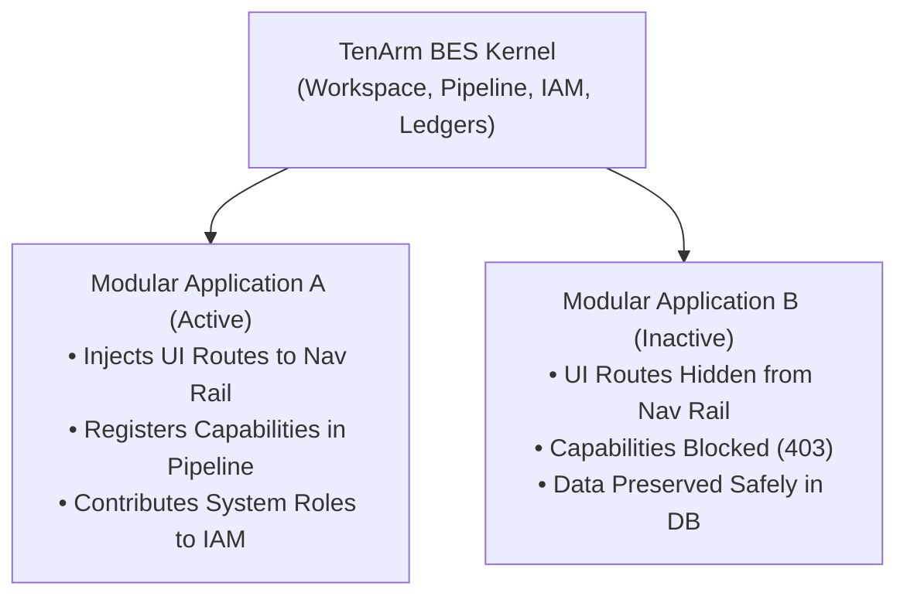

# App Enablement

TenArm BES is built on a modular package architecture. The kernel provides the foundational enterprise workspace, identity and access management, the governed capability pipeline, and immutable audit ledgers.

Business functionalities are authored and distributed as independent, modular application packages. **App Enablement** allows organizations to activate only the business capabilities they need.

---

## How Modular Enablement Works

- **Tenant-Scoped Activation**: Application packages are enabled or disabled independently per organization. Different organizations within a shared deployment can run entirely different sets of applications.
- **Dynamic Interface Adaptation**: When an application is turned off, its navigation icons disappear from the sidebar, its command palette shortcuts are hidden, and its action buttons are cleanly suppressed.
- **Data Non-Destruction**: Disabling an application **never deletes or modifies data**. Existing customer records, historical documents, posted transactions, and event logs remain preserved. Re-enabling the application immediately restores full operational access.
- **Soft Dependency Degradation**: When a companion module is turned off, dependent modules adapt gracefully without breaking. For example, operational documents can continue to function while background automated accounting postings are safely held in abeyance until the companion financial application is active.

---

## The Package Lifecycle

Application packages move through governed lifecycle states:

| State | What It Means | Operational Behavior |
|---|---|---|
| **Available** | Package is available in the deployment repository (`app_packages/`). | Not yet unpacked into the tenant instance. |
| **Installed** | Code, database migrations, and capability contracts are registered. | Ready for activation by the organization. |
| **Active** | Application is enabled for daily operations. | App routes appear in the Nav Rail, capabilities are executable, and role templates are assignable. |
| **Inactive** | Application is temporarily deactivated for the tenant. | Hidden from UI navigation; API calls return 403; historical data is preserved. |

---

## What an Application Contributes

When an application package is activated for an organization, it dynamically extends the workspace through standard kernel contribution points:

1. **Navigation & Routes**: Contributes screens and navigation items to the left Nav Rail and flyout menus.
2. **Capabilities & Transitions**: Registers business operations and document lifecycle state transitions in the kernel capability pipeline.
3. **Role Templates**: Adds domain-specific system templates (with pre-configured permissions) to **Roles & Permissions** (`/roles`).
4. **Event Handlers**: Subscribes to domain events to asynchronously update read-model projections.
5. **Custom Fields Scopes**: Exposes entity targets to the **Custom Fields Studio** (`/control/custom-fields`).

---

## Managing Application Packages

Tenant administrators manage enabled packages through organization settings:

1. Navigate to **Administration → App Enablement**.
2. Browse active and available application packages.
3. Toggle an application package on or off.
4. Changes take effect across user workstations on their next navigation or session refresh.

---

## If Something Goes Wrong (Common Validation & Guard Errors)

| What You See (Toast / Alert) | Why It Happens | How to Fix It |
|---|---|---|
| `"Application is not enabled for this organization"` | A user attempted to navigate to a screen or URL belonging to an inactive application package. | Activate the application package in App Enablement, or verify that your tenant organization is licensed for it. |
| `"Missing companion module dependency"` | Attempting to execute an action requiring a companion package that is currently inactive. | Activate the prerequisite companion application package. |
| `"Module hidden in navigation"` | A user cannot find a specific application icon in the left Nav Rail. | Verify that the application is active for the tenant and confirm that the user's assigned role includes permissions for that application. |
| `"Package installation failed schema validation"` | The package contract or manifest is missing required contribution fields. | Ensure the application package adheres to kernel contribution standards before installing. |

---

## Related Guides

- **[Tenant Setup](/admin-guides/tenant-setup)** — Organization-level configuration and branding
- **[Roles & Permissions](/admin-guides/roles-and-permissions)** — Managing RBAC roles and capability permissions
- **[Data Import & Migration](/admin-guides/data-import-and-migration)** — Ingesting legacy master data
- **[FAQ & Troubleshooting](/admin-guides/faq-and-troubleshooting)** — Diagnosing access locks and system errors
