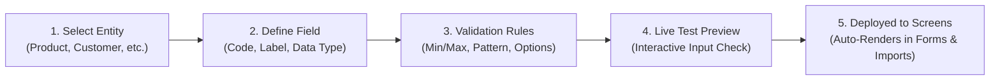

# Custom Fields

TenArm BES allows administrators to dynamically extend standard business entities (`Product`, `Party`, `Customer`, `Supplier`, etc.) with organization-specific custom attributes, validation rules, and category filters using the **Custom Fields Studio** (`/control/custom-fields`).

Custom attributes auto-render immediately across entity forms, command desk tables, quick-peek drawers, search filters, and bulk CSV data imports—without requiring custom code, software redeployments, or database schema migrations.

---

## Workspace Ergonomics

The Custom Fields Studio is built for safe schema administration:

- **Multi-Tab Multitasking**: Keep **Custom Fields** open in Tab 1 while inspecting how the fields render in **Parties** (`/parties`) or **Products** in Tabs 2 and 3.
- **Draft Protection & Dirty Dot (`•`)**: Edits inside the field studio drawer are tracked locally. The active tab displays a dirty dot indicator until changes are committed.
- **Optimistic Concurrency Control (OCC)**: Custom attribute definitions are protected by version tokens. If another administrator edits a field definition simultaneously, the **Conflict Resolution Drawer** prevents race conditions and accidental overwrites.

---

## Custom Fields Studio Workflow

---

## 1. Supported Entity Types & Scopes

- **Entity Targets**: Any registered business entity configured to accept custom attributes, including:
  - **Parties & Counterparties**: Master business counterparties, customer profiles, and supplier accounts.
  - **Products & Items**: Catalog items, materials, and inventory items.
- **Category-Specific Scoping**: For products, attributes can apply globally to all items or be restricted strictly to a specific **Product Category** (e.g. *Cold-Rolled Steel Coils*, *Raw Chemicals*, or *Electronics Components*). Only items assigned to that category display the attribute.
- **Variant vs Product Level**: Attributes can be attached at the parent `PRODUCT` master level or captured per individual `VARIANT` SKU.

---

## 2. Supported Data Types & Validation Controls

| Data Type | Description | Available Validation Controls |
|---|---|---|
| `text` | Single-line alphanumeric string. | Maximum character length, Regex pattern enforcement (e.g. alphanumeric code format). |
| `number` | Numeric value (supports decimals). | Minimum allowed value, Maximum allowed value. |
| `boolean` | Binary true/false or yes/no flag. | Pre-configured `Yes` / `No` toggle switches. |
| `date` | Calendar date picker. | ISO date formatting (`YYYY-MM-DD`). |
| `select` | Dropdown menu with controlled option choices. | Dynamic option chip builder (add, remove, and reorder available choices). |

---

## 3. The Custom Field Studio Drawer

Clicking **+ Define Field** opens the slide-out **Custom Field Studio**:

1. **Attribute Code**: A unique programmatic identifier in `snake_case` (e.g., `tensile_strength_mpa`, `credit_risk_tier`). By default, it auto-generates from the Label with a lock toggle to customize manually.
2. **Display Label**: The user-friendly label rendered on entity screens, search filters, and PDF prints (e.g., *Tensile Strength (MPa)*).
3. **Data Type**: Dropdown selecting `text`, `number`, `boolean`, `date`, or `select`.
4. **Mandatory Requirement**: Toggle switch enforcing whether users must fill this attribute before saving a record.
5. **Validation Builder**: Visual sliders and inputs for Min/Max, Character Limits, or Option Chips. An optional **Raw JSON** toggle allows direct editing of the underlying schema definition.
6. **Live Test Preview**: An interactive sandbox input at the bottom of the drawer that lets you type sample values and verify validation warnings immediately before committing.

---

## 4. How to Define a New Custom Field

1. Navigate to **Settings → Custom Fields** (`/control/custom-fields`).
2. In the **Domain Entity Selector**, choose the target entity (e.g. `Party` or `Product`).
3. (Optional) Select a specific **Category** if you want the attribute scoped to a sub-category.
4. Click **+ Define Field** to open the studio drawer.
5. Enter the **Display Label** and choose the **Data Type**.
6. Set validation constraints (e.g. Min: `0`, Max: `1000` for a number).
7. Test sample values in the **Live Test Preview** card.
8. Click **Save Attribute**. The field is immediately deployed to user forms and tables.

---

## 5. Deactivating & Managing Existing Fields

- **Edit Attribute**: Click **Edit** on any field row to update display labels or expand validation limits (e.g., adding an option to a `select` dropdown).
- **Deactivate Attribute**: Toggle the active switch to disable a field. Deactivated attributes are hidden from input forms and search dropdowns while existing historical data remains preserved on past records.
- **Data Non-Destruction**: In TenArm BES, custom attributes are never hard-deleted if records have populated values, safeguarding historical audit trails.

---

## If Something Goes Wrong (Common Validation & Guard Errors)

| What You See (Toast / Alert) | Why It Happens | How to Fix It |
|---|---|---|
| `"Attribute code already exists for this entity"` | An attribute with this exact programmatic code is already registered. | Assign a distinct attribute code (e.g. suffix with a category identifier). |
| `"Validation rule syntax is invalid"` | Invalid regex pattern or malformed JSON entered in the validation builder. | Correct the regular expression or switch back to visual slider controls. |
| `"Field value does not satisfy validation constraints"` | A user entered data outside the defined Min/Max limits or failed pattern regex. | Enter a value matching the required format or adjust the attribute's validation limits. |
| `"Record was modified by another administrator (OCC Conflict)"` | Another administrator updated field definitions simultaneously. | Review the **Conflict Resolution Drawer** and reload the latest schema version. |

---

## Permissions Reference

| Permission | Display Label | What It Authorizes |
|---|---|---|
| `attribute.list` | View Custom Fields | Browse defined custom attributes across entities and inspect validation schemas. |
| `attribute.define` | Create Custom Field | Author new custom field definitions and validation constraints on business entities. |
| `attribute.update` | Update Custom Field | Edit labels, modify validation rules, deactivate, or reactivate existing custom fields. |
