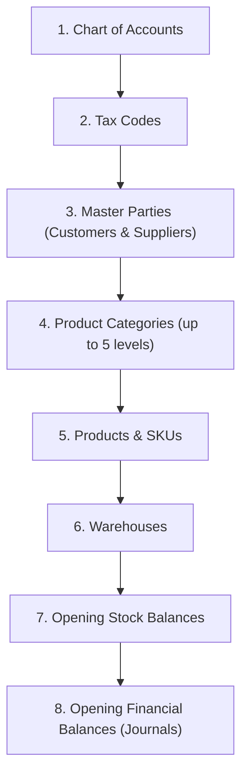

# Data Import & Migration

When transitioning to TenArm BES from a legacy ERP or spreadsheet system, administrators use the central **Data Import Desk** (`/settings/import`) to import master data, category hierarchies, and opening balances.

The Data Import Desk features automated CSV template generation, schema validation, live file preview, asynchronous batch processing, and detailed downloadable error logs.

---

## Workspace Ergonomics

The Data Import Desk is engineered for high-volume, reliable data migration:

- **Multi-Tab Desk**: Administrators can maintain up to 3 active tabs simultaneously (e.g. keeping the **Import Desk** open in Tab 1 while inspecting newly imported records in **Parties** or **Products** in Tab 2).
- **Two Administrative Views**:
  - **Import Wizard**: Step-by-step entity selector, CSV template downloader, file upload dropzone, and pre-commit preview card.
  - **Batch History**: Complete historical log of all past import runs with timestamps, record counts, execution statuses, and downloadable error reports.
- **Asynchronous Execution & Live Polling**: Large imports (e.g. 10,000 products) execute asynchronously in the background. The desk polls progress automatically, freeing administrators to perform other tasks without risking interrupted uploads.

---

## Strict Dependency Order

To satisfy relational integrity, master data must be imported in this exact sequence:

---

## Supported Import Entities (`/settings/import`)

| Entity | Target Scope | Required Columns | Optional Columns | Notes |
|---|---|---|---|---|
| **Parties** | Customers, Suppliers, Transporters, Expense Vendors | `code`, `name`, `role` | `email`, `phone`, `tax_id`, `address` | Role must be `CUSTOMER`, `SUPPLIER`, `VENDOR`, `EMPLOYEE`, or `PARTNER`. Active custom fields on Party are automatically supported as extra CSV columns. |
| **Product Categories** | Catalog taxonomy up to 5 levels deep | `path` | `description` | Paths separate parent and child with `>` (e.g. `Metals > Ferrous > Hot Rolled`). Rows are automatically sorted parent-before-child. |
| **Products & SKUs** | Commercial catalog and inventory items | `code`, `name`, `uom_code` | `category`, `description`, `standard_cost`, `selling_price`, `tax_code` | `uom_code` is validated against your tenant master. Active custom fields on Product are supported. |
| **Opening Balances** | Initial stock on hand across warehouses | `product_code`, `warehouse_code`, `qty` | — | Both `product_code` and `warehouse_code` must already exist in the organization. |
| **Chart of Accounts** | General Ledger account hierarchy | `code`, `name`, `account_type` | `normal_balance`, `parent_code` | `account_type` must be `ASSET`, `LIABILITY`, `EQUITY`, `REVENUE`, or `EXPENSE`. |
| **CRM Leads** | Prospect pipeline and opportunities | `title` | `company`, `contact_name`, `email`, `phone`, `source`, `estimated_value` | Automatically sequences new lead numbers. Source can be `WEB`, `REFERRAL`, `EVENT`, `COLD_CALL`, or `PARTNER`. |
| **Tax Codes** | Statutory tax rates catalogue | `code`, `name`, `rate` | `tax_type`, `is_default` | Rates are entered as percentages (e.g. `18.00`). |

---

## Step-by-Step Import Workflow

### 1. Download the Entity Template
1. Navigate to **Settings → Data Import** (`/settings/import`).
2. Select the entity type from the selector cards (e.g. **Parties** or **Products & SKUs**).
3. Click **Download CSV Template** (`<FileText />`). The system dynamically generates a clean CSV file pre-populated with exact header names and an example row.
4. If you already have existing records in TenArm, click **Export Existing Records** to review live data and column structures.

### 2. Populate and Clean Your Data
- Open the template in your spreadsheet editor (Excel, Google Sheets, LibreOffice).
- Paste your legacy data into the corresponding columns.
- Ensure unique codes (SKUs, Party Codes) have no duplicates.
- Save the file as standard UTF-8 encoded CSV.

### 3. Upload & Review Pre-Commit Preview
1. Drag and drop your CSV file into the **Import Dropzone** or click **Browse Files**.
2. The desk validates the file structure and displays the **Import Preview Card**:
   - Total row count detected in the file.
   - Detected column mapping confirming all required fields are present.
   - A tabular preview showing the first 5 rows of data.
3. Review the preview. If headers or columns are missing, fix the file before submitting.

### 4. Execute Batch & Monitor Progress
1. Click **Run Import Batch**.
2. The desk switches to the **Batch Execution Card** with real-time status:
   - `STAGED` — File uploaded and verified.
   - `PROCESSING` — The server is creating records and checking relational constraints.
   - `DONE` — All valid records created successfully.
   - `FAILED` — One or more validation errors occurred.

### 5. Review History & Download Error Reports
1. Switch to the **History** tab (`ImportHistoryTable`) at any time to review past batches.
2. If a batch encountered errors:
   - The table displays the count of rejected rows.
   - Click **Download Error CSV**. The report contains the original rows with an extra column explaining the exact rejection reason (e.g. `Unknown UoM code 'PKG'`, `Tax ID already assigned to another party`).
   - Fix only the failed rows in the error CSV and re-upload.

---

## Cutover & Go-Live Best Practices

### Pre-Cutover Checklist
- [ ] **Data Cleansing**: De-duplicate customer/supplier records in your legacy system prior to export.
- [ ] **Cutover Date Selection**: Choose a month-end or quarter-end date for clean accounting period boundaries.
- [ ] **Dry-Run Import**: Import a 20-row sample batch of parties and products to verify formatting before running the full dataset.
- [ ] **User Provisioning**: Ensure all administrators, sales leads, and warehouse operators have their user accounts and roles assigned prior to live operations.

### Opening Stock & Financial Balances
1. Perform physical stock cycle counts at each warehouse facility on the cutover date.
2. Import **Opening Stock Balances** via the Data Import Desk (`product_code`, `warehouse_code`, `qty`). This establishes verified starting physical inventory.
3. In **Finance**, post an **Opening Balance Journal Entry** reflecting your cutover balance sheet (Assets, Liabilities, Equity). Ensure the Inventory Asset account balances match the valuation of the imported opening stock.
4. Verify that the Trial Balance balances to zero before releasing the workspace for live commercial operations.

---

## If Something Goes Wrong (Common Validation & Guard Errors)

| What you see (Toast / Banner) | Why it happens | How to fix it in the workspace |
|---|---|---|
| `"Missing required column: <name>"` | Your CSV file header is missing an essential column (e.g. `uom_code` or `role`). | Download the official CSV template and verify that header spellings match exactly. |
| `"Foreign key reference not found: <code_value>"` | The row references a code that does not exist in TenArm (e.g. referencing warehouse `WH-NORTH` before creating it). | Follow the strict dependency order: import prerequisite masters (accounts, categories, warehouses) before transactions. |
| `"Duplicate code in batch: <code_value>"` | Two or more rows in your CSV file specify the exact same SKU or Party code. | Deduplicate your spreadsheet and ensure all identifiers are unique across the file. |
| `"Invalid role specified: <value>"` | A party record role column contains an unrecognized string. | Use only valid role constants: `CUSTOMER`, `SUPPLIER`, `VENDOR`, `EMPLOYEE`, `PARTNER`, or `BOTH`. |
| `"Invalid CSV encoding or delimiter"` | The file was saved with non-standard delimiters (semicolons) or non-UTF-8 character encoding. | Save the file as standard Comma-Separated Values (CSV) with UTF-8 encoding. |
