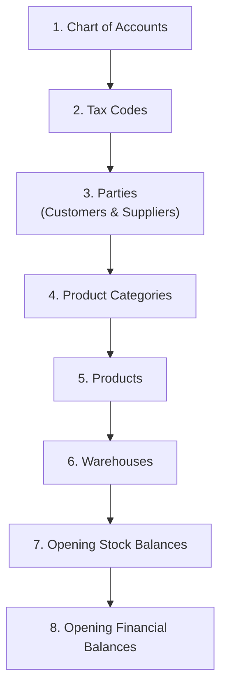

# Data Import & Migration

When setting up TenArm BES for the first time, you'll need to import existing data from your previous system. This guide covers the import process and best practices.

## Import Order

Import data in this order to satisfy dependencies:

## What to Import

### 1. Chart of Accounts
Your existing COA structure — account codes, names, types, and hierarchy.

| Column | Required | Format |
|--------|:--------:|--------|
| Account Code | ✅ | String (e.g., `1100`) |
| Account Name | ✅ | String |
| Account Type | ✅ | `ASSET`, `LIABILITY`, `EQUITY`, `REVENUE`, `EXPENSE` |
| Parent Code | — | Code of parent account |

### 2. Tax Codes
Tax rates and their GL account mappings.

| Column | Required | Format |
|--------|:--------:|--------|
| Code | ✅ | String (e.g., `GST18`) |
| Name | ✅ | String |
| Rate | ✅ | Decimal (e.g., `18.00`) |
| Tax Type | ✅ | `GST`, `IGST`, `VAT` |

### 3. Parties (Customers & Suppliers)
Your customer and supplier master records.

| Column | Required | Format |
|--------|:--------:|--------|
| Name | ✅ | String |
| Type | ✅ | `CUSTOMER`, `SUPPLIER`, or `BOTH` |
| Email | — | String |
| Phone | — | String |
| Tax ID / GSTIN | — | String |
| Address | — | JSON or structured fields |

### 4. Products
Your product catalog.

| Column | Required | Format |
|--------|:--------:|--------|
| SKU | ✅ | String (unique) |
| Name | ✅ | String |
| Category | ✅ | Category code |
| UoM | ✅ | Unit code (PCS, KG, etc.) |
| Standard Cost | — | Decimal |
| Selling Price | — | Decimal |
| Tax Code | — | Tax code reference |

### 5. Opening Balances
Financial balances as of cutover date — posted as journal entries.

## Migration Best Practices

### Before You Start

1. **Clean your data first** — Remove duplicates, correct spellings, standardize formats in the source system
2. **Map codes** — Create a mapping between old system codes and new TenArm codes
3. **Choose a cutover date** — Pick a month-end or year-end for clean financials
4. **Test with a subset** — Import 10-20 records first to verify the format is correct

### During Import

1. **Maintain referential integrity** — Import accounts before transactions, parties before orders
2. **Validate after each batch** — Check record counts, spot-check key fields
3. **Use document numbers carefully** — Imported documents should use a clear prefix (e.g., `MIG-`) to distinguish from new transactions

### After Import

1. **Reconcile totals** — Compare old system totals to TenArm reports
2. **Verify opening balances** — Trial balance should match the cutover date balance
3. **Test workflows** — Create a test order, invoice, and payment to verify the full cycle works

::: warning Cutover Checklist
- All users created and roles assigned
- All master data imported (COA, parties, products, warehouses)
- Opening balances posted and reconciled
- Test transactions completed successfully
- Old system set to read-only
:::

## Troubleshooting

| Issue | Cause | Solution |
|-------|-------|---------|
| Duplicate SKU error | Product already exists | Check for existing products, update instead of create |
| Unknown tax code | Tax code not imported yet | Import tax codes before products |
| Balance mismatch | Missing or double-counted entries | Re-run reconciliation against source system |
| Account not found | COA not imported yet | Import chart of accounts first |

## Related Guides

- **[Tenant Setup](./tenant-setup)** — Organization configuration
- **[Finance Setup](./finance-setup)** — Chart of accounts and tax codes
- **[Product Catalog Setup](./product-catalog-setup)** — Product master data
- **[Warehouse Setup](./warehouse-setup)** — Warehouse configuration
