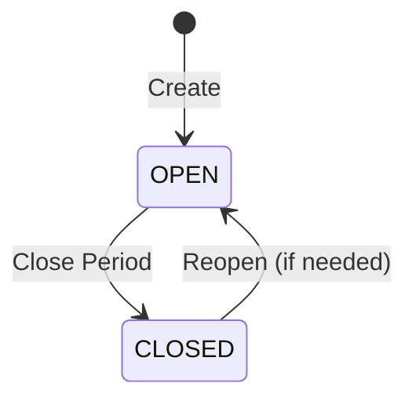

# Finance Setup

Before using the Finance module, set up your accounting foundation. This is typically done once during initial setup.

## Chart of Accounts (COA)

The Chart of Accounts is the master list of all financial accounts your organization uses.

### Account Structure

| Field | Required | Description |
|-------|:--------:|-------------|
| **Account Code** | ✅ | Unique identifier (e.g., `1100`, `4000`) |
| **Account Name** | ✅ | Descriptive name (e.g., "Cash at Bank", "Sales Revenue") |
| **Account Type** | ✅ | `ASSET`, `LIABILITY`, `EQUITY`, `REVENUE`, `EXPENSE` |
| **Parent Account** | — | For hierarchical grouping |
| **Is Active** | ✅ | Inactive accounts can't receive new postings |

### Setting Up

1. Navigate to **Finance → Chart of Accounts**
2. The system provides a standard COA template on first setup
3. Add, modify, or organize accounts as needed
4. **Group accounts** into hierarchies for reporting (e.g., Current Assets → Cash, Bank, Receivables)

### Common Account Categories

| Type | Examples | Normal Balance |
|------|----------|:-------------:|
| **Asset** | Cash, Bank, Accounts Receivable, Inventory | Debit |
| **Liability** | Accounts Payable, Tax Payable, Loans | Credit |
| **Equity** | Owner's Capital, Retained Earnings | Credit |
| **Revenue** | Sales, Service Income, Interest | Credit |
| **Expense** | COGS, Salaries, Rent, Utilities | Debit |

::: warning
Once journal entries are posted against an account, its type cannot be changed. Plan your COA structure carefully before posting transactions.
:::

## Tax Codes

Tax Codes define how taxes are calculated on invoices, bills, and transactions.

### Tax Code Fields

| Field | Required | Description |
|-------|:--------:|-------------|
| **Code** | ✅ | Short identifier (e.g., `GST18`, `IGST12`, `VAT0`) |
| **Name** | ✅ | Descriptive label (e.g., "GST 18%") |
| **Rate** | ✅ | Tax percentage (e.g., `18.00`) |
| **Tax Type** | ✅ | `GST`, `IGST`, `CGST`, `SGST`, `VAT`, `CESS` |
| **Is Active** | ✅ | Inactive tax codes aren't shown in dropdowns |

### Setting Up Tax Codes

1. Navigate to **Finance → Tax Codes**
2. Click **New Tax Code**
3. Set the code, name, rate, and type
4. Assign **GL accounts** for tax posting:
   - Output Tax Account (for sales)
   - Input Tax Account (for purchases)

### GST Tax Codes (India)

For Indian organizations with GST configured:

| Scenario | Tax Applied |
|----------|------------|
| Intra-state (same state) | CGST + SGST (split equally) |
| Inter-state (different states) | IGST (full rate) |

The system determines which taxes to apply automatically based on your organization's state code and the counterparty's state code.

## Accounting Periods

Accounting periods define the fiscal calendar for your organization.

### Period Lifecycle

| Status | What It Means |
|--------|-------------|
| **OPEN** | Transactions can be posted to this period |
| **CLOSED** | No new transactions allowed — period is finalized |

### Setting Up Periods

1. Navigate to **Finance → Accounting Periods**
2. Create periods matching your fiscal year:
   - Monthly (Jan 2024, Feb 2024, ...)
   - Quarterly (Q1 2024, Q2 2024, ...)
3. Only **OPEN** periods accept new journal entries

### Month-End Close Process

1. Review all transactions for the period
2. Post any pending journal entries
3. Run reconciliation checks
4. Click **Close Period** to freeze the period
5. If corrections are needed later, **Reopen** the period (requires finance admin permission)

::: tip
Always close periods in chronological order. Leaving old periods open allows backdated transactions that may affect financial accuracy.
:::

## Bank Accounts

Track your organization's bank accounts for payment reconciliation.

### Bank Account Fields

| Field | Required | Description |
|-------|:--------:|-------------|
| **Bank Name** | ✅ | Name of the banking institution |
| **Account Number** | ✅ | Your bank account number |
| **GL Account** | ✅ | Linked COA account for postings |
| **Currency** | ✅ | Account currency |
| **Is Active** | ✅ | Inactive accounts aren't shown in payment forms |

## Setup Checklist

Complete these in order for a clean finance setup:

- [ ] **Chart of Accounts** — Create or import your COA
- [ ] **Tax Codes** — Define all applicable tax codes with GL mappings
- [ ] **Accounting Periods** — Create periods for the current fiscal year
- [ ] **Bank Accounts** — Add your organization's bank accounts
- [ ] **Opening Balances** — Post journal entries for opening balances
- [ ] **Test Transaction** — Post a test journal entry and verify it lands correctly

## Related Guides

- **[Finance Module](../user-guides/modules/finance)** — Using Finance day-to-day
- **[Roles & Permissions](./roles-and-permissions)** — Finance role permissions
- **[Warehouse Setup](./warehouse-setup)** — For inventory-related GL accounts
