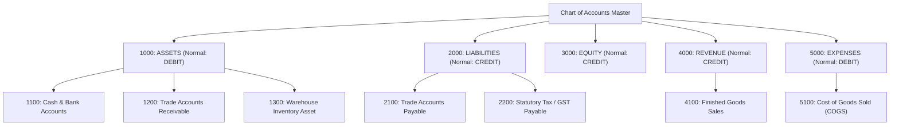
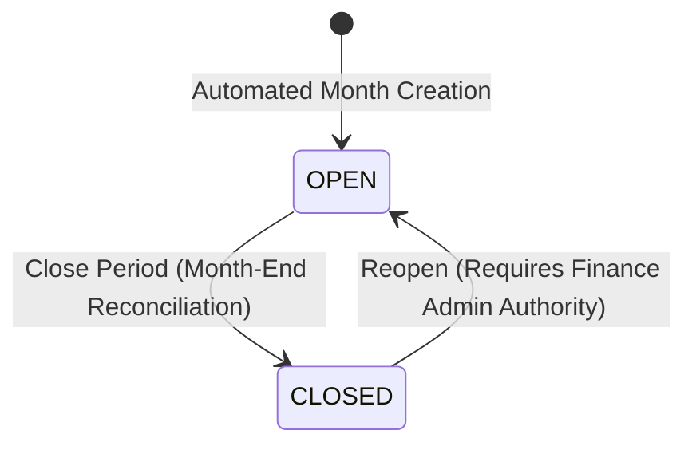

# Finance Setup

Before posting sales invoices, vendor bills, inventory adjustments, or payroll pay runs, administrators must establish the organization's accounting foundation.

This guide walks through configuring the **Chart of Accounts (COA)**, **Tax Codes**, **Fiscal Accounting Periods**, and **Bank Accounts**.

---

## Workspace Ergonomics

Financial setup and ledger operations adhere to strict workspace ergonomics:

- **Multi-Tab Desk**: Financial leads can maintain up to 3 active tabs simultaneously (e.g. keeping the **Chart of Accounts** open while inspecting active **Tax Codes** and verifying monthly **Accounting Periods**).
- **Draft Auto-Save & Dirty Dot**: Uncommitted ledger entries and tax code configurations are preserved in local browser session storage, displaying a dirty dot indicator (`•`) on the tab header until committed.
- **Quick-Peek Account Inspection**: Clicking any account code or journal reference opens a contextual slide-out drawer from the right edge of the screen, revealing real-time debit/credit balances and recent transaction history without navigating away.
- **Optimistic Concurrency Control (OCC)**: Financial masters and accounting period controls are versioned. If two administrators modify account attributes or close a period concurrently, the system prevents race conditions with immediate conflict alerts.

---

## 1. Chart of Accounts (COA)

The Chart of Accounts (`/finance/accounts`) is the authoritative general ledger directory governing all financial transactions in TenArm BES.

### Account Structure

Every ledger account requires:

| Field | Required | Description & Constraints |
|---|:---:|---|
| **Account Code** | ✅ | Unique alphanumeric code (e.g. `1100`, `2100`, `4000`, `5100`). |
| **Account Name** | ✅ | Clear business description (e.g. *Operating Cash*, *Trade Accounts Receivable*, *Sales Revenue*). |
| **Account Type** | ✅ | One of the 5 canonical categories: `ASSET`, `LIABILITY`, `EQUITY`, `REVENUE`, `EXPENSE`. |
| **Normal Balance** | ✅ | Standard financial direction: `DEBIT` (for Assets & Expenses) or `CREDIT` (for Liabilities, Equity & Revenue). Automatically derived if omitted. |
| **Parent Account** | — | Optional parent code for multi-tier hierarchical grouping on Balance Sheet and Income Statement reports. |
| **Status** | ✅ | `ACTIVE` (can receive postings) or `INACTIVE` (blocked from new journal postings). |

### Standard Five-Tier Structure

### Setting Up Accounts
1. Navigate to **Finance → Chart of Accounts** (`/finance/accounts`).
2. Click **+ New Account** in the header.
3. Enter the code, name, type, and optional parent account.
4. Click **Save Account**.

::: warning Immutable Account Types
Once a financial journal entry or invoice has posted against an account, its **Account Type** (`ASSET`, `LIABILITY`, etc.) cannot be changed. Ensure your account classifications are finalized before processing live transactions.
:::

---

## 2. Tax Codes & Automated Tax Rules

Tax Codes (`/finance/tax-codes`) define statutory tax percentages, categories, and preselection rules across commercial orders and invoices in TenArm BES.

### Tax Code Fields

| Field | Required | Purpose & Mapping |
|---|:---:|---|
| **Code** | ✅ | Short identifier used in order and invoice lines (e.g. `GST18`, `VAT5`, `ZERO`). Immutable once created. |
| **Name** | ✅ | Clear display label (e.g. *Standard GST 18%*, *Value Added Tax 5%*). |
| **Rate (%)** | ✅ | Applicable tax percentage from `0` to `100` (e.g. `18.00`, `12.00`, `5.00`). |
| **Type** | ✅ | Statutory classification: `GST`, `VAT`, or `SALES`. |
| **Default** | — | When enabled, this tax code automatically pre-populates new quotation, order, invoice, and purchase order lines. |
| **Active** | — | Active status toggle. Inactive codes are excluded from document dropdowns while preserved on historical records. |

### Setting Up a Tax Code
1. Navigate to **Finance → Tax Codes** (`/finance/tax-codes`) in the navigation flyout under **General Ledger**.
2. Click **+ Add Tax Code**.
3. Enter the **Code**, **Name**, **Rate (%)**, and select the statutory **Type**.
4. (Optional) Check **Default (preselected on new quotes/orders/POs)**.
5. Click **Create Tax Code**.

### Automated Tax Split (India GST)
When the India Compliance Pack is active:
- **Intra-State Transactions**: When your organization's state code matches the customer's state code, the system automatically splits standard GST into equal parts: 50% **CGST** and 50% **SGST**.
- **Inter-State Transactions**: When state codes differ, the system automatically applies **IGST** at the full statutory rate.

---

## 3. Fiscal Accounting Periods

Accounting Periods (`/finance/periods`) define your company's fiscal months and enforce regulatory closing cutoffs.

### Period Lifecycle & States

| State | What It Means | Operational Rules |
|---|---|---|
| `OPEN` | Active accounting period. | Daily transactions, sales invoices, vendor bills, and manual journals can be freely posted. |
| `CLOSED` | Finalized and audited period. | **Strictly locked**. No new transactions or backdated modifications can be posted. |

### How to Close a Month
1. Navigate to **Finance → Accounting Periods** (`/finance/periods`).
2. Review the target period (e.g. `June 2026`).
3. Ensure all bank statements are reconciled, inventory dispatches are invoiced, and depreciation runs have executed.
4. Click **Close Period**.
5. Once closed, the period displays a gray `CLOSED` badge. Any attempt to post backdated transactions to this month will be rejected by system validation guards.

::: tip Reopening a Period
If an emergency audit adjustment is required in a closed period, an authorized Finance Administrator can click **Reopen Period**, post the corrective adjustment, and promptly re-close the period. All reopening events are permanently recorded in the immutable audit log.
:::

---

## 4. Bank Accounts & Statement Reconciliation

Register corporate bank accounts to track cash positions and reconcile electronic bank feeds:

1. Navigate to **Finance → Bank Accounts** (`/finance/banks`).
2. Click **+ Add Bank Account**.
3. Specify the bank name, branch, account number, currency, and mapped General Ledger account (e.g. `1110 - HDFC Operating Account`).
4. Click **Save Bank Account**.

**Electronic Reconciliation Workflow**
- Under **Bank Reconciliation**, click **Import Statement (CSV)** to upload bank transactions.
- The system matches imported line items against recorded customer payments and supplier disbursements based on date, reference number, and amount.
- Click **Reconcile Match** to confirm cleared items, keeping your general ledger cash balance synchronized with actual bank balances.

---

## If Something Goes Wrong (Common Validation & Guard Errors)

| What you see (Toast / Banner) | Why it happens | How to fix it in the workspace |
|---|---|---|
| `"Journal entry is out of balance"` | Total debits do not equal total credits. | Adjust the debit and credit lines so that `Total Debits == Total Credits` exactly. |
| `"Cannot post to closed accounting period"` | The transaction date falls within a fiscal period that has been finalized and closed. | Either update the document date to an active `OPEN` period, or have a Finance Admin temporarily reopen the period. |
| `"Account is inactive and cannot accept postings"` | Attempting to use a disabled or archived General Ledger account. | Open **Chart of Accounts**, locate the account, and click **Activate Account**. |
| `"Missing Output Tax GL account mapping"` | A tax code was applied to an invoice line without a mapped Output Tax account. | Open **Tax Codes** under Finance and assign valid GL liability and asset accounts. |
| `"Duplicate account code already exists"` | Attempting to create an account with a code already in use. | Assign a unique numeric account code following your corporate chart of accounts naming plan. |
| `"Cannot delete account with existing transaction history"` | Attempting to remove an account that has posted journals. | Accounts with historical ledger entries cannot be deleted. Change the account status to `INACTIVE` instead. |
