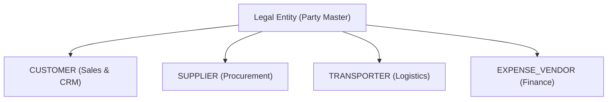

# Party Management

In TenArm BES, all external and internal counterparties—customers, suppliers, freight transporters, and expense vendors—are unified into a single master directory known as **Parties** (`/parties`).

## Why Unified Parties Matter

Legacy systems separate customer records from vendor records. This creates duplicate data entry and blinds the company to cross-role financial exposure.

With TenArm BES:
- **A Single Truth**: A partner entity has one legal name, one tax identification number (GSTIN / VAT ID), and one primary address.
- **Multiple Commercial Roles**: An entity can be a `SUPPLIER` (supplying raw steel coils) and simultaneously a `CUSTOMER` (purchasing fabricated parts).
- **Consolidated Credit & Ledgers**: Outstanding Accounts Receivable (AR) from customer invoices can be audited directly alongside Accounts Payable (AP) vendor bills for mutual settlement.

---

## The Master Parties Directory

Access the directory under **Administration → Parties** (`/parties`).

### Pulse HUD Metrics
- **Total Parties**: Total registered commercial entities.
- **Customers**: Counterparties holding active `CUSTOMER` roles eligible for quotations and sales orders.
- **Suppliers**: Counterparties holding active `SUPPLIER` roles eligible for purchase orders and goods receipt.
- **Active Records**: Total records in active commercial standing.

---

## Creating a Business Party

1. Navigate to **Parties** (`/parties`).
2. Click **+ New Party** in the header.
3. Complete the form:

| Field | Required | Description |
|---|:---:|---|
| **Party Code** | — | Unique code (e.g. `CUST-0001`, `SUPP-0012`). Leave blank to auto-generate sequentially. |
| **Full Legal Name** | ✅ | Registered business or individual legal name. |
| **Email** | — | Primary business email for order confirmations and invoicing. |
| **Phone** | — | Official telephone or mobile number. |
| **Primary Address** | — | Registered billing and shipping address. |
| **Tax ID / GSTIN** | — | 15-character GSTIN (India) or corporate tax identifier. Entering the first two digits automatically derives and populates the **State Code**. |
| **Tax Region / State Code** | — | 2-digit regional code (e.g. `27` for Maharashtra, `29` for Karnataka) driving automated inter-state vs. intra-state tax calculations. |
| **Party Roles** | ✅ | Toggle one or more roles: `Customer`, `Supplier`, `Transporter`, `Employee`, `Expense Vendor`. |
| **Credit Limit** | — | Maximum permissible commercial credit balance. Transactions exceeding this limit trigger finance review guards. |

4. Click **Create Party**. The record is immediately active across all enabled business apps.

---

## Managing Party Roles & Profiles

### Role Classifications

| Role | Used In | Business Purpose |
|---|---|---|
| `CUSTOMER` | **Sales & CRM** | Authorized recipient of quotations, sales orders, customer delivery notes, and tax invoices. |
| `SUPPLIER` | **Procurement** | Authorized provider of commercial goods, supplier RFQs, purchase orders, and vendor bills. |
| `TRANSPORTER` | **Logistics** | Freight carriers and transport logistics companies assigned to dispatch runs. |
| `EXPENSE_VENDOR` | **Finance** | Third-party service vendors, utility companies, and landlords for operational expense claims. |
| `EMPLOYEE` | **HR & Payroll** | Internal personnel receiving payroll disbursements or travel advance settlements. |

### Expanding Party Details
Click on any party row in the table to expand the inline detail tray:
- **Financial & Credit Snapshot**: Displays credit limits, currency, and payment terms.
- **Quick Links**: Click **Open Customer View** to jump directly to the CRM/Sales account view, or **Open Supplier View** to inspect procurement history.
- **Edit Party**: Click **Edit** in the Actions column to update contact details, tax numbers, or assign additional commercial roles.

---

## Best Practices & Data Hygiene

1. **Let the System Derive State Codes**: When entering Indian GSTINs, the first 2 numeric digits represent the state code. Let the system pre-fill the **State Code** to prevent tax calculation errors on invoices.
2. **Assign Multiple Roles Instead of Duplicates**: Never create separate accounts for the same company if they are both a buyer and a seller. Simply check both `Customer` and `Supplier` roles on one record.
3. **Set Realistic Credit Limits**: Establish credit limits during customer onboarding to enable automated credit check guards during sales order approvals.
4. **Export for Auditing**: Use the **Export CSV** button in the header to download a complete register of business counterparties for tax filings or accounting reconciliations.

---

## Related Guides

- **[User Management](/admin-guides/user-management)** — User provisioning and credential management
- **[Roles & Permissions](/admin-guides/roles-and-permissions)** — RBAC authority and permissions matrix
- **[Tenant Setup](/admin-guides/tenant-setup)** — Organization-level profile and currency settings
- **[App Enablement](/admin-guides/app-enablement)** — Activating and deactivating modular application packs
