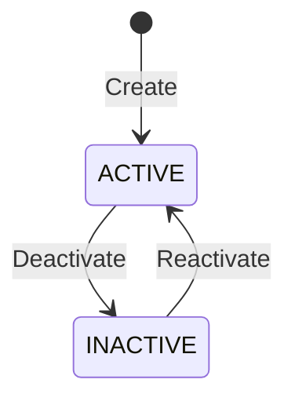

# Product Catalog Setup

The product catalog is your master list of everything you buy, sell, manufacture, or stock. Set it up before processing any transactions.

## Product Categories

Organize products into a hierarchy of categories before creating individual products.

1. Navigate to **Inventory → Product Categories**
2. Click **New Category**
3. Fill in:

| Field | Required | Description |
|-------|:--------:|-------------|
| **Name** | ✅ | Category name (e.g., "Raw Materials", "Electronics") |
| **Code** | ✅ | Short identifier (e.g., `RAW`, `ELEC`) |
| **Parent Category** | — | For nesting (e.g., "Fasteners" under "Raw Materials") |

## Creating Products

1. Navigate to **Inventory → Products**
2. Click **New Product**
3. Fill in the product details:

### Core Fields

| Field | Required | Description |
|-------|:--------:|-------------|
| **Name** | ✅ | Product name (e.g., "Stainless Steel Bolt M10") |
| **SKU** | ✅ | Stock Keeping Unit — unique identifier |
| **Category** | ✅ | Product category |
| **Unit of Measure** | ✅ | Primary UoM (e.g., PCS, KG, LTR, MTR) |
| **Status** | ✅ | `ACTIVE` (default) or `INACTIVE` |

### Pricing Fields

| Field | Required | Description |
|-------|:--------:|-------------|
| **Standard Cost** | — | Default purchase cost |
| **Selling Price** | — | Default selling price |
| **Tax Code** | — | Default tax code for this product |

### Tracking Fields

| Field | Description |
|-------|-------------|
| **Track Inventory** | Whether to track stock balances |
| **Track Lots** | Enable lot/batch tracking for this product |
| **Track Serials** | Enable serial number tracking |
| **Catch Weight** | Enable dual-unit tracking (piece count + measured weight) |

## Product Status

| Status | Meaning |
|--------|---------|
| **ACTIVE** | Available for purchase, sale, and stock operations |
| **INACTIVE** | Hidden from transaction forms — existing stock still tracked |

## Dual-Unit / Catch-Weight Products

For products sold by weight but counted by piece (common in food, chemicals, metals):

| Unit | Purpose | Example |
|------|---------|---------|
| **Discrete (COUNT)** | How many items | 10 cases |
| **Measured (MEASURE)** | Actual weight/volume | 47.3 kg |

When catch-weight is enabled:
- Stock receipts capture both piece count and measured weight
- Pricing uses the **measured** unit (per kg, per liter)
- Inventory reports show both quantities

::: tip
Catch-weight is ideal for products where actual weight varies per unit — like seafood, produce, or bulk chemicals. The system tracks both dimensions so you always know exactly what you have.
:::

## Units of Measure

Common units available in the system:

| Code | Name | Type |
|------|------|------|
| PCS | Pieces | Count |
| KG | Kilogram | Weight |
| LTR | Litre | Volume |
| MTR | Metre | Length |
| BOX | Box | Count |
| CTN | Carton | Count |
| TON | Metric Ton | Weight |
| SQM | Square Metre | Area |

## Setup Checklist

- [ ] Create product categories (at least top-level grouping)
- [ ] Create products for your initial inventory
- [ ] Set default tax codes on products
- [ ] Enable lot/serial tracking where needed
- [ ] Configure catch-weight for variable-weight products
- [ ] Import existing product catalog (see [Data Import](./data-import-and-migration))

## Related Guides

- **[Inventory Module](../user-guides/modules/inventory)** — Stock operations with products
- **[Warehouse Setup](./warehouse-setup)** — Where products are stored
- **[Finance Setup](./finance-setup)** — Tax codes for products
