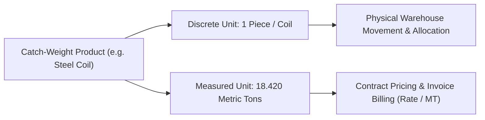

# Product Catalog Setup

The Product Catalog represents the authoritative master index of every physical good, raw material, consumable, assembly, and commercial service handled by your organization.

Before executing sales quotations, purchase orders, or warehouse receipts, administrators configure product categories, units of measure, and individual product definitions in the **Inventory** workspace.

---

## Workspace Ergonomics

Managing product masters benefits from built-in workspace ergonomics:

- **Multi-Tab Desk**: Catalog managers can maintain up to 3 active tabs simultaneously (e.g. keeping the **Products Directory** open while defining multi-level **Categories** in Tab 2 and verifying **Custom Attributes** in Tab 3).
- **Draft Auto-Save & Dirty Dot**: Uncommitted form inputs in product creation and edit dialogs are continuously preserved in session storage; the active tab displays a dirty dot indicator (`•`) until committed via **Save Product** or discarded.
- **Quick-Peek Product Drawer**: Clicking any product code or SKU from an order line, warehouse balance report, or inventory movement log opens an inspection drawer from the right edge of the screen, revealing real-time on-hand balances, standard costs, and technical specifications without leaving the active document.
- **Optimistic Concurrency Control (OCC)**: Product records display an OCC version badge. If two administrators edit product prices or specifications simultaneously, the system prevents accidental overwrites with automated conflict warnings.

---

## 1. Multi-Level Category Taxonomy

Product categories organize items for financial reporting, inventory valuation, and attribute scoping. TenArm BES supports up to **5 levels of nested categories**.

### Category Path Hierarchy
Categories use a clean path syntax separated by `>`:
```
Raw Materials > Metals > Ferrous > Hot Rolled Sheet
Finished Goods > Industrial Valves > Gate Valves
Services > Consulting > Technical Inspection
```

### Setting Up Categories
1. Navigate to **Inventory → Categories** (`/inventory/categories`).
2. Click **+ New Category**.
3. Specify:
   - **Category Name**: Display name (e.g. *Hot Rolled Sheet*).
   - **Parent Category**: Select a parent to nest under, or leave empty for a top-level category.
   - **Category Description**: Operational notes and material guidelines.
4. Click **Create Category**.

::: tip Hierarchical Sorting
When importing categories via CSV, the system automatically evaluates path dependencies and creates parent categories before child categories, supporting complete 5-level taxonomic structures in a single import batch.
:::

---

## 2. Defining Products & SKUs

Access the master product registry under **Inventory → Products** (`/inventory/products`).

### Core Master Fields

| Field | Required | Business Purpose & Validation |
|---|:---:|---|
| **Product Code / SKU** | ✅ | Unique alphanumeric stock-keeping unit (e.g. `STL-HR-002`, `VLV-GT-50`). Must be unique across the tenant. |
| **Product Name** | ✅ | Full commercial or engineering product description. |
| **Product Category** | ✅ | Selected from active category taxonomy. Drives default accounting mappings and custom attributes. |
| **Primary Unit of Measure (UoM)** | ✅ | Base inventory transaction unit (e.g. `PCS`, `KG`, `MTR`, `LTR`, `BOX`). |
| **Status** | ✅ | `ACTIVE` (available for sales, purchasing, and stock operations) or `INACTIVE` (hidden from new transaction forms). |

### Pricing & Financial Defaults

| Field | Required | Business Scope |
|---|:---:|---|
| **Standard Cost** | — | Default baseline unit purchase cost used for inventory reorder estimates. |
| **Selling Price** | — | Baseline unit sales price populated on sales quotations and order lines. |
| **Default Tax Code** | — | Mapped statutory tax code (e.g. `GST18`) automatically applied during line entry. |

### Tracking & Operational Modes

| Tracking Mode | When to Enable | Operational Behavior |
|---|---|---|
| **Track Inventory** | Physical goods and raw materials. | Automatically maintains on-hand, reserved, and available-to-promise (ATP) balances across warehouses. (Disable for pure services or expense consumables). |
| **Track Lots / Batches** | Chemicals, pharmaceuticals, steel heats, and perishable goods. | Requires assigning a batch/lot number and expiration date during warehouse receipt. Enforces FIFO / FEFO dispatch. |
| **Track Serial Numbers** | High-value machinery, electronic devices, and serialized tooling. | Tracks individual unique serial numbers through receipt, assignment, and dispatch. |
| **Dual-Unit / Catch-Weight** | Metals, agricultural produce, and commodities sold by weight but handled by piece. | Simultaneously tracks discrete piece counts and actual measured weight/volume. |

---

## 3. Dual-Unit / Catch-Weight Products

In heavy industry and commodity trading (e.g. steel coils, structural beams, bulk produce), items are purchased and priced by measured weight (e.g. Metric Tons or Kilograms), but inventoried and handled as discrete physical units (e.g. Coils, Bundles, or Cases).

Because two steel coils or agricultural crates never weigh the exact same amount, TenArm BES provides native **Catch-Weight Tracking**:



When Catch-Weight is enabled on a product:
1. **Warehouse Receipts**: Warehouse staff record both the discrete piece count (e.g. `5 Coils`) and the gross scale weight (e.g. `92.45 MT`).
2. **Sales Desk Pricing**: The Sales Desk automatically computes commercial totals based on actual measured weight while reserving exact discrete units.
3. **Inventory Valuation**: Warehouse valuation reports display both dimensions—total count on hand and total weighed tonnage—eliminating catch-weight inventory write-offs.

---

## 4. Custom Attributes & Technical Specifications

Different product categories require specialized engineering specifications (for example, steel requires *Thickness, Width, Grade*, while electrical equipment requires *Voltage, Wattage*).

Rather than cluttering standard forms with irrelevant fields, administrators define category-scoped **Custom Fields** (`/settings/attributes`):

1. Navigate to **Settings → Custom Fields** (`/settings/attributes`).
2. Select the target entity (**Product**).
3. Click **+ Add Custom Field**.
4. Define:
   - **Field Label**: Display name (e.g. *Steel Grade*, *Nominal Thickness*).
   - **Data Type**: `TEXT`, `NUMBER`, `BOOLEAN`, `DATE`, or `SELECT` (dropdown options).
   - **Category Scope**: Scope the attribute exclusively to a specific category (e.g. *Raw Materials > Metals*) or apply globally.
   - **Validation Rules**: Set minimum/maximum numeric ranges, mandatory entry, or regex constraints.
5. Click **Create Attribute**. The custom field immediately appears on product forms and is automatically included in CSV import/export templates.

---

## If Something Goes Wrong (Common Validation & Guard Errors)

| What you see (Toast / Banner) | Why it happens | How to fix it in the workspace |
|---|---|---|
| `"Product code already exists"` | Attempting to create a product with an SKU already registered in the tenant. | Enter a distinct product code or verify if the existing SKU is currently marked `INACTIVE`. |
| `"Unit of measure not recognized"` | The entered UoM code (e.g. `TONS`) does not match the standardized system UoM list. | Use standard codes (e.g. `KG`, `MT`, `PCS`, `LTR`, `MTR`). |
| `"Cannot deactivate product with active stock balances"` | Attempting to set a product status to `INACTIVE` while physical stock remains in warehouses. | Transfer or consume remaining stock balances before deactivating the product record. |
| `"Catch-weight requires both piece count and weight"` | Incomplete entry during warehouse receipt of a dual-unit product. | Enter both the discrete package count and the actual scale weight. |
| `"Product record was modified by another user (OCC Conflict)"` | Another administrator updated product pricing or attributes while you had the drawer open. | Refresh the product drawer, verify the updated details, and re-apply your changes. |
