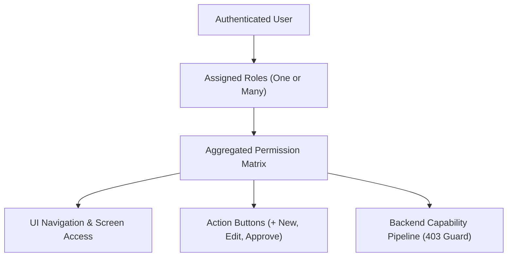

# Roles & Permissions

TenArm BES uses **Role-Based Access Control (RBAC)** to govern who can view screens, create records, edit documents, authorize approvals, and execute business actions across the platform. Every UI screen, action button, tab, and backend capability is protected by explicit permission checks.



Permissions are never assigned directly to individual users. Instead:
1. **Permissions** represent atomic capabilities (e.g., `user.create`, `approval.authorize`, `party.admin.list`).
2. **Roles** bundle permissions into operational job responsibilities.
3. **Users** are assigned one or more roles. Effective authority is the mathematical union of all permissions granted across assigned roles.

---

## The Roles & Permissions Workspace (`/roles`)

Navigate to **Administration → Roles** (`/roles`).

### Header Pulse Metrics
The page header displays real-time health metrics across your tenant's security landscape:
- **Total Roles**: Total count of authority roles configured in the tenant.
- **Active Roles**: Number of roles currently active and assignable to users.
- **System Templates**: Factory-defined base roles packaged with the kernel and active applications.
- **Permissions Catalog**: Total atomic permissions currently registered across all active capabilities.

### Top IAM Switcher & View Tabs
A segmented control allows quick switching across administrative domains:
- **Users**: Switches immediately to the user directory (`/users`).
- **Roles**: Displays the master role catalog with status filters and capability counts.
- **Permissions**: Displays the global catalog of registered capabilities, filterable by domain.

---

## System Templates vs Custom Roles

TenArm BES distinguishes between two classes of roles:

| Property | System Templates (`SYSTEM`) | Custom Roles (`CUSTOM`) |
|:---|:---|:---|
| **Badge** | Blue `SYSTEM` pill | Gray `CUSTOM` pill |
| **Origin** | Factory pre-installed with the kernel or contributed by installed packages | Authored by Tenant Administrators |
| **Modification** | Read-only; permissions cannot be added or removed directly | Fully customizable name, description, and permission matrix |
| **Lifecycle** | Always active; cannot be deactivated or deleted | Can be toggled between **Active** and **Inactive** |
| **Actions** | **View Permissions**, **Clone** | **Edit**, **Deactivate** / **Activate** |

### Built-in System Templates

The platform provides foundational system templates out of the box:

| Role Code | Template Name | Typical Coverage |
|:---|:---|:---|
| `admin` | **Administrator** | Full administrative control over organization settings, security policies, users, roles, and master counterparties |
| `auditor` | **Auditor** | Read-only inspection access across system dashboards, execution logs, and historical audit trails |
| `user` | **Standard User** | Baseline workspace access: personal notification settings, approvals triage desk, activity feed, and process lineage |

> [!NOTE] Dynamic Template Registration
> When modular business applications are installed into your workspace, each application automatically contributes its own domain-specific system templates (with pre-configured operational permissions) directly to your role catalog.

::: tip Combining Multiple Roles
Users can hold multiple roles simultaneously. For example, a department lead who handles team administration and financial authorizations can be assigned both an administrative role and an approval role; their effective permissions are the union of all granted rights.
:::

---

## Role Management Workflows

### 1. Inspecting Role Capabilities
Click any row in the **Roles** table or click **View Permissions** on a system template to expand its capabilities drawer:
- Review the total number of capabilities assigned.
- Group capabilities by functional domain.
- Inspect descriptions for each atomic capability code.

### 2. Creating a Custom Role from Scratch
1. Click **+ New Role** in the top right corner of the page.
2. In the **Create New Role** dialog, fill in:
   - **Role Code**: Unique identifier string in `snake_case` (e.g., `compliance_officer`, `shift_supervisor`). Must be unique across the tenant.
   - **Role Name**: Descriptive title displayed in user dropdowns (e.g., `Compliance Officer`).
   - **Description**: Optional explanation of the role's operational scope.
3. In the **Assign Permissions** matrix:
   - Filter by domain using the dropdown or search by capability name.
   - Toggle individual permissions or use batch-selection buttons to select entire sections.
4. Click **Create Role**. The new custom role appears in the list with a `CUSTOM` badge.

### 3. Cloning a System Template (Recommended Approach)
When creating a tailored role (such as a supervisor who should view documents but not authorize overrides), cloning a factory template saves time:
1. Locate the base system role in the table.
2. Click **Clone**.
3. The system opens the modal with pre-populated values:
   - **Role Code**: Appended with `_custom` (editable).
   - **Role Name**: Appended with `(Custom)` (editable).
   - **Description**: Pre-filled with `Cloned from <Template>`.
   - **Permissions**: Pre-selected with all baseline permissions of the parent template.
4. Deselect unauthorized permissions.
5. Click **Create Role**.

### 4. Editing a Custom Role
1. Click **Edit** on any custom role row.
2. Update the **Role Name**, **Description**, or adjust checkmarks in the permission matrix.
3. Click **Save Changes**. Changes take effect on the next session refresh for all assigned users.

### 5. Deactivating and Activating Roles
- To prevent a custom role from granting authority without deleting historic audit associations, click **Deactivate**.
- A confirmation prompt warns: *"Users assigned this role will lose permissions granted by it."* Confirm by clicking **Deactivate Role**.
- Deactivated roles display an `Inactive` badge. Filter by the `Inactive` pill to inspect them.
- Click **Activate** at any time to restore the role's permissions.

---

## Understanding Permission Identifiers

Permission identifiers follow a standard tripartite nomenclature:

```
{domain}.{entity}.{action}
```

| Component | Description | Examples |
|:---|:---|:---|
| `{domain}` | Functional application or kernel domain | `user`, `role`, `party`, `org`, `approval` |
| `{entity}` | Target business entity or aggregate root | `user`, `role`, `party`, `settings`, `policy` |
| `{action}` | Lifecycle transition or operation | `view`, `create`, `update`, `delete`, `authorize` |

### Enforcement Mechanics
When an unprivileged user accesses a protected capability:
1. **Navigation Menu**: Inaccessible screens are hidden from the sidebar navigation rail.
2. **Action Buttons**: Action buttons for unauthorized operations are automatically hidden or disabled.
3. **Direct URL Attempt**: Renders a standard **Access Denied** fallback screen.
4. **Backend Boundary**: Rejects unauthorized API requests with `403 Forbidden` and a human-readable authorization failure message.

---

## If Something Goes Wrong (Common Validation & Guard Errors)

| Error Message / Symptom | Cause | Resolution |
|:---|:---|:---|
| **"Role code already exists"** | A role with this code is already defined in the tenant. | Choose a distinct role code (e.g. suffix with department or level like `supervisor_l2`). |
| **"Role code is required"** / **"Role name is required"** | Submitted the modal form without entering mandatory identification fields. | Enter a code and descriptive title before submitting. |
| **"Cannot modify system role"** | Attempted to edit or delete a pre-installed factory role. | System roles are immutable. Click **Clone** to produce a custom role with modified permissions. |
| **"You don't have permission to modify roles"** | User profile lacks `role.create` or administrative authority. | Request access from your Organization Administrator. |
| **"Another administrator modified this role" (409 Conflict)** | Two administrators edited the role's permission matrix simultaneously. | Review the conflict resolution side drawer, select the desired version, and reload the latest record. |
| **User reports button missing after role assignment** | Role was assigned, but the user has an active stale browser session. | Have the user refresh their browser tab or sign out and back in to reload their effective permissions token. |

---

## Related Guides

- **[User Management](/admin-guides/user-management)** — Creating users and assigning roles
- **[Party Management](/admin-guides/party-management)** — Counterparty directory for customers, suppliers, and transporters
- **[Tenant Setup](/admin-guides/tenant-setup)** — Organization-level profile and branding settings
- **[App Enablement](/admin-guides/app-enablement)** — Activating and deactivating modular application packages
