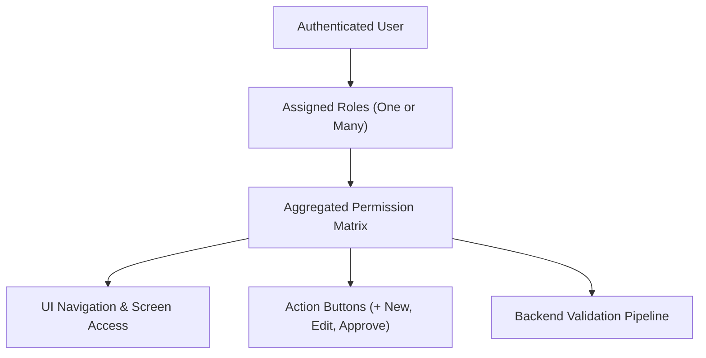

# Roles & Permissions

TenArm BES uses **Role-Based Access Control (RBAC)** to govern who can view, create, edit, approve, and execute business documents across all active apps. Every screen, action button, tab, and backend capability is protected by permission checks.



Permissions are never assigned directly to users. Instead:
1. **Permissions** represent atomic capabilities (e.g., `lead.view`, `order.approve`, `payroll.payrun.run`).
2. **Roles** bundle permissions into operational job responsibilities.
3. **Users** receive one or more roles in their profile. Effective authority is the mathematical union of all permissions granted across assigned roles.

---

## The Roles & Permissions Workspace (`/roles`)

Navigate to **Settings → Roles & Permissions** (or use the workspace quick-switcher to jump to `/roles`).

### Header & Pulse Metrics
The page header displays real-time health metrics across your tenant's security landscape:
- **Total Roles**: Total count of authority templates configured in the tenant.
- **Active Roles**: Number of roles currently active and assignable to users.
- **System Templates**: Factory-defined base roles packaged with installed modules.
- **Permissions Catalog**: Total atomic permissions currently registered across all enabled modules.

### Top IAM Switcher & View Tabs
A segmented control allows quick switching across administrative domains:
- **Users**: Switches immediately to the user directory (`/users`).
- **Roles**: Displays the master role catalog with status filters and capability counts.
- **Permissions**: Displays the global catalog of registered capabilities, filterable by module.

---

## System Templates vs Custom Roles

TenArm BES distinguishes between two classes of roles:

| Property | System Templates (`SYSTEM`) | Custom Roles (`CUSTOM`) |
|:---|:---|:---|
| **Badge** | Blue `SYSTEM` pill | Gray `CUSTOM` pill |
| **Origin** | Factory pre-installed with core modules | Authored by Tenant Administrators |
| **Modification** | Read-only; permissions cannot be added or removed directly | Fully customizable name, description, and permission matrix |
| **Lifecycle** | Always active; cannot be deactivated or deleted | Can be toggled between **Active** and **Inactive** |
| **Actions** | **View Permissions**, **Clone** | **Edit**, **Deactivate** / **Activate** |

### Built-in System Templates

TenArm BES ships with pre-configured system roles bundled for each business function:

| Role Code | Template Name | Typical Coverage |
|:---|:---|:---|
| `admin` | **Admin** | Full access to all modules, tenant settings, security policies, and party management |
| `sales` | **Sales** | Quotations, sales orders, order fulfillment tracking, and customer records |
| `procurement` | **Procurement** | Purchase requisitions, purchase orders, supplier management, and goods receipt |
| `finance` | **Finance** | Invoicing, vendor bills, payment entries, bank reconciliations, and general ledger postings |
| `inventory` | **Inventory** | Products, warehouses, batch/serial tracking, stock adjustments, and material movements |
| `crm` | **CRM & Sales** | Leads, sales pipelines, opportunities, customer interactions, and conversion activities |
| `hr` | **HR** | Employee master profiles, departments, designations, shifts, attendance, and leave requests |
| `payroll` | **Payroll** | Salary structures, pay run processing, tax declarations, bonus runs, and FnF settlements |
| `manufacturing` | **Manufacturing** | Bills of materials (BOM), production planning, and shop-floor work orders |
| `maintenance` | **Maintenance** | Equipment records, preventive maintenance schedules, and maintenance work orders |
| `asset` | **Asset Management** | Fixed asset registry, asset transfers, revaluations, and automated depreciation schedules |
| `projects` | **Projects** | Project task hierarchies, milestone billing, and team collaboration |
| `service` | **Service** | Service contracts, warranty entitlements, customer support tickets, and field tasks |
| `logistics` | **Logistics** | Dispatch processing, delivery runs, transfers, and warehouse movement documentation |
| `gst_compliance` | **GST Compliance** | E-invoicing, e-way bills, GST returns filing, and tax portal communication |
| `document_controller` | **Document Controller** | Print templates, document numbering rules, and export configurations |
| `portal_user` | **Portal User** | Read-only external customer/supplier self-service portal access |
| `auditor` | **Auditor / BI** | Analytical dashboards, trial balance verification, and system execution history |

::: tip Combining Multiple Roles
A warehouse supervisor who also handles goods receipt purchases should be assigned both **Inventory** and **Procurement**. Their effective access is the union of both roles' permissions.
:::

---

## Role Management Workflows

### 1. Inspecting Role Capabilities
Click any row in the **Roles** table or click **View Permissions** on a system template to expand its capabilities drawer:
- Review the total number of capabilities assigned.
- Group capabilities by application domain (Sales, Procurement, HR, Finance, etc.).
- Inspect descriptions for each atomic capability code.

### 2. Creating a Custom Role from Scratch
1. Click **New Role** in the top right corner of the page.
2. In the **Create New Role** dialog, fill in:
   - **Role Code**: Unique identifier string (e.g., `junior_buyer`, `shift_supervisor`). Must be unique across the tenant.
   - **Role Name**: Descriptive title displayed in user dropdowns (e.g., `Junior Buyer`).
   - **Description**: Optional explanation of the authority boundaries.
3. In the **Assign Permissions** matrix:
   - Filter by module using the dropdown or search by capability name.
   - Toggle individual permissions or use batch-selection buttons to select entire module sections.
4. Click **Create Role**. The new custom role appears in the list with a `CUSTOM` badge.

### 3. Cloning a System Template (Recommended Approach)
When creating a tailored role (such as a Sales Rep who should view quotations but not approve discounts), cloning a factory template saves time:
1. Locate the base system role (e.g., **Sales**) in the table.
2. Click **Clone**.
3. The system opens the modal with pre-populated values:
   - **Role Code**: Appended with `_custom` (editable).
   - **Role Name**: Appended with `(Custom)` (editable).
   - **Description**: Pre-filled with `Cloned from Sales template`.
   - **Permissions**: Pre-selected with all baseline permissions of the parent template.
4. Deselect unauthorized permissions (e.g., uncheck `order.approve`).
5. Click **Create Role**.

### 4. Editing a Custom Role
1. Click **Edit** on any custom role row.
2. Update the **Role Name**, **Description**, or adjust checkmarks in the permission matrix.
3. Click **Save Changes**. Changes take effect on the next session refresh for all assigned users.

### 5. Deactivating and Activating Roles
- To prevent a custom role from granting authority without deleting historic audit associations, click **Deactivate**.
- A confirmation prompt warns: *"Users assigned this role will lose permissions granted by it."* Confirm by clicking **Deactivate Role**.
- Deactivated roles display an `Inactive` badge. Filter by `Inactive` pill to inspect them.
- Click **Activate** at any time to restore the role's permissions.

---

## Understanding Permission Identifiers

Permission identifiers follow a standard tripartite nomenclature:

```
{module}.{entity}.{action}
```

| Pattern Component | Description | Examples |
|:---|:---|:---|
| `{module}` | Business application domain | `sales`, `crm`, `hr`, `payroll`, `finance` |
| `{entity}` | Aggregate or document entity | `lead`, `order`, `employee`, `payrun`, `invoice` |
| `{action}` | Lifecycle transition or action | `view`, `create`, `update`, `submit`, `approve`, `cancel` |

### Enforcement Mechanics
When an unprivileged user accesses a protected capability:
1. **Navigation Menu**: Hidden from sidebar navigation.
2. **Action Buttons**: Buttons such as **+ New Lead** or **Approve** are hidden or disabled.
3. **Direct URL Attempt**: Renders a standard **Access Denied** fallback screen.
4. **Backend Boundary**: Rejects unauthorized API requests with `403 Forbidden` and a human-readable authorization failure message.

---

## If Something Goes Wrong (Common Validation & Guard Errors)

| Error Message / Symptom | Cause | Resolution |
|:---|:---|:---|
| **"Role code already exists"** | A role with this code is already defined in the tenant. | Choose a distinct role code (e.g., suffix with department or role level like `sales_rep_l2`). |
| **"Role code is required"** / **"Role name is required"** | Submitted the modal form without entering mandatory identification fields. | Enter a code and descriptive title before submitting. |
| **"Cannot modify system role"** | Attempted to edit or delete a pre-installed factory role. | System roles are immutable. Click **Clone** to produce a custom role with modified permissions. |
| **"You don't have permission to modify roles"** | User profile lacks `role.create`, `tenant.admin`, or platform administrator authority. | Request access from your Organization Administrator. |
| **"Another administrator modified this role" (409 Conflict)** | Two administrators edited the role's permission matrix simultaneously. | Review the conflict resolution side drawer, select the desired version, and reload the latest record. |
| **User reports button missing after role assignment** | Role was assigned, but the user has an active stale browser session. | Have the user refresh their browser tab or sign out and back in to reload their effective permissions token. |

---

## Related Guides

- **[User Management](/admin-guides/user-management)** — Creating users and assigning roles
- **[Party Management](/admin-guides/party-management)** — Counterparty directory for customers, suppliers, and transporters
- **[Tenant Setup](/admin-guides/tenant-setup)** — Organization-level profile and currency settings
- **[App Enablement](/admin-guides/app-enablement)** — Activating and deactivating modular application packs
