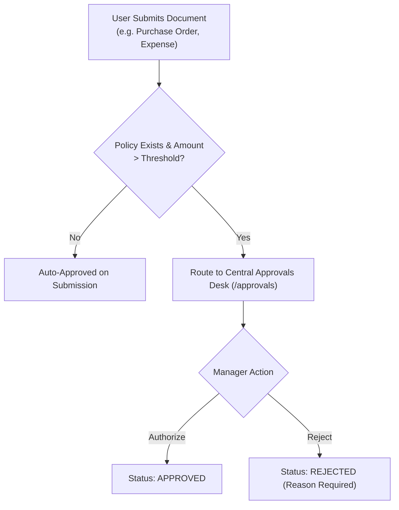
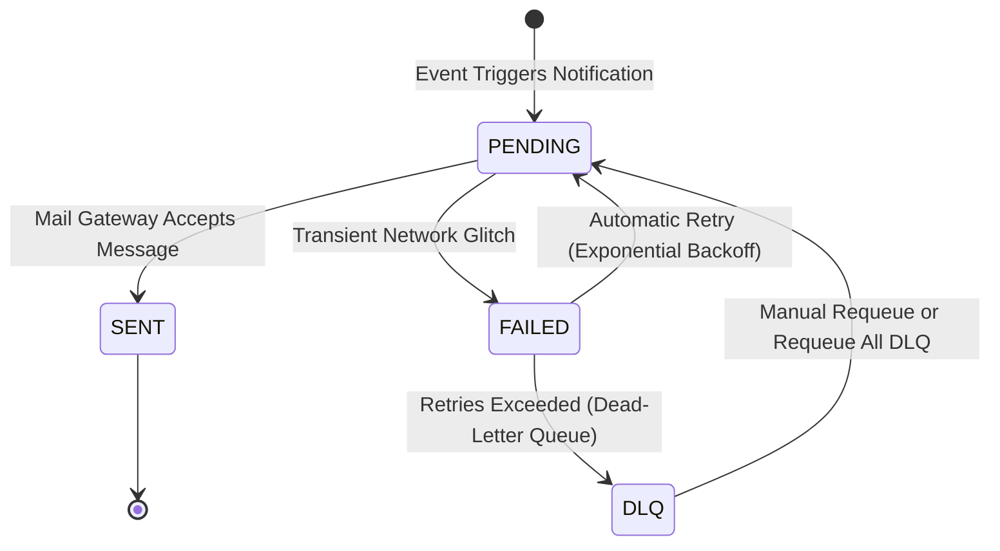

# System Configuration

The **System Configuration** suite governs core operational behaviors across TenArm BES—approval authority policies, document numbering sequences, outbound transactional email queues, scheduled background jobs, and system concurrency safeguards.

---

## 1. Approval Policies

Approval policies govern which transactions require managerial authorization before they become active or advance through operational lifecycles.



### How Approval Thresholds Work

When a user submits a document:
1. The system checks if an active approval policy is configured for that document type.
2. If the document total value is **below the threshold**, the document auto-approves immediately.
3. If the value **meets or exceeds the threshold**, the document transitions to `PENDING_APPROVAL` and appears in the centralized **Approvals Triage Desk** (`/approvals`).

### Policy Configuration

| Setting | Purpose & Constraints |
|---|---|
| **Document Type** | The target entity (e.g. `Purchase Order`, `Expense Claim`, `Sales Order`). |
| **Threshold Amount** | Monetary threshold in organization currency. Transactions above this value require approval. Set to `0` to require approval for **all** transactions of that type. |
| **Approver Role** | The RBAC role authorized to approve (e.g. `Procurement Manager`, `Finance Controller`). |

---

## 2. Document Number Sequences

Every business document generated in TenArm BES receives a permanent, gapless, tamper-evident document number.

### Canonical Sequence Format

```
{ORG_CODE}-{DOC_TYPE}-{FISCAL_YEAR}-{SEQUENCE}

Examples:
  ACME-SO-25-26-0001   (Sales Order)
  ACME-PO-25-26-0042   (Purchase Order)
  ACME-INV-25-26-0105  (Tax Invoice)
  ACME-GRN-25-26-0018  (Goods Receipt Note)
```

### Document Type Prefixes

| Prefix | Document Type | Description |
|:---:|---|---|
| `QT` | Quotation | Commercial sales quotation offered to a prospective customer |
| `SO` | Sales Order | Confirmed customer sales order commitment |
| `PO` | Purchase Order | Authorized procurement order sent to a supplier |
| `INV` | Tax Invoice | Statutory tax invoice issued to a customer |
| `BIL` | Vendor Bill | Commercial invoice received from a supplier |
| `GRN` | Goods Receipt Note | Warehouse material receiving and inspection slip |
| `JE` | Journal Entry | Balanced double-entry financial general ledger posting |
| `PMT` | Payment | Customer receipt or supplier disbursement entry |
| `DN` | Debit Note | Supplier adjustment or purchase return debit note |
| `CN` | Credit Note | Customer credit note or sales return adjustment |
| `EXP` | Expense | Operational employee expense claim |

::: warning Non-Configurable Sequences
Document sequence numbers are managed by the core sequence service. Numbers are generated sequentially and cannot be manually edited or backdated, ensuring complete statutory audit compliance.
:::

---

## 3. Transactional Email Outbox (`/control/email-outbox`)

TenArm BES maintains a durable, tenant-scoped outbox queue for all outbound transactional communications (invoice dispatch emails, purchase order PDFs, and managerial approval notifications).



### Outbox Pulse Metrics
- **Total Messages**: Aggregate outbound emails processed by your tenant.
- **SENT**: Successfully accepted by external mail relays and dispatched.
- **PENDING**: Buffered in the outbox queue waiting for the transmission worker.
- **FAILED**: Experienced transient network latency; queued for automatic backoff retry.
- **DLQ (Dead-Letter Queue)**: Exhausted maximum delivery attempts due to permanent mailbox rejection or invalid credentials.

### Master Delivery Channel Banner
The status banner at the top of `/control/email-outbox` controls the tenant mail gateway:
- **Active Channel**: Pending transactional emails are dispatched continuously.
- **Paused Channel**: Outgoing emails are safely held in the database queue without being sent over the wire. This is ideal during system maintenance or data migration to prevent sending draft alerts to customers.
- **Toggle Action**: Click **Pause Channel** or **Resume Channel** to switch gateway states instantly.

### Message Inspector Modal
Clicking **Inspect** on any email row displays:
- **Rendered HTML Tab**: A sandboxed visual preview of the exact email formatting and branding delivered to the recipient.
- **Plain Text Tab**: Raw text fallback format.
- **Error Diagnostics**: If a delivery fails, displays the exact mail server error code (e.g. `550 5.1.1 User unknown`) with a one-click **Copy Error** button.
- **Requeue DLQ**: Click **Requeue** on a message, or click **Requeue All DLQ** to retry delivery after resolving connectivity.

---

## 4. Personal Notification Preferences (`/control/notification-preferences`)

Users can customize how and when they receive business notifications:

- **Delivery Channels**: Enable or disable email notifications, in-app notification center alerts, and mobile notifications.
- **Event Subscriptions**: Choose which event categories trigger alerts (e.g. *New Approval Assigned*, *Order Dispatched*, *Credit Limit Warning*).
- **Quiet Hours**: Mute non-urgent notifications outside business hours.

---

## 5. Scheduled Background Jobs (`/control/scheduled-jobs`)

The Scheduled Jobs console provides single-pane visibility and operational control over automated periodic maintenance routines, ledger sweeps, and background tasks.

### Pre-Configured Presets

| Preset | Standard Cron | Operational Task |
|---|---|---|
| **Every 2 min** | `*/2 * * * *` | Outbound email outbox drain and immediate notification dispatches. |
| **Every 15 min** | `*/15 * * * *` | SLA deadline evaluations and overdue approval escalations. |
| **Every hour** | `0 * * * *` | Low-stock threshold checks and exchange rate updates. |
| **Nightly 2 AM** | `0 2 * * *` | Overdue invoice notices, interest calculations, and daily ledger reconciliation. |
| **Weekly Sunday** | `0 5 * * 0` | Historical audit log compression and background cache optimization. |

### Operational Controls
- **Run Now**: Click **Run Now** on any task row to trigger execution immediately within seconds. An OCC guard prevents double-execution if the task is already running.
- **Enable / Disable Toggle**: Pause or resume scheduled execution for any job.
- **Edit Schedule & Parameters**: Update the Cron frequency or customize execution parameters (e.g. `{"days": 30}` or `{"batch_size": 100}`).

---

## 6. System Safeguards & Concurrency

### Optimistic Concurrency Control (OCC)
All transactional documents and settings feature version tokens (`expected_version`):
- When two users edit a document simultaneously, the second save is rejected with a **409 Conflict** guard.
- The **Conflict Resolution Drawer** opens automatically, presenting a side-by-side comparison of local edits against the updated server version, allowing users to merge changes safely without data loss.

### Idempotency Protection
All mutating operations support client-supplied idempotency keys:
- Duplicate form submissions or network retries within a 24-hour window return the cached response rather than creating duplicate records or double-posting payments.

### Three Independent Ledgers
TenArm BES separates system records into three immutable audit ledgers:
1. **Event Store**: Business domain events (e.g. `OrderConfirmed`, `InvoiceIssued`). Permanent.
2. **Capability Execution Logs**: Every API execution, latency metric, and error trace. 90-day retention.
3. **Admin Audit Logs**: Security changes, user role updates, and app enablement events. Permanent.
