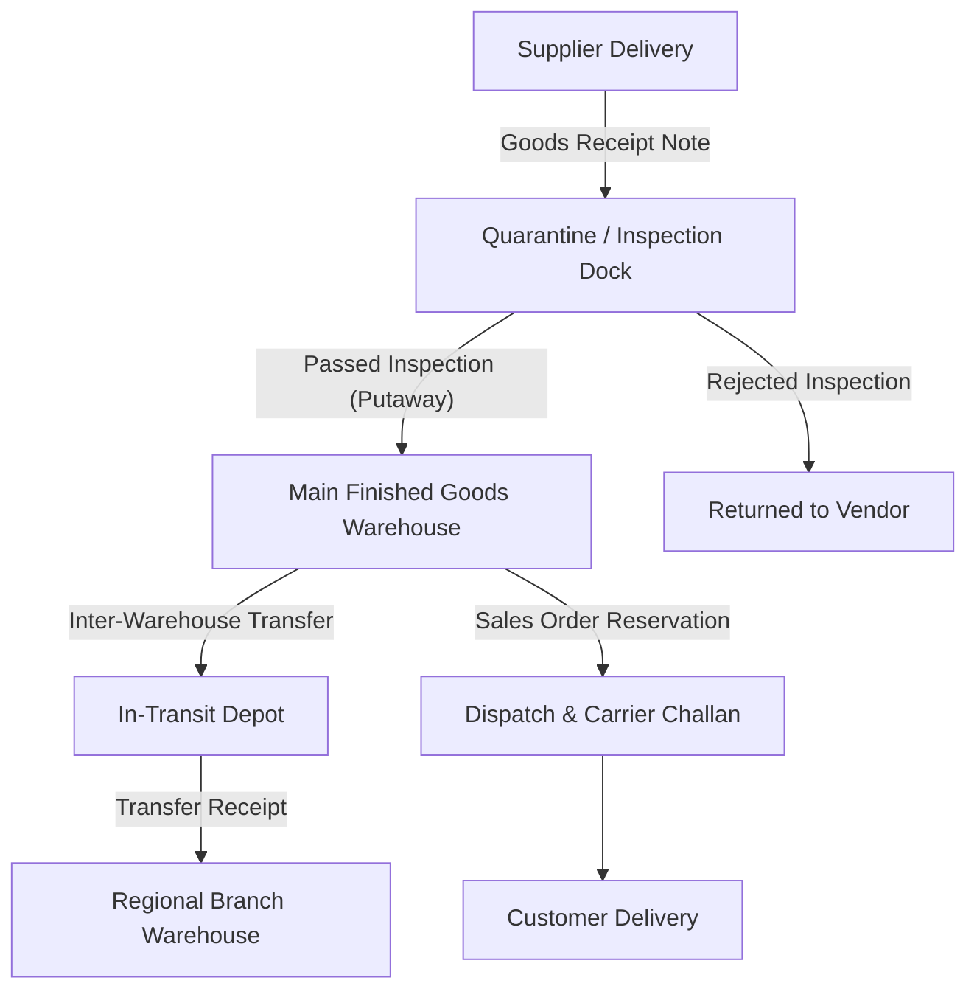
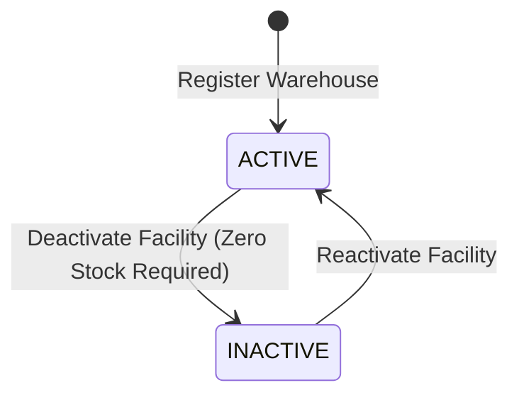

# Warehouse Setup

Warehouses represent the physical and logical facilities where your company holds, receives, manufactures, and dispatches inventory.

Before processing purchase receipts or customer order shipments, administrators configure the physical locations and storage topology in the **Inventory** workspace.

---

## Workspace Ergonomics

Managing warehouse facilities adheres to standard TenArm workspace ergonomics:

- **Multi-Tab Desk**: Operations leads can maintain up to 3 active tabs simultaneously (e.g. keeping the **Warehouses Directory** open while monitoring live **Stock Balances** in Tab 2 and verifying pending **Stock Transfers** in Tab 3).
- **Draft Auto-Save & Dirty Dot**: Unsaved inputs in warehouse configuration forms and storage zone mappings are preserved across navigation; the active tab displays a dirty dot indicator (`•`) until committed.
- **Quick-Peek Facility Drawer**: Clicking any warehouse code on an inventory movement, purchase order receipt, or dispatch note opens an inspection drawer displaying real-time on-hand valuation, open storage capacity, and recent movement logs.
- **Optimistic Concurrency Control (OCC)**: Warehouse configurations are protected by OCC version badges, preventing conflicting administrative updates.

---

## Defining Warehouses (`/inventory/warehouses`)

Access the warehouse directory under **Inventory → Warehouses** (`/inventory/warehouses`).

### Core Facility Fields

| Field | Required | Business Purpose & Validation |
|---|:---:|---|
| **Warehouse Code** | ✅ | Unique alphanumeric facility identifier (e.g. `WH-MAIN`, `WH-PLANT-1`, `WH-TRANSIT`). Must be unique across the tenant. |
| **Warehouse Name** | ✅ | Clear operational display name (e.g. *Central Distribution Hub — Mumbai*). |
| **Physical Address** | — | Street address, city, state, postal code, and contact telephone number used on shipping documents and carrier waybills. |
| **Facility Type** | ✅ | Operational role: `General`, `Raw Materials`, `Finished Goods`, `Transit`, `Quarantine`, or `Returns`. |
| **Status** | ✅ | `ACTIVE` (open for receipts, shipments, and transfers) or `INACTIVE` (locked against new operations). |

### Specialized Facility Types

| Type | Operational Scope | Example Facility |
|---|---|---|
| **General** | Standard commercial distribution warehouse holding diverse product lines. | Central Logistics Hub |
| **Raw Materials** | Dedicated staging warehouse feeding manufacturing production lines. | Plant Raw Materials Store |
| **Finished Goods** | Secure storage holding completed assemblies ready for commercial dispatch. | Finished Goods Yard |
| **Transit** | Virtual or physical holding depot representing inventory in transit on carrier trucks between corporate facilities. | Inter-State Transit Hub |
| **Quarantine / QC** | Restricted holding area for newly received lots awaiting metallurgical or chemical quality inspection before release to stock. | Quality Inspection Bay |
| **Returns Dock** | Staging depot for returned customer goods awaiting inspection, rework, or disposal. | Customer Returns Staging |

---

## Stock Operations & Warehouse Routing

Once warehouses are registered, all material operations reference them:

### Warehouse Routing Rules
- **Dock Receiving**: Inbound purchase receipts can route directly into a `Quarantine` warehouse. Stock remains visible but locked from sales reservations until quality sign-off transfers it to `General` stock.
- **Sales Desk Allocation**: Sales reps can allocate order lines from specific regional warehouses. The **Bulk Warehouse Adjuster** on the Sales Desk allows one-click reassignment of all order lines to the closest fulfilling warehouse.
- **Inter-Warehouse Transfers**: Moving stock between facilities uses a two-step dispatch/receive flow via a `Transit` warehouse, ensuring in-transit inventory remains fully accounted for on balance sheets.

---

## Warehouse Status & Lifecycle

| State | Allowed Operations | Guard Rules |
|---|---|---|
| `ACTIVE` | Receipts, dispatches, cycle counts, reservations, transfers. | Unrestricted operational status. |
| `INACTIVE` | Read-only reporting and audit history. | **Strictly locked**. Cannot receive, ship, or transfer items. Existing stock must be zero before deactivating. |

::: warning Deactivating a Facility
A warehouse cannot be set to `INACTIVE` while physical stock balances remain on record. Before deactivating an old facility, use **Stock Transfers** to relocate remaining inventory to an active warehouse or perform an authorized **Stock Adjustment** to reconcile balances to zero.
:::

---

## Setup Checklist for New Facilities

- [ ] Create unique warehouse code and descriptive commercial title.
- [ ] Enter complete postal address for shipping documents and E-Way bills.
- [ ] Assign specialized facility role (Raw Materials, Transit, Quarantine, General).
- [ ] Map appropriate General Ledger Inventory Asset accounts under Finance settings if separate balance sheet accounting per warehouse is required.
- [ ] Test a sample purchase order receipt and transfer to verify warehouse dropdown availability.

---

## If Something Goes Wrong (Common Validation & Guard Errors)

| What you see (Toast / Banner) | Why it happens | How to fix it in the workspace |
|---|---|---|
| `"Warehouse code already exists"` | Attempting to register a warehouse with a code already assigned. | Enter a distinct alphanumeric warehouse code (e.g. `WH-NORTH-2`). |
| `"Cannot deactivate warehouse with non-zero stock balance"` | Attempting to deactivate a facility that still holds physical inventory. | Execute **Stock Transfers** to move all remaining items to another warehouse before deactivating. |
| `"Source and destination warehouses cannot be identical"` | Selecting the same warehouse as both source and destination in a stock transfer. | Select different facilities for source dispatch and destination receipt. |
| `"Warehouse is inactive"` | Attempting to select a deactivated warehouse on a purchase order or sales dispatch form. | Choose an active warehouse or have an administrator reactivate the facility. |
