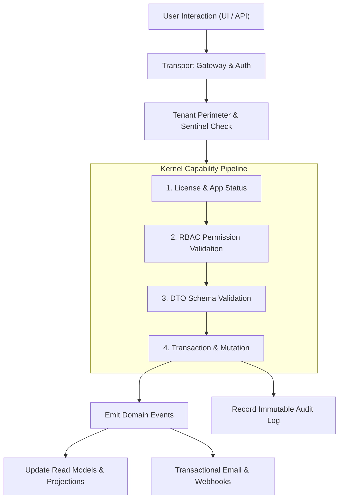

# What is TenArm BES?

**TenArm BES** (Business Execution System) is a modular, multi-tenant enterprise operating system. It provides a unified workspace, a governed execution pipeline, and an event-driven core designed to run business operations with absolute data integrity and complete audit compliance.

Rather than running disconnected point solutions, TenArm BES provides a cohesive platform where all operations share a single tenant boundary, every mutation is validated through a capability pipeline, and all actions are recorded in immutable audit ledgers.

---

## Core Architecture Principles

| Principle | Description |
|---|---|
| **Modular Kernel Architecture** | The kernel provides the foundational workspace, security, and integration pipeline. Business capabilities are packaged as modular applications that can be activated or deactivated per organization without software redeployments. |
| **Strict Multi-Tenant Isolation** | Every tenant organization operates in a completely isolated data perimeter. Cross-tenant reads and platform operator impersonation are strictly prevented by kernel guards. |
| **Governed Capability Pipeline** | Every business mutation flows through a unified 4-stage pipeline: license check → permission verification → payload validation → transaction execution and event emission. |
| **Event-Driven Integration** | Applications integrate asynchronously through business events. When an action occurs, events stream to read models and external webhooks without tight cross-module coupling. |
| **Tamper-Evident Ledgers** | Three independent, immutable ledgers record business events, capability execution telemetry, and administrative security actions. |

---

## How the Platform Works

Every action in TenArm BES—from changing an organization setting to submitting a document—follows the same governed execution pipeline:

---

## The Unified Workspace

The TenArm BES interface is engineered for high-efficiency, multi-tasking business operations:

- **Multi-Tab Desk**: Keep up to 3 active workspace tabs simultaneously (`t1`, `t2`, `t3`). Switching tabs preserves scroll positions, active search filters, and unsaved form edits without reloading.
- **Draft Auto-Save & Dirty Indicator**: In-progress edits are automatically preserved in local browser session storage. A dirty indicator (`•`) alerts you to unsaved changes.
- **Command Palette (`⌘K` / `Ctrl+K`)**: Instant search overlay to jump between screens, lookup master records, or execute quick actions.
- **Quick-Peek Drawers**: Contextual slide-out drawers allow you to inspect referenced records without leaving your current workspace tab.
- **Conflict Resolution Drawer**: Optimistic Concurrency Control (OCC) guards protect against concurrent edits, presenting a side-by-side reconciliation tool to merge changes safely.

---

## Next Steps

- **[Quick Start Guide](./quick-start)** — Log in and get oriented in the workspace
- **[Glossary](./glossary)** — Key architectural terms and platform concepts
- **[User Guides](/user-guides/)** — Daily workspace navigation, approvals triage, and activity tracking
- **[Admin Guides](/admin-guides/)** — Tenant setup, security policies, and system configuration
