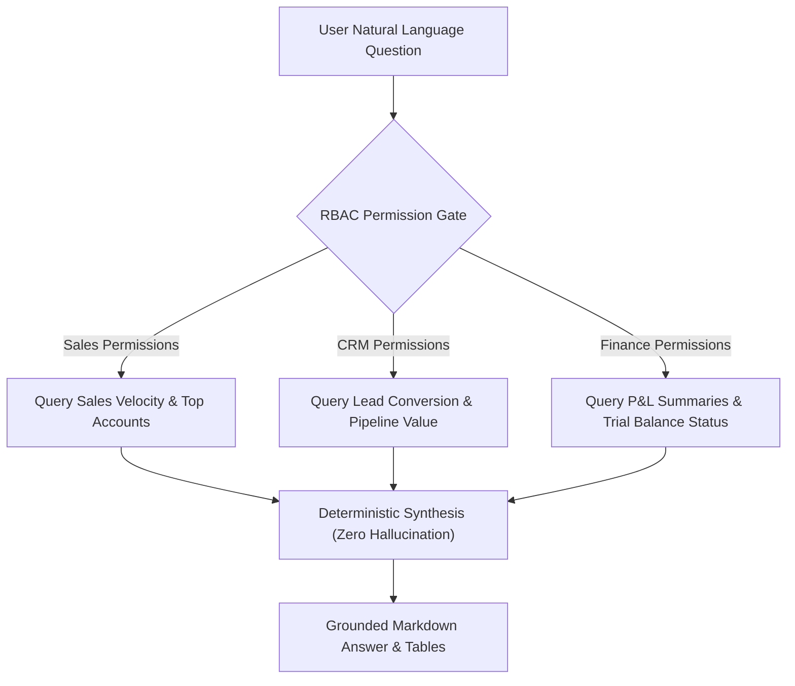

# AI Assistant

The **AI Assistant** is a conversational analytics co-pilot built directly into the TenArm BES workspace (`/ai`). It enables managers, executives, and team leads to query operational performance in natural language—such as *"What were total sales last month?"*, *"Which deals are in the pipeline?"*, or *"Is our trial balance currently balanced?"*—and receive verified, deterministic answers synthesized directly from live system aggregates.

Rather than manually exporting spreadsheets, compiling pivot tables, or navigating multiple departmental dashboards, users can ask questions and explore business trends interactively.

---

## Workspace Ergonomics

The AI Assistant is accessible everywhere across the workspace without interrupting focused desk work:

- **Global Floating Companion**: A compact floating launcher docks at the bottom-right corner of every screen. Clicking the **Sparkles** icon opens a conversation drawer, allowing you to ask questions on the fly while reviewing purchase orders, customers, or ledger entries.
- **Full-Page Command Desk (`/ai`)**: Promote any quick question into a full-page workspace tab by clicking **Full page**. The full-screen layout provides ample room for side-by-side period comparisons and detailed tabular breakdowns.
- **Multi-Tab Desk Multitasking**: Keep the AI Assistant open in Tab 1 while inspecting active quotations or invoices in Tabs 2 and 3. Switching between tabs preserves your active conversation thread, scroll position, and prompt drafts.
- **Multi-Turn Session Continuity**: The assistant maintains conversation context within your session. You can ask follow-up questions (such as *"Who was the top customer?"* or *"Compare that with the previous quarter"*) without restating dates or organization details.

---

## Core Concepts & Guarantees

### Grounded in Live Aggregates (Zero Hallucination)

Conventional conversational AI models often extrapolate or guess figures when answering questions about business performance. The TenArm BES AI Assistant enforces deterministic grounding:

- **Verified Aggregate Lookups**: The assistant never runs arbitrary database SQL queries or scans unvetted tables. It only queries pre-built, verified read-model aggregators (such as monthly sales summaries, pipeline conversion metrics, and statutory trial balances).
- **Absolute Ground Truth**: Answers are drawn strictly from live system numbers. If data is unavailable or outside your search scope, the assistant states so plainly rather than guessing.
- **Read-Only Operation**: The assistant is strictly an analytical companion. It cannot alter system settings, approve transactions, modify credit limits, or post financial journals.

### Role-Based Privacy & Tenant Isolation

Conversations are protected by TenArm BES security boundaries:

- **Role Permission Enforcement**: If a user's role does not possess permissions to view financial ledgers (e.g. `finance.dashboard.view`), the assistant automatically suppresses financial figures for that user.
- **Tenant Scope Enforcement**: All inquiries are isolated strictly to your organization. The assistant cannot view or aggregate records from other organizations.
- **Private Sessions**: Conversation history is private to the authenticated user's session.

---

## What You Can Ask

### 1. Sales & Revenue
- *"What were total sales last month?"*
- *"Who were our top 5 customers by sales volume this quarter?"*
- *"Compare this month's invoiced sales against last month."*
- *"How many orders were fulfilled versus cancelled?"*

### 2. CRM & Sales Pipeline
- *"What is the total value of active pipeline opportunities?"*
- *"How many leads were converted into deals in the last 30 days?"*
- *"Which stage in the pipeline currently holds the most deal value?"*

### 3. Financial Statements & Health
- *"What was our net operating revenue for the last closed accounting period?"*
- *"Is the trial balance currently balanced?"*
- *"Show a breakdown of revenue versus operating expenses this fiscal year."*

::: tip Calendar Month Resolution
When referencing calendar months (such as *"June"* or *"last month"*), the assistant automatically maps your phrase to your organization's official fiscal accounting period.
:::

---

## Permissions & Access Governance

Access to the AI Assistant is governed by permissions:

1. **User Permission (`assistant.ask`)**: The user's assigned role must include the `assistant.ask` atomic permission.
2. **Domain Visibility Guards**: Individual metric tools require their corresponding functional permission:
   - Sales queries require `sales.order.view` or `sales.dashboard.view`.
   - Pipeline queries require `crm.dashboard.view` or `lead.view`.
   - Financial ledger queries require `finance.dashboard.view` or `finance.journal.view`.

---

## Troubleshooting & Common Alerts

| What You See | Cause | How to Resolve |
|---|---|---|
| **"You don't have permission to use the AI assistant"** | Your user account has not been assigned a role with `assistant.ask`. | Request your tenant administrator to assign the `assistant.ask` permission to your role in **User Management**. |
| **"I do not have access to finance data for your account"** | Your role lacks permission to view General Ledger or financial dashboards. | If your daily duties require financial reporting, ask your administrator to grant financial viewing permissions. |
| **"The assistant is temporarily unavailable"** | Transient network latency or rate limit from the language model provider. | Click **Retry** or wait a few moments and resubmit your question. |
| **"Failed to load conversation history"** | Interrupted network connection while fetching prior session messages. | Refresh your browser tab or start a fresh session from the launcher. |
