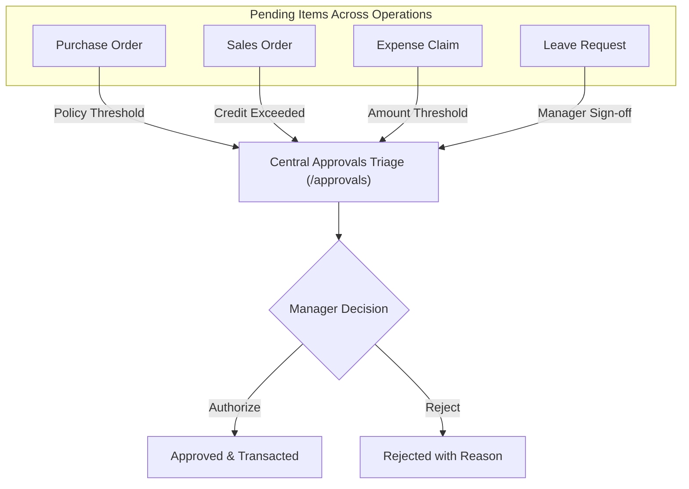
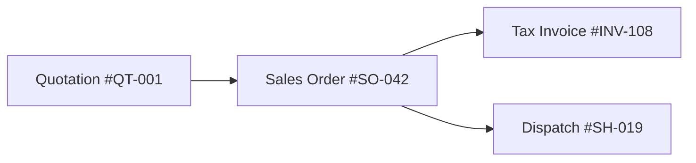

# Approvals & Activity

The TenArm BES workspace provides three unified operational surfaces that connect all daily business activities:

1. **Approvals Triage Desk (`/approvals`)**: A single unified inbox where managers review, inspect, approve, or reject business commitments requiring managerial sign-off.
2. **Activity Feed (`/activity`)**: A live, ambient pulse of enterprise operations streaming domain events in real time across the organization with instant search and filtering.
3. **Process & Audit Lineage (`/process`)**: An immutable chronological audit trail and graphical lineage tree for any document, revealing parent/child relationships and secondary effects.

---

## Workspace Ergonomics

- **Multi-Tab Desk**: Keep up to 3 active workspace tabs simultaneously (e.g., the **Approvals Triage Desk** in Tab 1 while inspecting a document's **Process Lineage** in Tab 2). Switching tabs preserves active filters and scroll positions without reloading.
- **Top-Bar Approvals Drawer**: A dedicated approvals bell and counter in the global header lets you authorize pending items from anywhere without leaving your active screen.
- **Quick-Peek Inspection**: Clicking document numbers or counterparties inside the Approvals Desk or Activity Feed opens contextual slide-out drawers for instant inspection.
- **Optimistic Concurrency Control (OCC)**: Approval decisions are versioned. If another manager reviews the same document concurrently, the system alerts you to prevent duplicate decisions.

---

## 1. Approvals Triage Desk (`/approvals`)

Instead of checking multiple departmental menus, all items requiring managerial authorization arrive in the centralized Approvals Triage Desk.

### Triaging Approvals
1. Navigate to `/approvals` (or click the bell icon in the top header).
2. Filter by status (`PENDING`, `APPROVED`, `REJECTED`) or module.
3. Click any row to inspect the document summary, line items, and audit trail in the quick-peek drawer.
4. Click **Approve** or **Reject** (rejections prompt for an mandatory explanation reason).

---

## 2. Activity Feed (`/activity`)

The Activity Feed provides an ambient, real-time stream of all business events occurring across the enterprise.

### Finding Activities
- **Search**: Search by document number, counterparty name, or user name.
- **Module Filter**: Narrow down to specific operational units.
- **Drill-Down**: Click on any event to view the originating document and its full execution lineage.

---

## 3. Process & Audit Lineage (`/process`)

Every document in TenArm BES tracks its complete parent-child chain and immutable audit history.

- **Graph View**: See the graphical dependency tree connecting quotations, orders, shipments, invoices, and payments.
- **Timeline**: View who created, edited, approved, or transitioned the document with exact millisecond timestamps.
