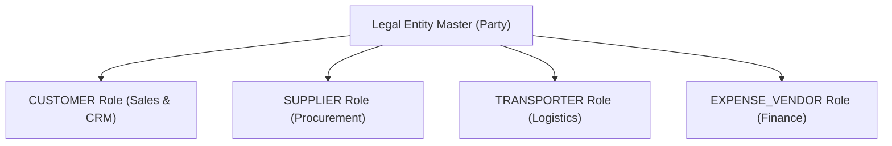
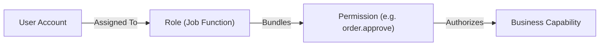
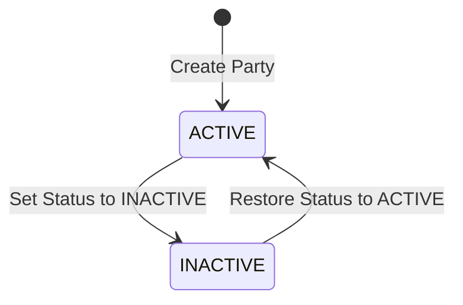
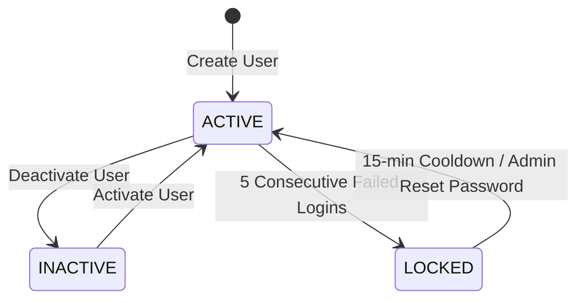
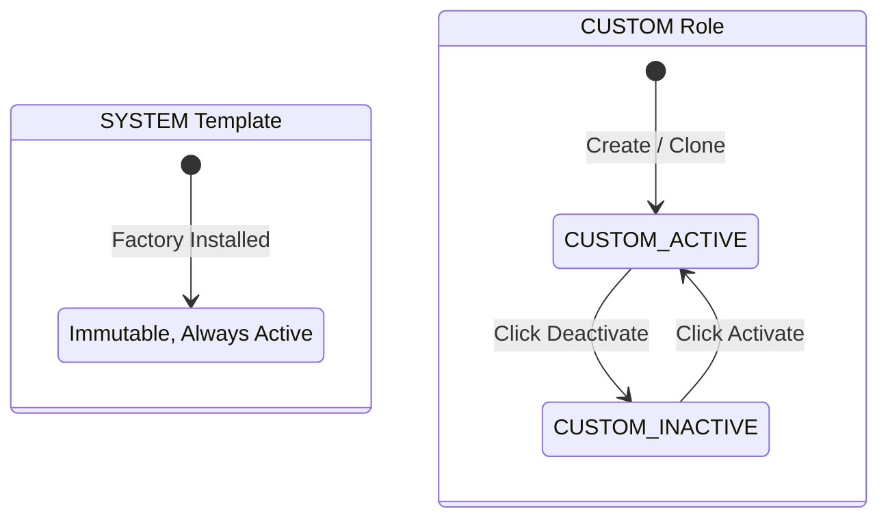
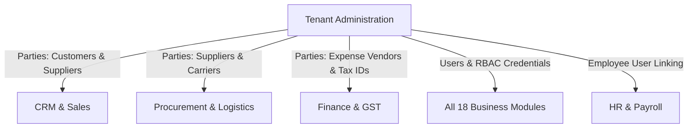

# Tenant Administration

<div class="storyline-breadcrumb">Core Foundation for <strong>Tenant Governance</strong>, <strong>Identity Security</strong> &amp; <strong>Master Data</strong></div>

> The central administration and security cockpit of TenArm BES, orchestrating unified business partner records, enterprise user provisioning, session security controls, and granular role-based access governance.

The Tenant Administration suite encompasses the core operational consoles that govern identity, authorization, and counterparty relationships across the organization. It provides tenant administrators with single-pane control over:
1. **Business Parties (`/parties`)**: The authoritative directory of commercial relationships, unifying customers, suppliers, freight transporters, and expense vendors into a single master partner ledger.
2. **User Management (`/users`)**: Identity provisioning, credential standards, brute-force security controls, active device tracking, and instant remote session termination.
3. **Roles & Permissions (`/roles`)**: Role-Based Access Control (RBAC) governing visibility and mutation authority across all 18 business modules.

---

## Workspace Ergonomics

The Administration consoles are built for secure, multi-desk operations and zero-downtime policy enforcement:

- **Multi-Tab Desk**: Administrators can maintain up to 3 active tabs simultaneously (e.g. keeping the **Users** directory open while inspecting effective permissions under **Roles & Permissions** and managing partner credit limits in **Parties**). Switching tabs preserves active filters, search criteria, and table selections without page reloads.
- **Draft Auto-Save**: Uncommitted form inputs in creation and edit dialogs are continuously preserved in local browser session storage, displaying a dirty dot indicator (`•`) on the active tab until committed or cancelled.
- **Quick-Peek Slide-Out Drawers**: Clicking any user name or party code opens an inspection drawer from the right edge of the screen, allowing administrators to audit effective permissions, contact information, and linked transactions without navigating away from the list.
- **Optimistic Concurrency Control (OCC)**: User profiles, custom roles, and party records display an OCC version badge (e.g. `v3`). If two administrators update the same role or user concurrently, the system alerts you and opens the **Conflict Resolution Drawer** to prevent accidental overwrites.

---

## Core Administrative Concepts

### The Unified Party Architecture
In legacy ERP systems, "Customers", "Suppliers", and "Vendors" exist in isolated, duplicated tables. In TenArm BES, all business counterparties are modeled as **Parties** (`/parties`). A single legal entity can hold multiple simultaneous commercial roles:



- **Unified Identity**: If a supplier also purchases finished goods from your company, they share one primary record with a unified Tax ID (GSTIN/VAT) and address.
- **Role-Scoped Ledgers**: Sales orders and invoices interact with the entity under their `CUSTOMER` role, while purchase orders and vendor bills interact under their `SUPPLIER` role.
- **Cross-Role Credit Monitoring**: Accounts Receivable (AR) and Accounts Payable (AP) aging can be evaluated jointly to offset customer dues against supplier payables.

### The RBAC Security Hierarchy
Security in TenArm BES follows a strict three-tier hierarchy that separates platform operators from tenant data:



1. **Users**: Individuals who sign in with unique email credentials.
2. **Roles**: Functional job titles (e.g. *Sales Manager*, *Warehouse Clerk*, *Finance Officer*). A user can hold multiple roles simultaneously; their effective permissions are the union of all assigned roles.
3. **Permissions**: Atomic authorization gates (e.g. `po.approve`, `inventory.adjust`, `user.create`). Permissions cannot be assigned directly to users; they must be granted via a role.

### Enterprise Identity & Device Security
- **Strict Password Standards**: All user passwords require a minimum of 12 characters, including uppercase, lowercase, numbers, and symbols.
- **Automatic Brute-Force Lockout**: Five consecutive failed sign-in attempts lock the account for 15 minutes. Administrators can unlock an account immediately by initiating a password reset.
- **Active Device Tracking & Instant Invalidation**: All authenticated sessions display device type, browser, client IP, and sign-in timestamps. Administrators and users can remotely terminate any active device or click **Sign Out Others** to terminate all remote sessions immediately via real-time Server-Sent Events (SSE).

---

## Features

### Business Parties Directory (`/parties`)

**What it does** — The authoritative register for all customers, suppliers, contract carriers, expense vendors, and third-party partners.

```
/parties
```

**Lifecycle & States**



| State | Business Meaning | Allowed Operations |
|---|---|---|
| `ACTIVE` | Operational commercial counterparty in good standing. | Eligible for quotations, sales orders, purchase orders, shipments, and invoicing. |
| `INACTIVE` | Suspended or dormant partner. | Existing transaction history preserved for auditing; hidden from new transaction dropdowns. |

**Pulse HUD Metrics**
- **Total Parties**: Total registered commercial counterparties.
- **Customers**: Entities holding active `CUSTOMER` roles eligible for quotations and sales orders.
- **Suppliers**: Entities holding active `SUPPLIER` roles eligible for purchase orders and goods receipt.
- **Active Records**: Total party records in active commercial standing.

**Key Fields on Business Parties**

| Field | Required | Description & Validation |
|---|:---:|---|
| **Party Code** | — | Unique partner identifier (e.g. `CUST-0001`, `SUPP-0042`). Auto-generated if left blank. |
| **Full Legal Name** | ✅ | Registered corporate or individual legal name. Cannot be blank. |
| **Email** | — | Primary business or accounts contact email address. |
| **Phone** | — | Contact telephone or mobile number. |
| **Primary Address** | — | Billing and dispatch postal address. |
| **Tax ID / GSTIN** | — | 15-character GSTIN (India) or corporate VAT identification number. Auto-populates state code. |
| **Tax Region / State Code** | — | 2-digit regional tax code (e.g. `27` for Maharashtra, `29` for Karnataka) driving inter-state vs. intra-state tax determination. |
| **Party Roles** | ✅ | Multi-select buttons: `CUSTOMER`, `SUPPLIER`, `TRANSPORTER`, `EXPENSE_VENDOR`, `EMPLOYEE`. |
| **Customer Credit Limit** | — | Maximum permissible outstanding commercial credit balance (shown when `CUSTOMER` role is active). |

**How to Create a New Business Party**
1. Navigate to **Parties** (`/parties`).
2. Click **New Party** in the top action bar (or click **Export CSV** to download existing records).
3. In the **New Business Party** modal:
   - Leave **Party Code** blank for auto-sequence numbering, or enter a custom identifier.
   - Enter the **Full Legal Name** (mandatory).
   - Enter **Party Email**, **Contact Phone**, and **Primary Address**.
   - Enter the **Tax ID / GSTIN**. The system automatically derives and pre-populates the 2-digit **State Code** from the first two digits.
   - Toggle the active **Business Roles** (`CUSTOMER`, `SUPPLIER`, `TRANSPORTER`, `EXPENSE_VENDOR`, `EMPLOYEE`).
   - If `CUSTOMER` is enabled, optionally enter a **Customer Credit Limit**.
4. Click **Create Party**. The partner record is immediately available for transactions across Sales, Procurement, and Finance.

**How to Edit Party Profiles**
1. On the **Parties** table, locate the party and click **Edit** under the Actions column.
2. In the **Edit Party · {code}** modal, update contact details, tax numbers, or select `ACTIVE` / `INACTIVE` status.
3. Click **Save Changes**.

**Drill-In & Quick Navigation**
- Click **360** on any customer or supplier row to jump directly to **Customer 360** (`/sales/customers/:id`) or **Supplier 360** (`/procurement/suppliers/:id`).
- Click the **Process History** clock icon to inspect end-to-end document lineage and transaction audit logs.
- Click any party row to expand the inline detail tray showing currency, credit limit, payment terms, and registered addresses.

---

### User Accounts & Session Security (`/users`)

**What it does** — Manages organization user accounts, credential assignments, password resets, effective permission audits, and live authenticated devices.

```
/users
```

**Lifecycle & States**



| State | Business Meaning | Allowed Operations |
|---|---|---|
| `ACTIVE` | Authorized corporate account in good standing. | Can log in, access authorized workspaces, create documents, and approve transactions. |
| `INACTIVE` | Suspended or departed employee account. | Sign-in rejected immediately. Historical transactions, authorship, and audit trails remain preserved. |
| `LOCKED` | Account temporarily frozen due to brute-force detection. | Sign-in blocked for 15 minutes. Automatically restores after cooldown or when an administrator resets the password. |

**Pulse HUD Metrics**
- **Total Users**: Total user accounts provisioned in the organization.
- **Active Accounts**: Users currently authorized to sign in.
- **Inactive Accounts**: Deactivated or suspended accounts whose historical audit trails remain preserved.
- **Roles Catalog**: Total authority templates configured, with one-click navigation to `/roles`.

**Key Fields on User Accounts**

| Field | Required | Description & Security Validation |
|---|:---:|---|
| **Email Address** | ✅ | Unique corporate email address used for system authentication. Cannot be duplicated across the platform. |
| **Full Name** | ✅ | User's full display name rendered on document history and audit logs. |
| **Initial Password** | ✅ | Must meet enterprise complexity standards (12+ characters, uppercase, lowercase, numbers, symbols). |
| **Initial Role** | — | Optional base role assigned upon creation. Additional roles can be added anytime in the detail desk. |
| **Active Status** | ✅ | Toggle controlling sign-in authority. Deactivating immediately blocks login without deleting history. |

**How to Provision a New User**
1. Navigate to **Users** (`/users`).
2. Click **New User** in the header.
3. In the **Create New User** dialog:
   - Enter the **Full Name** and **Email Address**.
   - Enter an **Initial Password** conforming to security standards.
   - Optionally select an **Initial Role** from the dropdown (or leave as *None (Assign role later)*).
4. Click **Create User**.

**How to Manage Existing Users & Roles**
1. In the **Users** table, click on any user row to open the **User Details** command desk on the right.
2. **Edit Profile**: Click **Edit Profile** to adjust their display name or email in the **Edit User Profile** modal. Click **Save Changes**.
3. **Assign Additional Roles**: Under **Assign Role**, choose an available role from the dropdown and click **Assign**.
4. **Remove a Role**: Under **Assigned Roles**, click the remove icon (`X`) next to any assigned role.
5. **Inspect Effective Permissions**: Expand the **Effective Permissions** accordion to review the exact list of capabilities granted across all assigned roles, grouped by business module.
6. **Toggle Account Status**: Click **Deactivate** or **Activate** in the panel header. Deactivating suspends sign-in immediately.
7. **Reset Password**: Click **Reset Password**. In the **Reset Password — {user.full_name}** modal, enter the new 12+ character password, confirm it, and click **Reset Password**. This also clears any active brute-force lockouts.

**Active Sessions & Remote Device Invalidation**
1. Click the user profile avatar in the application header and select **Active Sessions**.
2. Review all currently authenticated devices (Platform, Browser, IP address, Location, Sign-in timestamp).
3. **Remote Sign Out**: Click **Sign Out** next to any specific device (e.g. a misplaced mobile phone). The server immediately terminates the session and pushes an instant SSE disconnect notification that terminates the remote browser session.
4. **Sign Out Others**: Click **Sign Out Others** to terminate all remote sessions across the fleet in a single action, keeping only the current device authenticated.

---

### Roles & Access Control Matrix (`/roles`)

**What it does** — The RBAC control matrix allowing administrators to inspect pre-configured system roles, author custom organizational roles, clone templates, and inspect permission coverage across all modules.

```
/roles
```

**Lifecycle & States**



| Role Type | Status | Modifiable? | Deactivatable? | Available Actions |
|---|---|:---:|:---:|---|
| **SYSTEM** | Active | No | No | **View Permissions**, **Clone** |
| **CUSTOM** | Active / Inactive | Yes | Yes | **Edit**, **Deactivate** / **Activate** |

**Tabs & Navigation**
- **Roles Tab (Default)**: Lists all active and inactive roles, displaying role code, name, description, assigned user count, and permission counts.
- **Permissions Tab**: Searchable catalog of all platform permissions grouped by module.

**Pre-Configured System Roles**
TenArm BES includes pre-configured system roles aligned with standard business departments:

| System Role | Code | Job Function & Scope |
|---|---|---|
| **Admin** | `admin` | Full tenant-wide authority across all modules, settings, and users. |
| **Sales** | `sales` | Quotations, sales orders, customer delivery, and commercial invoicing. |
| **CRM & Sales** | `crm` | Leads, accounts, sales pipelines, and customer touchpoints. |
| **Procurement** | `procurement` | Purchase orders, supplier RFQs, and warehouse goods receipts. |
| **Inventory** | `inventory` | Products, warehouses, stock movements, and catch-weight lots. |
| **Finance** | `finance` | Chart of accounts, journal entries, AP/AR ledgers, bank reconciliation, and period close. |
| **HR** | `hr` | Employee directory, departments, leave approvals, attendance, and offboarding clearance. |
| **Payroll** | `payroll` | Compensation structures, pay components, monthly pay runs, and GL salary postings. |
| **Manufacturing**| `manufacturing`| Bills of materials (BOM), production work orders, and WIP costing. |
| **Maintenance**  | `maintenance`  | Asset maintenance plans, preventive schedules, and work orders. |
| **Asset Management**| `asset`   | Fixed asset registry, custody assignments, and depreciation schedules. |
| **Projects**     | `projects`     | Task management, Gantt milestones, and team time tracking. |
| **Service**      | `service`      | Customer support tickets, SLA tracking, and service workboard. |
| **Logistics**    | `logistics`    | Outbound dispatch, carrier consignments, and proof of delivery. |
| **GST Compliance**| `gst_compliance`| India e-invoicing, e-way bills, and GST portal credentials. |
| **Document Controller**| `document_controller`| Editable PDF print templates for quotations and invoices. |
| **Auditor / BI** | `auditor`      | Read-only dashboards, financial statements, and audit ledgers. |
| **Portal User**  | `portal_user`  | Restricted shell for external customers and vendors to view their own orders. |

> [!NOTE]
> **System Role Immutability**: Pre-configured system roles (marked with the blue **SYSTEM** badge) are protected to ensure core operational stability. They cannot be edited, renamed, or deactivated.

**How to Create a Custom Role from Scratch**
1. Navigate to **Roles & Permissions** (`/roles`).
2. Click **New Role** in the top action bar.
3. In the **Create New Role** modal:
   - Enter a unique **Role Code** (e.g. `sales_supervisor`).
   - Enter the display **Role Name** (e.g. *Sales Desk Supervisor*).
   - Enter a functional **Description**.
   - In the **Assign Permissions** matrix, select permissions individually or use batch-selection controls per module.
4. Click **Create Role**. The custom role is immediately available to assign to users.

**How to Clone a System Template (Recommended)**
1. On the **Roles** table, locate a base system template (e.g. **Sales**).
2. Click **Clone**.
3. In the **Clone Role ({code})** modal, adjust the pre-filled code, name, and toggle specific permission checkboxes.
4. Click **Create Role**.

**How to Edit or Deactivate a Custom Role**
1. Locate your custom role in the table.
2. Click **Edit** to adjust display names or add/remove permissions. Click **Save Changes**.
3. To temporarily revoke a custom role from all assigned users without deleting it, click **Deactivate**.
4. In the confirmation dialog, review the warning (*"Users assigned this role will lose permissions granted by it."*) and click **Deactivate Role**.
5. Click **Activate** at any time to restore the role's permissions.

---

## If Something Goes Wrong (Common Validation & Guard Errors)

The table below explains common administration warnings, toasts, and guard errors encountered when managing parties, users, and roles:

| What you see (Toast / Banner) | Why it happens | How to fix it in the workspace |
|---|---|---|
| `"Party name is required"` | The new party form was submitted with an empty legal name. | Enter the legal registered entity name in the **Full Legal Name** field. |
| `"Credit limit must be a valid non-negative amount"` | A negative number or non-numeric characters were entered in the credit limit field. | Enter a positive number (e.g. `500000`) or leave the field blank for no credit limit. |
| `"Party code already exists"` | The specified manual party code is already used by another entity. | Leave the party code blank to use auto-sequence numbering, or choose a distinct code. |
| `"Email already registered in the system"` | A user account was submitted with an email address that belongs to an existing user in the platform. | Use a unique corporate email address for the user account. |
| `"Password must be at least 12 characters and include uppercase, lowercase, number and symbol"` | The entered password does not satisfy enterprise complexity requirements. | Formulate a strong password with at least 12 characters, including at least one uppercase letter (`A-Z`), one lowercase letter (`a-z`), one digit (`0-9`), and one symbol (`!@#$%^&*`). |
| `"Cannot deactivate your own user account"` | An administrator attempted to toggle their own active account status to inactive. | Another administrator must execute account suspension or role changes for your profile. |
| `"Account locked due to consecutive failed login attempts"` | A user entered an invalid password 5 consecutive times. | Wait 15 minutes for automatic cooldown, or an administrator can immediately unlock the account by selecting the user and clicking **Reset Password**. |
| `"Role code already exists"` | A custom role was submitted with a code that already exists. | Enter a unique role identifier (e.g. `ops_lead_south` instead of `ops_lead`). |
| `"Cannot modify system role"` | An edit or delete operation was attempted on a built-in system role (`Admin`, `Sales`, etc.). | System roles are immutable. Click **Clone** to produce an editable custom role with modified permissions. |
| `"Another administrator modified this record (409 Conflict)"` | Another administrator updated the user, role, or party while your edit form was open (OCC guard). | The **Conflict Resolution Drawer** will open automatically. Review the other user's changes and choose whether to merge or reload. |

---

## Cross-Module Integrations

Tenant administration provides foundational data across the entire TenArm BES suite:



| Domain | Integration Touchpoint | Business Outcome |
|---|---|---|
| **Sales & CRM** | Master party records holding `CUSTOMER` roles; linked user accounts. | Powers quotations, sales orders, customer delivery addresses, credit checks, and sales commission attribution. |
| **Procurement** | Master party records holding `SUPPLIER` roles. | Authorizes purchase order generation, vendor proforma references, and warehouse dock receipts. |
| **Logistics** | Master party records holding `TRANSPORTER` roles. | Enables carrier consignments, vehicle registration, and freight bill allocation. |
| **Finance** | Master party tax regions (GST state codes), bank accounts, and expense vendors. | Drives automated intra-state vs inter-state tax postings, AP vendor bill settlements, and 1099/TDS withholding. |
| **HR & Payroll** | Linking `User` accounts to `Employee` profiles. | Authorizes Employee Self-Service portal access (`My Leave`, `My Attendance`, `My Payslips`) and sales rep commissions. |

---

## Permissions Reference

Access to tenant administration consoles is governed by strict administrative permissions:

| Permission | Display Label | What It Authorizes |
|---|---|---|
| `party.admin.list` | View Parties | View the master business parties directory, contact cards, and credit terms. |
| `party.create` | Create Party | Register new customers, suppliers, transporters, and expense vendors. |
| `party.edit` | Edit Party | Edit party contact details, credit limits, addresses, and tax identifiers. |
| `user.list` | View Users | View user accounts, active status, assigned roles, and login history. |
| `user.create` | Create User | Provision new user accounts and establish initial credentials. |
| `user.edit` | Edit User | Edit user names, emails, and toggle active/inactive account status. |
| `user.password.reset` | Reset User Password | Set a new password and unlock brute-force frozen accounts. |
| `role.list` | View Roles | Browse the role catalog and inspect effective module permissions. |
| `role.create` | Create Custom Role | Author new custom roles and bundle permissions from the permission matrix. |
| `role.assign` | Assign Roles | Assign or revoke roles on user accounts. |
| `tenant.admin` | Full Tenant Administration | Full authority over all tenant-tier settings, configuration, and security consoles. |
