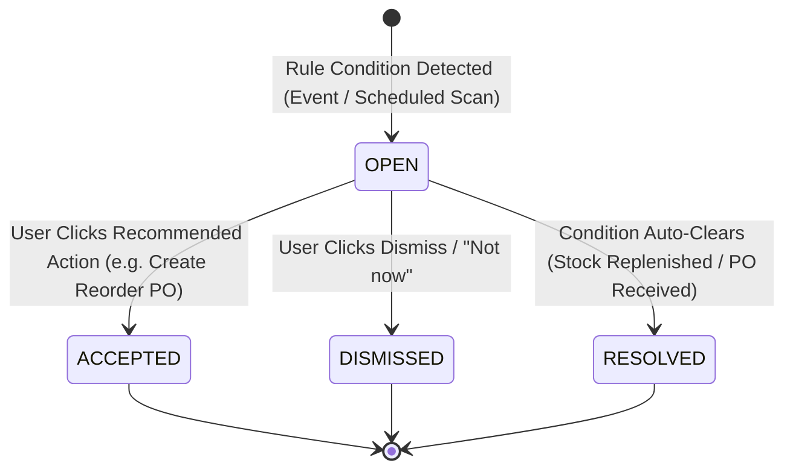

# AI Insights

<div class="storyline-breadcrumb">Part of the <strong>Order to Cash (O2C)</strong>, <strong>Procure to Pay (P2P)</strong> &amp; <strong>Make to Order (M2O)</strong> Storylines: Ambient Rule-Based Exceptions &amp; Operational Risk Guardrails</div>

> The ambient operational intelligence engine of TenArm BES, continuously monitoring supply chains, inventory velocity, and commercial demand to surface real-time, rule-based recommendations on the documents where decisions happen—with zero data egress.

AI Insights provides deterministic, rule-based operational surveillance across your entire enterprise. Unlike external generative AI services that transmit sensitive corporate data over public networks, AI Insights executes entirely within your organization's own secure database boundary. It monitors operational events in real time, evaluates scheduled risk scans, and calculates risk scores against configurable business thresholds.

When an operational condition demands attention—such as an overdue vendor shipment, capital trapped in dormant inventory, or sales quotes promising more stock than is physically available—AI Insights highlights the issue inline on the document and inside the **AI Suggestions** slide-out panel, providing one-click remediation actions.

For conversational natural-language exploration, queries, and summaries, see the companion [AI Assistant](./assistant) module.

---

## Workspace Ergonomics

AI Insights is woven directly into the daily workspace so users never have to navigate away from their active tasks:

- **Multi-Tab Desk**: Reviewing an insight from the **AI Suggestions** drawer automatically opens the underlying document (such as a Purchase Order, Sales Order, or Product Record) in a new workspace tab. Operators can open up to 3 workspace tabs concurrently without losing active search filters, table scroll positions, or uncommitted form drafts.
- **Draft Auto-Save**: Incomplete entries across forms—including sensitivity threshold adjustments in **Tenant Configuration** (`/control/tenant`) and custom feedback notes—are continuously preserved locally. Active tab headers display a dirty dot indicator (`•`) until modifications are saved or discarded.
- **Quick-Peek Slide-Out Drawer**: Clicking the floating **AI SUGGESTIONS** button at the right edge of the screen slides out the **AI Suggestions** drawer (`MyDayPanel`) without displacing the active workstation or interrupting in-progress transactions. Clicking linked references inside insight cards opens quick-peek inspection sheets directly over the active view.

---

## Core AI Insights Concepts

### 1. Zero Data Egress Guarantee
AI Insights operates under strict data sovereignty principles:
- **100% In-Database Execution**: Insight rules evaluate mathematical formulas, timestamps, and inventory quantities directly on your tenant's relational database.
- **Zero Third-Party APIs**: No company names, product codes, financial figures, customer details, or pricing contracts are ever sent to external Large Language Models (LLMs) or third-party cloud endpoints.
- **Always-On Base Intelligence**: AI Insights is active for every licensed organization by default, ensuring continuous operational guardrails without recurring API per-query costs.

### 2. Five Deterministic Operational Rules
The engine runs five core business rules across procurement, inventory, and sales:

```
┌─────────────────────────────────────────────────────────────────────────────────────────────┐
│ REAL-TIME BUSINESS EVENTS                    SCHEDULED RISK SCANS (06:00 UTC)                │
│ • Stock movements (Receipt, Dispatch, Transfer) • Overdue Purchase Orders (Past Grace Days) │
│ • Purchase Order receipts & deliveries       • Dead Stock Dormancy (90+ Days Idle)          │
│ • Quotation commitments & updates            • Quoted Demand Over-Commitment Multipliers    │
└──────────────────────────────────────────────┬──────────────────────────────────────────────┘
                                               │
                                               ▼
                         ┌───────────────────────────────────────────┐
                         │       AI INSIGHT DETERMINATION ENGINE     │
                         │    Evaluates thresholds, purviews & OCC   │
                         └─────────────────────┬─────────────────────┘
                                               │
               ┌───────────────────────────────┴───────────────────────────────┐
               ▼                                                               ▼
┌─────────────────────────────┐                                 ┌─────────────────────────────┐
│    DOCUMENT AI PANEL        │                                 │     AI SUGGESTIONS DRAWER   │
│ Contextual alert on PO / SO │                                 │ Global triage deck on right │
└─────────────────────────────┘                                 └─────────────────────────────┘
```

1. **Overdue Purchase Order Escalation (`overdue_po`)**:
   - *What it watches*: Approved or partially received Purchase Orders past their promised delivery date plus configured grace days.
   - *Operational impact*: Prevents stalled manufacturing lines and unmet customer dispatches caused by silent supplier delays.
   - *Remediation*: One-click action to contact the supplier or reassign delivery priorities.
2. **Reorder Point Stock Alert (`reorder_alert`)**:
   - *What it watches*: Stock levels that drop below the configured reorder threshold where no open purchase order exists to cover the deficit.
   - *Operational impact*: Eliminates stockouts before they affect production or sales fulfillment.
   - *Remediation*: One-click **Create Reorder PO** button pre-populating suggested shortfall quantities.
3. **Supplier Delivery Reliability Tracker (`supplier_reliability`)**:
   - *What it watches*: Historical delivery timeliness across recent completed orders. Flags suppliers whose late delivery percentage exceeds the acceptable threshold.
   - *Operational impact*: Enables procurement teams to negotiate tighter SLAs or qualify secondary suppliers.
4. **Dead Stock & Idle Capital Detection (`dead_stock`)**:
   - *What it watches*: Products holding positive inventory on hand with zero inbound or outbound movements across a configurable dormancy window (e.g. 90+ days).
   - *Operational impact*: Identifies trapped working capital and warehouse yard congestion, prompting clearance discounting or supplier returns.
5. **Quoted Demand Over-Commitment (`over_commitment`)**:
   - *What it watches*: Fast-moving items where open, non-expired sales quotations collectively demand more physical inventory than is currently Available to Promise (ATP).
   - *Operational impact*: Warns sales managers that competing sales quotes exceed physical yard inventory, preventing simultaneous commercial promises that lead to fulfillment shortfalls.

### 3. Severity & Confidence Scoring
Every generated insight carries standardized classification metadata:
- **Severity Levels**:
  - `CRITICAL` / `HIGH`: Requires immediate intervention (e.g. dead stock exceeding high-valuation limits or purchase orders more than 7 days overdue).
  - `MEDIUM`: Operational warning requiring planned review (e.g. stock falling below reorder point or moderate quote contention).
  - `LOW`: Ambient operational intelligence (e.g. supplier reliability trend or low-value stock dormancy).
- **Confidence Metric**: Rule-based insights compute a deterministic match rating (typically `100% match`), ensuring recommendations reflect mathematical certainty rather than probabilistic guesses.

### 4. Role-Based Purview Scoping (Domain Security)
Insights respect strict departmental purviews based on the active user's permissions:
- **Procurement Specialists**: View overdue purchase orders, reorder point alerts, and supplier reliability ratings.
- **Sales Representatives**: View live quotation over-commitment alerts and customer demand contention.
- **Warehouse & Inventory Controllers**: View dead stock dormancy alerts, stockout warnings, and ATP balances.
- **Finance Managers**: View billing bottlenecks and landed cost allocation anomalies.
- **Tenant Administrators**: Maintain complete visibility across all operational domains.

Users never see alerts outside their authorized functional purview.

---

## Core Surfaces & Workflows

### 1. Floating AI Suggestions Drawer (`MyDayPanel`)

**What it does** — A global slide-out operations deck accessible from every screen via the floating sparkle trigger button.

```
┌──────────────────────────────────────────────────────────────────┐
│ ✨ AI Suggestions                                            [X] │
├──────────────────────────────────────────────────────────────────┤
│ Proactive operational recommendations and insights               │
├──────────────────────────────────────────────────────────────────┤
│ [HIGH] 100% match                                                │
│ PO PO-00042 is 8 days overdue                                    │
│ Purchase Order PO-00042 from Acme Metals was expected by         │
│ 2026-11-03 but has not been fully received.                      │
│ [ 👁 Review ]  [ Dismiss ]                        [ 👍 ] [ 👎 ]   │
├──────────────────────────────────────────────────────────────────┤
│ [MEDIUM] 100% match                                              │
│ Steel Sheet 2mm is below reorder point                           │
│ Stock has fallen to 12.0 units, below the reorder point of 50.0. │
│ [ 👁 Review ]  [ Dismiss ]                        [ 👍 ] [ 👎 ]   │
├──────────────────────────────────────────────────────────────────┤
│                                           [ 🤖 Open AI Assistant ]│
└──────────────────────────────────────────────────────────────────┘
```

#### How to Triage Insights from the Drawer
1. Click the floating **AI SUGGESTIONS** button (featuring the sparkle icon and live counter badge) located at the bottom-right or navigation rail of the screen.
2. Review the active cards, each displaying its severity badge (`HIGH`, `MEDIUM`, `LOW`), confidence indicator (`100% match`), title, and description.
3. Choose an action:
   - **Review**: Click **Review** (`Eye` icon) to open the specific document in a new workspace tab. The drawer closes automatically.
   - **Dismiss**: Click **Dismiss** to remove the insight if it does not require operational action.
   - **Feedback**: Click the thumbs-up (`👍`) or thumbs-down (`👎`) button. The button instantly confirms with a `Thanks` indicator, logging operator sentiment without interrupting workflow.
4. When all active operational exceptions are cleared, the drawer displays the **All Clear** banner:
   ```
   ✓ All Clear
   No active AI suggestions right now. Operational metrics and ledgers are normal.
   ```
5. Click **Open AI Assistant** in the drawer footer if you wish to launch the conversational AI co-pilot.

---

### 2. Contextual Document Panels (`DocumentAIPanel`)

**What it does** — Directly embeds active recommendations onto the document detail modals and storylines (such as Purchase Orders, Sales Orders, and Product 360 drawers).

```
┌─────────────────────────────────────────────────────────────────────────────────────────────┐
│ ✨ AI Insights                                                                              │
├─────────────────────────────────────────────────────────────────────────────────────────────┤
│ Over-committed across open quotes                                                           │
│ 3 open quote(s) promise 120.0 MT of Hot Rolled Coil, but only 45.0 MT is available to       │
│ promise — short by 75.0 MT. Reorder, or decide which quote to honour first.                 │
│ ━━━━━━━━━━━━━━━━━━━━━━━━ 100% confidence · Rule-based                                       │
│                                                                                             │
│ [ Create Purchase Order ]  [ Not now ]                                         [ 👍 ] [ 👎 ] │
└─────────────────────────────────────────────────────────────────────────────────────────────┘
```

#### How to Act on Inline Document Insights
1. Open any document storyline (e.g. **Purchase Order Storyline**, **Sales Order Storyline**, or **Product Storyline**).
2. If an open rule condition exists for this entity, the **AI Insights** card renders at the top of the storyline.
3. Review the severity bar, confidence rating, and recommended action.
4. Execute or clear the recommendation:
   - Click the primary action button to accept the recommendation and navigate directly to the resolution workspace:
     - **Create Purchase Order** or **Create Reorder PO**: Opens the **Procurement Desk** (`/procurement/desk`) with the product and suggested quantity pre-selected.
     - **Contact Supplier**: Opens the **Suppliers** register (`/procurement/suppliers`) filtered to the vendor's profile.
     - **Create Invoice**: Opens **Invoices** (`/finance/invoices`) to bill delivered lines.
     - **Follow Up**: Opens **CRM Leads** (`/crm/leads`) to follow up with commercial accounts.
     - **Review**: Opens the related inspection view.
   - Click **Not now** to dismiss the recommendation.
   - Submit fire-and-forget feedback using the thumbs-up / thumbs-down buttons.

---

### 3. AI Intelligence & Sensitivity Settings

**What it does** — Allows tenant administrators to fine-tune the mathematical thresholds that govern when alerts fire, avoiding notification fatigue and tailoring risk detection to company scale.

To adjust sensitivity thresholds:
1. Navigate to **System Control → Tenant Configuration** (`/control/tenant`).
2. In the category navigation bar, click the **AI Sensitivity** tab (`Sparkles` icon).
3. Update the parameters under **AI Intelligence & Sensitivity**:

#### Procurement Risk Sensitivity

| Field Label | Default | Valid Range | Business Impact |
|---|:---:|:---:|---|
| **Overdue PO Grace Days** | `3` | `0` – `90` days | Number of buffer days after the promised delivery date before triggering an overdue PO escalation. |
| **Supplier Min PO Data Points** | `3` | `1` – `50` orders | Minimum completed purchase orders required before calculating a vendor's delivery reliability score. |
| **Supplier Late Rate Threshold (0.01 - 1.0)** | `0.50` | `0.01` – `1.00` | Fraction of late deliveries (e.g. `0.5` = 50%) required to trigger a vendor reliability warning. |

#### Inventory Health & Stock Dormancy

| Field Label | Default | Valid Range | Business Impact |
|---|:---:|:---:|---|
| **Dead Stock Dormancy (Days)** | `90` | `7` – `730` days | Inactivity window without stock movement before inventory is flagged as dormant capital. |
| **Supplier Concentration Limit (0.01 - 1.0)** | `0.70` | `0.01` – `1.00` | Single-vendor procurement share (e.g. `0.7` = 70%) triggering supply chain dependency risk. |
| **Dead Stock High Valuation (₹)** | `100,000` | $\ge$ Medium Val | Inventory carrying value threshold above which dormant stock triggers a `HIGH` severity alert. |
| **Dead Stock Medium Valuation (₹)** | `10,000` | $\ge 1$ | Inventory carrying value threshold above which dormant stock triggers a `MEDIUM` severity alert. |

#### Sales Quoting Over-Commitment Multipliers

| Field Label | Default | Valid Range | Business Impact |
|---|:---:|:---:|---|
| **High Severity Multiplier** | `2.0` | $1.0\times$ – $10.0\times$ | Quoted Demand / ATP ratio that escalates inventory contention to `HIGH` severity. |
| **Medium Severity Multiplier** | `1.3` | $1.0\times$ – $10.0\times$ | Quoted Demand / ATP ratio that escalates inventory contention to `MEDIUM` severity. |

4. Click **Save Now** in the top action bar to commit changes. Settings take effect immediately across all background scans and event handlers.

---

## Entity Lifecycle & States

Every insight is an aggregate entity tracked through four distinct lifecycle states:



| State | Business Meaning | Permitted User Actions |
|---|---|---|
| **`OPEN`** | The condition has been detected and is actively awaiting review. | Click recommended action (**Accept**), click **Dismiss** / **Not now**, or submit feedback. |
| **`ACCEPTED`** | An operator accepted the recommendation and triggered the resolution flow. | Record is locked for audit history; removed from active drawers. |
| **`DISMISSED`** | An operator determined the recommendation does not apply or chose to defer action. | Record is archived; removed from active drawers. |
| **`RESOLVED`** | The underlying condition cleared automatically (e.g. overdue goods were received or excess stock was replenished). | Automatically marked resolved by system projections; archived. |

---

## If Something Goes Wrong (Common Validation & Guard Errors)

The table below translates UI validation errors, system toast notices, and guard conditions into immediate operational remedies:

| What you see (Toast / Banner) | Business Cause | How to fix it in the workspace |
|---|---|---|
| **"Could not load AI insights"** | Network connectivity issue or temporary backend query timeout while fetching document insights. | Close and re-open the document drawer, or refresh the active workspace tab. |
| **"Failed to load tenant config"** | User attempted to open Tenant Configuration without proper administrative rights. | Ensure you are logged in with an account carrying the `tenant.admin` role. |
| **"Dead stock high value must be greater than or equal to dead stock medium value"** | In **AI Sensitivity**, the High Valuation threshold was configured lower than the Medium Valuation threshold. | Increase the **Dead Stock High Valuation** field so it is greater than or equal to the **Dead Stock Medium Valuation** field. |
| **"High severity multiplier must be greater than or equal to medium severity multiplier"** | In **AI Sensitivity**, the High Severity Multiplier was configured lower than the Medium Severity Multiplier. | Adjust the **High Severity Multiplier** to be greater than or equal to the **Medium Severity Multiplier** (e.g. High = `2.0`, Medium = `1.3`). |
| **"403 Forbidden / AI app not enabled for tenant"** | The AI Insights module is disabled for your organization. | Ask your system administrator to switch on the **AI Insights** module in **Platform Fleet Console → App Enablement**. |
| **No insights appear on a known overdue PO or low-stock product** | The scheduled scan job has not run yet, or your user role lacks permission to inspect that domain. | Verify your role has domain view permissions (`po.view` or `inventory.view`). Tenant admins can verify scheduled jobs under **Scheduled Tasks**. |
| **"Insight has already been resolved or modified by another user"** | An Optimistic Concurrency Control (OCC) collision occurred because another team member accepted or dismissed the insight. | The UI automatically refreshes the drawer to reflect the current state. No further action is required. |

---

## Cross-Module Integrations

AI Insights monitors events across core operational modules to maintain ambient risk surveillance:

| Integrated Module | Monitored Trigger Points | Resulting Insight Capabilities |
|---|---|---|
| **Procurement** | PO Approval, Expected Delivery Date, PO Receipts | Detects overdue purchase orders; tracks historical vendor delivery timeliness; suggests supplier contact. |
| **Inventory** | Stock Receipts, Issues, Cycle Adjustments, Transfers | Detects stock dropping below reorder point; flags dormant inventory exceeding dead-stock thresholds. |
| **Sales** | Quotation Creation, Line Updates, Expirations, Cancellations | Evaluates live quoted demand against available ATP inventory to detect customer over-commitment contention. |
| **Finance** | Invoice Generation & Supplier Bills | Correlates delayed supplier deliveries with payment terms and unapplied vendor deposits. |
| **Core Platform** | Scheduled Background Jobs (`ai.cron_scan`, `ai.insights_prune`) | Executes daily risk scans across all tenants at 06:00 UTC; automatically prunes archived insights older than 180 days at 03:00 UTC. |

---

## Role-Based Access Control & Permissions

Access to AI Insights capabilities is governed by four granular security permissions:

| Permission Key | Role Description | Capabilities Unlocked |
|---|---|---|
| `ai.view` | AI Insights Observer | View the **AI Suggestions** drawer (`MyDayPanel`), inspect contextual document panels, and view summary count badges. |
| `ai.manage` | Operational Remediation Lead | Accept recommended remediation actions (e.g. creating reorder POs) and dismiss active insights. |
| `ai.feedback` | Operational Contributor | Submit fire-and-forget helpfulness ratings (thumbs up / thumbs down) on active insight cards. |
| `ai.configure` | Tenant System Administrator | Modify operational risk sensitivity thresholds, delivery grace days, and valuation limits under **Tenant Configuration → AI Sensitivity**. |
