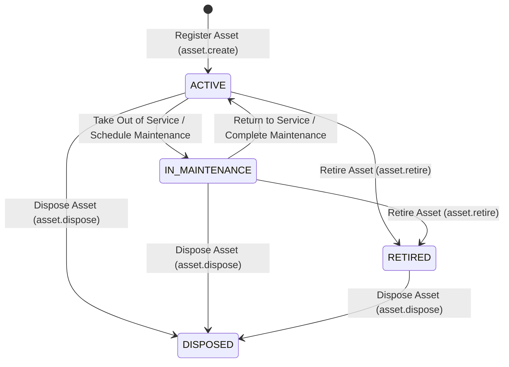
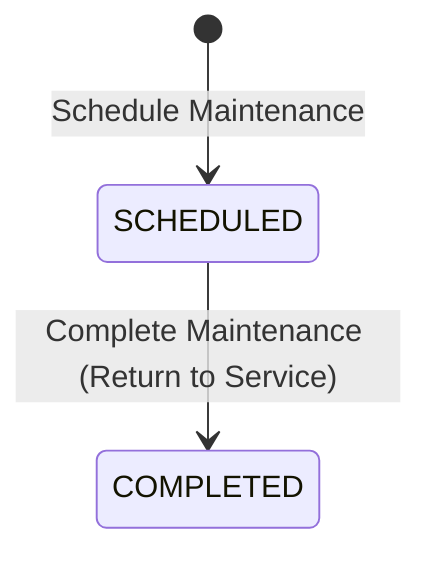

# Asset Management

<div class="storyline-breadcrumb">Core Foundation for <strong>Asset Lifecycle Management (Acquire to Retire)</strong>, <strong>CapEx Tracking</strong> &amp; <strong>Fixed Asset Accounting</strong></div>

> Track, maintain, depreciate, and govern capital assets across their operational lifecycle — from procurement intake and employee custody to preventive servicing, straight-line depreciation runs, and commercial disposal.

The Asset Management module maintains the organization's fixed asset register. It links upstream capital expenditure (CapEx) purchasing and warehouse intake with downstream human resources custody, operational maintenance servicing, and automated straight-line depreciation postings to the General Ledger in Finance.

---

## Workspace Ergonomics

The Asset Management desk is engineered for clarity, rapid custody transitions, and accounting precision:

- **Multi-Tab Desk**: Operators can operate across up to 3 asset management tabs simultaneously (for example, keeping the **Asset Register** open while previewing the **Periodic Straight-Line Depreciation Desk** and evaluating the **Asset Summary** rollup). Switching tabs preserves active filters, search criteria, and uncommitted form inputs without page reloads.
- **Draft Auto-Save**: Uncommitted form inputs in **Register New Asset** and **Schedule Maintenance** are preserved locally across browser sessions. The active tab header displays a dirty dot indicator (`•`) until the asset or maintenance schedule is saved or cancelled.
- **Quick-Peek Slide-Out Drawer**: Clicking linked employee custody links (`/asset-management/custody/:id`) or asset reference numbers opens a contextual slide-over drawer from the right screen edge. Users can verify held equipment, serial numbers, and book values or perform an offboarding check-in without losing their active register or depreciation desk flow.
- **Optimistic Concurrency Control (OCC)**: Every asset modification, custody assignment, maintenance status flip, and depreciation posting verifies the document revision (`Rev v1`, `v2`, etc.). If another operator updates or disposes an asset while your tab is open, stale mutations are blocked with an interactive conflict resolution drawer.

---

## Core Asset Management Concepts

### Fixed Asset Register & Capitalization
Fixed assets represent tangible, long-term capital property owned and utilized by the business—including manufacturing machinery, delivery vehicles, computer hardware, testing apparatus, and office installations. Each asset is registered with its unique sequence number (`AST-XXXX`), name, serial number, physical location, and initial acquisition cost. The acquisition cost forms the unadjusted baseline from which historical depreciation is calculated.

### Straight-Line Depreciation & Salvage Floor
The module implements the standard **Straight-Line Depreciation** method. Depreciation is distributed evenly across each asset's configured useful life in months:

$$\text{Monthly Depreciation} = \frac{\text{Acquisition Cost} - \text{Salvage Value}}{\text{Useful Life in Months}}$$

Key depreciation invariants enforced by the system:
- **Salvage Value Floor**: An asset's Net Book Value will never drop below its defined **Salvage Value** floor ($\text{Book Value} \ge \text{Salvage Value}$). Once an asset depreciates down to its salvage value, its calculation status becomes `Salvage Floor` and subsequent periods post zero depreciation.
- **Monthly Period Granularity**: Depreciation runs are processed per calendar month (`YYYY-MM`).
- **Idempotent Runs**: Re-running a depreciation period for an asset that has already posted is a safe, idempotent no-op. The system retains the existing ledger entry and prevents duplicate expense postings.

### Category-Level Defaults & Inheritance
Asset categories (e.g. `MACH` for Machinery, `VEH` for Vehicles, `IT` for Computer Hardware) standardize fixed-asset accounting rules. When authoring an asset category, administrators define the **Default Useful Life (months)** and **Default Salvage Value**. When operators register a new asset under that category, these depreciation parameters populate automatically, eliminating manual data entry errors.

### Employee Custody 360 & HR Offboarding
High-value portable assets—such as laptops, mobile phones, field test kits, and safety tools—can be assigned directly to employees. The system maintains an immutable custody history ledger recording:
- When custody was assigned (`assigned_at`)
- Who received the asset (`assigned_to_user_id`)
- Handover and offboarding notes (`notes`)
- When the equipment was returned to company inventory (`returned_at`)

During employee offboarding or departmental transfers, administrators and HR leads open the **Employee Custody 360** slide-out drawer to verify all equipment held by that employee and execute 1-click check-ins before completing separation sign-off.

### 1-Click Operational Floor Toggles
On manufacturing floors and active job sites, equipment breakdowns require immediate operational intervention. Operators can toggle asset serviceability without navigating through administrative forms:
- **Take Out of Service**: With a single click from the Asset Register table, an operator can immediately flag a malfunctioning asset as `IN_MAINTENANCE` with an emergency corrective maintenance log, preventing unauthorized production allocation.
- **Return to Service**: Once technicians finish repairs and verify safety clearance, a single click restores the asset to `ACTIVE` status and marks the scheduled maintenance record as `COMPLETED`.

### Retirement vs. Commercial Disposal
The module clearly differentiates between decommissioned assets and disposed assets:
- **Retirement (`RETIRED`)**: The asset is permanently removed from active operations (e.g. obsolete computer hardware or worn machinery placed in cold storage). Custody is automatically closed, but the asset record remains in the historical registry.
- **Disposal (`DISPOSED`)**: Terminal removal of the asset from organizational books (e.g. sold to a third party, auctioned, or scrapped). Disposal records any commercial proceeds received and terminates all ongoing depreciation calculations. A disposed asset leaves the active asset register and summary rollups permanently.

---

## Asset Register & Lifecycle

### Asset Register (`/asset-management/assets`)

**What it does** — The central directory and master ledger of all physical assets owned and operated by the tenant, displaying live statuses, financial book values, current custody assignments, and operational action triggers.

**Lifecycle & Status Progression**



| Status | What it means | Allowed Next Actions |
|---|---|---|
| `ACTIVE` | Asset is fully operational and available for production, custody assignment, or scheduled maintenance. | Assign to user, take out of service, schedule maintenance, edit details, depreciate, retire, or dispose. |
| `IN_MAINTENANCE` | Asset is undergoing preventive maintenance, inspection, or corrective floor repair. Cannot be assigned to users. | Return to service, complete maintenance work order, edit details, depreciate, retire, or dispose. |
| `RETIRED` | Asset has been permanently decommissioned from service. Custody is terminated. | View historical logs or permanently dispose (scrap/sell). *(Cannot be reassigned or scheduled for maintenance).* |
| `DISPOSED` | Asset has been sold, auctioned, or scrapped. Book value and active custody are terminated. | Historical inspection only. *(Terminal state; cannot be reopened or edited).* |

**Key Fields in the Asset Register**

| Field | Required | Description |
|---|:---:|---|
| **Number (`asset_number`)** | ✅ | System-generated sequence code (e.g. `AST-0001`). Displayed as a code badge. |
| **Name (`name`)** | ✅ | Descriptive name of the asset (e.g. `Forklift FL-12`, `MacBook Pro 16"`). |
| **Category (`category_id`)** | — | Asset category grouping (e.g. `Machinery`, `Vehicles`, `IT Equipment`). Inherits default useful life and salvage value. |
| **Status (`status`)** | ✅ | Current operational state: `ACTIVE`, `IN_MAINTENANCE`, `RETIRED`, or `DISPOSED`. |
| **Rev (`version`)** | ✅ | Document revision counter (e.g. `v1`, `v2`) enforcing Optimistic Concurrency Control. |
| **Cost (`acquisition_cost`)** | ✅ | Capital acquisition cost formatted in tenant currency. Immutable once created. |
| **Book Value (`book_value`)** | ✅ | Current net asset value ($\text{Acquisition Cost} - \text{Accumulated Depreciation}$). |
| **Assigned (`assigned_to_user_id`)** | — | User ID of the employee holding physical custody; displays `—` if in company stock. |

**How to Register a New Asset**
1. Navigate to **Asset Management → Assets** (`/asset-management/assets`).
2. Click **+ New Asset** in the top header (or on the empty state banner).
3. In the **Register New Asset** dialog, fill in:
   - **Name**: Descriptive asset label (e.g. `Haas CNC Mill #2`).
   - **Category**: Select the category to automatically inherit depreciation defaults.
   - **Serial Number**: Manufacturer serial or chassis number.
   - **Location**: Storage location, plant bay, or office department (e.g. `Bay 4 - Machine Shop`).
   - **Acquisition Cost**: Initial purchase and capitalization price (must be $\ge 0$).
   - **Useful Life (months)**: Planned operational lifespan in months (leave blank to inherit category default).
   - **Salvage Value**: Anticipated terminal scrap or resale value (defaults to category value or `0`; cannot exceed acquisition cost).
4. Click **Save**. The asset is created in `ACTIVE` status with revision `v1`.

**How to Edit an Asset**
1. In the **Asset Register** table, locate the target asset.
2. Click **Edit** in the row's actions column.
3. Update the asset name, category, serial number, physical location, useful life, or salvage value in the **Edit Asset** dialog.
   *(Note: Acquisition cost cannot be altered after creation to preserve financial ledger auditability).*
4. Click **Save** to apply changes.

**Operational Actions Available on Asset Rows**
- **Take Out of Service**: (Visible on `ACTIVE` assets) 1-click emergency maintenance floor toggle. Immediately marks the asset `IN_MAINTENANCE` and schedules a corrective maintenance log.
- **Return to Service**: (Visible on `IN_MAINTENANCE` assets) 1-click restoration toggle. Verifies technician clearance, completes the scheduled maintenance, and marks the asset `ACTIVE`.
- **Assign**: Opens the assignment dialog to check out an unassigned active asset to an employee by entering **Assign to User ID** and optional **Notes**.
- **Return**: Checks in an assigned asset back to company custody, recording return notes and clearing the user assignment.
- **Maintenance**: Opens the maintenance modal to schedule preventive or corrective maintenance with a designated maintenance type.
- **Depreciate**: Opens the depreciation modal to calculate and post one monthly period (`YYYY-MM`) of straight-line depreciation for this individual asset.
- **Retire**: Opens the retirement modal to decommission the asset, closing any active employee custody.
- **Dispose**: Opens the disposal dialog to record terminal disposal, optional commercial **Proceeds** (sale price), and audit notes.

---

## Asset Categories

### Categories Directory (`/asset-management/categories`)

**What it does** — Establishes standardized master data categories for assets that share physical characteristics, operational lifespans, and depreciation accounting rules.

**Key Fields in Asset Categories**

| Field | Required | Description |
|---|:---:|---|
| **Code (`code`)** | ✅ | Short uppercase alphanumeric identifier (e.g. `MACH`, `VEH`, `IT_EQUIP`). |
| **Name (`name`)** | ✅ | Full category name (e.g. `Machinery & Plant`, `Commercial Fleet`, `IT Hardware`). |
| **Description (`description`)** | — | Optional notes detailing what types of equipment belong to this category. |
| **Default Life (mo) (`default_useful_life_months`)** | — | Baseline useful life in months inherited by newly registered assets (e.g. `60` months for 5-year assets). |
| **Default Salvage (`default_salvage_value`)** | — | Baseline salvage floor value inherited by newly registered assets (defaults to `0`). |

**How to Create an Asset Category**
1. Navigate to **Asset Management → Categories** (`/asset-management/categories`).
2. Click **+ Add Category**.
3. In the **Create Asset Category** dialog, provide:
   - **Code**: Unique short code (e.g. `VEH`).
   - **Name**: Category display name (e.g. `Motor Vehicles`).
   - **Description**: Optional business scope description.
   - **Default Useful Life (months)**: Standard lifespan (e.g. `36` for IT laptops, `84` for commercial vans).
   - **Default Salvage Value**: Standard terminal residual value (e.g. `500.00`).
4. Click **Save**.

---

## Periodic Straight-Line Depreciation Desk

### Depreciation Desk (`/asset-management/depreciation`)

**What it does** — The dedicated monthly depreciation cockpit for calculating, reviewing, and posting straight-line depreciation runs across the entire asset portfolio, tracking pending calculations, and auditing historical ledger entries.

**Period Navigation & Controls**
- **Period Selector**: Formatted as `YYYY-MM` (e.g. `2026-06`).
- **Previous Month (`<`) & Next Month (`>`)**: Step back and forth through accounting periods.
- **Current Month**: Instantly jumps to the current calendar month.
- **Refresh**: Re-queries the live backend preview calculations without altering the selected period.

**Summary KPI Cards**
- **Period**: The active accounting period under review.
- **Total Period Depreciation**: Grand total depreciation calculated for the period ($\text{Posted} + \text{Pending}$).
- **Posted (Locked)**: Financial depreciation already committed and locked to the ledger for this period, including the count of posted assets.
- **Pending**: Total depreciation calculated and ready to post, highlighted in amber if eligible assets remain unposted.

**General Ledger Impact Breakdown**
The desk displays the exact double-entry accounting impact that will post to the General Ledger when pending depreciation is executed:
- **Debit ($\text{Dr}$)**: `Depreciation Expense` (operating expense account from your accounting mapping)
- **Credit ($\text{Cr}$)**: `Accumulated Depreciation` (contra-asset account reducing the balance sheet carrying value)

```
┌────────────────────────────────────────────────────────┐
│  General Ledger Impact                                 │
│  Dr Depreciation Expense               $12,450.00      │
│  Cr Accumulated Depreciation           $12,450.00      │
└────────────────────────────────────────────────────────┘
```

### Period Run Tab (`DepreciationPreviewGrid`)
Displays every asset in the register along with its calculated monthly depreciation amount and post readiness for the active period.

**Asset Calculation Statuses**

| Status | Badge Label | Business Meaning |
|---|---|---|
| `READY` | `Ready to Post` | Asset is active, has remaining depreciable value above salvage floor, and has not yet been posted for this period. |
| `POSTED` | `Posted (Locked)` | Depreciation has already been posted to the ledger for this period. Cannot be posted again. |
| `SALVAGE_FLOOR` | `Salvage Floor` | Net book value has reached the salvage value floor ($\text{Book Value} = \text{Salvage Value}$). Zero depreciation generated. |
| `NO_USEFUL_LIFE` | `No Useful Life` | Asset has no `useful_life_months` configured. Calculation is bypassed. |
| `DISPOSED` | `Disposed` | Asset has been scrapped or sold. Bypassed from all periodic depreciation runs. |

**How to Execute a Depreciation Run**
1. Select the target **Period** (e.g. `2026-06`).
2. Review the list of assets in the **Period Run** tab.
3. **To post a single asset**: Click **Post** on the individual asset row.
4. **To post in batch**:
   - Check the **Select all ready asset(s)** checkbox on the run banner (or selectively check specific assets).
   - Click **Post Selected (X)**.
5. The system posts each selected asset under Optimistic Concurrency Control. Once committed:
   - Accumulated depreciation increases by the period amount.
   - Net book value is reduced.
   - An immutable `AssetDepreciationEntry` ledger row is recorded.
   - Finance is notified via the `AssetDepreciated` domain event to record the General Ledger journal entry.
   - The asset's status badge switches to `Posted (Locked)`.

### Posted History Tab (`DepreciationHistoryGrid`)
Provides a read-only audit log of all depreciation entries posted for the active period, displaying:
- **Entry #**: Unique ledger entry ID (`#ID`).
- **Asset**: Name and asset code (`Forklift FL-12 (AST-0002)`).
- **Period**: Target cycle (`2026-06`).
- **Method**: Depreciation formula applied (`STRAIGHT_LINE`).
- **Depreciation Posted**: Exact currency amount debited.
- **Book Value After**: Remaining net carrying value following posting.
- **Timestamp**: Exact system date and time of posting.

---

## Maintenance & Upkeep

### Maintenance Desk (`/asset-management/maintenance`)

**What it does** — Manages scheduled preventive upkeep, inspections, and emergency corrective repairs across equipment, tracking maintenance costs and coordinating asset downtime.

**Maintenance Types**
- **Preventive (`PREVENTIVE`)**: Scheduled routine maintenance, calibration, oil changes, and regular servicing intended to prevent equipment failure.
- **Corrective (`CORRECTIVE`)**: Repairs and troubleshooting initiated in response to an operational defect, emergency breakdown, or wear failure.
- **Inspection (`INSPECTION`)**: Safety audits, certification reviews, and compliance inspections.

**Maintenance Record Lifecycle**



| Status | What it means | Allowed Next Actions |
|---|---|---|
| `SCHEDULED` | Maintenance has been planned or asset is currently in service bay. Asset is marked `IN_MAINTENANCE`. | Complete maintenance and return asset to service. |
| `COMPLETED` | Maintenance work has finished. Actual cost and completion date are recorded. Asset is restored to `ACTIVE`. | Historical log only. |

**Key Fields in Maintenance Records**

| Field | Required | Description |
|---|:---:|---|
| **Asset (`asset_id`)** | ✅ | Fixed asset linked to the maintenance record (`AST-XXXX (Name)`). |
| **Type (`maintenance_type`)** | ✅ | Nature of servicing: `PREVENTIVE` or `CORRECTIVE`. |
| **Status (`status`)** | ✅ | `SCHEDULED` or `COMPLETED`. |
| **Scheduled Date (`scheduled_date`)** | — | Target planned date for servicing. |
| **Completed Date (`completed_date`)** | — | Date when work was verified and signed off by the technician. |
| **Cost (`cost`)** | — | Total cost incurred for servicing (parts, labor, external contractor). |
| **Notes (`notes`)** | — | Work order details, technician observations, and clearance notes. |

**How to Schedule Maintenance**
1. Navigate to **Asset Management → Maintenance** (`/asset-management/maintenance`).
2. Click **Schedule New Maintenance** in the top header.
3. In the dialog, select:
   - **Asset**: Choose any active fixed asset from the dropdown.
   - **Type**: Select `Preventive` or `Corrective`.
   - **Scheduled Date**: Enter the target date.
   - **Notes**: Enter task instructions (e.g. `500-hour hydraulic fluid change and seal check`).
4. Click **Schedule**. The maintenance record is created in `SCHEDULED` status, and the asset's status in the register automatically switches to `IN_MAINTENANCE`.

**How to Complete Maintenance & Return Asset to Service**
1. Locate the scheduled record in the **Maintenance** table.
2. Click **Return to Service** in the actions column.
3. In the dialog:
   - Verify or enter the **Completed Date**.
   - Enter the actual **Cost** incurred (e.g. replacement filters and technician labor).
4. Click **Return to Service**. The maintenance record is marked `COMPLETED`, and the asset status in the register automatically returns to `ACTIVE`.

---

## Employee Custody 360 & Quick-Peek

### Employee Custody Drawer (`/asset-management/custody/:id`)

**What it does** — A dedicated contextual slide-out drawer (or full-tab view) providing a 360-degree overview of all hardware, tools, and vehicles currently in the custody of a specific employee (`User Account #ID`).

**Key Highlights & Capabilities**
- **Clearance Badge**: Displays a prominent status pill in the drawer header:
  - `Cleared` (green) — Indicates the employee currently holds 0 active company assets. Safe for HR offboarding clearance.
  - `X Held` (amber) — Indicates the employee is holding $X$ active devices or tools.
- **Custody KPIs**: Summarizes the total count of assigned assets and their combined current net book value.
- **Assigned Equipment Cards**: Each held asset displays:
  - Asset code badge (`AST-XXXX`) and status badge
  - Asset name and category
  - Manufacturer serial number
  - Physical office location or department
  - Current financial net book value
- **1-Click Check In**: Allows administrators to check an asset back into company inventory with a single click. The confirmation modal automatically pre-populates return notes with `"Employee offboarding return"`, clears the custody hold, and refreshes the drawer.

**How to Perform an Offboarding Custody Sign-Off**
1. Open the custody drawer for the departing employee by clicking their custody link or navigating to `/asset-management/custody/<user_id>`.
2. Inspect the **Assigned Equipment** list.
3. As the employee returns each device (laptop, badge, company phone), click **Check In** on the respective asset card.
4. Confirm return notes and click **Return Asset**.
5. Once all items are returned, the header badge transitions to `Cleared` and the drawer displays the **Custody Fully Cleared** shield banner, confirming safe completion of offboarding sign-off.

---

## Asset Summary

### Summary Rollup Desk (`/asset-management/summary`)

**What it does** — Provides a real-time category rollup of fixed asset holdings, aggregate acquisition costs, and total net book values maintained by the background projection engine (disposed assets are automatically excluded).

**Summary Metrics Cards**
- **Active Assets**: Total count of all non-disposed assets currently registered across the tenant.
- **Total Book Value**: Combined current net book value of all active fixed assets.

**Category Breakdown Table**

| Column | Description |
|---|---|
| **Category** | Name of the asset category (or `Uncategorized` if unassigned). |
| **Assets** | Number of active assets registered within this category. |
| **Total Cost** | Aggregate historical acquisition cost of active assets in this category. |
| **Total Book Value** | Aggregate current net book value remaining in this category. |

---

## If Something Goes Wrong (Common Validation & Guard Errors)

The table below explains system validation toasts, guard errors, and exactly how to resolve them in the workspace:

| What you see (Toast / Banner) | Why it happens | How to fix it in the workspace |
|---|---|---|
| **"salvage_value cannot exceed acquisition_cost"** | The salvage value entered is higher than the original purchase cost. An asset cannot have a scrap residual value greater than its purchase price. | Adjust **Salvage Value** so it is lower than or equal to **Acquisition Cost**. |
| **"Cannot edit a DISPOSED asset"** / **"Cannot edit a RETIRED asset"** | Attempted to update fields on an asset that has already been retired or permanently disposed. | Retired and disposed assets are locked to preserve audit integrity. If a new asset was acquired, register it using **+ New Asset**. |
| **"Asset is already disposed"** | Attempted to retire or dispose an asset that is already in `DISPOSED` status. | No action needed; the asset is already in its terminal state. |
| **"Asset is IN_MAINTENANCE; only ACTIVE assets can be assigned"** | Tried to check out an asset to an employee while it is currently in maintenance or repair. | Open **Maintenance**, complete the active maintenance work order or click **Return to Service** to restore the asset to `ACTIVE` before assigning. |
| **"Asset is already assigned; return it before reassigning"** | Attempted to assign an asset that is currently checked out to another user without checking it in first. | Click **Return** on the asset row (or in the **Employee Custody 360** drawer) to check in the asset, then assign it to the new user. |
| **"Asset is not currently assigned"** | Attempted to execute a return action on an asset that has no active custody record. | Check the **Assigned** column; if it displays `—`, the asset is already in company inventory. |
| **"Cannot schedule maintenance on a disposed asset"** | Attempted to create a maintenance record for an asset that has been scrapped or sold. | Disposed assets cannot undergo maintenance. Select an active or in-maintenance asset. |
| **"Maintenance is COMPLETED; only SCHEDULED can be completed"** | Attempted to complete a maintenance work order that has already been marked complete. | Refresh the maintenance list. The record is already closed. |
| **"Asset has no useful_life_months set; cannot depreciate"** | Attempted to run depreciation on an asset where useful life was left blank and no category default existed. | Click **Edit** on the asset row, enter a valid number in **Useful Life (months)**, save, and re-run depreciation. |
| **"Period must be in YYYY-MM format"** | Period string was entered with invalid formatting (e.g. `2026/06` or `June 2026`). | Enter the period using the exact 4-digit year and 2-digit month format (e.g. `2026-06`). |
| **"Document was modified by another user (OCC Conflict 409)"** | Another user modified, reassigned, or posted depreciation against the asset while your screen was open. | Click **Reload** in the Conflict Resolution drawer to refresh the latest asset figures, verify changes, and repeat your action. |

---

## Cross-Module Integrations

The Asset Management module operates in tight coordination with surrounding enterprise applications:

### Finance & General Ledger
- **Automatic Depreciation Journal Entries**: When operators post monthly straight-line depreciation from the Depreciation Desk, the system emits the `AssetDepreciated` domain event. The Finance module catches this event and automatically generates balanced journal entries:
  - $\text{Debit}$: Depreciation Expense
  - $\text{Credit}$: Accumulated Depreciation (contra-asset)
- **Period Close Readiness (`asset.period_close.check`)**: Before an accounting period can be officially closed in Finance, the kernel ledger door checks asset books readiness. If any depreciable active assets have not had depreciation posted for the closing period, the system flags an actionable warning banner: `asset.depreciation_not_run`.
- **CapEx Invoicing & Capitalization**: Fixed assets acquired through capital purchase orders link their historical purchase cost directly to vendor bills in Accounts Payable.

### Human Resources (HR)
- **Employee Custody Tracking**: Links physical hardware assets to employee profiles in HR (`User Account #ID`).
- **Offboarding Equipment Clearance**: When an employee departs, HR administrators inspect the **Employee Custody 360** drawer to ensure zero company hardware is held before issuing final payroll settlement.

### Maintenance & Operations
- **Floor Work Order Integration**: Work orders generated for fixed assets can reserve replacement spare parts and consumables from Inventory (`stock.reserve`) and issue them to maintenance jobs (`stock.ship`).
- **Production Asset Availability**: Manufacturing bills of materials and production routing lines inspect asset status to ensure machinery is `ACTIVE` before dispatching production work orders.

### Procurement
- **Capital Goods Receiving**: Inbound purchase orders for capital equipment capture vendor delivery receipts, equipment serial numbers, and warranty certificates for instant asset registration.

---

## Navigation & Permissions

### Screen Navigation

| Page | URL Path | Group | Entry Operation | Description |
|---|---|---|---|---|
| **Asset Summary** | `/asset-management/summary` | Overview | `asset.summary.get` | Rollup of active asset counts, total cost, and book value by category. |
| **Assets** | `/asset-management/assets` | Assets | `asset.list` | Master asset register, lifecycle actions, and emergency service toggles. |
| **Categories** | `/asset-management/categories` | Assets | `asset.category.list` | Asset categories and inherited useful life and salvage defaults. |
| **Custody Drawer** | `/asset-management/custody/:id` | Assets | `asset.custody.list` | Employee Custody 360 slide-out drawer and offboarding check-in. |
| **Maintenance** | `/asset-management/maintenance` | Operations | `asset.maintenance.list` | Preventive and corrective maintenance schedules and completions. |
| **Depreciation Desk** | `/asset-management/depreciation` | Finance | `asset.depreciation.preview.get` | Monthly straight-line depreciation run and General Ledger audit log. |

### Role-Based Access Control (Permissions)

| Permission Code | Business Capability | What It Allows |
|---|---|---|
| `asset.view` | View Asset Register & Summaries | Inspect asset lists, categories, depreciation preview, custody, and summary rollups. |
| `asset.create` | Register Fixed Assets | Access **+ New Asset** button and create new fixed asset records. |
| `asset.update` | Edit Asset Details & Service Toggles | Update asset attributes; execute 1-click **Take Out of Service** and **Return to Service** toggles. |
| `asset.assign` | Assign Asset Custody | Check out active assets to employees with assignment notes. |
| `asset.return` | Return Asset Custody | Check in assets from employee custody back to inventory. |
| `asset.retire` | Retire Fixed Assets | Permanently decommission obsolete assets from active service. |
| `asset.dispose` | Dispose Fixed Assets | Record terminal asset disposal, scrapping, or sale proceeds. |
| `asset.category.view` | View Asset Categories | View category listings and inherited depreciation defaults. |
| `asset.category.create` | Create Asset Categories | Add new asset categories with default useful life and salvage values. |
| `asset.depreciate.run` | Execute Depreciation | Run single-asset or batch straight-line depreciation from the Depreciation Desk. |
| `asset.maintenance.view` | View Maintenance Records | Inspect maintenance schedules, work history, and service costs. |
| `asset.maintenance.schedule` | Schedule Maintenance | Create preventive or corrective maintenance work orders; sets asset `IN_MAINTENANCE`. |
| `asset.maintenance.complete` | Complete Maintenance | Verify service completion, record repair costs, and return asset to `ACTIVE` status. |
