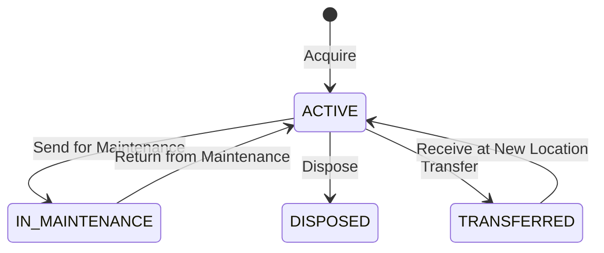

# Asset Management

The Asset Management module tracks your organization's fixed assets throughout their lifecycle — from acquisition to disposal.

## Key Features

### Asset Register
Maintain a complete registry of all fixed assets:

| Field | Description |
|-------|-------------|
| **Asset Code** | Unique identifier |
| **Name** | Descriptive name |
| **Category** | Asset category (Vehicles, Machinery, IT Equipment, etc.) |
| **Location** | Where the asset is located (branch, department) |
| **Purchase Date** | When it was acquired |
| **Purchase Value** | Original cost |
| **Useful Life** | Expected lifespan (months/years) |
| **Salvage Value** | Expected value at end of life |

### Asset Lifecycle

### Depreciation
Calculate and post depreciation automatically:

- **Straight-Line** method supported
- Monthly depreciation runs
- Automatic journal posting to Finance:
  - Debit: Depreciation Expense
  - Credit: Accumulated Depreciation

### Asset Assignment
Track who has what:
- Assign assets to employees or departments
- Record assignment history
- Check-in / check-out workflow

### Maintenance Tracking
Link assets to maintenance schedules:
- View maintenance history per asset
- Schedule preventive maintenance
- Track repair costs

## Navigation

| Page | Path | Permission |
|------|------|-----------|
| Assets | `/asset-management/assets` | `asset.view` |
| Categories | `/asset-management/categories` | `asset.category.view` |
| Depreciation | `/asset-management/depreciation` | `asset.depreciation.view` |
| Dashboard | `/asset-management/dashboard` | `asset.view` |

## Cross-Module Integration

| Integration | How It Works |
|------------|-------------|
| **Finance** | Depreciation journals auto-posted (event: `AssetDepreciated`) |
| **Maintenance** | Assets link to maintenance plans and work orders |

## Permissions

| Permission | Description |
|-----------|-------------|
| `asset.view` | View assets |
| `asset.create` | Register new assets |
| `asset.update` | Edit asset details |
| `asset.dispose` | Dispose of assets |
| `asset.depreciation.run` | Run depreciation |
| `asset.depreciation.view` | View depreciation schedules |
