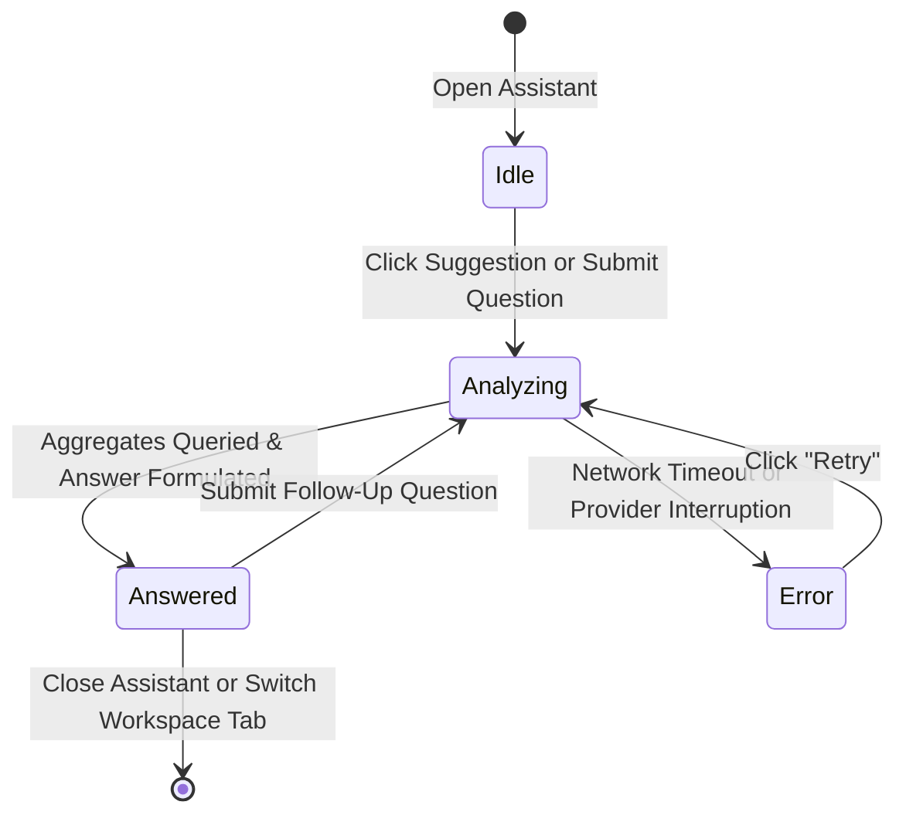
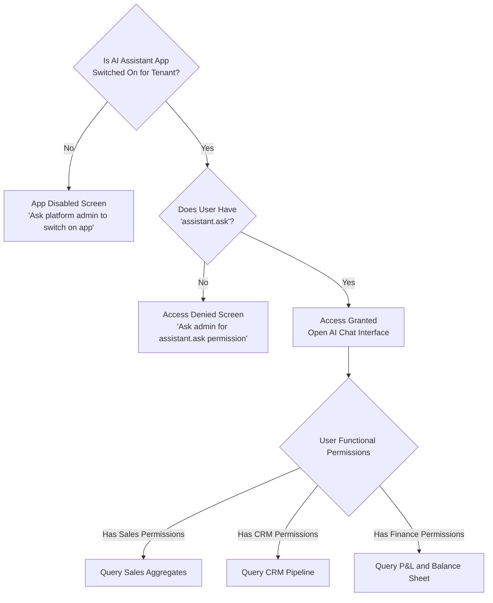

# AI Assistant

Conversational Co-Pilot across <strong>Order to Cash (O2C)</strong>, <strong>Sales Pipeline</strong> &amp; <strong>Financial Governance</strong>

> A natural-language co-pilot that answers executive and managerial questions about sales velocity, commercial pipeline health, and statutory financial performance using live operational figures.

The **AI Assistant** provides an intuitive conversational interface across your organization's business metrics. Instead of manually navigating multiple dashboards, exporting spreadsheets, or compiling monthly trend reports, managers can ask questions in plain English—such as *"What were sales last month?"*, *"Where are we declining?"*, or *"How is the sales pipeline this month?"*—and receive immediate, synthesized answers drawn directly from verified system aggregates.

Because questions are interpreted and answered through an external language-model provider, the AI Assistant is an **opt-in application**. It remains deactivated until your platform administrator explicitly enables it for your organization. For automated, rule-based alerts that monitor inventory thresholds, supplier performance, and overdue orders without connecting to an external service, see [AI Insights](./ai).

---

## Workspace Ergonomics

The AI Assistant is designed to accompany operational workflows without disrupting focused desk work:

- **Multi-Tab Desk**: Users can keep the **AI Assistant** open in its dedicated workspace tab (`/ai`) while actively managing negotiations on the **Sales Desk** or reviewing account schedules in the **General Ledger** in adjacent tabs. Switching between workspace tabs preserves your ongoing conversation, scroll position, and input drafts.
- **Global Floating Companion**: The floating launcher docks unobtrusively at the bottom-right corner of every tenant screen. Clicking the **Sparkles** button opens a compact conversation popover, allowing users to query live metrics on the fly without navigating away from active purchase orders, delivery notes, or customer records.
- **Single-Click Promotion (`Full page`)**: Any ad-hoc inquiry started in the floating launcher can be promoted into a roomy, full-page workspace tab by clicking **Full page**, expanding the layout to accommodate complex multi-period comparisons and tabular breakdown summaries.
- **Multi-Turn Session Continuity**: The assistant retains the conversational thread within an active session. When querying monthly sales trends, you can ask immediate follow-up questions (such as *"Who was the top customer?"* or *"Compare that with the previous period"*) without re-entering the timeframe or organizational scope.

---

## Core Assistant Concepts

### Grounded in Live Aggregates (Zero Hallucination)

Conventional conversational AI models often guess or extrapolate figures when asked about corporate performance. The TenArm BES AI Assistant is governed by strict deterministic grounding rules:
- **Verified Aggregate Lookups**: The assistant never generates arbitrary database queries or reads unvetted tables. It calls only the system's pre-built, read-only analytics capabilities (such as monthly sales dashboards, pipeline conversion summaries, and statutory financial statements).
- **Direct Truth**: The assistant answers strictly from numbers returned by verified system services. If data is unavailable or out of scope, it states so plainly rather than guessing.
- **Read-Only Operation**: The assistant cannot alter system states, approve documents, modify credit limits, or post ledger journals. It operates strictly as an observational analytics companion.

### Role-Based Data Isolation

Your conversation is governed by your existing organization roles and functional permissions:
- **Permission Filtering**: If your user account does not have permission to review financial journals or general ledger dashboards, the assistant is restricted from querying financial statements on your behalf.
- **Tenant Scope Enforcement**: Every query is strictly isolated to your organization. The assistant cannot view, aggregate, or reference data from other tenant organizations.
- **Private Conversations**: Your questions and answers are stored within your private session. Colleagues and unauthorized users cannot view your conversation history.

### Multi-Period Trend Analysis

When asked performance questions such as *"Where are we declining?"* or *"How are sales trending?"*, the assistant evaluates 6-month historical operational trajectories across:
- Completed and cancelled sales orders
- Recognized revenue progression
- Lead acquisition and deal conversion velocity

It highlights month-over-month percentage movements, identifies specific periods of contraction, and surfaces top-performing customer accounts driving the volume.

---

## Interaction Surfaces

The AI Assistant is accessible through two distinct interfaces:

### 1. Global Floating Launcher (`AIAssistantLauncher`)

**What it does** — A lightweight floating panel docked in the bottom-right corner of the screen, available across all tenant pages.

**How to Use**
1. Click the floating **Sparkles** button (`Open AI assistant`) in the lower right corner.
2. In the popover dialog, review suggested prompt chips or type your question in the **Ask a question…** field.
3. Press **Enter** or click **Ask**.
4. To expand the conversation into a dedicated workspace tab, click **Full page** in the header.
5. Click the close button (**✕**) or the floating trigger button to dismiss the popover. Your conversation remains cached during your session.

### 2. Full-Page Analytics Console (`/ai`)

**What it does** — A dedicated full-width workspace screen tailored for extensive analytical review and multi-turn inquiry.

**How to Use**
1. Navigate to **AI Assistant** (`/ai`) from the main navigation menu or click **Full page** from the floating launcher.
2. On initial entry, the assistant displays quick-start suggestion chips:
   - **What were sales last month?**
   - **Where are we declining?**
   - **How is the sales pipeline this month?**
3. Click any suggestion button to launch the query immediately, or enter a custom prompt in **Ask a question…**.
4. Click **Ask** (or press Enter). The system displays **Analyzing…** while live metrics are aggregated.
5. Review the grounded response. When applicable, transparent **Sources** citations appear beneath the message bubble (e.g. `Sources: get_sales_overview`).
6. Type follow-up questions to drill into customer rankings, pipeline bottlenecks, or accounting periods.

---

## Conversation Lifecycle

Each interaction follows a deterministic sequence ensuring data integrity and responsiveness:

| Lifecycle State | Description | Next Available Actions |
|---|---|---|
| **Idle** | Awaiting user input. Displays suggestions and the query input box. | Click a suggestion chip or type a question and click **Ask**. |
| **Analyzing…** | In-flight request. The system inspects permissions, gathers domain aggregates, and compiles the response. | Input field is temporarily disabled while analysis completes. |
| **Answered** | Grounded answer displayed with source citations. | Read summary, copy text, or ask a contextual follow-up question. |
| **Error** | Temporary provider unavailability or network disruption. | Click **Retry** on the alert box to re-execute the request. |

---

## Domain Capabilities & What You Can Ask

The assistant answers questions across three primary domains:

| Domain | What the Assistant Analyzes | Example Questions | Required User Permissions |
|---|---|---|---|
| **Sales & Bookings** | Monthly confirmed order counts, cancelled orders, net revenue, top customer accounts, and 6-month historical revenue trajectories. | *"What were total sales last month?"* *"Who was our highest revenue customer in October?"* *"Are sales orders growing or declining over the last quarter?"* | `sales.dashboard.view`, `order.view` |
| **CRM & Pipeline** | Leads created, contacted, qualified, won, and lost; total won deal value; pipeline conversion funnel; and 6-month pipeline health. | *"How is our sales pipeline performing this month?"* *"How many leads converted to won deals in the last 60 days?"* *"What is our lead qualification drop-off rate?"* | `crm.dashboard.view`, `lead.view` |
| **Finance & Accounting** | Accounting period status, net operating profit, asset/liability/equity totals, trial balance reconciliation integrity, and Profit & Loss statement lines. | *"Is our trial balance currently balanced?"* *"What was our net operating profit for June?"* *"Show revenue vs expense breakdown for the last closed accounting period."* | `finance.dashboard.view`, `finance.journal.view` |

> [!NOTE]
> Financial queries requiring an accounting period automatically resolve calendar month names (e.g. *"June"*) into the organization's official fiscal accounting period.

---

## Permissions & Access Governance

Access to the AI Assistant is governed by two layers of authorization:

1. **Organization-Level License**: The `assistant` application package must be switched on in tenant settings.
2. **User Functional Permission**: The user account must be assigned a role containing the `assistant.ask` permission:
   - Grants access to the floating launcher and `/ai` full-page console.
   - Allows users to review and continue their own historical conversation sessions.
3. **Domain Visibility Guards**: Tool access is strictly partitioned according to functional permissions. A user lacking `finance.dashboard.view` can ask sales questions, but any financial ledger inquiries will politely state that finance data is inaccessible to their account.

---

## If Something Goes Wrong (Common Validation & Guard Errors)

| What you see (Toast / Banner / Alert) | Why it happens | How to fix it in the workspace |
|---|---|---|
| **"The AI Assistant is not switched on for your organization."** | The organization has not enabled the opt-in `assistant` application package. | Contact your platform administrator to enable the **AI Assistant** application for your organization. |
| **"You don't have permission to use the AI assistant."** | Your user account has not been assigned a role with `assistant.ask`. | Request your tenant administrator to assign `assistant.ask` to your user role under **User Management**. |
| **"The assistant is temporarily unavailable."** | The external language model provider encountered a temporary network timeout, rate limit, or transient service outage. | Click **Retry** on the error banner, or wait a few moments and resubmit your question. |
| **"Failed to load conversation history."** | Network interruption occurred while fetching prior messages for an existing session ID. | Refresh your browser tab or relaunch the assistant panel to begin a fresh conversation session. |
| **"Finance is not enabled for this organization"** *(or Sales / CRM)* | The query requested information from a module that is uninstalled or disabled in your tenant's active app configuration. | If your business workflow requires this data, ask an administrator to install and enable the missing domain module. |
| **"I do not have access to finance data for your account"** | Your current user role does not possess permissions to view financial ledgers or dashboards. | Verify your functional assignments with your administrator if your daily responsibilities require financial reporting access. |

---

## Integrations

The AI Assistant synchronizes insights across core operational domains:

- **Sales**: Consolidates confirmed sales order lines, customer account volumes, and fulfillment revenue trends.
- **CRM**: Traverses lead stages from initial intake through qualification and won deal values.
- **Finance**: Connects to the double-entry General Ledger, verifying trial balance reconciliation and summarizing statutory P&L statements.
- **AI Insights**: Complements the proactive, rule-based alerts of [AI Insights](./ai). While AI Insights notifies you when a reorder point is breached or a purchase order is overdue, the AI Assistant enables conversational exploration of broader organizational trends.
- **Reporting**: Complements the consolidated [CEO Dashboard](./reporting), translating composite metrics into plain-language executive summaries.
