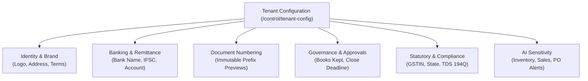
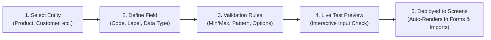
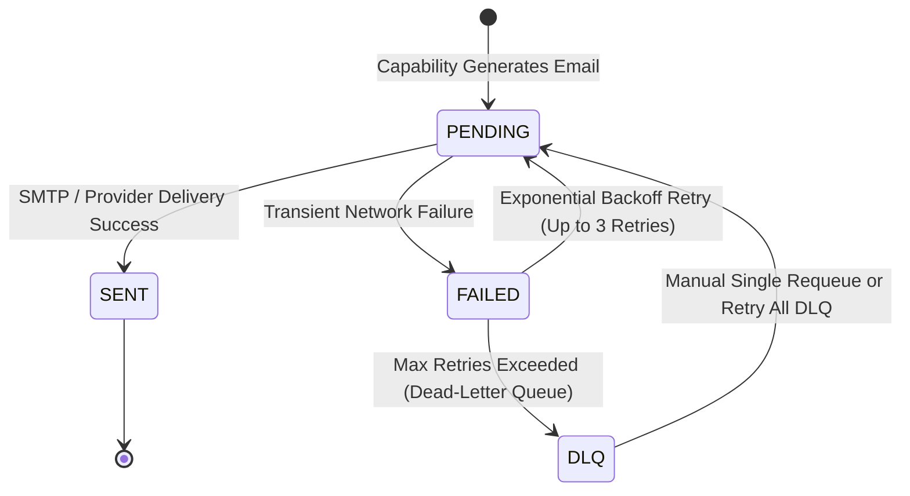
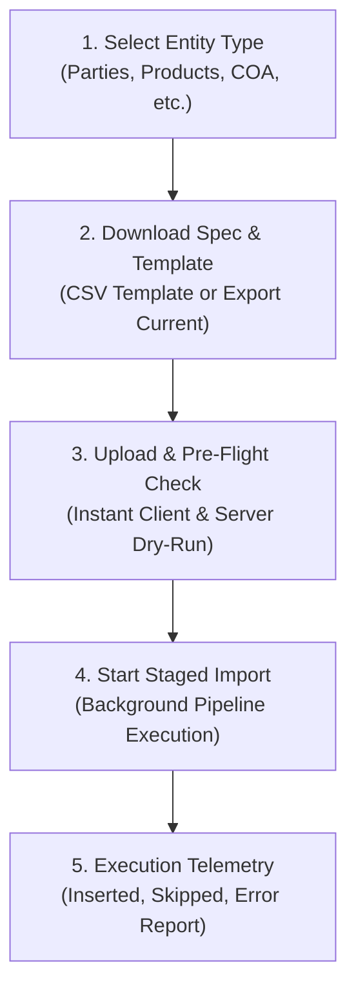
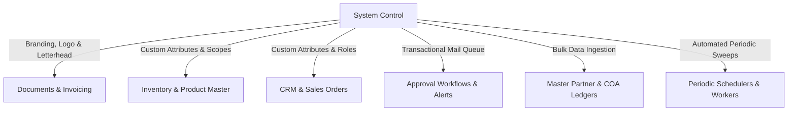

# System Control

<div class="storyline-breadcrumb">Core Foundation for <strong>Tenant Governance</strong>, <strong>System Customization</strong> &amp; <strong>Operational Control</strong></div>

> The central operational control cockpit of TenArm BES, orchestrating enterprise organization settings, letterhead branding, dynamic custom fields, outbound email telemetry, personal notification alerts, audited bulk data imports, and automated background jobs.

While **Tenant Administration** (`/parties`, `/users`, `/roles`) governs who can access the system and who you trade with, **System Control** (`/control/*`) governs how the system operates—defining the company's legal identity and letterhead, expanding entity data structures with custom fields, auditing outbound communication queues, setting delivery preferences, ingesting legacy master data, and scheduling background maintenance routines.

---

## Workspace Ergonomics

The System Control consoles are engineered for high-assurance administrative execution and zero-downtime reconfiguration:

- **Multi-Tab Desk**: Administrators can keep up to 3 active workspace tabs open simultaneously (e.g. keeping **Tenant Configuration** open while validating field schemas in **Custom Fields** and monitoring a batch in **Data Import**). Switching tabs preserves filter selections, scroll positions, and uncommitted form edits without page refreshes.
- **Draft Auto-Save**: In-progress configuration changes, branding inputs, and custom field schemas are continuously preserved locally in browser session storage. The active tab header displays a dirty dot indicator (`•`) until changes are saved or discarded.
- **Quick-Peek Slide-Out**: Clicking linked entity codes or job references opens an inspection drawer from the right edge of the screen, allowing administrators to audit live records without leaving their current configuration workflow.
- **Optimistic Concurrency Control (OCC)**: Organization configuration, custom field definitions, and scheduled job parameters feature version tracking (e.g. `v4`). If another administrator saves conflicting updates concurrently, the system alerts you and launches the **Conflict Resolution Drawer** to merge changes safely without data loss.

---

## 1. Tenant Configuration

### Organization Profile & Letterhead Desk

**What it does** — Establishes your company's corporate identity, official document letterhead, registered banking details, document numbering sequences, financial governance deadlines, support operator access, statutory tax parameters, and automated AI insight thresholds.

```
/control/tenant-config
```



#### Pulse Metrics & Navigation Tabs

The configuration desk provides a segmented toolbar to navigate specific parameter domains:

- **All Settings**: Full vertical inspection view across all configuration domains.
- **Identity & Brand**: Corporate legal name, postal address, support contact email, phone, and letterhead logo.
- **Banking & Terms**: Remittance bank account numbers, branch names, IFSC codes, standard quotation terms, and invoice declarations.
- **Document Numbering**: Read-only previews of official document sequence prefixes (e.g., `SO`, `PO`, `INV`, `QT`) displaying current fiscal year formatting.
- **Governance & Approvals**: Financial accounting books residency (`HERE` vs `EXTERNAL`) and financial month-end close deadline days.
- **Support Access**: Governed delegation protocols allowing verified platform support engineers temporary time-boxed access to assist with troubleshooting.
- **Statutory Compliance**: Regional Tax IDs (e.g., 15-character GSTIN), regional tax jurisdiction codes, home currency, fiscal year starting month, and Buyer-side TDS under Section 194Q.
- **AI Sensitivity**: Operational risk thresholds determining when AI alerts fire for dead stock, overdue supplier deliveries, and over-committed customer orders.

#### Interactive Letterhead Preview

The right sidebar features an interactive **Letterhead Preview** that renders a live quotation and invoice header. It displays an instant **Profile Completeness** gauge (0% to 100%) checking eight vital corporate data points: Company Name, Support Email, Tax ID, Tax Region, Registered Address, Phone, Bank Name, and Bank Account Number.

#### Key Fields on Tenant Configuration

| Field | Section | Required | Description & Validation |
|---|---|:---:|---|
| **Company Name** | Identity & Brand | ✅ | Legal entity name rendered on document letterheads and outbound emails. |
| **Registered Address** | Identity & Brand | — | Official registered head-office address printed on invoices and bills. |
| **Support Email** | Identity & Brand | — | System email reply-to address; must follow standard format (`user@domain.com`). |
| **Phone** | Identity & Brand | — | Central customer service or finance telephone contact number. |
| **Letterhead Logo** | Identity & Brand | — | Corporate graphic logo (PNG, JPG, SVG, WebP). Maximum file size is strictly **400 KB** to prevent bloating generated PDF document buffers. |
| **Bank Name & Branch** | Banking & Terms | — | Primary bank and branch name printed on customer invoice payment stubs. |
| **Bank Account No.** | Banking & Terms | — | Primary corporate current account number for customer remittances. |
| **Bank IFSC Code** | Banking & Terms | — | 11-character Indian Financial System Code for bank wire transfers. |
| **Quotation Terms** | Banking & Terms | — | Default commercial boilerplate text printed on quotations (validity, freight terms). |
| **Invoice Declaration** | Banking & Terms | — | Legal compliance declaration printed at the bottom of tax invoices. |
| **Books Kept** | Governance | ✅ | Determines whether accounting is maintained in TenArm (`HERE`) or an external ERP (`EXTERNAL`). |
| **Close Deadline Days** | Governance | — | Permissible working days following period end before accounting journals lock. |
| **Tax ID / GSTIN** | Statutory | — | Corporate tax identifier (maximum 32 alphanumeric characters). |
| **Tax Region** | Statutory | — | Regional tax code (e.g., 2-digit Indian State Code) driving intra-state vs. inter-state tax splits. |
| **Fiscal Year Start Month** | Statutory | ✅ | Integer between 1 and 12 (default is `4` for April–March; `1` for January–December). |
| **Timezone** | Statutory | ✅ | Standard IANA timezone identifier (e.g., `Asia/Kolkata`, `Europe/London`, `America/New_York`). |
| **TDS u/s 194Q Applies** | Statutory | — | Toggle indicating buyer turnover exceeded ₹10 Crore in previous financial year, activating statutory buyer-side TDS withholding on vendor bills. |

#### How to Update Tenant Settings
1. Navigate to **Control → Settings** (`/control/tenant-config`).
2. Click the desired category tab (e.g., **Identity & Brand** or **Banking & Terms**).
3. Update the required fields or click **Upload Logo** to select a corporate letterhead image (under 400 KB).
4. Review the real-time **Letterhead Preview** on the right side of the screen.
5. Click **Save Changes** in the top action bar.

---

## 2. Custom Fields

### Custom Fields Studio Desk

**What it does** — Allows administrators to dynamically extend business entities (`Product`, `Party`, `Customer`, `Supplier`, etc.) with organization-specific custom attributes, data types, validation rules, and category filters without writing code or running database migrations.

```
/control/custom-fields
```



#### Supported Entity Types & Scopes

- **Entity Types**: Any entity enabled in your tenant that accepts custom attributes—including Products, Parties, Customer records, and Supplier profiles.
- **Category-Specific Attributes**: For products, attributes can be scoped to apply globally or limited strictly to a specific **Product Category** (e.g., *Steel Coils* or *Raw Chemicals*).
- **Capture Scopes**: For inventory items, attributes can be attached at the parent `PRODUCT` level or captured per `VARIANT` / SKU.

#### Supported Data Types

| Data Type | Description | Available Validation Controls |
|---|---|---|
| `text` | Single-line alphanumeric string. | Max character length, Regex pattern enforcement. |
| `number` | Numeric value (supports decimals). | Minimum value, Maximum value. |
| `boolean` | Binary true/false or yes/no flag. | Pre-configured `Yes` / `No` toggle controls. |
| `date` | Calendar date picker. | ISO date formatting (`YYYY-MM-DD`). |
| `select` | Dropdown choice with controlled option values. | Dynamic option chip builder (add, remove, reorder choices). |

#### Custom Field Studio Drawer

Clicking **+ Define Field** opens the slide-over **Custom Field Studio**:

1. **Attribute Code**: A unique programmatic identifier in `snake_case` (e.g., `fabric_weight_gsm`). By default, it auto-generates from the Label with a lock toggle to customize manually.
2. **Display Label**: The user-friendly label rendered on entity screens, search filters, and PDF prints (e.g., *Fabric Weight (GSM)*).
3. **Data Type**: Dropdown selecting `text`, `number`, `boolean`, `date`, or `select`.
4. **Mandatory Requirement**: Toggle switch enforcing whether users must fill this attribute before saving a record.
5. **Validation Builder**: Visual sliders and inputs for Min/Max, Character Limits, or Option Chips. An optional **Raw JSON** toggle allows direct editing of the underlying schema definition.
6. **Live Test Preview**: An interactive sandbox input at the bottom of the drawer that lets you type sample values and verify validation warnings immediately before committing.

#### How to Define a New Custom Field
1. Navigate to **Control → Custom Fields** (`/control/custom-fields`).
2. In the **Domain Entity Selector Cards** at the top, click the target entity (e.g., **Product** or **Customer**).
3. Click **+ Define Field** in the top action bar.
4. In the drawer:
   - Enter the **Display Label** (e.g., `Quality Grade`). The system automatically generates the `attribute_code` (`quality_grade`).
   - Select the **Data Type** (e.g., `select`).
   - For dropdowns, type option names in the input (e.g., `Grade A`, `Grade B`, `Prime`) and click **Add**.
   - If defining for Products, choose whether to apply globally or select a specific **Category**.
   - Toggle **Required Field** if mandatory.
   - Use the **Live Test Preview** box to test entering values.
5. Click **Save Custom Field**. The field is instantly live across all creation dialogs, detail cards, and bulk import spreadsheets.

#### Field Actions: Edit, Deactivate, and Reactivate
- **Edit**: Click the pencil icon on any active field row to update its label, description, mandatory requirement, or validation constraints. *(Note: Code and Data Type are permanently immutable after creation to safeguard historical records).*
- **Deactivate**: Click **Deactivate** to retire a field. A confirmation dialog appears explaining that historical values stored on existing records remain intact, but the field will no longer appear on creation forms or enforce validation.
- **Reactivate**: Check the **Include Inactive** box in the filter toolbar to display retired fields, then click **Reactivate** to restore a field to active duty.
- **Copy Code**: Click the copy icon next to any attribute code to copy its exact identifier to your clipboard for use in spreadsheets or template placeholders.

---

## 3. Email Outbox

### Transactional Delivery Telemetry Desk

**What it does** — Provides a durable, tenant-scoped outbox queue for all system-generated outbound emails (customer quotation PDFs, invoice dispatch emails, purchase order sign-offs, and approval notices). Allows administrators to inspect message payloads, monitor delivery telemetry, pause the tenant delivery channel, and requeue dead-letter messages.

```
/control/email-outbox
```



#### Pulse HUD Metrics

- **Total Messages**: Aggregate count of all outbound emails processed across your tenant.
- **SENT**: Successfully accepted by external mail relays and dispatched to recipient inboxes.
- **PENDING**: Queued in the buffer waiting for the background transmission drain.
- **FAILED**: Experienced a transient transmission failure; currently waiting for automatic backoff retry.
- **DLQ (Dead-Letter Queue)**: Exhausted maximum delivery attempts due to permanent failure (e.g., invalid mailbox or rejected credentials). Requires administrative review.

#### Master Delivery Channel Banner

At the top of the desk, the **Delivery Channel Status Banner** displays whether outbound email transmission is actively running or paused for the tenant:

- **Active Channel**: All pending transactional notifications are continuously processed and dispatched.
- **Paused Channel**: Queues all outgoing emails safely in the local database without sending them over the wire. This is ideal during cutover migrations or system maintenance to prevent sending draft alerts to live customers.
- **Toggle Action**: Click **Pause Channel** or **Resume Channel** to immediately switch the transmission gateway state.

#### Message Inspection Modal

Clicking the **Inspect** (`Eye`) icon on any row opens the full message inspector:

- **Rendered HTML Tab**: Displays a sandboxed, sanitized visual preview of the exact email formatting and branding seen by the recipient.
- **Plain Text Tab**: Displays the raw text fallback version of the message.
- **Delivery Metadata**: Displays sender display name, recipient address, linked entity type and reference ID, created timestamp, sent timestamp, and total retry count.
- **Error Diagnostics**: If a delivery fails, an alert banner displays the exact mail server error code (e.g., `550 5.1.1 User unknown` or `Connection timed out`) with a one-click **Copy Error** button to share with your network team.

#### How to Requeue DLQ Messages
1. In the **Email Outbox** desk, click the **DLQ** filter pill or search by recipient email.
2. **To Requeue a Single Email**: Click **Requeue** in the action column next to the failed message. The message transitions back to `PENDING` and attempts delivery on the next worker cycle.
3. **To Bulk Requeue All Failures**: If multiple messages are held in the Dead-Letter Queue, click the red **Retry All DLQ (N)** button in the top action bar to flush and retry the entire backlog simultaneously.

---

## 4. Notification Settings

### Personal Alert Preferences Desk

**What it does** — Allows individual business users and administrators to tailor their personal notification channels. While critical in-app notifications remain permanently active in the top bell feed, users can independently toggle which operational events dispatch outbound email alerts to their inbox.

```
/control/notification-preferences
```

#### Dual-Channel Architecture

TenArm BES separates communications across two independent delivery tiers:

1. **In-App Notification Feed (The Top Nav Bell)**: Always active. Real-time notifications for assigned tasks, approvals, and workflow steps appear here instantly via live server events and cannot be turned off.
2. **Email Delivery Channel**: Fully customizable per user. Toggles below control whether the system also dispatches an outbound email to your registered corporate address.

#### Categorized Notification Directory

| Category Group | Event Code | Display Label | Business Purpose | Default State |
|---|---|---|---|:---:|
| **Workflows & Approvals** | `workflow.approval_required` | Approval Required | Urgent alerts when purchase orders, sales quotes, or stock adjustments require your manager sign-off. | **ON** |
| **Workflows & Approvals** | `workflow.approved` | Workflow Approved | Confirmation notices when transactions authored by you are formally approved by reviewers. | **ON** |
| **Workflows & Approvals** | `workflow.assigned` | Task Assigned | Immediate alerts when a new project milestone, ticket, or workflow step is assigned to your account. | **ON** |
| **Workflows & Approvals** | `workflow.overdue` | Workflow Overdue | Time-sensitive reminders and escalations when an assigned approval or task passes its SLA deadline. | **ON** |
| **Workflows & Approvals** | `workflow.failed` | Workflow Failed | Diagnostic notices when an automated background transition or scheduled rule fails to execute. | OFF |
| **Inventory & Operations** | `inventory.low_stock` | Low Stock Alert | Urgent replenishment warnings when warehouse stock falls to or below configured reorder levels. | **ON** |

#### Bulk Actions & Personalization
- **Enable All**: Click **Enable All** to activate email delivery across every notification category.
- **Disable All**: Click **Disable All** to mute all outbound email notifications, keeping alerts strictly inside the in-app bell feed.
- **Reset to Defaults**: Click **Reset to Defaults** to restore the system's recommended baseline notification profile.
- **Individual Toggles**: Flip the accessible toggle switch next to any notification item. Settings save instantly with live toast feedback.

---

## 5. Data Import

### Audited Bulk Data Ingestion Engine

**What it does** — Provides an enterprise bulk data import and migration workbench. Imports external spreadsheets directly through the platform's audited capability pipeline—guaranteeing full business validation, event sourcing, ledger balance checks, and row-level fault isolation.

```
/control/import
```



#### Supported Ingestion Entities

| Entity Type | Entity Label | Key Business Columns | Description |
|---|---|---|---|
| `parties` | **Parties** | `code`, `name`, `role` (Required); `email`, `phone`, `tax_id`, `address` | Bulk import commercial partners (Customers, Suppliers, Transporters, Expense Vendors). Auto-supports active Custom Fields. |
| `categories` | **Product Categories** | `path` (Required); `description` | Hierarchical catalog taxonomy up to 5 levels deep (e.g. `Electronics > Gadgets > Audio`). Auto-sorted parent-before-child. |
| `products` | **Products & SKUs** | `code`, `name`, `uom_code` (Required); `category`, `standard_cost`, `selling_price` | Catalog items and goods. Validates unit of measure against tenant masters; supports active Custom Fields. |
| `opening_balances` | **Opening Balances** | `product_code`, `warehouse_code`, `qty` (Required) | Establishes starting physical inventory balances across warehouses during cutover. |
| `accounts` | **Chart of Accounts** | `code`, `name`, `account_type` (Required); `normal_balance`, `parent_code` | General Ledger accounting tree. Normal balance (`DEBIT`/`CREDIT`) is auto-derived if omitted. |
| `leads` | **CRM Leads** | `title` (Required); `company`, `contact_name`, `email`, `phone`, `source` | Imports prospective leads into the sales pipeline with automatic lead sequence numbering. |
| `tax_codes` | **Tax Codes** | `code`, `name`, `rate` (Required); `tax_type`, `is_default` | Master tax rates and deduction catalogue. |

#### Two-Phase Import Architecture

To safeguard data integrity, imports execute in two distinct phases:

1. **Phase 1: Pre-Flight Dry-Run Validation**:
   - Dropping or selecting a `.csv` file triggers an instant validation dry-run without writing anything to the database.
   - The preview card reports total rows, valid rows, and invalid rows.
   - If errors exist, click **Download Pre-flight Errors (.csv)** to obtain an annotated CSV containing original row data alongside specific validation error descriptions.
2. **Phase 2: Staged Pipeline Execution**:
   - Clicking **Start Staged Import** queues valid records into the background capability engine.
   - The system executes each row through the business logic pipeline, writing events to the audit ledger and updating search projections.
   - A real-time progress monitor polls execution progress, displaying live counters for `Inserted`, `Skipped`, and `Failed` rows.

#### Import History Audit Log

Switching to the **Import History** tab provides an audit log of all historical batch runs:

- **Batch ID & Entity Type**: Unique batch identifier and imported entity category.
- **Execution Status**: `DONE`, `FAILED`, or `PROCESSING`.
- **Metrics**: Total rows evaluated, successful inserts, duplicates skipped, and errors encountered.
- **Timestamp & Runtime**: Start time and elapsed duration.
- **Error Report Download**: Click **Download Errors** to retrieve a row-by-row error spreadsheet for any historical batch that encountered failures.

---

## 6. Scheduled Jobs

### Platform Periodic Tasks Desk

**What it does** — Provides single-pane visibility and operational control over automated background maintenance jobs, scheduled business routines, projection health catch-ups, and periodic batch sweeps across the tenant.

```
/control/scheduled-jobs
```

#### Pulse HUD Metrics

- **Tasks**: Total registered periodic background routines.
- **Enabled**: Active recurring jobs currently scheduled on the platform timer.
- **Disabled**: Paused jobs whose schedules are currently suspended.
- **Last run failed**: Jobs whose most recent background run encountered an error.

#### Pre-Configured Cron Presets & Parameter Customization

Administrators can customize both the recurrence frequency (in UTC) and runtime JSON parameters for any registered task:

| Preset Label | Standard Cron Expression | Typical Use Case |
|---|---|---|
| **Every 2 min** | `*/2 * * * *` | High-frequency telemetry sweeps and outbox drains. |
| **Every 15 min** | `*/15 * * * *` | SLA deadline evaluations and workflow escalation sweeps. |
| **Every hour** | `0 * * * *` | Inventory low-stock threshold recalculations and currency syncs. |
| **Nightly 2 AM** | `0 2 * * *` | Overdue invoice reminders, interest calculations, and ledger health checks. |
| **Nightly 3 AM** | `0 3 * * *` | Database index optimizations and read-model projection integrity checks. |
| **Weekly Sunday** | `0 5 * * 0` | Historical audit archive consolidation and storage pruning. |

#### Scheduled Job Operations
- **Run Now**: Click **Run Now** on any task row to trigger execution immediately within seconds, without waiting for the next cron schedule. If the job is already active in a worker thread, an OCC guard prevents double-execution and alerts you that the task is already running.
- **Enable / Disable Toggle**: Click the toggle switch in the task row to pause or activate recurring scheduling.
- **Edit Schedule & Parameters**: Click the pencil icon to open the editor card. Update the Cron expression or select a preset from the dropdown. Modify execution JSON parameters (e.g., `{"days": 30}` or `{"batch_size": 100}`). Click **Save Changes**.
- **Worker Queue Link**: Click **Worker Queue** in the top action bar to inspect lower-level asynchronous Celery/Redis worker thread distribution.

---

## If Something Goes Wrong (Common Validation & Guard Errors)

The table below explains common warnings, toasts, and guard errors encountered across the System Control consoles:

| What you see (Toast / Banner) | Why it happens | How to fix it in the workspace |
|---|---|---|
| `"The logo is larger than 400KB — choose a smaller image"` | The uploaded company logo file size exceeds the 400 KB limit. | Compress your logo image (PNG/JPG) using an image optimizer and re-upload. Keeping logos under 400 KB ensures fast document PDF generation. |
| `"Invalid IANA time zone (e.g. Asia/Kolkata, Europe/London)"` | An unrecognized or misspelled timezone string was entered in Tenant Configuration. | Enter an official IANA timezone identifier such as `Asia/Kolkata`, `Europe/London`, or `America/New_York`. |
| `"IFSC code must be 11 characters"` | The bank IFSC code entered in Banking & Terms does not meet standard 11-character formatting. | Enter a valid 11-character alphanumeric IFSC code (e.g., `HDFC0001234`). |
| `"Financial-year start month must be between 1 and 12"` | An invalid month number was entered in statutory settings. | Enter `4` for standard April financial years (India/UK) or `1` for calendar financial years (January). |
| `"Code must be snake_case (start with lowercase letter, contain only lowercase letters, digits, underscores)"` | A custom field code was entered with uppercase letters, spaces, or illegal punctuation. | Use lowercase snake_case formatting (e.g., `batch_grade` or `heat_number`). |
| `"Pre-flight validation failed"` | The uploaded CSV file contains formatting errors, missing required headers, or incorrect file extensions. | Ensure the file is saved as `.csv`, download the official entity template from Step 2, and verify that all mandatory headers are present. |
| `"Cannot change entity while an import batch is running"` | You attempted to switch import entity categories while an active batch was still executing. | Wait for the active batch to reach terminal status (`DONE` or `FAILED`) or inspect progress in the **Import History** tab. |
| `"Job is already running"` | You clicked **Run Now** on a scheduled job that is currently executing in a background worker thread. | Wait a few moments for the active worker thread to finish before triggering the job again. |
| `"Params must be a JSON object, e.g. {\"days\": 30}"` | Invalid syntax or an array was entered in the scheduled job parameters box. | Enter a valid JSON dictionary enclosed in curly braces `{}`. |
| `"Record was modified by another session (vX vs vY)"` | Another administrator saved changes to Tenant Configuration, Custom Fields, or a Scheduled Job concurrently (OCC guard). | The **Conflict Resolution Drawer** will open automatically. Compare your changes against the server version and select whether to merge or reload. |

---

## Cross-Module Integrations

System Control serves as the operational substrate for all 18 business modules in TenArm BES:



| Domain | Integration Touchpoint | Business Outcome |
|---|---|---|
| **Documents & Sales** | Letterhead branding, logos, bank details, and quote terms configured in `/control/tenant-config`. | Dynamically printed on all PDF quotations, sales order confirmations, delivery notes, and tax invoices. |
| **Inventory** | Custom fields defined in `/control/custom-fields` scoped by Product Category. | Renders product-specific specification attributes (e.g. coil thickness, melting point) on catalog items and stock receipts. |
| **CRM & Sales** | Custom attributes defined for Parties and Customers. | Captures custom customer attributes (credit tier, sales region, buyer segment) directly on account cards. |
| **Workflows & Approvals** | Email outbox queue (`/control/email-outbox`) and user preferences (`/control/notification-preferences`). | Ensures reliable, auditable transmission of manager approval alerts, SLA escalation notices, and order status updates. |
| **Finance** | Chart of Accounts and Tax Codes bulk ingestion (`/control/import`). | Populates the foundational General Ledger accounts tree and tax schedules during tenant provisioning. |
| **Platform Workers** | Scheduled jobs engine (`/control/scheduled-jobs`). | Automates routine operational jobs including overdue order alerts, inventory replenishment calculations, and audit log archival. |

---

## Permissions Reference

Access to System Control consoles is protected by granular administrative permissions:

| Permission | Display Label | What It Authorizes |
|---|---|---|
| `tenant.admin` | Full Tenant Administration | Full authority over organization settings, branding, banking parameters, custom fields, and support delegation. |
| `attribute.list` | View Custom Fields | Browse defined custom attributes across entities and inspect validation schemas. |
| `attribute.define` | Create Custom Field | Author new custom field definitions and validation constraints on business entities. |
| `attribute.update` | Update Custom Field | Edit labels, modify validation rules, deactivate, or reactivate existing custom fields. |
| `email.outbox.list` | View Email Outbox | View outbound email queues, delivery status counters, and inspect message payloads. |
| `email.channel.toggle` | Toggle Email Channel | Pause or resume the tenant-wide outbound email delivery gateway. |
| `email.retry` | Requeue Outbox Email | Requeue single failed messages or flush the entire Dead-Letter Queue (DLQ). |
| `notification.preferences.get` | View Notification Settings | View personal notification preferences and delivery channel configurations. |
| `notification.preferences.update` | Update Notification Settings | Customize email alert opt-ins, enable/disable all alerts, or reset to defaults. |
| `import.batches.list` | View Data Imports | Inspect current import status and review historical batch audit logs. |
| `import.batch.create` | Execute Data Import | Upload spreadsheets, run pre-flight dry runs, and trigger staged capability imports. |
| `scheduled_job.list` | View Scheduled Jobs | Inspect scheduled platform cron tasks, schedules, and execution health. |
| `scheduled_job.update` | Manage Scheduled Jobs | Edit cron frequencies, update JSON parameters, toggle enabled states, or trigger **Run Now**. |
