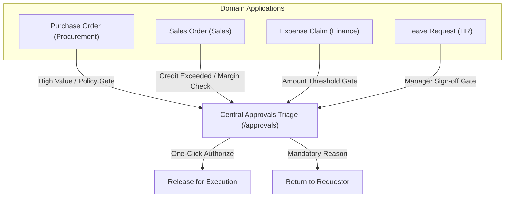
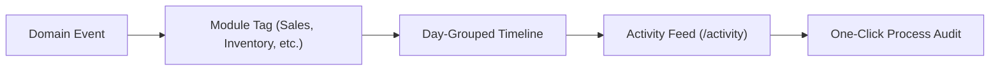
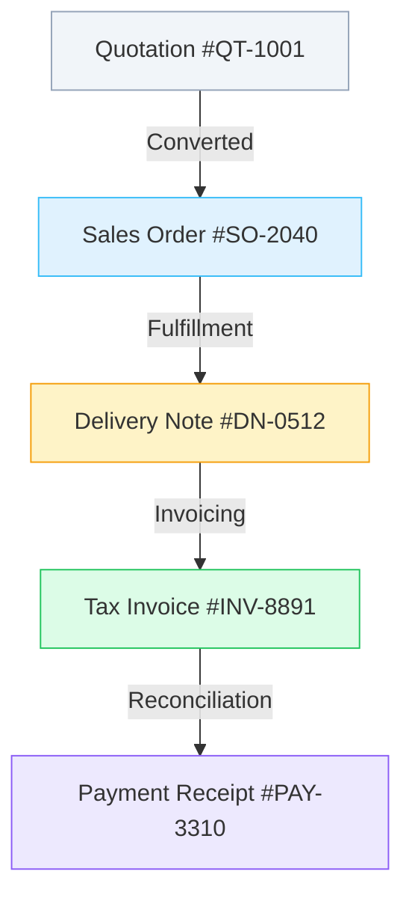

# Core Platform

<div class="storyline-breadcrumb">Core Foundation for <strong>Cross-Module Operations</strong>, <strong>Managerial Approvals</strong> &amp; <strong>Process Audit Lineage</strong></div>

> The central operational backbone of TenArm BES, orchestrating unified managerial approval triage across all business units, an ambient live event activity stream, and complete chronological process audit lineage with compensating undo controls for every document in the enterprise.

While individual domain modules (Sales, Procurement, Inventory, Finance, HR) handle specialized departmental workflows, the **Core Platform** provides the universal operational glue that connects them into a coherent business execution system. It provides managers, department leads, and operations teams with three essential cross-module capabilities:

1. **Approvals Triage Desk (`/approvals`)**: A single unified inbox where managers review, inspect, approve, or reject business commitments requiring managerial sign-off—eliminating the need to check four separate modules for pending actions.
2. **Activity Feed (`/activity`)**: A live, ambient pulse of enterprise operations streaming domain events in real time across the entire organization, with instant search, module filtering, and direct links to document execution lineage.
3. **Process & Audit Lineage (`/process`)**: A complete, immutable chronological audit trail and graphical lineage tree for any document in the system, revealing connected parent/child documents, secondary caused effects, and guided compensating actions (such as raising credit notes).

---

## Workspace Ergonomics

The Core Platform tools are woven directly into the workspace layout for instant access and zero lost context:

- **Multi-Tab Desk**: Like all TenArm consoles, users can maintain up to 3 active workspace tabs simultaneously (for example, keeping the **Approvals Triage Desk** open in Tab 1 while inspecting a specific sales order's **Process Lineage** in Tab 2 and verifying inventory balances in Tab 3). Switching between tabs preserves all active filters, search queries, and scroll positions without reloading.
- **Top-Bar Approvals Drawer**: A dedicated approvals bell and counter sits in the global top header from every screen in the application. Clicking it opens the **Approvals Drawer** from the right edge of the screen, allowing managers to authorize pending items instantly without leaving their active task.
- **Quick-Peek Inspection**: Clicking document numbers or counterparties inside the Approvals Desk or Activity Feed opens contextual slide-out drawers, enabling deep inspection without losing your active filter state.
- **Draft Auto-Save**: Uncommitted form inputs—such as rejection remarks or custom document lookup criteria—are preserved locally in your session, displaying a dirty dot indicator (`•`) on the tab until submitted or cleared.
- **Optimistic Concurrency Control (OCC)**: Approval decisions and document actions are versioned. If two managers review the same document at the same time, the system prevents accidental duplicate decisions with automated conflict warnings.

---

## Core Operational Concepts

### Unified Managerial Approvals & Separation of Duties (SoD)

In legacy ERPs, managers must log into different modules to approve purchase orders, sign off on sales discounts, review expense claims, and accept leave requests. TenArm BES consolidates all pending managerial gates into a single, high-velocity queue.



Key governance safeguards enforce regulatory compliance:
- **Separation of Duties (SoD)**: The system strictly prevents self-approval. If a manager drafts or submits a Purchase Order or Sales Order, they are prohibited from approving their own submission (`requested_by != user_id`). The approval buttons are automatically disabled for the author.
- **Permission-Gated Decision Authority**: Approval authority is strictly governed by atomic role permissions:
  - `po.approve` for Purchase Orders
  - `order.approve` for Sales Orders
  - `finance.expense.approve` for Expense Claims
  - `hr.leave.approve` for Leave Requests
  If a user lacks the requisite permission, action buttons remain disabled with a clear tooltip indicating the required permission.
- **Mandatory Rejection Reasons**: To prevent ambiguous cancellations, rejecting any document requires entering a descriptive reason. This remark is recorded in the document audit trail and notified to the requestor for prompt correction.

### Ambient Operational Activity Stream

The **Activity Feed** acts as the central nervous system of TenArm BES. Rather than requiring users to manually check multiple departmental logs, the Activity Feed captures and surfaces business events as they happen:



- **Cross-Module Normalization**: Events from Sales, Procurement, Inventory, Finance, and HR are presented in a unified format with color-coded module pills and human-readable action labels.
- **Actor Accountability**: Every event clearly identifies the initiating actor (e.g. `Jane Doe (Sales Lead)`) or flags system-automated workflows (`System`).
- **Direct Drill-Down**: Every event row includes a direct link to the affected document and a **Process** button to jump straight into its complete end-to-end execution history.

### End-to-End Document Process & Causal Lineage

Business documents in TenArm BES do not exist in isolation. A Quotation leads to a Sales Order, which triggers a Goods Delivery Note, an Accounts Receivable Invoice, and a Bank Payment Receipt. The **Process** screen (`/process`) provides a complete 360-degree interactive map of this lifecycle.



- **Visual Lineage Tree (`LineageTree`)**: Renders the complete multi-tier hierarchy of parent and child records connected to the selected document.
- **Chronological Execution Steps**: Shows every state change, transaction approval, and inventory movement in chronological order, with exact timestamps and sequence numbers.
- **Secondary Caused Effects**: Shows cascading system actions nested under their triggering step (for example, confirming a delivery note automatically updates warehouse ledger balances and creates financial journal lines).
- **Compensating Undo Guidance**: Rather than allowing arbitrary or dangerous deletions, the system provides structured compensating controls:
  - **In-Place Undo**: Available when an action can be safely reversed without side effects (e.g. unapproving an order before fulfillment begins).
  - **Offsetting Document Raising**: When transactions have affected physical stock or financial ledgers, the system guides you to raise the legal offsetting document (such as clicking **Raise Credit Note** for a posted invoice).
  - **Clear Block Reasons**: Explains exactly why a direct undo is prohibited (e.g. `Blocked — Goods already dispatched`).

---

## Screens & Workflows

### 1. Approvals Triage Desk (`/approvals`)

**What it does** — The dedicated managerial command post for reviewing, inspecting, and deciding on pending approval requests across Procurement, Sales, Finance, and HR.

```
┌────────────────────────────────────────────────────────────────────────────────────────┐
│ Approvals Triage                 [ Refresh ]                                           │
│ Cross-module managerial approval requests awaiting review and authorization            │
├────────────────────────────────────────────────────────────────────────────────────────┤
│ [ All (5) ]  [ Purchase Orders (2) ]  [ Sales Orders (2) ]  [ Expenses (1) ]  [ Leaves (0) ] │
├────────────────────────────────────────────────────────────────────────────────────────┤
│ ┌────────────────────────────────────────────────────────────────────────────────────┐ │
│ │ [PROCUREMENT]  PO-2026-0042                                           14m ago      │ │
│ │ Purchase Order PO-2026-0042                                                        │ │
│ │ Supplier: High-Tech Alloys Corp · 5 line items                      $48,500.00     │ │
│ │ ⚠️ Total order amount exceeds manager sign-off threshold ($25,000.00)              │ │
│ │                                                                                    │ │
│ │ [ ↗ Open in Workspace ]                      [ ✕ Reject ]          [ ✓ Approve ]   │ │
│ └────────────────────────────────────────────────────────────────────────────────────┘ │
└────────────────────────────────────────────────────────────────────────────────────────┘
```

**Category Filter Chips**
- **All**: Displays all pending requests across all modules.
- **Purchase Orders**: Purchase orders exceeding buyer limits or requiring senior sign-off.
- **Sales Orders**: Customer orders exceeding credit limits or requiring price discount overrides.
- **Expenses**: Employee expense reimbursements awaiting departmental sign-off.
- **Leaves**: Paid time off, sick leave, and casual leave applications awaiting manager approval.

**Approval Card Breakdown**
- **Type Badge & Document Number**: Visual tag indicating module origin (`PROCUREMENT`, `SALES`, `FINANCE`, `HR`) and hyperlinked document reference.
- **Relative Timestamp**: Shows when the request was submitted (e.g. `just now`, `14m ago`, `2d ago`).
- **Title & Subtitle**: Document name, counterparty (customer/supplier name), and item summary.
- **Monetary Value Badge**: Formatted financial total or duration (e.g. `$48,500.00` or `3 Days`).
- **Trigger Reason Banner**: Visual warning explaining the exact business rule triggering the approval gate (e.g. `Total PO amount exceeds manager sign-off threshold ($25,000.00)` or `Customer credit limit exceeded by $12,400.00`).

**Action Buttons & Workflows**

| Button Label | Action Performed | Requirements |
|---|---|---|
| **Open in Workspace** | Opens the complete document in a new workspace tab for detailed item verification. | Available to all viewers. |
| **Approve** | Authorizes the document, updates its version, and releases it for operational execution. | User must hold the requisite permission and cannot be the submitter. |
| **Reject** | Opens an inline rejection remarks drawer to provide mandatory feedback to the author. | User must hold the requisite permission. |
| **Confirm Rejection** | Submits the rejection with remarks, returning the document to draft/rejected status. | Remarks text cannot be blank. |
| **Cancel** | Collapses the rejection remarks box without rejecting the document. | Available when rejection prompt is open. |

**How to Triage and Authorize Requests**
1. Click the **Approvals** bell in the top navigation bar to open the quick drawer, or navigate to **Approvals Triage** (`/approvals`).
2. Click category chips (e.g. **Purchase Orders**) to narrow down your triage list.
3. Review the **Trigger Reason** and financial total. If line-level verification is needed, click **Open in Workspace** (`<ExternalLink />`).
4. To confirm authorization, click **Approve** (`<Check />`). The card is immediately removed from the triage list with a success notification.
5. To reject, click **Reject** (`<X />`), enter the business explanation in the rejection remarks box, and click **Confirm Rejection**.

---

### 2. Activity Feed (`/activity`)

**What it does** — The real-time operational stream tracking business transactions across all departments in chronological order.

```
┌────────────────────────────────────────────────────────────────────────────────────────┐
│ Activity Feed                    [ Refresh ]                                           │
│ What's happening across every module                                                   │
├────────────────────────────────────────────────────────────────────────────────────────┤
│ [ 🔍 Search events, aggregates...           ]  [ All ] [ Sales ] [ Inventory ] [ Finance ]│
├────────────────────────────────────────────────────────────────────────────────────────┤
│ Today                                                                                  │
│ • Sales Order Approved             [ sales ]       Order #SO-2026-0089  ·  Jane Doe    │
│   10m ago                                          [ ⎇ Process ]                       │
│ ────────────────────────────────────────────────────────────────────────────────────── │
│ • Stock Reserved                   [ inventory ]   Reservation #RES-4412 · System      │
│   9m ago                                           [ ⎇ Process ]                       │
│ ────────────────────────────────────────────────────────────────────────────────────── │
│ Yesterday                                                                              │
│ • Purchase Order Submitted         [ procurement ] PO #PO-2026-0042     ·  Bob Miller   │
│   Yesterday 4:32 PM                                [ ⎇ Process ]                       │
│                                                                                        │
│                                  [ Load more ]                                         │
└────────────────────────────────────────────────────────────────────────────────────────┘
```

**Key Toolbar Controls**
- **Search Events & Aggregates**: Instant text search filtering by event title, document reference, or aggregate ID. Click the clear button (`✕`) to reset.
- **Module Filter Pills**: Instant pills filtering the stream by application area (**All**, **Sales**, **Inventory**, **Procurement**, **Finance**, **HR**).
- **Refresh**: Manually polls the latest domain events from the server.

**Activity Row Components**
- **Color-Coded Status Dot**: Green for sales, blue for inventory, amber for procurement, purple for finance, and teal for HR.
- **Event Name & Module Badge**: Human-readable milestone (e.g. `Sales Order Approved`, `Delivery Note Dispatched`, `Payment Received`).
- **Entity Reference & Actor**: Displays the aggregate type, document ID, and the full name of the user or `System` for automated events.
- **Process Shortcut Button**: Clicking **Process** (`<Workflow />`) immediately opens the Process screen for that document.
- **Time Indicator**: Scannable relative time (`just now`, `10m ago`) or formatted day timestamps.
- **Load More**: Fetches the next batch of historical events without page reloads.

**How to Monitor Operational Activity**
1. Navigate to **Activity Feed** (`/activity`).
2. Select a specific departmental pill (such as **Inventory**) to monitor warehouse receipts and stock reservations.
3. Type a customer name, order number, or product SKU in the search input to filter related milestones.
4. Click **Process** on any event row to inspect its upstream origin and downstream fulfillment path.

---

### 3. Process & Document Lineage (`/process`)

**What it does** — The definitive end-to-end execution audit, visual relationship graph, and compensating action center for any business record.

```
┌────────────────────────────────────────────────────────────────────────────────────────┐
│ Process                          [ 🔍 Look up another document ]                       │
│ Sales Order #SO-2026-0089 — every step of the work it belongs to                       │
├────────────────────────────────────────────────────────────────────────────────────────┤
│ Visual Lineage Tree                                                                    │
│ Quotation #QT-1001 ──► Sales Order #SO-2026-0089 ──► Delivery Note #DN-0512           │
│                                                  ──► Tax Invoice #INV-8891             │
├────────────────────────────────────────────────────────────────────────────────────────┤
│ Connected Records:                                                                     │
│ • [Quotation #QT-1001] [CONVERTED]                                                     │
│ • [Sales Order #SO-2026-0089] [APPROVED]  Next: Generate Delivery Note, Create Invoice │
│ • [Delivery Note #DN-0512] [DISPATCHED]                                                │
├────────────────────────────────────────────────────────────────────────────────────────┤
│ Steps (4 steps)                                                                        │
│ Monday, November 10, 2026                                                              │
│ ┌────────────────────────────────────────────────────────────────────────────────────┐ │
│ │ [Sales Order #SO-2026-0089] [order.approve]                                        │ │
│ │ Order approved                                                                     │ │
│ │ Jane Doe  ·  Nov 10, 2026, 10:14 AM  ·  step #1042                                 │ │
│ │   ↳ Stock reserved [InventoryReservation #RES-4412] [inventory.reserve]            │ │
│ │ 🔒 Corrected by: Cancel Order — Blocked: Delivery note already dispatched         │ │
│ └────────────────────────────────────────────────────────────────────────────────────┘ │
└────────────────────────────────────────────────────────────────────────────────────────┘
```

**Key Sections & Displays**
- **Document Lookup Form**: When opened directly (`/process`), select the **Document Type** (e.g. `SalesOrder`, `PurchaseOrder`, `Invoice`), enter the **Document ID**, and click **View Process**.
- **Look Up Another Document**: While viewing an active process, click **Look up another document** to reveal the search bar and switch records.
- **Visual Lineage Tree (`LineageTree`)**: A clean tree diagram mapping upstream sources (where the document originated) and downstream records (what was created from it).
- **Connected Records Toolbar**: Summarizes every connected document with its current state badge (`DRAFT`, `APPROVED`, `DISPATCHED`, `POSTED`) and recommended next steps (`Next: ...`).
- **Date-Grouped Execution Steps**: Chronological breakdown of actions taken:
  - Document link and capability badge (e.g. `order.approve`, `inventory.reserve`).
  - Humanized step name (e.g. `Order approved`, `Stock reserved`).
  - User identity, exact timestamp, and immutable step ID.
  - Nested secondary effects (`↳`) caused automatically by the action.
- **Undo & Compensating Action Line**:
  - Displays whether an action can be undone directly (`Undo: <Action Name>`).
  - Flags blocked reversals with clear explanations (e.g. `Blocked: Goods already dispatched`).
  - Provides direct one-click buttons to initiate offsetting documents (e.g. **Raise Credit Note**).

**How to Audit and Trace a Process**
1. Open any document and click the **Process** button in its header or row actions, or navigate to `/process`.
2. Review the **Visual Lineage Tree** to see the full transaction family (quotes, orders, shipments, invoices, payments).
3. Scroll through the chronological **Steps** to review who authorized each milestone and when.
4. If an erroneous transaction occurred, inspect the compensating action line:
   - If an in-place undo is available, trigger the reversal.
   - If blocked due to downstream transactions, follow the provided guidance or click the suggested button (such as **Raise Credit Note**) to generate an offsetting correction.

---

## Workspace Tips & Best Practices

- **Zero-Friction Approvals via Drawer**: You don't need to navigate away from your daily work to authorize urgent requests. When a colleague notifies you of an urgent order, simply click the checkmark badge in the top bar, authorize the item in the slide-out drawer, and resume your task.
- **Cross-Referencing Lineage**: When troubleshooting an invoice dispute with a customer, open the invoice's **Process** screen. The lineage tree shows the originating quotation and delivery note, including who signed off on each step and the exact vehicle tracking number.
- **Event-Driven Work Tracking**: Keep the **Activity Feed** open in an auxiliary tab during peak operational hours to monitor fulfillment throughput and catch backorders or holds the moment they occur.

---

## If Something Goes Wrong (Common Validation & Guard Errors)

| What you see (Toast / Banner) | Why it happens | How to fix it in the workspace |
|---|---|---|
| `"Rejection reason is required"` | You clicked Confirm Rejection without typing remarks in the rejection drawer. | Enter a clear explanation for the rejection in the remarks textarea and click **Confirm Rejection**. |
| `"Requires <permission> permission"` | Your assigned role does not hold the necessary authorization rights for this document type. | Contact your Tenant Administrator to assign the appropriate managerial role (e.g. `po.approve` or `order.approve`). |
| `"Cannot approve own document"` | Separation of Duties (SoD) invariant prevents users from approving documents they drafted or submitted. | Have another designated department manager or supervisor review and authorize the document. |
| `"Document was modified by another user (OCC Conflict)"` | Another manager or automated job updated the document while you were viewing it. | Click **Refresh** to load the latest document version and verify its state before approving or rejecting. |
| `"Undo blocked: Goods already dispatched"` | You attempted to cancel or unapprove an order after delivery notes or stock dispatches have already occurred. | Initiate a standard return flow: create a **Goods Return Note** and issue a **Credit Note** in Sales/Finance. |
| `"Undo blocked: Invoice already posted to ledger"` | Financial integrity rules prohibit deleting or unapproving an invoice that has posted to the General Ledger. | Navigate to Finance and click **Raise Credit Note** to offset the posted liability or receivable balance. |
| `"Please select a valid document type and positive ID"` | The Document Lookup form was submitted with an empty type or invalid document number. | Select a valid document type from the dropdown, enter a positive numeric ID (e.g. `1042`), and click **View Process**. |

---

## Integrations

The Core Platform binds every domain module into a cohesive system:

| Module | Core Platform Integration Points |
|---|---|
| **Procurement** | Purchase Orders route to the Approvals Triage Desk; goods receipt events stream to Activity Feed; PO-to-Bill lifecycle maps to Process Lineage. |
| **Sales** | High-value quotations, orders exceeding credit limits, and margin overrides route to Approvals Triage; fulfillment milestones map to Process Lineage. |
| **Inventory** | Stock reservations, warehouse dispatches, and inventory write-offs generate Activity Feed events; stock movement links directly to Process Lineage. |
| **Finance** | Expense reimbursement approvals route to Approvals Triage; posted invoices and payment reconciliations link to Process Lineage with compensating credit note actions. |
| **HR** | Employee leave requests route to the Approvals Triage Desk; attendance and onboarding milestones stream to Activity Feed. |
