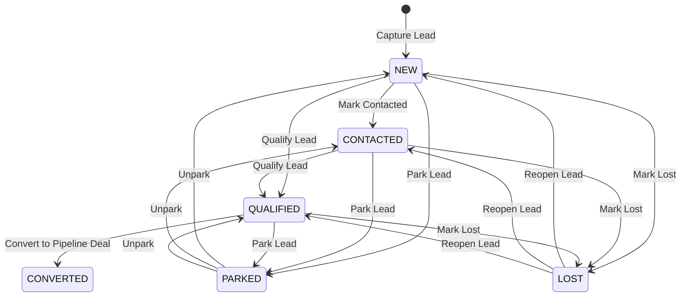
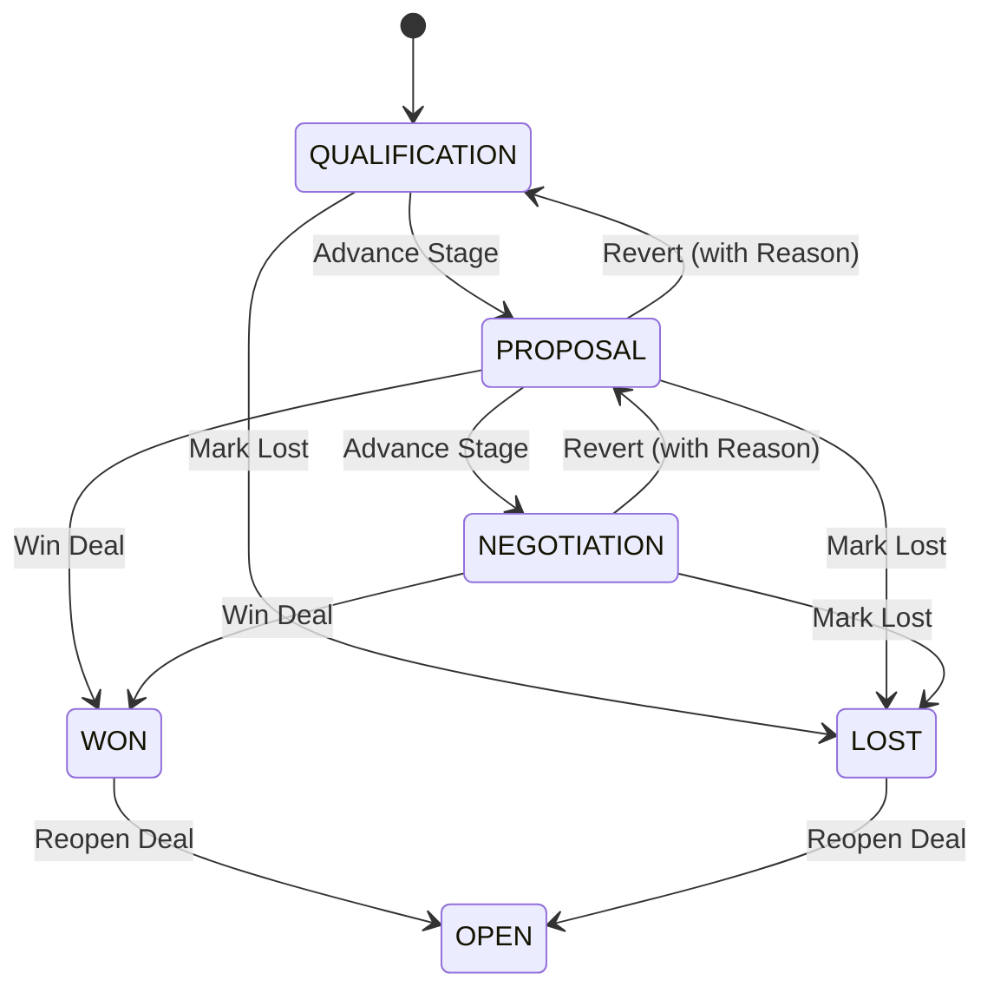

# CRM

Part of the <strong>Order to Cash (O2C)</strong> Storyline: Steps 1 &amp; 2 of 6 (Lead &amp; Opportunity)

> The commercial front door of TenArm BES, orchestrating prospective buyer engagement from initial lead intake and qualification through pipeline deal progression, commercial quotation conversion, and 360-degree customer relationship management.

The CRM module manages your customer relationships before and alongside commercial transactions. It provides a structured progression: prospective buyers enter as **Leads**, undergo systematic qualification against organizational standards, convert into **Accounts**, **Contacts**, and **Deals (Opportunities)**, and move through a visual Kanban pipeline toward quotation conversion in Sales.

---

## Workspace Ergonomics

The CRM desk is engineered for rapid outreach, pipeline triage, and zero lost context:

- **Multi-Tab Desk**: Sales representatives can keep up to 3 active CRM tabs open simultaneously (e.g. keeping **Today** agenda, the **Deals & Pipeline** Kanban board, and a specific **Customer 360** profile open together). Switching between tabs preserves table search terms, owner filters, scroll offsets, and in-progress drafts without reloading.
- **Draft Auto-Save**: Uncommitted form inputs (such as lead intake details, deal notes, or meeting logs) are continuously preserved. The active tab header displays a dirty dot indicator (`•`) until the record is saved or discarded.
- **Quick-Peek Slide-Out**: Clicking any linked company name, contact, deal code, or lead number opens an inspection drawer from the right edge of the screen, allowing reps to log calls or review quotation history without losing their primary active workflow.

---

## Core CRM Concepts

### Qualification Standards Checklist
To ensure sales reps focus energy on viable opportunities, leads must satisfy organizational qualification standards before advancing to proposals. Tenant administrators configure weighted criteria (e.g. *Budget Confirmed*, *Decision Maker Engaged*, *Delivery Logistics Feasible*, *Catalog Specifications Fit*). Mandatory criteria must be verified and checked off before commercial conversion is permitted.

### Parked Backlog & Automated Callbacks
Rather than permanently discarding leads that cannot buy immediately due to budget or inventory constraints, reps can **Park** the prospect with a specific reason:
- **Price Not Matching (`PRICE_NOT_MATCHING`)**: The prospect wants the product but at a lower price point.
- **Stock Unavailable (`STOCK_UNAVAILABLE`)**: The requested item or grade is temporarily out of stock.

When new purchase shipments arrive in Inventory, product benchmark rates adjust, or the scheduled follow-up date arrives, the system surfaces the lead on the **Ready to Call Back** board, converting lost demand into active pipeline.

### Unified Customer 360
An Account in CRM provides a comprehensive 360-degree operational view:
- **Commercial Relationship**: Active contacts, open deals, and logged touchpoints.
- **Order Fulfillment**: Live sales orders and delivery notes fetched cross-app from Sales.
- **Financial Exposure**: Accounts Receivable (AR) open invoices, overdue balances, credit limits, and unapplied cash advances fetched cross-app from Finance.

---

## Lead Management

### Leads

**What it does** — Captures raw inbound inquiries, trade show contacts, and marketing prospects, guiding them through outreach and qualification before commercial commitments are made.

**Lifecycle & States**

| State | What it means | What you can do next |
|---|---|---|
| `NEW` | Fresh unassigned or uncontacted lead. | Log calls/emails, claim ownership, mark contacted, qualify, park, or lose. |
| `CONTACTED` | Outreach touchpoint has been logged and communication established. | Schedule tasks, update requirements, evaluate criteria, qualify, park, or lose. |
| `QUALIFIED` | Lead satisfies mandatory criteria and is confirmed as a viable buyer. | Convert into an Account, Contact, and Pipeline Deal, or park if timing delays occur. |
| `PARKED` | Kept in a reachable backlog due to price mismatches or inventory stock-outs. | Monitor the callback feed; unpark when stock arrives or rates align. |
| `CONVERTED` | Successfully graduated into active commercial pipeline. | View linked Account, Contact, and Opportunity records. |
| `LOST` | Disqualified, unresponsive, or lost to a competitor. | View historical audit notes; reopen if the prospect re-engages. |

**Key Fields**

| Field | Required | Description & Validation |
|---|:---:|---|
| **Lead Title** | ✅ | Concise description of the opportunity (e.g. *500 MT Hot Rolled Coils - Infra Corp*). |
| **Company Name** | — | Prospect organization or trading business name. |
| **Contact Name** | — | Primary point of contact person. |
| **Email & Phone** | — | Direct communication channels; validated for phone digit format. |
| **Lead Source** | — | Channel origin: `WEBSITE`, `REFERRAL`, `TRADE_SHOW`, `COLD_OUTREACH`, `INBOUND_CALL`. |
| **Estimated Value** | — | Anticipated initial order value before detailed line item configuration. |
| **Lead Owner** | — | Assigned sales representative. Defaults to current user if unclaimed. |
| **Tax ID / Region** | — | Corporate tax identifier (e.g. GSTIN) and jurisdiction code. |
| **Interested Products** | — | Catalog SKUs, target purchase quantities, and acceptable customer target price. |

**How to Use**

#### Creating a New Lead
1. Navigate to **CRM → Leads** (`/crm/leads`).
2. Click **New Lead** in the page header.
3. Fill in **Lead Title**, **Company**, **Contact Name**, **Phone**, and **Email**.
4. Optionally record **Estimated Value** and assign a **Lead Owner**.
5. Click **Create Lead**.

#### Contacting and Qualifying a Lead
1. Open the lead in the **Command Desk** view.
2. In the right-hand **Lead 360 Inspector**, click **Log Activity** to record the initial call, email, or meeting. *(Note: At least one logged activity is mandatory before marking a lead as contacted or qualified).*
3. Click **Mark Contacted** to move the lead from `NEW` to `CONTACTED`.
4. Once the prospect confirms commercial intent, click **Qualify**.
5. In the **Qualify Lead** modal, review the **Evaluate Qualification Standards** checklist. Check off passed criteria and record verification notes.
6. Click **Confirm & Qualify Lead**. The lead advances to `QUALIFIED`.

#### Converting a Lead to a Deal
1. On a `QUALIFIED` lead, click **Convert Lead** (or click **Convert to Deal** in the inspector header).
2. The **Convert Lead** dialog opens pre-populated with:
   - **Company Account**: Name of new company to create, or toggle *Attach to an existing company* to link to an established account.
   - **Primary Contact**: First name and last name.
   - **Opportunity / Deal Name**: Deal title carried over from lead.
   - **Deal Owner** & **Expected Close Date**.
3. Click **Convert to Pipeline Deal →**.
4. The system automatically creates the **Account**, **Contact**, and an **Opportunity** in the `PROPOSAL` stage, copying interested products directly into deal line items.

#### Parking a Lead for Callbacks
1. If a lead cannot proceed due to pricing or lack of warehouse stock, click **Park Lead** on the lead row or inspector.
2. Select the reason under **Why it waits \***:
   - `Price not matching`: Customer budget is below current catalog pricing.
   - `Stock unavailable`: The desired SKU, coil grade, or dimensions are not currently in warehouse inventory.
3. Enter an optional **Call back on** calendar date.
4. Click **Park lead**. The prospect moves to `PARKED`.
5. The **Ready to Call Back** banner automatically surfaces parked leads as soon as matching stock arrives in Inventory or benchmark pricing drops to the customer's target rate.

#### Losing and Reopening a Lead
1. To disqualify a lead, click **Mark Lost**.
2. Select a standardized **Loss Reason**: `Price too high`, `Went with a competitor`, `Product not available as needed`, `Payment terms not accepted`, `Customer cancelled or postponed`, or `Other`.
3. Add explanatory notes and confirm. The pre-loss stage is preserved.
4. If the client re-engages, click **Reopen Lead**. The lead is instantly restored to its exact previous stage (`NEW`, `CONTACTED`, or `QUALIFIED`).

---

## Opportunity & Pipeline Management

### Deals & Pipeline

**What it does** — Manages qualified commercial opportunities through a visual, stage-gated Kanban pipeline, providing weighted revenue forecasting, margin analysis, and one-click quotation conversion.

**Status & Pipeline Stage Progression**

| Stage | Default Win Probability | Key Milestone & Objective |
|---|:---:|---|
| **Qualification** | 25% | Initial needs discovery and technical feasibility evaluation. |
| **Proposal** | 50% | Detailed line item configuration and formal sales quotation drafting. |
| **Negotiation** | 75% | Commercial price terms, delivery scheduling, and contract finalization. |
| **Won** | 100% | Customer purchase order received and commercial agreement finalized. |
| **Lost** | 0% | Deal closed without sale; loss reason category recorded. |

**Key Fields**

| Field | Required | Description |
|---|:---:|---|
| **Deal Name** | ✅ | Commercial opportunity title. |
| **Account** | ✅ | Associated customer company. |
| **Primary Contact** | — | Key decision maker or purchasing manager. |
| **Pipeline Stage** | ✅ | Current funnel stage: `Qualification`, `Proposal`, `Negotiation`. |
| **Estimated Close Date** | — | Target commercial commitment date. |
| **Deal Amount** | — | Total monetary value. *Automatically rolls up from line items when configured*. |
| **Deal Owner** | — | Assigned sales executive. |
| **Product Lines** | — | Line items specifying product SKU, warehouse, quantity, and unit selling rate. |

**How to Use**

#### Managing the Kanban Board
1. Navigate to **CRM → Deals & Pipeline** (`/crm/pipeline`).
2. The top **Executive Pulse Cards** show:
   - **Active Pipeline**: Total unweighted value across open deals.
   - **Weighted Forecast**: Probability-adjusted revenue forecast ($\sum \text{Amount} \times \text{Win Probability}$).
   - **Active Deals**: Count of open opportunities.
   - **Win Rate**: Historical win percentage of closed deals.
3. Drag deal cards horizontally between columns to advance stages, or click a card to open the **Deal 360 Drawer**.
4. Use the filter bar to filter deals by **Owner**, search terms, or toggle **Stale Only** to highlight deals with zero activity for 7+ days.

#### Configuring Deal Product Lines & Margin
1. Open a deal card in the **Deal 360 Drawer**.
2. Under **Product Line Items**, click **+ Add Product Line**.
3. Select the catalog **Product**, fulfillment **Warehouse**, **Quantity**, and **Unit Price**.
4. For dual-unit catch-weight items (e.g. steel coils, bulk goods), enter both primary count and secondary measure.
5. The system automatically recalculates the **Deal Amount** and displays the **Profit & Margin** chip comparing total revenue against base product costs.

#### Building and Converting to Quotation
1. When a deal reaches the `PROPOSAL` or `NEGOTIATION` stage, the **Build Quotation** button appears in the drawer header.
2. Click **Build Quotation** to open the quotation builder modal.
3. Review line items, payment terms, and freight terms.
4. Click **Convert to Sales Quotation**.
5. The CRM deal generates a formal Sales Quotation in the Sales module, stamps the quote reference ID onto the deal, and establishes automated bidirectional status synchronization.
6. To jump directly into the commercial sales order desk, click **Sales Desk** in the drawer header.

#### Winning or Losing a Deal
1. **Winning a Deal**:
   - Click **Won** in the drawer header.
   - *Guard Requirement*: A deal must have product line items added or be linked to an accepted quotation to be marked as won.
   - Win probability updates to 100% and close timestamp is stamped.
2. **Losing a Deal**:
   - Click **Lost** in the drawer header.
   - Select a standardized loss category and enter conclusion notes.
   - Win probability updates to 0%.

---

## Customer & Contact Relationships

### Accounts (Customer Directory)

**What it does** — Maintains master records of client companies, integrating commercial CRM history with live order execution and credit exposure.

**How to Use**
1. Navigate to **CRM → Accounts** (`/crm/accounts`).
2. Use the list picker tabs to filter:
   - **All Customers**: Complete account database.
   - **Has purchased before**: Accounts with at least one historical confirmed sales order.
   - **Quotation sent — awaiting PO**: High-priority accounts holding active, unexpired quotations awaiting customer purchase order confirmation.
3. Click **New Account** to register a new client company with billing address, tax ID, and assigned account owner.
4. Click any account row to open the **Customer 360 View** (`/crm/accounts/:id`).

**Customer 360 View Features**
- **Commercial Snapshot**: High-level tiles showing Lifetime Orders Value, Open Invoices (AR), Available Credit Limit, and Unallocated Cash Advances.
- **Record Advance**: Click **Record Advance** to log customer advance deposit receipts directly with Finance without leaving CRM.
- **Sales Orders Grid**: Live status of pending warehouse dispatches and invoices.
- **Contacts & Deals**: Sub-panels for adding contacts (`+ Add Contact`) or initiating new deals (`+ New Deal`).
- **Touchpoint Stream**: Chronological history of every call, meeting, email, and task logged with company representatives.

---

### Contacts (People Directory)

**What it does** — Manages individual business contacts, linking people to customer accounts with job titles, direct contact information, and primary decision-maker designations.

**Key Fields**

| Field | Required | Description |
|---|:---:|---|
| **First Name** | ✅ | Contact's given name. |
| **Last Name** | — | Contact's family name. |
| **Job Title** | — | Role (e.g. *Head of Procurement*, *Plant Manager*). |
| **Account** | — | Associated customer company from Accounts directory. |
| **Contact Owner** | — | Internal relationship manager. |
| **Email & Phone** | — | Direct email address, office phone, and mobile number. |
| **Primary Contact** | — | Toggle indicating the main commercial representative for quotes and invoices. |

**How to Use**
1. Navigate to **CRM → Contacts** (`/crm/contacts`).
2. Click **New Contact**.
3. Select the associated **Account**, enter name, job title, and communication channels.
4. Check **Primary Contact** if this person is the primary signer for proposals.
5. Click **Create Contact**.

---

## Daily Sales Execution

### Today (Operational Cockpit)

**What it does** — The daily morning cockpit for sales reps and account managers, unifying scheduled follow-ups, overdue tasks, touchpoint logging, and sales radar alerts in a single focused workspace.

**Cockpit Layout**

- **Left Pane — Tasks & Agenda**:
  - Filter tabs: **All**, **Overdue**, **Today**, **Upcoming**, **No Date**.
  - Type filters: **Calls**, **Meetings**, **Emails**, **Tasks**.
  - One-click completion: Check off completed items inline, enter optional resolution notes, and immediately clear the task.
  - Action buttons: Click **Schedule Task** to calendar upcoming follow-ups, or **Log Activity** to record ad-hoc touches.
- **Right Pane — Sales Radar & Inbound Queue**:
  - **Stalled Deals**: Identifies open opportunities sitting in Proposal or Negotiation with zero logged touches for 7+ days.
  - **Fresh Inbound Leads**: Live feed of newly captured prospects awaiting initial outreach.
  - **Customers Needing Attention**: Flags accounts with overdue invoice balances or stalled delivery orders.

**Activity Types**

| Type | Default Completion Behavior | When to Use |
|---|---|---|
| `CALL` | Auto-completed if due date is empty. | Telephone check-ins, prospect discovery calls, pricing negotiations. |
| `MEETING` | Auto-completed if due date is empty. | On-site plant visits, product demos, commercial review conferences. |
| `EMAIL` | Auto-completed if due date is empty. | Quotation transmissions, specification follow-ups, inquiries. |
| `TASK` | Stays open until explicitly checked off. | Action items: drafting custom specs, checking stock with yard, credit review. |
| `NOTE` | Instant record. | Internal account memos, organizational insights, executive commentary. |

---

## Settings & Administration

### CRM Settings (Qualification Standards)

**What it does** — Configures the organizational qualification criteria evaluated by sales representatives before leads can advance into active commercial deals.

**How to Use**
1. Navigate to **CRM → Settings** (`/crm/settings`).
2. The grid displays current active criteria with order, name, description, and requirement badges.
3. Click **+ Add Qualification Criteria**.
4. Enter:
   - **Criteria Name**: Short benchmark title (e.g. *Authorized Purchasing Authority Verified*).
   - **Description & Guidance**: Specific instructions for reps on how to verify this criterion.
   - **Display Order**: Integer sequence positioning on the checklist.
   - **Mandatory Check**: Toggle on if this requirement is strictly required to qualify a lead.
   - **Active in Checklist**: Toggle on to include in live qualification dialogs.
5. Click **Save Criteria**.

---

### CRM Dashboard

**What it does** — Executive performance dashboard tracking lead conversion velocity, pipeline distribution, sales rep activity volume, and revenue forecasting.

**Key Metrics & Charts**
- **Funnel Stage Conversion**: Total leads captured vs contacted vs qualified vs converted.
- **Active Pipeline by Stage**: Distribution of open deal capital across Qualification, Proposal, and Negotiation.
- **Rep Activity Scorecard**: Breakdown of calls logged, meetings held, and tasks completed per team member.
- **Win/Loss Analysis**: Breakdown of lost deal categories to identify pricing or product availability bottlenecks.

---

## If Something Goes Wrong (Common Validation & Guard Errors)

The table below explains CRM system validation guards and toasts, detailing the operational reason and resolution:

| What you see (Toast / Banner) | Why it happens | How to fix it in the workspace |
|---|---|---|
| **"Log at least one activity before marking this lead Contacted"** | Attempting to advance a lead from `NEW` to `CONTACTED` without recording proof of outreach. | Open the **Lead 360 Inspector** and click **Log Activity** to record the initial phone call, email, or meeting note first. |
| **"Log at least one activity against this lead before qualifying it"** | Attempting to qualify a fresh lead with zero recorded customer touchpoints. | Record an outreach touchpoint (Call or Meeting) documenting the customer's requirement before clicking **Qualify**. |
| **"This lead has overdue follow-ups — open it to resolve them"** | A lead cannot change stage while assigned follow-up tasks have past-due dates. | Open the lead in the **Command Desk**, scroll to **Scheduled Activities**, and either check off the overdue task or reschedule its due date. |
| **"Mandatory criteria not met: [Criteria Names]"** | One or more organization-mandated qualification standards were unchecked during qualification evaluation. | In the **Qualify Lead** modal, verify customer compliance for each mandatory item and ensure their checkboxes are selected. |
| **"Cannot convert deal to quote without at least one product line"** | Attempting to convert an opportunity to a sales quotation while the deal line items table is empty. | In the **Deal 360 Drawer**, scroll to **Product Line Items**, click **+ Add Product Line**, specify products, quantities, and rates, then retry conversion. |
| **"Sequential stages: Qualification -> Proposal -> Negotiation. Cannot skip stages."** | Attempting to move an opportunity across multiple stages at once (e.g. dragging directly from Qualification to Negotiation). | Advance the deal one stage at a time (`Qualification → Proposal → Negotiation`) to complete prerequisite checklists. |
| **"Moving deal backward requires a reason"** | Reverting an opportunity to an earlier pipeline stage requires governance justification. | In the stage reversal prompt, enter a mandatory explanation note describing why the deal reverted (e.g. *Client revised scope back to discovery*). |
| **"Cannot create a quote from a WON / LOST opportunity"** | Quotation generation is strictly restricted to active pipeline deals in `PROPOSAL` or `NEGOTIATION` stage. | If the deal is closed, click **Reopen Deal** first before generating new commercial quotes. |
| **"Cannot reopen deal: linked quote is ACCEPTED or CONVERTED"** | A closed deal cannot be reopened if its sales quotation has already been accepted by the customer or converted into a confirmed Sales Order. | Commercial execution has transferred to the **Sales** module. Review the linked document in **Sales → Orders**. |
| **"A park_reason is required to park a lead"** | Parking a lead requires selecting an official backlog classification. | In the **Park Lead** modal, select either `Price not matching` or `Stock unavailable` from the dropdown. |
| **"Cannot edit products of a CONVERTED lead"** | A converted lead's requirements have transferred into an active Opportunity. | Manage line items directly on the generated deal under **CRM → Deals & Pipeline**. |
| **"Amount is derived from this deal's product lines — edit the lines instead"** | Attempting to manually overwrite the deal header amount when line items exist. | Adjust individual line quantities or unit selling prices under **Product Line Items**; the header amount rolls up automatically. |

---

## Integrations

| Module | Business Trigger | What Happens Automatically |
|---|---|---|
| **Sales** | Build Quotation (`deal.convert_to_quote`) | Pushes deal product lines, pricing, and buyer tax profiles into Sales to generate a formal Sales Quotation (`quote.create`). |
| **Sales** | Quotation Acceptance / Cancellation | Bidirectional event synchronization (`OpportunityQuoteSyncProjection`) automatically updates deal probability and closes or advances the CRM deal. |
| **Core (Parties)** | First Commercial Transaction | When converting a lead or deal, automatically provisions an enterprise `Party` record with role `CUSTOMER` to facilitate unified accounting. |
| **Inventory** | Stock Receipts & Reorder Updates | Cross-app availability checks evaluate parked leads, automatically surfacing them on the **Ready to Call Back** board when matching inventory arrives. |
| **Finance** | Account 360 Inspection | Streams real-time Accounts Receivable balances, unpaid invoices, credit limit utilization, and unapplied cash receipts into the customer profile. |
| **AI Insights** | Daily Pipeline Sweeps | AI scans open deals for stale velocity (7+ days inactive), over-committed product quotations, and high-probability closing candidates. |

---

## Permissions

| Permission | What it unlocks |
|---|---|
| `crm.dashboard.view` | Access executive CRM analytics, conversion funnels, and team activity scorecards. |
| `lead.view` | View the Leads directory and inspect individual Lead 360 profiles. |
| `lead.create` | Create new prospective leads in the CRM intake desk. |
| `lead.update` | Edit lead details, manage interested product lines, park, and unpark leads. |
| `lead.contact` | Record first customer contact and advance lead status to `CONTACTED`. |
| `lead.qualify` | Evaluate qualification criteria and advance lead status to `QUALIFIED`. |
| `lead.convert` | Convert qualified leads into customer Accounts, Contacts, and Pipeline Deals. |
| `lead.lose` | Mark leads as lost with standardized loss category codes. |
| `lead.reopen` | Restore lost leads back to their pre-loss pipeline stage. |
| `deal.view` | Access the Deals & Pipeline Kanban board and Deal 360 drawer. |
| `deal.create` | Create new commercial opportunities. |
| `deal.update` | Edit deal details, update owners, and configure product line items. |
| `deal.advance` | Advance deals sequentially through pipeline stages (`Qualification → Proposal → Negotiation`). |
| `deal.convert` | Convert opportunities into formal Sales Quotations. |
| `deal.win` | Close opportunities as Won upon customer PO receipt. |
| `deal.lose` | Close opportunities as Lost with standardized loss category codes. |
| `deal.reopen` | Reopen closed opportunities back to active pipeline stages. |
| `customer.view` | View the Accounts directory and Customer 360 operational panels. |
| `customer.create` | Create new customer company accounts. |
| `customer.update` | Modify customer account information, tax IDs, and owner assignments. |
| `person.view` | View the Contacts directory. |
| `person.create` | Add new contact persons and associate them with customer accounts. |
| `person.update` | Edit contact details and designate primary account representatives. |
| `activity.view` | View scheduled tasks, follow-up agendas, and the touchpoint stream on Today. |
| `activity.log` | Log phone calls, meetings, emails, tasks, and notes against CRM entities. |
| `activity.complete` | Mark follow-up tasks and activities as completed. |
