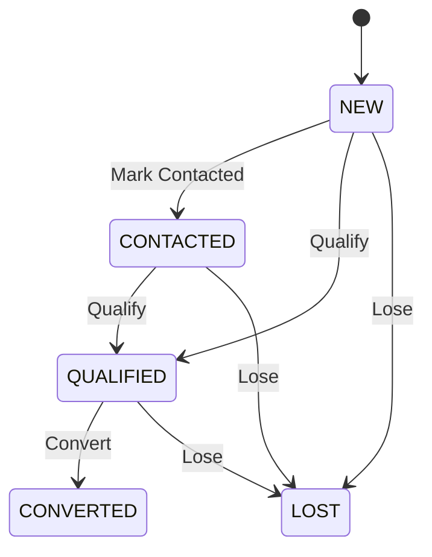
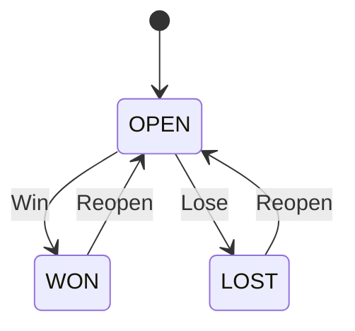

# CRM

> The CRM module lets you manage the entire lead-to-deal conversion story, tracking customer relationships and pipeline progress.

## Overview

The CRM module provides tools to track potential business from initial contact through to a closed deal. It is structured around a clear progression: **Leads** represent raw, unqualified prospects. Once qualified, they are converted into **Accounts**, **Contacts**, and **Opportunities** (Deals) that move through a defined sales pipeline. All interactions are tracked via **Activities**.

---

## Leads

### What It Does
Captures and qualifies raw prospects before they become active pipeline opportunities.

### Status Lifecycle

| Status | What It Means | What You Can Do |
|--------|--------------|-----------------|
| **NEW** | A fresh lead that hasn't been engaged yet. | Log activities, Mark Contacted, Qualify, Lose |
| **CONTACTED** | Initial communication has occurred. | Log activities, Qualify, Lose |
| **QUALIFIED** | The prospect meets business criteria to become a real deal. | Convert, Lose |
| **CONVERTED** | Successfully transitioned into an Account, Contact, and Opportunity. | View linked records |
| **LOST** | The lead was disqualified or went cold. | Reopen |

### Key Fields
| Field | Required | Notes |
|-------|----------|-------|
| `lead_number` | Yes | Auto-generated identifier. |
| `title` | Yes | The primary name or subject of the lead. |
| `status` | Yes | Defaults to `NEW`. |
| `company` | No | Target company name. |
| `contact_name` | No | Primary contact person's name. |

### How To Qualify a Lead
1. Navigate to **Daily Work → Leads**
2. Click the **Qualify** button on a Lead row.
3. Fill in the **Evaluate Qualification Standards** checklist.
4. Click **Confirm & Qualify Lead**.

### How To Convert a Lead
1. Navigate to **Daily Work → Leads**
2. On a `QUALIFIED` lead, click the **Convert Lead** button (often represented by a trending up icon).
3. Fill in the details in the **Convert Lead** dialog (Account, Contact, Opportunity names).
4. Click to submit. This automatically creates the linked Account, Contact, and Opportunity, and sets the Lead to `CONVERTED`.

### Things to Know
- **Activity Prerequisite:** You must log at least one activity (call, email, meeting) without overdue tasks before you can mark a lead as `CONTACTED` or `QUALIFIED`.
- **Mandatory Criteria:** Qualifying a lead checks against active mandatory qualification criteria configured in your organization.
- **Losing a Lead:** Marking a lead as `LOST` requires providing a standardized lost reason category (e.g., Price Too High, Competitor Won).
- **Reopening:** If you reopen a `LOST` lead, it restores the funnel stage it was lost from (e.g., back to `CONTACTED`).

---

## Opportunities (Deals)

### What It Does
Tracks qualified deals through a structured sales pipeline until they are won or lost.

### Status Lifecycle

*Note: While `OPEN`, an opportunity progresses through sequential stages: `QUALIFICATION` → `PROPOSAL` → `NEGOTIATION`.*

| Status | What It Means | What You Can Do |
|--------|--------------|-----------------|
| **OPEN** | An active deal moving through pipeline stages. | Advance stage, Set Lines, Convert to Quote, Win, Lose |
| **WON** | The deal was successfully closed. | Reopen |
| **LOST** | The deal was lost. | Reopen |

### Key Fields
| Field | Required | Notes |
|-------|----------|-------|
| `opportunity_number` | Yes | Auto-generated identifier. |
| `name` | Yes | Deal name. |
| `amount` | Yes | Total estimated value (rolls up from product lines). |
| `stage` | Yes | The current pipeline stage (e.g., `PROPOSAL`). |
| `probability` | Yes | Win probability percentage (defaults based on stage). |

### How To Advance a Deal
1. Navigate to **Daily Work → Pipeline**
2. Drag the deal card to the next stage column on the Kanban board, or click the **Advance Deal** button.
3. Fill in any required checklist items if advancing out of `QUALIFICATION`.

### How To Convert Deal to Quote
1. Navigate to **Daily Work → Pipeline**
2. Select a deal in the `PROPOSAL` or `NEGOTIATION` stage.
3. Click the **Convert to Quote** button.
4. Review the product lines and confirm to generate a Sales Quotation.

### Things to Know
- **Sequential Stages:** Deals must advance one stage at a time. Skipping stages is not allowed. Moving a deal backward requires a justification reason.
- **Winning Requires Lines:** You cannot mark a deal as `WON` unless it has product lines added or is linked to a converted quote.
- **Quote Dependency:** A deal cannot be reopened from `WON` if its linked quotation is already `ACCEPTED` or `CONVERTED` in the Sales module.
- **Stale Deals:** Deals that go quiet in `PROPOSAL` or `NEGOTIATION` for more than 7 days are flagged as stale.

---

## Accounts & Contacts

### What It Does
Stores the central record of companies (Accounts) and the people who work there (Contacts).

### Things to Know
- These are typically generated automatically when a Lead is converted.
- Accounts sync with central `Parties` when quotes or sales orders are generated, ensuring billing consistency.

---

## Activities

### What It Does
Logs follow-ups, calls, meetings, emails, and tasks against CRM records.

### Things to Know
- **Types:** Activities can be categorized as CALL, MEETING, EMAIL, TASK, or NOTE.
- **Gatekeepers:** Logging activities is a hard requirement for progressing Leads through the early stages (`CONTACTED`, `QUALIFIED`).
- Open activities with past-due dates will block certain transitions until they are completed.

---

## Integrations

| Module | When | What Happens |
|--------|------|-------------|
| **Sales** | Convert to Quote | The deal's product lines are sent to the Sales module to create a Quotation. |
| **Sales** | Quote Status Changes | If a linked Sales Quotation is Accepted or Cancelled, an event (`OpportunityQuoteSyncProjection`) updates the Deal accordingly. |
| **Core (Parties)** | Quote Creation | If the Account doesn't have a linked Party, one is automatically created with the `CUSTOMER` role to facilitate billing. |

---

## Permissions

| Permission | What It Unlocks |
|-----------|----------------|
| `crm.dashboard.view` | View the CRM metrics and funnel dashboard. |
| `lead.view` / `lead.create` / `lead.update` | Basic CRUD operations for Leads. |
| `lead.contact` / `lead.qualify` | Advance lead through early stages. |
| `lead.lose` / `lead.reopen` | Close or reopen leads. |
| `lead.convert` | Turn a lead into an Account, Contact, and Opportunity. |
| `deal.view` / `deal.create` / `deal.update` | Basic CRUD operations for Opportunities. |
| `deal.advance` | Move a deal through pipeline stages (e.g., Proposal to Negotiation). |
| `deal.win` / `deal.lose` / `deal.reopen` | Close or reopen deals. |
| `deal.convert` | Convert a deal into a Sales Quotation. |
| `customer.view` / `customer.create` / `customer.update` | Manage Accounts (Customers). |
| `person.view` / `person.create` / `person.update` | Manage Contacts (Persons). |
| `activity.view` / `activity.log` / `activity.complete` | Manage tasks and communications. |
