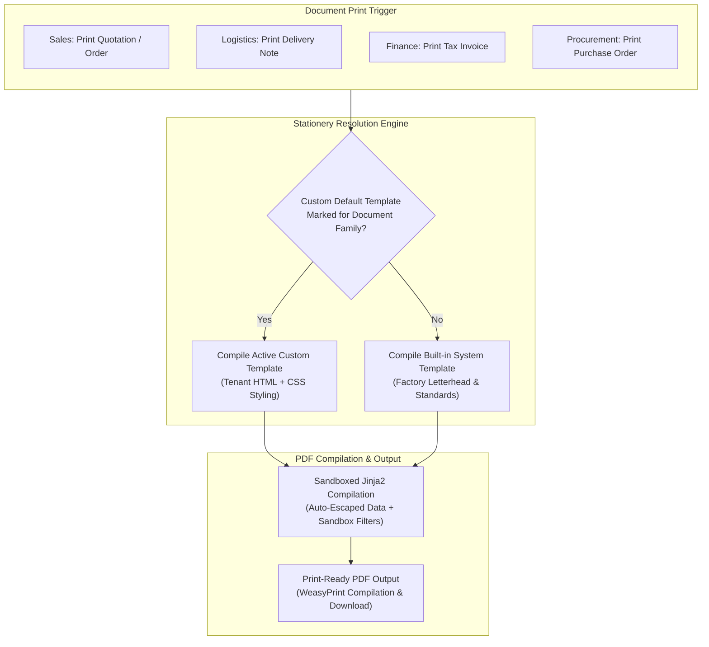
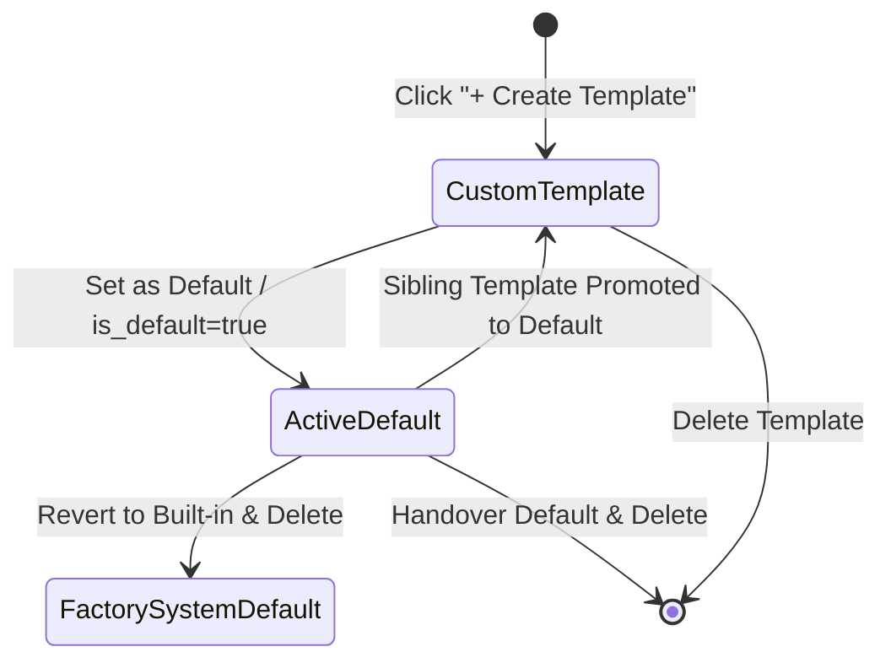
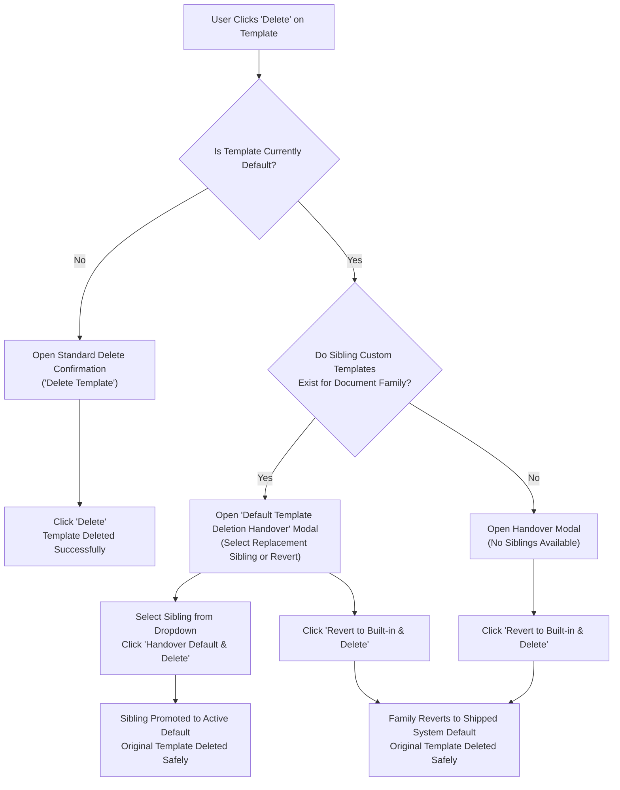

# Documents

<div class="storyline-breadcrumb">Stationery &amp; Print Foundation for <strong>Order to Cash (O2C)</strong> &amp; <strong>Procure to Pay (P2P)</strong> Storylines: Document Generation Across All Steps</div>

> The high-assurance stationery and document generation engine of TenArm BES, powering customizable, pixel-perfect PDF rendering for sales quotations, customer tax invoices, delivery challans, purchase orders, vendor bills, and payment receipts.

Every commercial agreement, goods shipment, and financial settlement in TenArm BES requires authoritative, beautifully formatted physical or digital paperwork. The **Documents** module gives tenant administrators and operations leads a centralized studio to design, preview, and govern official document stationery across all ten operational document families. With instant dual-mode previewing, factory-shipped starter presets, sandboxed formatting filters, and safe deletion handover protocols, organizations maintain continuous, compliant document output with zero print disruption.

---

## Workspace Ergonomics

The Document Templates workspace is engineered for precision design, real-time visual feedback, and zero configuration loss:

- **Multi-Tab Desk**: Administrators can maintain up to 3 simultaneous workspace tabs (for example, keeping **Document Templates** open while checking registered bank details in **Tenant Configuration** and verifying customer billing data in **Finance**). Switching tabs preserves active family filters, search terms, table scroll positions, and uncommitted studio drafts without reloading.
- **Draft Auto-Save**: In-progress template markup, template names, document family selections, and default status toggles (`doc_tpl_create` and `doc_tpl_edit_{id}`) are continuously preserved locally in the browser. The active tab header displays a dirty dot indicator (`•`) until the template is saved or cancelled.
- **Slide-Over Studio Drawer**: Creating or modifying templates occurs within a dedicated slide-over studio drawer from the right edge of the screen, keeping the template registry visible in the background for instant context.
- **Optimistic Concurrency Control (OCC)**: Every custom template is guarded by version sequencing. If another administrator edits a template simultaneously, the system prevents silent overwrites and launches the **Conflict Resolution Drawer** to review and reconcile changes safely.

---

## Core Concepts & Template Architecture



### Supported Document Families

TenArm BES organizes all business paperwork into ten canonical document families. Each family corresponds to a specific operational phase across commercial, logistics, procurement, and treasury operations:

| Document Family | System Code | Primary Domain | Business Purpose & Key Data Captured |
|---|---|---|---|
| **Sales Invoices** | `invoice` | Finance & Billing | Official customer tax invoices detailing line items, GST/tax breakdowns (CGST, SGST, IGST), payment terms, and remittance bank accounts. |
| **Quotations & Estimates** | `quotation` | Sales & Commercial | Commercial sales proposals detailing offered rates, commercial terms, proposal validity periods, and customer acceptance signature lines. |
| **Sales Orders** | `sales_order` | Sales & Orders | Formal order confirmations capturing agreed item lines, delivery schedules, freight terms, and billing/shipping counterparty addresses. |
| **Delivery Notes** | `delivery_note` | Warehouse & Logistics | Dispatch slips and transport challans detailing vehicle numbers, carrier names, driver contacts, package counts, and scale catch-weight tonnage. |
| **Credit Notes** | `credit_note` | Finance & Adjustments | Accounts Receivable credit adjustments, return allowances, damaged shipment compensations, and sales tax reversals. |
| **Debit Notes** | `debit_note` | Procurement & AP | Accounts Payable debit adjustments, purchase return debits, and vendor price discrepancy corrections. |
| **Payment Receipts** | `payment` | Treasury & Accounts | Customer remittance receipts, settlement voucher numbers, payment mode acknowledgments, and open invoice allocations. |
| **Purchase Orders** | `purchase_order` | Procurement & Sourcing | Legally binding purchase contracts issued to vendors specifying delivery deadlines, destination warehouses, agreed rates, and terms. |
| **Vendor Bills** | `bill` | Procurement & AP | Vendor invoice verification records displaying audited line charges, taxable sub-totals, and payment due schedules. |
| **Goods Receipts (GRN)** | `goods_receipt` | Warehouse & Receiving | Inbound warehouse receiving notes recording physical gatehouse check-ins, accepted versus rejected quantities, and inspection lot tags. |

### Factory System Templates vs. Custom Tenant Stationery

TenArm BES eliminates the risk of missing or unconfigured document stationery through a two-tier resolution hierarchy:

1. **Factory Shipped System Defaults**: Every document family comes pre-loaded with an out-of-the-box corporate template adhering to international layout standards, legal tax disclosures, and responsive table formatting. Even if a tenant creates zero custom templates, every invoice, quote, and delivery note can be printed immediately.
2. **Custom Tenant Templates**: Tenant administrators can create customized stationery for any document family to reflect specific corporate branding, custom CSS typography, localized statutory disclaimers, or specialized line tables.
3. **The Active Default Guarantee**: Exactly one template per document family can hold the **Default** designation. When a user clicks print or download on an order or invoice, the system resolves the active custom default template. If no custom template is designated as default, it automatically and seamlessly falls back to the factory-shipped template.

### Template Lifecycle & Statuses



| Lifecycle Stage | What it means | Allowed Actions |
|---|---|---|
| **Built-in System Default** | The factory-shipped layout supplied by the platform. Used whenever no custom default is active. | Click **Customize Default Template** to load its layout into the studio as a new custom template. |
| **Custom Template (Inactive)** | A tenant-authored template saved in the system but not currently designated as the default for its family. | Click **Edit**, click **Set Default** to activate, click **Preview PDF**, or click **Delete**. |
| **Active Default Template** | The designated official template currently used across the entire tenant when printing that document family. | Click **Edit**, click **Preview PDF**, or click **Delete** (launches safe handover workflow). |

---

## Core Screens & Workflows

### 1. Document Templates Registry (`/control/document-templates`)

**What it does** — The central stationery management cockpit. Displays document family hub cards, status banners indicating active defaults versus built-in fallbacks, and the searchable table of all tenant templates.

```
┌────────────────────────────────────────────────────────────────────────────────────────────────────────────────┐
│ Document Templates                                                                         [+ Create Template] │
│ Design and configure print/PDF layouts for invoices, quotations, orders, and delivery slips.                   │
├────────────────────────────────────────────────────────────────────────────────────────────────────────────────┤
│ DOCUMENT TYPE HUB                                                                                              │
│ [ All Types (6) ] [ Sales Invoices (2) ] [ Quotations (1) ] [ Sales Orders (1) ] [ Delivery Notes (0) ] ...   │
├────────────────────────────────────────────────────────────────────────────────────────────────────────────────┤
│ ℹ️ Sales Invoices: Currently printing with custom default "Standard Tax Invoice" (#4).                         │
├────────────────────────────────────────────────────────────────────────────────────────────────────────────────┤
│ TEMPLATES TABLE                                                                                                │
│ Template Name              Document Family      Last Modified   Actions                                        │
│ • Standard Tax Invoice ★   Sales Invoices       11/10/2026      [Edit] [Preview PDF] [Delete]                  │
│ • Export Commercial Inv    Sales Invoices       10/24/2026      [Edit] [Set Default] [Preview PDF] [Delete]    │
│ • Standard Sales Quote ★   Quotations           11/02/2026      [Edit] [Preview PDF] [Delete]                  │
└────────────────────────────────────────────────────────────────────────────────────────────────────────────────┘
```

#### Key Controls & Components

- **Header Action (`+ Create Template`)**: Opens the slide-over **Document Template Studio Drawer** to draft a new template.
- **Document Type Hub Grid (`DocTypeHubGrid`)**: Segmented clickable cards for each of the 10 document families plus an **All Types** overview. Each card displays the family icon, title, operational domain, and count of custom templates created. Clicking any card filters the table to that specific family.
- **Template Status Banner (`TemplateStatusBanner`)**:
  - When viewing a specific family with an active custom default: Confirms the active template name and provides a summary of its operational status.
  - When viewing a family relying on built-in stationery: Displays a notification banner:
    ```
    Documents for [Document Family] currently print using the shipped system default.
    ```
    Includes an immediate action button: **Customize Default Template**, which opens the studio pre-loaded with the factory template markup ready for customization.
- **Templates Table (`TemplatesTable`)**:
  - `Template Name`: The human-readable name of the template along with its internal reference ID (`#id`) and a green **Default** star badge (`★ Default`) if designated as the active stationery.
  - `Document Family`: The business domain badge with its family icon (e.g., `Sales Invoices`, `Quotations & Estimates`, `Purchase Orders`).
  - `Last Modified`: Formatted date stamp of the last saved revision.
  - `Actions`:
    - **Edit**: Opens the template in the studio drawer for modification.
    - **Set Default**: Instant one-click action (visible on non-default templates) to promote the template to the active default for that family.
    - **Preview PDF**: Directly compiles the template against sample business data and opens the rendered PDF in a new browser tab for immediate visual inspection.
    - **Delete**: Initiates the deletion flow. For regular templates, opens a standard confirmation dialog. For active default templates, triggers the **Default Template Deletion Handover** modal to prevent broken stationery.

---

### 2. Slide-Over Document Template Studio Drawer

**What it does** — A full-featured split-screen design and markup editor. The left column provides metadata inputs, starter preset buttons, click-to-insert variable tokens, and the code editor; the right column provides a real-time dual-mode preview desk.

```
┌───────────────────────────────────────────────┬────────────────────────────────────────────────────────┐
│ Create Document Template                      │ DUAL PREVIEW DESK                                      │
│ Jinja2 HTML template compiled in sandbox. [X] │ Mode: [ Live HTML ] [ Sample PDF ]                     │
├───────────────────────────────────────────────┼────────────────────────────────────────────────────────┤
│ Template Name *        Document Type *        │ ┌────────────────────────────────────────────────────┐ │
│ [ Standard Tax Invoice ] [ INVOICE        ▼ ] │ │ Acme Manufacturing Pvt Ltd                         │ │
│                                               │ │ Plot 42, Hinjewadi Phase 1, Pune, MH 411057        │ │
│ Starter Presets:                              │ │ Tax Invoice: INV-2026-0042                         │ │
│ [Load System Default (invoice)] [Clean Layout]│ │ Billed To: Apex Engineering Solutions Ltd          │ │
│                                               │ │ Line 1: Industrial Valves  Qty: 50  Amt: 162,500   │ │
│ Variable Reference Cheat-Sheet:               │ │ Total: ₹1,91,750.00                                │ │
│ Organization: [org.name] [org.tax_id]         │ │ One Lakh Ninety One Thousand Seven Hundred Fifty   │ │
│ Customer:     [customer.name] [...]           │ └────────────────────────────────────────────────────┘ │
│ Line Items:   [for line in lines] [...]       │                                                        │
│                                               │                                                        │
│ HTML / Jinja2 Template Body *                 │                                                        │
│ ┌───────────────────────────────────────────┐ │                                                        │
│ │                  │ │                                                        │
│ │                        │ │                                                        │
│ │   Company Letterhead: Acme Mfg            │ │                                                        │
│ └───────────────────────────────────────────┘ │                                                        │
│ [x] Set as default template for invoice       │                                                        │
├───────────────────────────────────────────────┴────────────────────────────────────────────────────────┤
│ [ Preview PDF ]                                                    [ Cancel ] [ Save Template ]        │
└────────────────────────────────────────────────────────────────────────────────────────────────────────┘
```

#### Key Fields & Configuration

| Field / Control | Required | Description & Validation Rules |
|---|:---:|---|
| **Template Name** | ✅ | Unique name describing the stationery (e.g., `Standard Tax Invoice`, `Export Packing Challan`). Must be unique per document family. |
| **Document Type** | ✅ | The target document family selector (e.g., `Sales Invoices`, `Quotations`, `Delivery Notes`). Editable during creation; locked during editing to preserve family integrity. |
| **Starter Presets** | — | Quick-action buttons to accelerate authoring: <br />• **Load System Default ({docType})**: Fetches the official factory template from the server.<br />• **Clean Minimalist Layout**: Injects a clean, modern responsive HTML starter layout with clean borders, header typography, and line item tables. |
| **Variable Reference Cheat-Sheet** | — | Click-to-insert variable tokens that paste dynamic placeholders directly at the current cursor position in the template body. |
| **HTML / Jinja2 Template Body** | ✅ | Monospace code editor for HTML markup, inline CSS styles, and Jinja2 templating tags. Validated for correct syntax prior to saving. |
| **Set as default template** | — | Checkbox designating this template as the active default for its document family. When checked, automatically promotes this template and unsets any existing default. |

#### Variable Reference Cheat-Sheet Tokens

The studio provides organized token categories that can be inserted with a single click:

::: v-pre
| Category | Available Tokens | What It Resolves To |
|---|---|---|
| **Organization** | `{{ org.name }}`<br />`{{ org.tax_id }}`<br />`{{ org.address }}`<br />`{{ org.phone }}`<br />`{{ org.email }}`<br />`{{ org.bank_name }}`<br />`{{ org.bank_account_no }}`<br />`{{ org.bank_ifsc }}` | Registered tenant name, GSTIN/Tax ID, corporate postal address, official support phone, billing email, and bank remittance details (bank name, account number, IFSC/SWIFT code). |
| **Customer / Party** | `{{ customer.name }}`<br />`{{ customer.address }}`<br />`{{ customer.tax_id }}`<br />`{{ customer.tax_region }}` | Counterparty trading name, registered billing/shipping address, customer GSTIN or Tax ID, and state tax code. |
| **Document Meta** | `{{ document.number }}`<br />`{{ document.date \| dt }}`<br />`{{ document.due_date \| dt }}`<br />`{{ document.status }}`<br />`{{ extra.buyer_order_no }}`<br />`{{ extra.vehicle_no }}` | Official document numbering code (e.g., `INV-2026-0042`), formatted creation date, due date, document status, customer purchase order reference, and transport vehicle number. |
| **Line Items Loop** | ``<br />`{{ line.product }}`<br />`{{ line.qty \| money }}`<br />`{{ line.unit_price \| money }}`<br />`{{ line.line_total \| money }}`<br />`` | Table iteration loop over all transaction item rows, displaying product description, formatted quantity, agreed unit rate, and line total. |
| **Totals & In Words** | `{{ totals.net \| money }}`<br />`{{ totals.tax \| money }}`<br />`{{ totals.gross \| money }}`<br />`{{ totals.gross \| words }}` | Document net sub-total, total tax charge, gross grand total, and statutory grand total spelled out in formal words. |
:::

#### Built-in Formatting Filters

Templates support formatting filters executed within the sandboxed template engine:

- **`| money`**: Formats numbers into standardized currency amounts with thousands grouping commas and two decimal places (e.g., `12450.5` becomes `12,450.50`). Never raises errors on empty values.
- **`| qty`**: Formats physical product quantities up to three decimal places, automatically trimming redundant trailing zeroes (e.g., `8.000` becomes `8`, `2.500` becomes `2.5`, and `21.375` remains `21.375`).
- **`| dt`**: Formats ISO timestamps and calendar dates into readable format (`YYYY-MM-DD` or localized format).
- **`| words`** (or **`| in_words`**): Converts numeric currency amounts into formal Indian numbering system words (crore, lakh, thousand, hundred, rupees, and paise). For example, `3835.50` resolves to:
  ```
  Three Thousand Eight Hundred Thirty Five Rupees and Fifty Paise
  ```

---

### 3. Dual Live Preview Desk (`TemplatePreviewDesk`)

The studio drawer's right column features a dual-mode preview desk that eliminates the guesswork from template styling:

1. **Live HTML Tab**:
   - Updates instantly in the browser as you type markup and CSS in the editor.
   - Evaluates Jinja2 tags, loops, and conditions against realistic corporate mock data (sample customer, line items, totals, and bank credentials).
   - Ideal for rapid layout styling, checking table column widths, aligning text, and tuning CSS margins.
2. **Sample PDF Tab**:
   - Submits the unsaved template body to the server PDF compilation engine.
   - Compiles the exact print layout using the server's PDF pagination engine.
   - Accurately renders page breaks, header and footer margins, multi-page line item overflow, and print typography.
   - Can also be launched into a new browser tab via the footer **Preview PDF** button.

---

### 4. Safe Handover & Deletion Workflow

**Why it matters** — In an active ERP, accidentally deleting an active default template could cause background invoicing, shipment printing, or quotation generation to fail. TenArm BES enforces a strict deletion handover protocol via the **Default Template Deletion Handover** modal (`DefaultTemplateHandoverModal`).



#### Handover Options

1. **Handover to Sibling Template (`Handover Default & Delete`)**:
   - Available when other custom templates exist for the same document family.
   - The user selects which sibling template should assume default status.
   - The system promotes the sibling template and deletes the outgoing template in an atomic operation.
2. **Revert to Built-in Stationery (`Revert to Built-in & Delete`)**:
   - Unsets custom default status, returning the document family to the platform's factory-shipped template, and safely deletes the custom template.
   - Guarantees zero print disruption: documents immediately generate using the built-in system template.

---

### 5. Generating & Printing Documents Across Core Modules

Once templates are configured, business users across sales, logistics, procurement, and finance generate printed paperwork with a single click. Document generation requires only the view permission for the underlying transaction:

- **Sales Quotations (`/sales/desk`)**: Sales reps click **Print Quotation** to generate commercial proposals for customers.
- **Sales Orders (`/sales/orders`)**: Order administrators click **Download Order PDF** to provide confirmed sales order slips.
- **Goods Delivery Challans (`/logistics`)**: Warehouse dispatchers click **Print Delivery Note** to produce transport challans with vehicle and weight scale details.
- **AR Tax Invoices (`/finance/invoices`)**: Billing accountants click **Print Invoice** to generate official tax invoices with CGST/SGST/IGST breakdowns.
- **Payment Receipts (`/finance/payments`)**: Cashiers click **Download Receipt** to hand customers an official payment receipt.
- **Purchase Orders (`/procurement/orders`)**: Buyers click **Print PO** to generate official vendor contracts.

---

## Step-by-Step How-To Guides

### How to Create a Branded Invoice Template from the System Default

1. Navigate to **Control → Document Templates** (`/control/document-templates`).
2. In the **Document Type Hub**, click the **Sales Invoices** card.
3. If no custom template exists, click **Customize Default Template** in the status banner. If templates exist, click **+ Create Template** in the top header.
4. In the studio drawer:
   - Enter **Template Name** (e.g., `Corporate Tax Invoice 2026`).
   - Ensure **Document Type** is set to `Sales Invoices`.
   - Click **Load System Default (invoice)** in the Starter Presets bar to populate the factory template markup.
5. In the **HTML / Jinja2 Template Body** editor, customize your layout:
   - Adjust corporate logo, font sizes, or color accents.
   - Use the **Variable Reference Cheat-Sheet** to add custom fields or bank details.
6. Verify the appearance in the right-hand **Dual Preview Desk**:
   - Inspect the **Live HTML** tab for immediate styling checks.
   - Click **Preview PDF** to verify real print pagination and margins.
7. Check the **Set as default template for invoice** checkbox.
8. Click **Save Template**. The template is saved and becomes the active default invoice stationery across the tenant.

---

### How to Set an Active Default Template

1. Navigate to **Control → Document Templates** (`/control/document-templates`).
2. Filter the table to the desired document family using the **Document Type Hub**.
3. In the template row you wish to activate, click **Set Default**.
4. The system updates the stationery configuration, displays a success notification (`'{name}' set as default template for {docType}`), and updates the table row with the green **★ Default** badge.

---

### How to Safely Handover and Delete a Default Template

1. Navigate to **Control → Document Templates** (`/control/document-templates`).
2. Locate the active default template in the table (marked with **★ Default**).
3. Click **Delete** in the table row.
4. The **Default Template Deletion Handover** modal opens:
   - **If sibling templates exist**: Select a replacement template from the **Designate New Default Template** dropdown and click **Handover Default & Delete**, or click **Revert to Built-in & Delete** to return to the system factory layout.
   - **If no sibling templates exist**: Click **Revert to Built-in & Delete**.
5. The outgoing template is deleted, the new default is assigned, and documents continue printing without interruption.

---

## If Something Goes Wrong (Common Validation & Guard Errors)

| What you see (Toast / Banner) | Why it happens | How to fix it in the workspace |
|---|---|---|
| **"Template name is required"** | Attempting to save a template with an empty name field. | Enter a descriptive name in the **Template Name** input field before saving. |
| **"Document type is required"** | The document family selector was left unselected. | Select a valid document family from the **Document Type** dropdown. |
| **"A document template named '{name}' already exists for document type '{doc_type}'"** | A template with the identical name already exists under the same document family for your organization. | Modify the **Template Name** in the studio drawer (e.g., append a suffix or version number) to make it unique. |
| **"Invalid template syntax: {message} (line {N})"** | The template body contains invalid Jinja2 markup, such as an unclosed `` loop, an unmatched ``, or a misspelled filter. | Review line `{N}` indicated in the error message. Ensure all opening tags have matching closing tags (e.g. ``) and verify filter names match `dt`, `money`, `qty`, or `words`. |
| **"Cannot delete active default template '{name}' for document type '{doc_type}'..."** | An active default template cannot be deleted without designating a replacement or reverting to built-in stationery. | Use the **Default Template Deletion Handover** modal to designate a replacement sibling template or click **Revert to Built-in & Delete**. |
| **"Document template has been modified by another user (OCC Conflict)"** | Another administrator updated the same template while you had it open in the studio drawer. | In the **Conflict Resolution Drawer**, review the side-by-side differences between your changes and the latest server version, then re-apply your edits. |
| **"Failed to load document templates"** | Network connectivity issue or temporary session expiration while loading template records. | Click **Retry** on the error banner or refresh your browser tab. |
| **"Document type and HTML body are required to preview"** | Attempting to trigger a PDF preview while the template body or document type is blank. | Select a document type and enter valid HTML markup in the editor (or click a starter preset) before requesting a preview. |

---

## Integrations

| Integrated Module | When & Where | What Happens Automatically |
|---|---|---|
| **Sales** | Quotations & Sales Orders | Resolves active `quotation` and `sales_order` templates. Injects customer commercial profile, agreed deal pricing, validity dates, and payment terms into printed proposals and order acknowledgments. |
| **Logistics** | Dispatch & Shipping | Resolves active `delivery_note` templates. Populates transport challan documents with assigned vehicle numbers, driver phone contacts, carrier names, discrete package counts, and weighbridge scale readings. |
| **Finance** | Invoicing & Receipts | Resolves active `invoice`, `credit_note`, `debit_note`, and `payment` templates. Formats official tax invoices with CGST/SGST/IGST tax splits, customer GSTIN, registered corporate bank details, and grand total in words. |
| **Procurement** | Purchase Orders & Bills | Resolves active `purchase_order`, `bill`, and `goods_receipt` templates. Populates supplier contracts with agreed unit rates, warehouse shipping addresses, delivery dates, and receiving lot numbers. |
| **Tenant Configuration** | Organization Branding & Bank Setup | Automatically feeds corporate identity (`org.name`, `org.address`, `org.tax_id`, `org.phone`, `org.email`) and remittance banking credentials (`org.bank_name`, `org.bank_account_no`, `org.bank_ifsc`) into all rendered templates. |

---

## Permissions Reference

| Permission | What It Unlocks in the Workspace |
|---|---|
| `document_template.view` | View the **Document Templates** console (`/control/document-templates`), inspect template markup, and generate test PDF previews. |
| `document_template.create` | Create new document templates, load starter presets, and save custom stationery layouts. |
| `document_template.update` | Edit existing document templates, modify HTML/Jinja2 markup, and promote templates to active default status. |
| `document_template.delete` | Delete custom document templates and execute safe default handover transitions. |
| `tenant.admin` | Full administrative control across all document templates, system presets, and deletion handovers. |

*Note: Generating and downloading official document PDFs from business workflows (such as downloading a Sales Order or Tax Invoice) does not require `document_template.*` administrative permissions; it requires the corresponding transaction view permission (e.g., `quote.view`, `order.view`, `finance.invoice.view`, `po.view`, `shipment.view`).*
