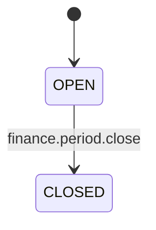
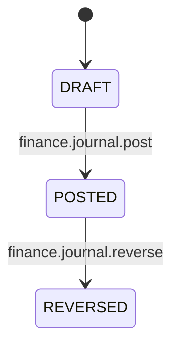
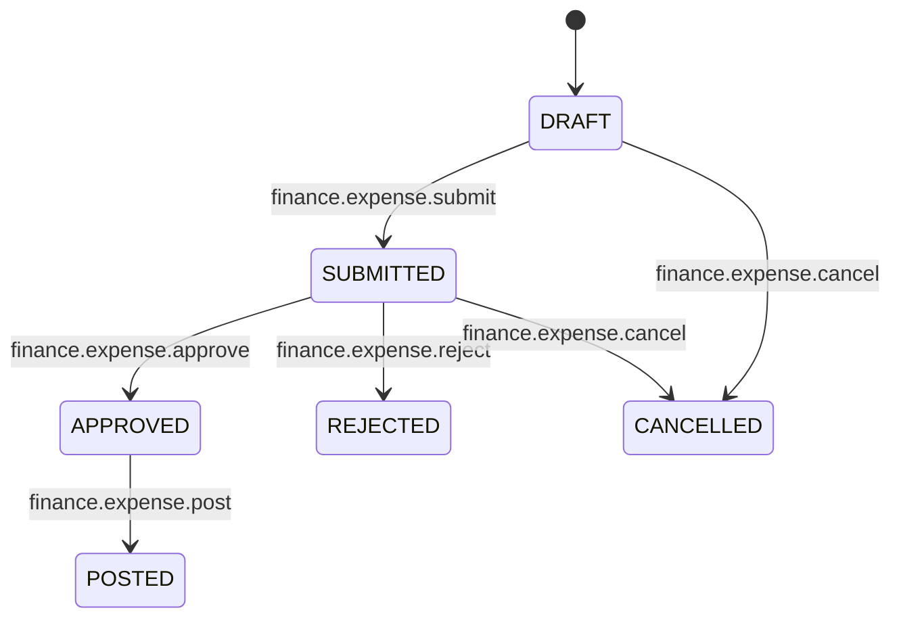
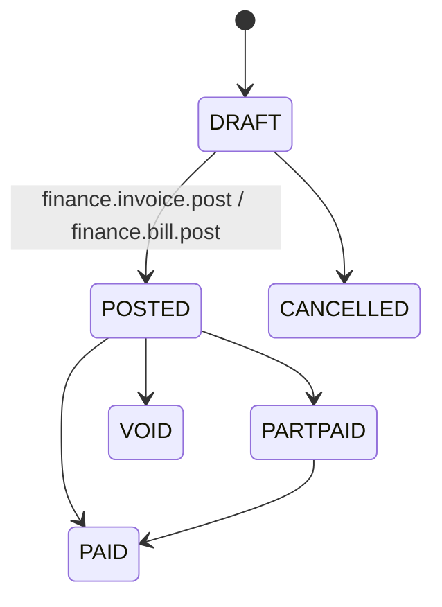
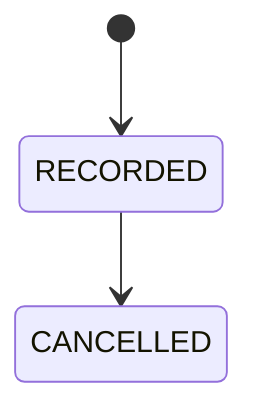

> One sentence: Record transactions across double-entry general ledger, manage billing, process expenses, and control accounting periods.

## Overview
The Finance module is the core of TenArm BES's accounting capabilities. It provides a full double-entry accounting system with automated general ledger postings, period management, chart of accounts, and comprehensive accounts receivable (AR) and accounts payable (AP) functionalities.

## Accounting Periods

### What It Does
Controls when journal entries can be posted and prevents historical modifications by closing financial periods.

### Status Lifecycle

| Status | What It Means | What You Can Do |
|--------|--------------|-----------------|
| OPEN | The period is active and accepting financial postings. | You can post journals, invoices, and bills in this period. |
| CLOSED | The period is finalized for reporting. | No new financial postings or modifications can occur. |

### Key Fields
| Field | Required | Notes |
|-------|----------|-------|
| `code` | Yes | Identifier for the period (e.g., "2026-Q1"). |
| `name` | Yes | Human-readable name (e.g., "Q1 2026"). |
| `start_date` | Yes | First day of the accounting period. |
| `end_date` | Yes | Last day of the accounting period. |
| `status` | Yes | Automatically set to OPEN on creation. |

### How To Close a Period
1. Navigate to **Finance → Accounting Periods**
2. Select the OPEN period you wish to finalize.
3. Click **Close Period** (requires `finance.period.close` permission).

### Things to Know
- Once a period is CLOSED, you cannot post any new journal entries to dates within that period.
- Reversals must be posted in an OPEN period, even if the original transaction happened in a CLOSED period.

---

## Journal Entries

### What It Does
Records double-entry financial transactions directly to the General Ledger.

### Status Lifecycle

| Status | What It Means | What You Can Do |
|--------|--------------|-----------------|
| DRAFT | Work-in-progress journal entry. | Can be edited or deleted. Not visible in General Ledger. |
| POSTED | Permanently recorded in the General Ledger. | Cannot be deleted. Must be reversed if incorrect. |
| REVERSED | Has been offset by an opposing journal entry. | Exists for audit trail but has net zero impact. |

### Key Fields
| Field | Required | Notes |
|-------|----------|-------|
| `entry_date` | Yes | Must fall within an OPEN accounting period. |
| `description` | Yes | Rationale or note for the entry. |
| `lines` | Yes | Must contain at least two lines (Debit and Credit) that perfectly balance. |

### How To Post a Journal Entry
1. Navigate to **Finance → Journal Entries**
2. Click **Create Journal Entry**
3. Fill in the `entry_date`, `description`, and balance the Debit and Credit `lines`.
4. Click **Post** (requires `finance.journal.post` permission).

### Things to Know
- A Journal Entry **must** balance (Total Debits = Total Credits).
- DRAFT entries can be deleted, but POSTED entries can only be reversed.

---

## Expenses

### What It Does
Tracks out-of-pocket or corporate card spending, routing it through approval workflows before reimbursing or posting to the ledger.

### Status Lifecycle

| Status | What It Means | What You Can Do |
|--------|--------------|-----------------|
| DRAFT | Unsubmitted expense record. | Can be modified or cancelled. |
| SUBMITTED | Sent for manager/finance approval. | Wait for review. Can be cancelled by the submitter. |
| APPROVED | Approved for payment. | Ready to be posted to AP. |
| REJECTED | Declined during review. | Check notes to understand why it was rejected. |
| POSTED | Financial impact recorded (Dr Expense, Cr AP). | Ready for payment allocation. |
| CANCELLED | The expense is voided. | Terminal state. |

### Key Fields
| Field | Required | Notes |
|-------|----------|-------|
| `vendor_party_id` | Yes | The vendor or employee who incurred the expense. |
| `reimbursable` | Yes | Whether this expense requires reimbursement out of company funds. |
| `expense_date` | Yes | Date the expense was incurred. |
| `lines` | Yes | Breakdown of spending across Expense Categories. |

### How To Submit an Expense
1. Navigate to **Finance → My Expenses** (or **Expenses** for finance admins)
2. Click **Add Expense**
3. Select the Vendor/Employee, Date, and fill in line items categorizing the spend.
4. Click **Submit** to route for approval.

### Things to Know
- Expenses must use predefined Expense Categories (mapped to GL accounts).
- Only APPROVED expenses can be POSTED to the General Ledger.

---

## Billing (Invoices & Bills)

### What It Does
Manages Accounts Receivable (Invoices to customers) and Accounts Payable (Bills from vendors).

### Status Lifecycle

| Status | What It Means | What You Can Do |
|--------|--------------|-----------------|
| DRAFT | Unconfirmed billing document. | Can be updated or cancelled. |
| POSTED | Recorded in AR/AP. | Awaiting payment. Affects GL. |
| PARTPAID | Payment partially applied. | Awaiting remaining balance. |
| PAID | Fully settled. | Finished. |
| CANCELLED | Discarded before posting. | Terminal state. |
| VOID | Reversed after posting. | Reverses GL impact. |

### Things to Know
- **Invoices** are created from Sales Orders and post as Dr AR / Cr Revenue.
- **Bills** are created from Purchase Orders and post as Dr Inventory/Expense / Cr AP.
- DRAFT documents can be cancelled, releasing the unbilled quantities back to the source orders.

---

## Payments

### What It Does
Records incoming receipts (AR) and outgoing disbursements (AP), allocating them against invoices and bills.

### Status Lifecycle

### Key Fields
| Field | Required | Notes |
|-------|----------|-------|
| `direction` | Yes | Incoming (receipt) or Outgoing (disbursement). |
| `amount` | Yes | Total payment amount. |
| `unapplied_amount` | Yes | Amount not yet allocated to specific bills or invoices. |
| `payment_date` | Yes | Date the transaction occurred. |

### How To Record a Payment
1. Navigate to **Finance → Payments**
2. Click **Record Payment** (or **Vendor Payment**).
3. Select the party, enter the amount and date.
4. (Optional) Allocate the payment directly to open Invoices or Bills.

### Things to Know
- Payments immediately affect the Cash/Bank GL account.
- Any unapplied amount represents an advance or on-account balance that can be later allocated or refunded.

---

## Integrations
| Module | When | What Happens |
|--------|------|-------------|
| `sales` | Invoice Created | DRAFT invoice created from Sales Order. |
| `procurement` | Bill Created | DRAFT bill created from Purchase Order. |
| `inventory` | Stock Shipped | Auto-posts COGS and reduces Inventory GL. |
| `inventory` | Stock Returned | Auto-reverses COGS and restores Inventory GL. |
| `payroll` | Expense Posted | Posts reimbursement data to payroll. |
| `asset_management` | Asset Depreciated | Auto-posts depreciation expense and accumulated depreciation. |

## Permissions
| Permission | What It Unlocks |
|-----------|----------------|
| `finance.dashboard.view` | View finance dashboards and KPIs. |
| `finance.account.view` | View Chart of Accounts and mappings. |
| `finance.journal.create` | Create DRAFT journal entries. |
| `finance.journal.post` | Post DRAFT journals to the GL. |
| `finance.invoice.post` | Issue/Post customer invoices. |
| `finance.bill.post` | Post vendor bills. |
| `finance.expense.approve` | Approve submitted expenses. |
| `finance.payment.record` | Record incoming customer payments. |
| `finance.period.close` | Close an accounting period. |
| `finance.bank.reconcile` | Perform bank reconciliation. |
