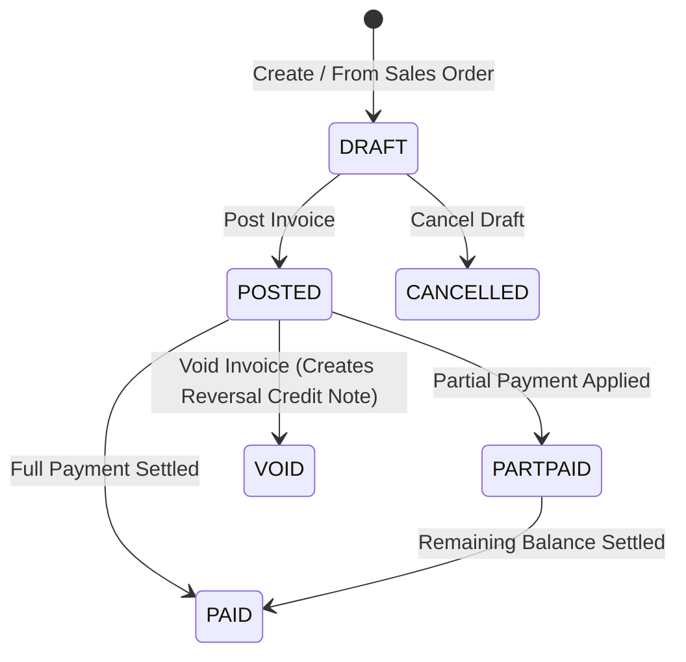
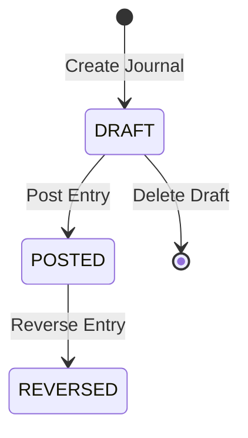

```mermaid
stateDiagram-v2
    [*] --> DRAFT : Create / From Purchase Order
    DRAFT --> POSTED : Post Bill
    POSTED --> PARTPAID : Partial Disbursement Recorded
    POSTED --> PAID : Fully Settled
    PARTPAID --> PAID : Remaining Balance Settled
    DRAFT --> CANCELLED : Cancel Draft
    POSTED --> CANCELLED : Cancel (0 Paid only; Reverses GL)
```

# Finance

Part of the <strong>Order to Cash (O2C)</strong> &amp; <strong>Procure to Pay (P2P)</strong> Storylines: Step 6 of 6 (O2C Invoicing &amp; Receipt) &amp; Steps 4 &amp; 5 of 5 (P2P Bill &amp; Settlement)

> The financial heart and double-entry general ledger of TenArm BES, orchestrating accounts receivable invoicing, accounts payable vendor bills, cash receipts and disbursements, banking reconciliation, period close governance, statutory tax codes, and financial reporting.

The Finance module provides an immutable, auditable, double-entry financial architecture for TenArm BES. It connects upstream customer dispatches from Sales and warehouse receipts from Procurement directly to the General Ledger (GL) through automated posting rules. From tracking customer credit limits and invoice aging through vendor disbursements, multi-currency bank reconciliations, and executive P&L statements, every transaction adheres to strict accounting invariants with zero manual balance drift.

---

## Workspace Ergonomics

The Finance workspace is engineered for meticulous accounting accuracy, high-volume document auditing, and uninterrupted financial triage:

- **Multi-Tab Desk**: Financial controllers and accountants can operate across up to 3 active finance tabs simultaneously (e.g. keeping **Invoices** open while reviewing an unposted **Journal Entry Storyline** and verifying **Bank Reconciliation**). Switching tabs preserves active status filters, search queries, pagination offsets, and uncommitted form edits without reloading.
- **Draft Auto-Save**: Uncommitted form inputs across draft customer invoices, vendor bills, manual journal debit/credit allocations, expenses, and payment distributions are continuously preserved locally. The active tab header displays a dirty dot indicator (`•`) until the record is formally posted or cancelled.
- **Quick-Peek Slide-Out**: Clicking any linked invoice number, vendor bill ID, journal entry, source sales order, customer credit badge, or tax code opens an inspection drawer from the right edge of the screen, allowing users to verify double-entry debit/credit distributions and master attributes without navigating away from their active work queue.

---

## Core Financial Concepts & Invariants

### Strict Double-Entry General Ledger (`sum(Dr) == sum(Cr)`)
All financial entries post to the General Ledger as balanced double-entry transactions. The fundamental invariant requires that the total debit amount must exactly equal the total credit amount (`sum(Dr) == sum(Cr) > 0`).

**The Immutability Contract**:
- **Draft Entries**: Work-in-progress journals can be edited or deleted while in `DRAFT`.
- **Posted Entries**: Once an entry is `POSTED`, it becomes permanently immutable. Posted journals, invoices, and bills cannot be modified or deleted. Corrections are executed exclusively through formal **Reversal Entries** that generate an offsetting journal entry in an open accounting period, preserving a complete audit trail.

### Fiscal Period Lock & Close Readiness
Accounting periods control the timing of financial postings:
- **Open Periods**: Financial postings (invoices, bills, receipts, disbursements, and journal entries) can only be posted if their accounting date falls within an `OPEN` period.
- **Closed Periods**: Once an accounting period is marked `CLOSED`, no transactions or reversals can be posted to dates within that period.
- **Close Readiness Audit**: Before a period can be closed, the system runs an automated readiness check across all active modules (Sales, Procurement, Inventory, Payroll). If any unposted documents, pending allocations, or unconfirmed goods receipts exist, the period close is blocked until these items are resolved.

### Automated Subledger Posting Rules
Instead of manual bookkeeping, business transactions automatically trigger balanced double-entry GL postings through configurable **Auto-Posting Rules** (`/finance/document-mappings`):
- **Customer Invoice Posted**: Dr Accounts Receivable, Cr Sales Revenue, Cr Tax Output.
- **Vendor Bill Posted**: Dr Inventory Valuation / Expense, Dr Tax Input, Cr Accounts Payable.
- **Customer Payment Received**: Dr Bank / Cash, Cr Accounts Receivable.
- **Vendor Disbursement Paid**: Dr Accounts Payable, Cr Bank / Cash.
- **Goods Shipped to Customer**: Dr Cost of Goods Sold (COGS), Cr Inventory Valuation.

### Customer Advances & On-Account Deposits
When customers pay before orders are shipped or invoices are raised, receipts are captured as **Customer Advances** (`CUSTOMER_ADVANCE`). Advances are held as an on-account liability (`Dr Cash / Cr Customer Advance`). Once the tax invoice is posted, open advances can be allocated directly to the invoice with a single click (**Apply to Order** or **Apply Advance**), posting an automated reclassification journal (`Dr Customer Advance / Cr Accounts Receivable`).

### Three-Way Matching & Purchase Price Variance (PPV)
Vendor bills undergo strict three-way matching against Purchase Orders and warehouse receiving receipts:
- Billed quantities cannot exceed received warehouse quantities.
- Discrepancies between expected purchase order prices and final carrier/supplier invoices are captured using the **Record PPV Variance** tool, posting the difference cleanly to Purchase Price Variance accounts rather than distorting raw material inventory valuation.

---

## Core Screens & Workflows

### 1. Finance Dashboard (`/finance/dashboard`)

**What it does** — Executive and operational financial overview providing instant visibility into cash positions, revenue velocity, operating margins, and ledger balance integrity.

**Key Features & Highlights**
- **Period Filter**: Select any configured accounting period to inspect historical performance. Defaults automatically to the current open fiscal period.
- **Consolidated Tabs**:
  - `Overview`: High-level executive pulse cards and comparative charts.
  - `P&L Summary`: Condensed Profit and Loss report broken down by Revenue, Direct Cost of Sales, and Operating Expenses (OpEx).
  - `Balance Sheet Summary`: Condensed statement of Assets, Liabilities, and Equity.
- **Pulse KPI Cards**:
  - `Revenue`: Gross and net billed revenue for the selected period.
  - `Net Profit`: Bottom-line earnings after all direct costs, overheads, and taxes.
  - `Operating Expenses`: Aggregated overhead, administrative, and payroll spending.
  - `Operating Margin`: Net operating profit percentage indicator.
  - `Cash Flow`: Net cash movement across all banking and cash ledgers.
- **Direct Ledger Navigation**: Every revenue, expense, and asset account line includes an instant **Ledger →** link to inspect itemized GL transactions in Quick-Peek.

---

### 2. Customer Tax Invoices (`/finance/invoices` & `/finance/invoices/:id`)

**What it does** — Comprehensive Accounts Receivable (AR) cockpit for issuing customer tax invoices, tracking outstanding balances, generating GST E-Invoices, and recording payment collections.

**Lifecycle & States**

| State | What It Means | What You Can Do Next |
|---|---|---|
| `DRAFT` | Invoice created but not yet recognized on the General Ledger. | Edit line items, re-sync from order shipments, cancel, or post. |
| `POSTED` | Formally posted to GL (Dr AR / Cr Revenue). Open for collection. | Collect payments, allocate advances, generate E-Invoice, or void. |
| `PARTPAID` | Partial customer payment has been recorded and allocated. | Collect remaining balance or apply on-account credit notes. |
| `PAID` | Balance due is zero. Fully settled. | View payment audit trail; download receipt or tax PDF. |
| `CANCELLED` | Draft discarded before posting. Releases order quantities. | Terminal audit state. |
| `VOID` | Post-facto reversal of a posted invoice via full credit note. | Terminal state; releases sales order unbilled balances for re-invoicing. |

**Key Views & Sections**
- **Segmented Header Tabs**:
  - `Invoices`: Complete register of all customer tax invoices with status filters and overdue toggles.
  - `Ready to Invoice`: Sourcing queue listing approved Sales Orders with fulfilled dispatches awaiting invoicing.
- **View Switcher**: Toggle between **Command Desk** (SplitDesk with sticky invoice queue on the left and full Storyline on the right) and **Table Mode**.
- **Receivables Pulse Grid**: Tracks Total Billed Receivables, Current Outstanding AR, Overdue Balance count, and Collection Realization Rate.

**The Invoice Storyline Sections**
1. **Document Header**: Displays Invoice #, status badge, revision version, invoice date, and customer name. Clicking the **Position** button opens the customer credit inspection drawer to check real-time credit limits, total exposure, and aged AR balance.
2. **Billed Items & Totals**: Itemized table showing catalog SKU, billed quantity, unit price, discounts, freight charges, and itemized statutory tax parts (e.g. CGST, SGST, IGST).
3. **Advance Payments Panel**: If the customer has unapplied advance deposits on account, this section highlights available funds. Click **Apply to Invoice** to settle the balance due without writing a new payment.
4. **Payment Allocations Panel**: Lists all payments and credit notes currently applied to this invoice. Authorized users can click **Unallocate** if a payment was applied to the wrong invoice.
5. **GST E-Invoice (IRN)**: For Indian tax regimes, click **Generate IRN** to dispatch the invoice payload to the government tax portal and store the authenticated Invoice Reference Number (IRN) and QR code.

**How to Invoice an Order and Collect Payment**
1. Navigate to **Finance → Invoices** (`/finance/invoices`).
2. Switch to the **Ready to Invoice** tab. Locate the customer's sales order and click **Create Invoice**.
3. In the draft invoice, verify quantities, freight, and applied tax codes. If additional items were dispatched in the interim, click **Re-sync from Order**.
4. Click **Post Invoice**. The system validates that the accounting date falls within an open period, assigns an immutable document number, and posts Dr AR / Cr Revenue.
5. Under the **Advance Payments** panel, click **Apply Advance** if deposit credits exist.
6. When customer remittance arrives, click **Collect Payment**. In the payment modal, select the receiving bank account, enter the transaction reference, and click **Record Payment**.

---

### 3. Accounts Payable & Vendor Bills (`/finance/bills` & `/finance/bills/:id`)

**What it does** — Manages Accounts Payable (AP) commitments, tracks incoming supplier invoices, enforces three-way matching against purchase orders, and records vendor disbursements.

**Lifecycle & States**

**Key Features & Controls**
- **Three-Way Matching**: Bills linked to Purchase Orders verify that billed quantities do not exceed dock receipts from Inventory.
- **Vendor Reference & Dates**: Captures the supplier's original tax invoice number, bill date, and payment due date.
- **Action Buttons in Storyline**:
  - `Post Bill`: Establishes the AP liability on the General Ledger (`Dr Inventory / Expense, Dr Tax Input, Cr Accounts Payable`).
  - `Pay Supplier`: Opens payment modal to disburse funds from a corporate bank account (`Dr AP / Cr Cash/Bank`).
  - `PPV Variance`: Launches the modal to record purchase price variance to GL.
  - `Peek GL Impact`: Inspects the exact debit and credit lines posted to the ledger.
  - `Advance Payments`: Matches and absorbs upfront deposits paid to the vendor.

---

### 4. Payments & Cash Settlements (`/finance/payments`)

**What it does** — Central ledger of all monetary movements across corporate cash and bank accounts, tracking incoming receipts (AR) and outgoing disbursements (AP).

**Key Features & Controls**
- **Direction Filters**:
  - `All Payments`: Complete chronological cash flow register.
  - `Customer Receipts (AR)`: Inflows from buyers settling invoices or paying upfront advances (`Dr Bank/Cash / Cr AR`).
  - `Vendor Payments (AP)`: Outflows to suppliers settling bills or funding procurement advances (`Dr AP / Cr Bank/Cash`).
- **Advances & On-Account Deposits**:
  - Any payment amount received or disbursed without immediate document allocation is tagged with an **Advance** badge.
  - The **Advances Only** toggle filters exclusively for unapplied balances.
- **Cash Flow Pulse Cards**: Tracks Total Receipts, Total Disbursements, Net Cash Flow, and Total Held Advances across the tenant.
- **Recording Payments**:
  1. Click **Record Advance / Payment** to open the payment drawer.
  2. Select the **Direction** (`Customer Payment / Advance (AR)` or `Vendor Disbursement (AP)`).
  3. Select the **Customer or Vendor Account**.
  4. Enter the **Amount**, **Payment Date**, **Payment Method** (`Bank Transfer`, `Cheque`, `Cash`, `UPI`), and target **Bank Account**.
  5. (Optional) Select specific open invoices or bills to allocate against immediately. Any remainder is automatically saved as an unapplied advance.
  6. Click **Confirm Payment**.

---

### 5. Credit Notes & Debit Notes (`/finance/credit-notes` & `/finance/debit-notes`)

**What they do** — Official accounting adjustments reversing or discounting posted commercial transactions without altering historical invoices.

**Credit Notes (`/finance/credit-notes`)**
- Issued to customers against posted invoices to record sales returns, price corrections, or volume rebates.
- **Optional Warehouse Restocking**: When goods are returned by the customer, checking **Restock Goods** and choosing a **Restock Warehouse** automatically generates an inventory receipt, restoring warehouse stock balances and reversing Cost of Goods Sold.
- **GL Impact**: Posts `Dr Sales Returns / Revenue, Dr Tax Output, Cr Accounts Receivable`.

**Debit Notes (`/finance/debit-notes`)**
- Issued to suppliers against posted vendor bills to claim deductions, damaged shipment allowances, or returned goods.
- **GL Impact**: Posts `Dr Accounts Payable, Cr Purchase Returns / Expense, Cr Tax Input`.

---

### 6. General Ledger & Journal Entries (`/finance/journals` & `/finance/journals/:id`)

**What it does** — Direct double-entry journal workstation for manual adjustments, payroll allocations, tax adjustments, and year-end closing entries.

**Lifecycle & States**

| State | What It Means | What You Can Do Next |
|---|---|---|
| `DRAFT` | Work-in-progress entry. Can be unbalanced while being drafted. | Edit lines, balance debits and credits, post, or delete. |
| `POSTED` | Permanently recorded in the General Ledger. Lines are immutable. | Reverse entry; inspect account balance impacts. |
| `REVERSED` | Offset by an opposing mirror reversal entry. Net GL impact is zero. | Permanent audit record. |

**Key Features & Rules**
- **Strict Balance Validation**: A draft entry can only be posted when total debits exactly equal total credits (`sum(Dr) == sum(Cr)`). The header displays a green `Balanced` badge or a red `Out of Balance` indicator.
- **Open Period Constraint**: The entry date must fall within an open accounting period.
- **Reversal Workflows**: Clicking **Reverse Entry** prompts for a reversal date (which must also fall within an open period) and automatically generates and posts a mirrored opposing entry, tagging both documents with cross-reference audit links.

---

### 7. Chart of Accounts (`/finance/accounts`)

**What it does** — The organizational hierarchy of financial accounts structuring the general ledger.

**Account Categories & Normal Balances**

| Category | Normal Balance | Purpose | Examples |
|---|:---:|---|---|
| **ASSET** | Debit (Dr) | Economic resources owned by the business. | Operating Bank Accounts, Petty Cash, Accounts Receivable, Inventory Valuation. |
| **LIABILITY** | Credit (Cr) | Financial obligations and debts owed to third parties. | Accounts Payable, Customer Advances Held, GST/Tax Payable. |
| **EQUITY** | Credit (Cr) | Owner capital, retained earnings, and reserves. | Share Capital, Retained Earnings, Partner Equity. |
| **REVENUE** | Credit (Cr) | Inflows generated from primary business operations. | Product Sales Revenue, Service Income, Interest Received. |
| **EXPENSE** | Debit (Dr) | Operational outflows and consumption of resources. | Cost of Goods Sold (COGS), Warehouse Rent, Freight Expense, Salaries. |

**How to Add an Account**
1. Navigate to **Finance → Chart of Accounts** (`/finance/accounts`).
2. Click **Add Account**.
3. Enter a unique **Account Code** (e.g. `1210`), descriptive **Account Name** (e.g. `HDFC Bank - Operating`), and select the **Account Type**.
4. The system automatically assigns the correct normal balance convention (`Debit` for Assets/Expenses; `Credit` for Liabilities/Equity/Revenue). Click **Create Account**.

---

### 8. Accounting Periods & Fiscal Governance (`/finance/periods`)

**What it does** — Controls fiscal calendars, establishes financial posting windows, and governs month-end / year-end closing audits.

**Period Closing Readiness & Blockers**
Closing an accounting period prevents any further postings to historical dates. Before an open period can be closed, TenArm BES executes an automated **Close Readiness Review**:
- Audits open draft invoices and bills across the period.
- Scans for unposted subledger pending transactions.
- Verifies that all prior periods in the fiscal year are already closed.
- If blocker count is zero, authorized controllers can click **Close Period**.

**Reopening Periods**
If historical adjustments are legally required, authorized finance managers can click **Reopen Period**. The system enforces a mandatory commercial justification dialog, logging who reopened the period, when, and the business reason into the administrative audit ledger.

---

### 9. Banking & Bank Reconciliation (`/finance/bank-accounts` & `/finance/reconciliation`)

**What it does** — Manages corporate bank accounts and reconciles statement transactions against internal general ledger cash books.

**Reconciliation Cockpit (`/finance/reconciliation`)**
1. **Select Account**: Choose the corporate bank account.
2. **Review Balances**: The header displays three critical metrics:
   - `Statement Balance`: Closing balance reported by the bank.
   - `Ledger Balance`: Current balance of the linked Asset GL account.
   - `Unreconciled Difference`: Net variance requiring investigation.
3. **Import Statements**: Click **Import Statement**. Paste CSV statement lines (columns: `date, amount, description, reference`) or upload bank statement files.
4. **Match Transactions**: The screen presents two interactive columns:
   - **Bank Statement Lines** (Left).
   - **Internal Book Payments / Journal Lines** (Right).
   - Click **Match** on corresponding items with matching amounts and dates. Once matched, lines transition to `RECONCILED`, clearing the variance.

---

### 10. Expenses & Corporate Spend (`/finance/expenses`)

**What it does** — Tracks out-of-pocket, travel, employee reimbursement, and corporate card spending through a structured approval workflow.

**Lifecycle**: `DRAFT` → `SUBMITTED` → `APPROVED` → `POSTED` → `PAID` (or `REJECTED`, `CANCELLED`).
- **Submit Expense**: Employees enter spending lines categorized by **Expense Category** (each mapped to a specific GL expense account) and click **Submit Expense**.
- **Management Review**: Finance leads review attached receipts and approve via **Approve Expense** (or **Reject Expense** with feedback notes).
- **Posting & Reimbursement**: Approved expenses are posted to the ledger via **Post to GL** (`Dr Expense Category / Cr Accounts Payable`) and disbursed via **Pay Expense**.

---

### 11. Financial Statements & Reporting (`/finance/statements`)

**What it does** — Real-time statutory and managerial financial reporting generated directly from general ledger account balances.

**Available Statements & Reports**
- **Profit & Loss Statement (P&L)**: Real-time calculation of Gross Revenue, Cost of Goods Sold, Gross Margin, Operating Expenses, and Net Operating Income.
- **Balance Sheet**: Point-in-time snapshot proving the fundamental accounting equation: `Assets = Liabilities + Equity`.
- **Trial Balance (`/finance/reports/trial-balance`)**: Comprehensive list of all general ledger accounts with their net debit or credit balances, confirming ledger balance integrity.
- **General Ledger (`/finance/reports/ledger`)**: Detailed chronological transaction register for any chosen account, with running balance tallies.
- **AR & AP Aging Reports (`/finance/reports/ar-aging` & `ap-aging`)**: Bucket analysis of outstanding receivables and payables (Current, 1–30 Days, 31–60 Days, 61–90 Days, 90+ Days Overdue).
- **Comparison Modes**: Compare statements against **Prior Period**, **Year-over-Year (YoY)**, or a **Custom Period**. Includes CSV export and print-ready formatting.

---

### 12. Tax Codes (`/finance/tax-codes`)

**What it does** — Configures organization-wide statutory tax codes (such as GST, VAT, and Sales Tax), percentage rates, tax types, and default preselection rules applied across quotations, sales orders, customer invoices, and vendor purchase orders.

**Key Metrics & Pulse Cards**
- **Total Codes**: Aggregate count of all configured statutory tax codes.
- **Active Codes**: Number of tax codes currently available for transaction line selection.
- **Default Tax**: Currently designated default tax code automatically pre-selected on newly created sales and procurement lines.
- **Tax Types**: Distinct statutory regimes active across the organization (`GST`, `VAT`, `SALES`).
- **Active Rate**: Percentage of tax codes currently enabled.

**Key Fields**

| Field | Required | Description & Validation |
|---|:---:|---|
| **Code** | ✅ | Short alphanumeric identifier (e.g. `GST18`, `VAT5`, `ZERO`). Immutable once created to maintain transaction line integrity. |
| **Name** | ✅ | Clear business description (e.g. `Standard GST 18%`, `Export Zero-Rated`). |
| **Rate (%)** | ✅ | Statutory percentage between `0` and `100` (e.g. `18.00`, `5.00`, `0.00`). |
| **Type** | ✅ | Statutory regime classification: `GST`, `VAT`, or `SALES`. |
| **Default** | — | When enabled, this code is preselected automatically on new quotes, sales orders, invoices, and purchase orders. Only one code can be the default; activating this flag un-defaults any previous selection. |
| **Active** | — | Controls dropdown availability. Inactive codes cannot be chosen on new documents, but remain preserved on historical lines. |

**How to Configure a Tax Code**
1. Navigate to **Finance → Tax Codes** (`/finance/tax-codes`) under the **General Ledger** menu group.
2. Click **+ Add Tax Code** to open the creation dialog.
3. Enter the **Code**, **Name**, **Rate (%)**, and select the statutory **Type**.
4. (Optional) Check **Default (preselected on new quotes/orders/POs)** to make this the primary organization-wide rate.
5. Click **Create Tax Code**.

**Workspace Tips**
- **Quick Status Toggle**: Click the **Active** / **Inactive** badge on any row to toggle its availability without opening the edit dialog.
- **Promote to Default**: Click the star icon on any active tax code row to designate it as the system default.
- **Immutable Code Guarantee**: Tax codes are locked once created to safeguard historical transactions. If a tax rate changes legislatively, set the old code to Inactive and create a new code.
- **Concurrent Guard (OCC)**: Tax code updates enforce version validation. If two administrators modify a rate simultaneously, a conflict alert guides you to review competing changes.

---

### 13. Auto-Posting Rules (`/finance/document-mappings`)

**What it does** — Establishes the automated double-entry bridge between commercial business documents and the General Ledger. Defines which GL accounts are automatically debited and credited when invoices, bills, payments, expenses, and inventory shipments are posted.

**Document Types & Mapping Roles**

| Document Type | Role | Typical GL Account | Posting Impact |
|---|---|---|---|
| **Invoice** | `AR` | Trade Accounts Receivable (Asset) | Dr Accounts Receivable |
| **Invoice** | `REVENUE` | Finished Goods Sales (Revenue) | Cr Sales Revenue |
| **Invoice** | `TAX_OUTPUT` | Output GST / Tax Payable (Liability) | Cr Tax Output |
| **Bill** | `AP` | Trade Accounts Payable (Liability) | Cr Accounts Payable |
| **Bill** | `INVENTORY` | Raw Materials / Merchandise Inventory (Asset) | Dr Inventory Valuation |
| **Bill** | `TAX_INPUT` | Input Tax Credit (Asset) | Dr Tax Input |
| **Payment** | `CASH` | Operating Bank / Cash Account (Asset) | Dr Cash / Cr AR (Receipts) |
| **Payment** | `CUSTOMER_ADVANCE` | Customer Deposits / Advances (Liability) | Cr Customer Advance |
| **VendorPayment** | `SUPPLIER_ADVANCE` | Supplier Advances Paid (Asset) | Dr Supplier Advance |
| **Shipment** | `COGS` | Cost of Goods Sold (Expense) | Dr Cost of Goods Sold |
| **Shipment** | `INVENTORY` | Inventory Asset (Asset) | Cr Inventory Valuation |
| **TdsDeduction** | `TDS_PAYABLE` | Statutory TDS Payable (Liability) | Cr TDS Payable |

**How to Configure an Auto-Posting Rule**
1. Navigate to **Finance → Auto-Posting Rules** (`/finance/document-mappings`) under **General Ledger**.
2. Click **+ Add Mapping Rule**.
3. Select the source **Document Type** (e.g. `Invoice`, `Bill`, `Payment`).
4. Select the accounting **Mapping Role** (e.g. `AR`, `REVENUE`, `TAX_OUTPUT`).
5. Choose the corresponding target **GL Account** from the Chart of Accounts.
6. Click **Create Rule**.

---

### 14. Customer & Vendor Refunds (`/finance/refunds`)

**What it does** — Dedicated register tracking return disbursements paid to customers (for cancelled orders, overpayments, or return credit balances) and recovery receipts received from vendors (for returned materials or overbilled debit notes).

**Refund Directions**

| Direction | Source Document | Financial & GL Impact |
|---|---|---|
| **Customer Refund (AR)** | Customer Payment / Advance or Credit Note | Returns customer funds. Debits the Customer Advance liability account and credits the corporate Bank/Cash account (`Dr Customer Advance / Cr Bank`). |
| **Vendor Refund (AP)** | Supplier Disbursement / Advance or Debit Note | Receives returned funds from supplier. Debits the corporate Bank/Cash account and credits Supplier Advance / Debit Note receivables (`Dr Bank / Cr Supplier Advance`). |

**How to Inspect and Track Refunds**
1. Navigate to **Finance → Refunds** (`/finance/refunds`) under **Receivables**.
2. Use the segmented filter bar to toggle between **All**, **Customer Refunds**, or **Vendor Refunds**.
3. Review the pulse cards tracking aggregate refund volumes and net monetary returns.
4. Click any **Refund #** to open Quick-Peek and trace the direct audit lineage back to the originating Payment, Credit Note, or Debit Note.
5. Click **Export CSV** to download the audit register.

---

## If Something Goes Wrong (Common Validation & Guard Errors)

| What you see (Toast / Banner) | Why it happens | How to fix it in the workspace |
|---|---|---|
| **"Accounting date must fall within an OPEN accounting period"** | The document date belongs to a period that is `CLOSED` or not yet created. | Navigate to **Finance → Accounting Periods**. Create or reopen the relevant period, or adjust the document's date to fall within an active open period. |
| **"Posting must strictly balance: sum(Dr) == sum(Cr)"** | Total debit lines do not equal total credit lines on a draft journal entry. | Review the journal lines table. Ensure the net variance between debits and credits is exactly zero before clicking **Post Entry**. |
| **"Cannot close period: unresolved blockers detected"** | Period close readiness audit found unposted draft invoices, bills, or pending subledger transactions. | In the **Close Readiness Review** panel, inspect the blocker list. Post or cancel the open documents, resolve pending postings, and re-attempt closing. |
| **"Cannot cancel posted document: payments have been applied"** | An invoice or bill has payments or advances allocated against it and cannot be directly cancelled. | Under the **Payment Allocations** panel on the document, click **Unallocate** to remove all applied payments, then cancel the document or issue a formal Credit/Debit Note. |
| **"Cannot void draft invoice (use cancel instead)"** | Voiding is reserved for posted invoices that have generated legal document numbers and GL entries. | For draft invoices, click **Cancel** to discard the draft without creating a reversal credit note. |
| **"Billed quantity exceeds received quantity on purchase order"** | Three-way match guard: supplier invoice bills for more units than warehouse clerks received on the dock. | Verify dock receipts with the warehouse team in Inventory. Ensure all goods receipt notes are posted before approving the vendor bill. |
| **"Credit limit exceeded for customer"** | Total open invoice balance plus current orders exceeds the buyer's approved commercial credit terms. | Collect an upfront deposit via **Record Advance / Payment**, apply existing credit notes, or request a credit override from a financial controller. |
| **"Tax regime cannot decide posting parts (missing tax identity)"** | Organization or partner profile lacks tax registration information (e.g. missing GSTIN or state territory). | Edit the customer or vendor commercial profile to add their Tax ID and state region, or select an appropriate tax treatment. |
| **"Tax code already exists"** | A tax code with the same code identifier already exists for the organization. | Choose a unique code identifier or edit the existing tax code. |
| **"Tax rate must be between 0 and 100"** | Entered tax rate percentage is outside valid numerical bounds. | Enter an exact decimal tax rate between 0 and 100 (e.g. `18.00`). |
| **"Bank statement import failed: invalid CSV format"** | Uploaded statement text does not match the expected column structure. | Ensure the CSV header row exactly matches `date,amount,description,reference` with amounts formatted as standard decimals. |
| **"Record has been modified by another user (OCC Conflict)"** | Another user modified or posted the document while you had it open on screen. | Review the **Conflict Resolution Drawer** comparing local edits with the latest server state, select the desired version, and re-apply. |

---

## Integrations

| Integrated Module | When & Where | What Happens Automatically |
|---|---|---|
| **Sales** | Dispatching goods & taking orders | Dispatched sales orders surface in **Ready to Invoice**. Posting invoices updates AR ledgers; advance receipts link directly to sales commitments. |
| **Procurement** | Receiving vendor goods & freight | Purchase order dock intake triggers three-way match billing candidates. Carrier freight bills capitalize into inventory via Landed Cost allocations. |
| **Inventory** | Stock dispatches & adjustments | Customer shipments auto-post Cost of Goods Sold (Dr COGS / Cr Inventory). Cycle count variances post inventory adjustment journals. |
| **Logistics** | Proof of Delivery & transport bills | Carrier logistics bills post as Accounts Payable freight liabilities or pass-through customer freight expenses. |
| **Payroll** | Monthly payroll processing | Finalized pay runs automatically generate balanced double-entry payroll journals (Dr Wage Expense / Cr Payroll Payable, Cr Statutory Deductions). |
| **Asset Management** | Monthly asset depreciation runs | Automated batch runs post depreciation expense journals (`Dr Depreciation Expense / Cr Accumulated Depreciation`). |
| **GST Invoicing** | Statutory tax compliance | Transmits posted customer invoices to government tax portals, generating compliant IRNs, signed QR codes, and E-Way bills. |
| **AI Insights** | Background financial surveillance | Continuously scans for overdue AR aging thresholds, cash runway depletion, and unusual expense spend anomalies. |

---

## Permissions Reference

| Permission | What It Unlocks in the Workspace |
|---|---|
| `finance.dashboard_overview.get` | Access the executive Finance Dashboard, P&L summaries, and cash velocity charts. |
| `finance.account.view` | View Chart of Accounts and account balance registers. |
| `finance.account.create` | Create new general ledger accounts in the Chart of Accounts. |
| `finance.journal.view` | View Journal Entries register and Journal Storyline inspection desk. |
| `finance.journal.create` | Author and edit draft manual journal entries. |
| `finance.journal.post` | Post balanced draft journals to the General Ledger. |
| `finance.journal.reverse` | Issue formal mirror reversal entries for posted journals. |
| `finance.journal.delete` | Delete unposted draft journal entries. |
| `finance.invoice.view` | View customer invoices queue and Invoice Storyline. |
| `finance.invoice.create` | Author draft customer invoices and convert sales order billing candidates. |
| `finance.invoice.post` | Post draft customer invoices to the General Ledger. |
| `finance.invoice.void` | Void posted customer invoices via automated reversal credit notes. |
| `finance.invoice.cancel` | Cancel unposted draft customer invoices. |
| `finance.bill.view` | View vendor bills queue and Bill Storyline. |
| `finance.bill.create` | Author draft vendor bills from purchase orders. |
| `finance.bill.post` | Post draft vendor bills to the General Ledger and AP. |
| `finance.bill.cancel` | Cancel draft or unpaid vendor bills. |
| `finance.payment.view` | View payments register, advance balances, and cash flows. |
| `finance.payment.record` | Record incoming customer receipts and outgoing vendor disbursements. |
| `finance.payment.allocate` | Allocate unapplied customer advances to posted invoices. |
| `finance.payment.refund` | Issue cash/bank refunds for unapplied customer deposits. |
| `finance.payment.forfeit` | Forfeit abandoned customer advances to income accounts. |
| `finance.period.view` | Inspect fiscal calendars, accounting periods, and close readiness. |
| `finance.period.open` | Configure and open new accounting periods. |
| `finance.period.close` | Execute month-end close reviews, close periods, or reopen closed periods. |
| `finance.bank.create` | Set up corporate bank accounts linked to General Ledger assets. |
| `finance.bank.import` | Import electronic bank statements via CSV or file uploads. |
| `finance.bank.reconcile` | Perform bank statement matching and clear unreconciled variances. |
| `finance.expense.view` | View corporate spend register and employee expense claims. |
| `finance.expense.create` | Submit new expense claims with categorized line items. |
| `finance.expense.approve` | Approve submitted expense claims for reimbursement. |
| `finance.expense.post` | Post approved expenses to the General Ledger and AP. |
| `finance.tax.view` | View configured statutory tax codes register (`/finance/tax-codes`). |
| `finance.tax.create` | Create new statutory tax codes and jurisdiction rates. |
| `finance.tax.update` | Update existing statutory tax code names, rates, active status, and default designation. |
| `finance.document_mappings.list` | View and configure subledger auto-posting rules (`/finance/document-mappings`). |
| `gst.einvoice.generate` | Transmit posted customer invoices to generate government GST IRNs. |
