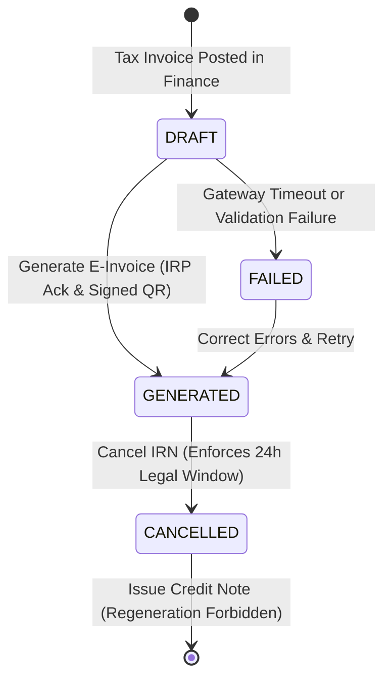
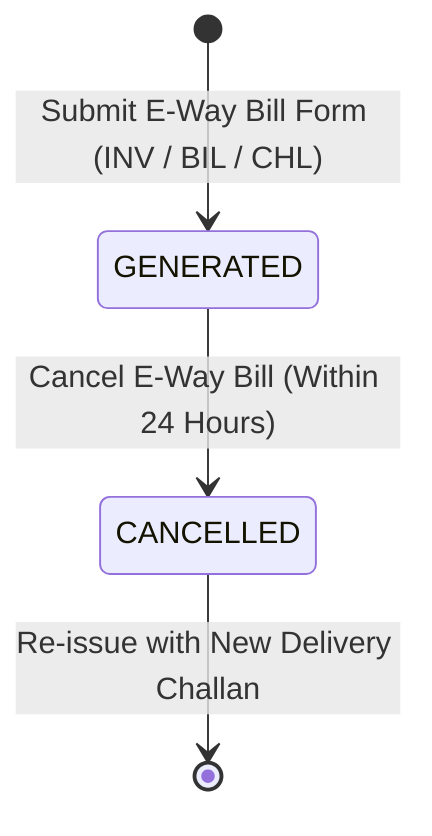

# GST Invoicing & Compliance (India)

<div class="storyline-breadcrumb">Part of the <strong>Order to Cash (O2C)</strong> Storyline: Step 5 of 6 (Statutory E-Invoicing &amp; E-Way Bill Dispatch)</div>

> The statutory compliance engine for Indian organizations, automating GST tax splits (CGST/SGST vs IGST), electronic invoicing with Invoice Registration Numbers (IRN) and signed 2D QR codes via the NIC IRP, transport E-Way Bills, and purchase withholding tax (TDS u/s 194Q).

Operating in India requires compliance with statutory mandates enforced by the Goods and Services Tax Network (GSTN) and the National Informatics Centre (NIC). TenArm BES provides native, automated localization for Indian enterprises. Issued tax invoices automatically generate cryptographically signed Invoice Registration Numbers (IRN) and scannable 2D QR codes. Consignments moving by road generate sequential E-Way Bills with distance-based validity. Intra-state and inter-state transactions automatically split into CGST, SGST, or IGST, while high-volume corporate purchases automatically assess and post TDS under Section 194Q.

---

## Workspace Ergonomics

The GST Compliance workspace is designed for high-volume billing desks, logistics dispatchers, and statutory auditors who demand complete accuracy and zero lost context:

- **Multi-Tab Desk**: Compliance managers can maintain up to 3 independent workspace tabs simultaneously (for example, keeping the **E-Invoices Register** active while monitoring outgoing shipments in **Logistics** and reviewing customer GSTIN profiles in **Counterparties**). Switching tabs preserves active sub-registers, search terms, status filters, and pagination offsets without reloading.
- **Draft Auto-Save (`useFormDraft`)**: Unsaved inputs in the **GST Credentials** configuration form (`gst_credentials`) and the **Generate Statutory E-Way Bill** dialog (`gst_generate_ewaybill`) are automatically saved locally. The active browser tab displays a dirty dot indicator (`•`) until the data is submitted or cancelled.
- **Unsaved Changes Protection (`useUnsavedChanges`)**: Closing the E-Way Bill generation modal with dirty, uncommitted fields triggers an immediate safety confirmation dialog, preventing accidental loss of dispatch parameters.
- **Quick-Peek Slide-Out & Inspection Modals**: Clicking **QR / Detail** on any generated e-invoice opens a dedicated inspection modal displaying the 64-character IRN, an interactive SVG 2D QR code preview, cryptographic tokens, and statutory acknowledgement timestamps without leaving the primary register.
- **Tabular Numerals & One-Click Clipboard Actions**: Statutory 64-character IRNs, 12-digit E-Way Bill numbers, postal PIN codes, and timestamp strings are formatted with monospace tabular numerals for rapid visual scanning. Built-in copy buttons provide one-click clipboard copying with immediate toast confirmation.

---

## Core Statutory Concepts

### 1. Place of Supply & Dual GST Tax Split
Under the Central Goods and Services Tax (CGST) and Integrated Goods and Services Tax (IGST) Acts, tax treatment depends on the seller's state versus the buyer's place of supply:

- **Intra-State Supply (Same State)**: When the organization and the customer/vendor operate within the same Indian state or union territory, tax splits equally:
  $$\text{Total GST Rate} = 50\% \text{ CGST} + 50\% \text{ SGST}$$
  *(For example, an 18% GST item splits into 9% CGST and 9% SGST).*
- **Inter-State Supply (Across States)**: When goods or services cross state boundaries, the entire tax is levied as **100% IGST**.

The system resolves the state automatically by inspecting the party's statutory tax region or the first 2 digits of their 15-character GSTIN. If an invoice requires custom statutory handling (such as special economic zones or zero-rated exports), billing operators can explicitly select either `CGST_SGST` or `IGST`.

### 2. Statutory Invoice Numbering (GST Rule 46b)
In accordance with Rule 46(b) of the CGST Rules:
- Tax Invoices (`INV`), Credit Notes (`CRN`), and Debit Notes (`DRN`) follow an uncompromised sequential numbering sequence specific to each Indian financial year (April 1 through March 31).
- Document numbers are restricted to a maximum length of **16 characters**, consisting of alphanumeric characters, slashes, or hyphens, strictly omitting internal organization prefixes.

### 3. E-Invoicing Architecture (NIC IRP Gateway)
All B2B and export transactions exceeding statutory turnover thresholds must be registered on the government's Invoice Registration Portal (IRP):
- **Canonical IRN Generation**: A unique 64-character hexadecimal SHA-256 hash is computed from the supplier's GSTIN, financial year, document type, and document number.
- **Cryptographic 2D QR Code**: The IRP returns a digitally signed 2D QR code containing vital invoice header details, item summaries, and the digital signature of the portal. This QR code is automatically embedded on printed Tax Invoice PDFs and can be verified using government mobile inspection tools.
- **Statutory 24-Hour Cancellation Window**: Under government regulations, an IRN can only be cancelled within **24 hours** of generation. Once cancelled, government portals forbid regenerating an IRN for the same document number within that financial year. If an error is discovered after 24 hours, the user must issue a formal GST Credit Note (`CRN`).

### 4. Transport E-Way Bills & Validity Calculation
Consignments of goods exceeding ₹50,000 in value require an electronic waybill for transit:
- **12-Digit E-Way Bill Number**: Generated directly from the statutory IRP/E-Way Bill gateway, linking transport details (vehicle number, transporter ID) to the tax invoice or delivery challan.
- **Validity Calculation (CGST Rule 138-10)**: Validity duration is calculated based on transport distance:
  - Consignments up to **200 km**: Valid for **1 calendar day**.
  - For every additional **200 km** (or part thereof): **1 additional day** is added.
- **Strict 24-Hour Cancellation (CGST Rule 138-9)**: An E-Way Bill can be cancelled within 24 hours of generation provided the consignment has not been intercepted in transit by statutory tax officers.

### 5. TDS Under Section 194Q (Purchase Withholding)
Under Section 194Q of the Income-tax Act, 1961:
- Corporate buyers whose business turnover exceeded **₹10 crore** in the preceding financial year must withhold tax on purchases from resident vendors.
- When cumulative purchases from a single vendor in the financial year exceed the threshold of **₹50 lakh**, the buyer withholds **0.1%** on the incremental purchase amount above ₹50 lakh.
- TenArm BES automatically tracks cumulative financial-year supplier purchases, applies the withholding deduction on vendor bills, and posts the journal entry:
  $$\text{Debit: Accounts Payable (Vendor)} \quad \longleftrightarrow \quad \text{Credit: TDS Payable (Section 194Q Liability)}$$

### 6. Dual Gateway Modes (Sandbox vs Production)
TenArm BES supports two operating modes:
- **Sandbox Mode (NIC Test IRP)**: Offline, deterministic simulation gateway that mimics official NIC responses instantly. Perfect for staging environments, testing billing automations, training dispatch clerks, and sandbox onboarding.
- **Production Mode (Live NIC / GSP)**: Communicates directly over secure HTTPS with government-authorized GSP and NIC gateways for legally binding IRNs and E-Way Bills.

---

## Lifecycles & State Transitions

### E-Invoice (IRN) Lifecycle



| State | What It Means | Permitted Next Actions |
|---|---|---|
| **DRAFT / PENDING** | Invoice is posted in Finance but has not yet been registered with the government IRP. | Click **Generate E-Invoice** on the invoice or dispatch desk to submit to NIC. |
| **GENERATED** | Successfully registered with the IRP. A 64-character IRN, acknowledgement number, and signed 2D QR code are assigned. | Click **QR / Detail** to inspect or download QR SVG; click **Cancel IRN** (within 24 hours) if billing error occurred. |
| **CANCELLED** | Voided on the government portal with an official reason code (1–4) and remarks. | The document number is frozen. Issue a formal Credit Note (`CRN`) in Finance. |
| **FAILED** | The IRP rejected the payload due to invalid master data (e.g. incorrect GSTIN, invalid HSN code, or PIN code mismatch). | Correct the counterparty or item data, then re-trigger generation. |

---

### E-Way Bill Lifecycle



| State | What It Means | Permitted Next Actions |
|---|---|---|
| **GENERATED** | Active 12-digit statutory E-Way Bill assigned with a defined expiration timestamp based on transit distance. | Copy E-Way Bill number to shipping documentation; hand over to transporter; click **Cancel** if trip is aborted within 24h. |
| **CANCELLED** | The transit movement was cancelled before vehicle dispatch. | Generate a fresh E-Way Bill against a new delivery challan or invoice. |
| **FAILED** | Gateway rejected the request (e.g. invalid vehicle registration format or PIN code distance anomaly). | Correct vehicle number or postal codes and resubmit. |

---

## Core Screens & Workflows

### 1. GST Compliance & Statutory Desks (`/gst/einvoices`)

**What it does** — The central operational cockpit for monitoring, inspecting, generating, and cancelling electronic tax invoices and transport waybills.

```
┌────────────────────────────────────────────────────────────────────────────────────────┐
│ GST Compliance & Statutory Desks                                                       │
│ Monitor electronic tax invoices (IRN via NIC/IRP) and transport E-Way Bills.            │
├────────────────────────────────────────────────────────────────────────────────────────┤
│ [ E-Invoices (142) ]  [ E-Way Bills (38) ]       🔍 Search Doc # or IRN... [Status: All]│
├────────────────────────────────────────────────────────────────────────────────────────┤
│ Document #   Type  Status     IRN                          Generated Date   Actions    │
│ INV-2026-001  INV   GENERATED  3b9a7c81...e4210f9a  [Copy]  11/11/2026, 09:30 [QR/Detail]│
│ INV-2026-002  INV   GENERATED  8f12a4c9...c0182b74  [Copy]  11/11/2026, 09:45 [QR/Detail]│
│ INV-2026-003  INV   CANCELLED  5d09e12b...1109a823  [Copy]  11/11/2026, 10:15 [QR/Detail]│
└────────────────────────────────────────────────────────────────────────────────────────┘
```

#### A. E-Invoices Tab
The primary register for issued sales tax invoices:
- **Document #**: The official sequential invoice number formatted under GST Rule 46(b).
- **Type**: Statutory document category (e.g. `INV` for Tax Invoice, `CRN` for Credit Note).
- **Status**: Live compliance badge (`GENERATED`, `CANCELLED`, `FAILED`).
- **IRN (Invoice Reference Number)**: Displays the truncated 64-character hash with an inline **Copy** button for instant clipboard access.
- **Generated Date**: Date and time of statutory acknowledgement by the IRP.
- **Actions**:
  - **`QR / Detail`**: Opens the **Statutory E-Invoice Details** inspection modal.
  - **`Cancel IRN`** (Ban Icon): Opens the **Cancel Statutory E-Invoice** modal (available only for `GENERATED` records within the 24-hour window).

#### B. E-Way Bills Tab
The transport movement desk:
- **`+ Generate E-Way Bill`**: Primary action button in the page header to raise a new waybill.
- **E-Way Bill #**: 12-digit statutory waybill number with an inline **Copy** button.
- **Invoice / Challan #**: The underlying commercial document justifying transport.
- **Status**: Compliance badge (`GENERATED`, `CANCELLED`, `FAILED`).
- **Generated Date**: Timestamp when transit authorization was granted.
- **Valid Until**: Expiration date and time computed from transit distance.
- **Actions**:
  - **`Cancel`**: Initiates waybill cancellation.

---

### 2. Statutory E-Invoice Details Modal

Clicking **QR / Detail** on any invoice in the register displays the cryptographic proof issued by the government:

```
┌────────────────────────────────────────────────────────────────────────┐
│ Statutory E-Invoice Details                       Invoice INV-2026-001 │
├────────────────────────────────────────────────────────────────────────┤
│ IRN (64-Character SHA-256):                                    [ Copy ]│
│ 3b9a7c81d0f5e29a4c11b0e9987a21f83c44e901a55b6c72e819f032e4210f9a       │
├────────────────────────────────────────────────────────────────────────┤
│ ┌──────────────┐  Statutory 2D QR Code                                 │
│ │ █▀▀▀▀▀█ ▄█▄  │  Digitally signed cryptographic QR payload issued by  │
│ │ █ ███ █ ▀▀▄  │  statutory IRP. Scannable via NIC mobile apps.        │
│ │ █▀▀▀▀▀█ █ █  │                                                       │
│ │ ▄▄▄▄▄ ▄▄█ ▀  │  🛡️ Cryptographically Signed & Verifiable             │
│ │ █▄█▄█▄█ ▀▄█  │                                                       │
│ └──────────────┘  [ Download SVG ]  [ Copy String ]  [ View Raw ]      │
├────────────────────────────────────────────────────────────────────────┤
│ Signed Payload Token:                                          [ Copy ]│
│ eyJhbGciOiJSUzI1NiIsInR5cCI6IkpXVCJ9.eyJkYXRhIjoiZXlKaGJHY2lPa...     │
└────────────────────────────────────────────────────────────────────────┘
```

**Key Features & Capabilities:**
- **Interactive SVG QR Code (`QRCodeSvg`)**: High-resolution vector representation of the official signed QR payload.
- **`Download SVG`**: One-click download of the vector QR code as `QR_<document_number>.svg`, suitable for embedding into custom printing templates or physical packaging.
- **`Copy String`**: Copies the entire signed QR payload string to the clipboard.
- **`View Raw` / `Hide Raw`**: Toggles visibility of the raw encrypted cryptographic string.
- **Signed Payload Token**: The government-issued JSON Web Token (JWT) bearing the digital signature of the IRP registrar.

---

### 3. Generate Statutory E-Way Bill Workflow

When moving goods between facilities, dispatching sales orders, or transporting materials under delivery challans, click **`+ Generate E-Way Bill`** on the E-Way Bills tab:

**Modal Fields & Validation Rules:**

| Field Label | Required | Statutory Validation & Description |
|---|:---:|---|
| **Document Type** | ✅ | Select from `Tax Invoice (INV)`, `Bill of Supply (BIL)`, or `Delivery Challan (CHL)`. |
| **Document Number \*** | ✅ | The official commercial document number (e.g. `INV-2026-001` or `CHL-2026-0042`). |
| **Transporter ID** | Optional | 15-character GSTIN or government-issued Transporter ID of the logistics carrier. |
| **Vehicle Number** | Optional | Motor vehicle registration number (e.g. `MH12AB1234`). Required if goods move by road without a dedicated transporter ID. |
| **From PIN Code** | Optional | 6-digit numeric postal code of the dispatch warehouse/origin (e.g. `400001`). |
| **To PIN Code** | Optional | 6-digit numeric postal code of the delivery destination (e.g. `560001`). |
| **Distance (km)** | Optional | Positive integer transit distance (between 1 and 5,000 km). Determines validity duration. Defaults to 100 km if omitted. |

**Step-by-Step Procedure:**
1. Navigate to **Compliance → E-Invoices** (`/gst/einvoices`).
2. Switch to the **E-Way Bills** tab.
3. Click **Generate E-Way Bill** (`+ Generate E-Way Bill`).
4. Select the **Document Type** and enter the **Document Number**.
5. Enter the **Vehicle Number** (e.g. `MH12AB1234`) and dispatch/destination PIN codes.
6. Enter the estimated **Distance (km)**.
7. Click **Generate E-Way Bill**. The modal closes, a success toast confirms generation with the 12-digit number, and the record appears in the register.

---

### 4. Statutory Cancellation Workflow (IRN & E-Way Bills)

When an invoice or consignment must be voided due to order cancellation, clerical entry error, or duplicate submission:

1. Locate the active record in the register (`/gst/einvoices`).
2. Click the **Cancel** button (Ban icon on E-Invoices table; `Cancel` button on E-Way Bills table).
3. The **Cancel Statutory E-Invoice** or **Cancel E-Way Bill** modal appears.
4. Select the statutory **Cancellation Reason Code**:
   - `1 - Duplicate` — The document was mistakenly submitted more than once.
   - `2 - Data Entry Error` — Line item prices, quantities, HSN codes, or party details were entered incorrectly.
   - `3 - Order Cancelled` — The commercial transaction was cancelled prior to dispatch.
   - `4 - Other` — Any other legitimate commercial justification.
5. In the **Remarks** input, enter an explicit textual explanation (mandatory).
6. Click **Confirm Cancellation**.
7. The system transmits the cancellation to the government portal, updates the record status to `CANCELLED`, logs the cancellation timestamp, and displays a confirmation toast.

> [!WARNING]
> **Strict 24-Hour Legal Window**: Government portals strictly reject cancellations submitted after 24 hours. If 24 hours have elapsed since generation, the cancellation button will fail with a statutory guard error. You must issue a formal GST Credit Note (`CRN`) in the Finance module instead.

---

### 5. GST Credentials & Gateway Configuration (`/settings/gst`)

**What it does** — Configures authentication parameters, GSP client credentials, and sandbox/production toggles for the tenant.

```
┌────────────────────────────────────────────────────────────────────────┐
│ GST Credentials                                                        │
│ Configure government IRP (NIC) authentication credentials and client   │
│ placeholders for statutory E-Invoicing and E-Way Bills.                 │
├────────────────────────────────────────────────────────────────────────┤
│ 🛡️ IRP Connection Status                             [ Authenticated ] │
├────────────────────────────────────────────────────────────────────────┤
│ [X] Use Sandbox (NIC test IRP)                                         │
│                                                                        │
│ Company GSTIN *                                                        │
│ [ 27AAAAA1111A1Z1                                                    ] │
│                                                                        │
│ IRP Portal Username *                                                  │
│ [ acme_irp_admin                                                     ] │
│                                                                        │
│ IRP Portal Password                                                    │
│ [ •••••••••••••••••••••                                               ] │
│                                                                        │
│ GSP Client ID *                                                        │
│ [ gsp_live_client_9941                                                ] │
│                                                                        │
│ GSP Client Secret                                                      │
│ [ •••••••••••••••••••••                                               ] │
│                                                                        │
│ [ ⚡ Test Connection ]                              [ Save Credentials ]│
└────────────────────────────────────────────────────────────────────────┘
```

**Fields & Configuration Guide:**
- **`Use Sandbox (NIC test IRP)`**: When enabled, all requests route to the offline simulation gateway. When unchecked, requests route to live government production endpoints.
- **`Company GSTIN`**: The organization's legal 15-character GSTIN. Must match the state code and PAN of the entity.
- **`IRP Portal Username`**: Username registered on the government e-invoice portal (e.g. `einvoice1.gst.gov.in`).
- **`IRP Portal Password`**: Portal password. Encrypted in storage; leave blank when editing other fields to preserve the existing password.
- **`GSP Client ID` & `Client Secret`**: API keys provided by your GST Suvidha Provider (GSP).
- **`Test Connection`**: Authenticates against the gateway and returns immediate status feedback without generating statutory records.
- **`Save Credentials`**: Persists changes and flushes local drafts.

---

## If Something Goes Wrong (Common Validation & Guard Errors)

| What you see (Toast / Banner) | Why it happens | How to fix it in the workspace |
|---|---|---|
| **"IRN cancellation is only permitted within 24 hours of generation"** | Government statutory rule: an IRN cannot be cancelled on the IRP portal once 24 hours have elapsed. | Do not cancel the IRN. Navigate to **Finance → Credit Notes** and issue a formal GST Credit Note (`CRN`) against the invoice. |
| **"E-Way Bill cancellation is only permitted within 24 hours of generation under statutory rules"** | CGST Rule 138(9) prohibits cancelling a waybill after 24 hours. | If goods have not moved, file an internal cancellation memo. If goods require updated routing, generate a new E-Way Bill with updated vehicle details. |
| **"E-Invoice for {doc_number} was cancelled and cannot be regenerated under statutory rules"** | Under statutory NIC rules, a cancelled document number cannot have another IRN generated in the same financial year. | In Finance, raise a new Tax Invoice with a fresh document number (e.g. `INV-2026-0045`), post it, and generate the IRN. |
| **"E-Way Bill for {doc_number} was cancelled and cannot be regenerated"** | The document number is permanently associated with a cancelled waybill. | Issue a fresh Delivery Challan or revised invoice number in Logistics, then generate a new waybill. |
| **"The client secret and the portal password are required the first time"** | Initial setup of GST credentials requires all security parameters. | Fill in both the **IRP Portal Password** and the **GSP Client Secret** in `/settings/gst` before clicking **Save Credentials**. |
| **"GST Credentials not found for this organization"** | An operator attempted to generate an IRN or E-Way Bill before setting up gateway credentials. | Navigate to **Settings → GST Credentials** (`/settings/gst`) and configure your Company GSTIN, portal username, password, client ID, and secret. |
| **"Document number (DocDtls.No) is required and cannot be empty"** | Attempted to generate an IRN for an unposted or draft invoice that lacks a formal document number. | Ensure the invoice is formally issued/approved in the Finance module so that sequential numbering is assigned. |
| **"Remarks are required for statutory cancellation"** | Government regulations mandate an explicit explanation for every cancelled compliance document. | In the cancellation dialog, enter an explanation in the **Remarks** input before confirming. |
| **"Must be a 6-digit numeric PIN code"** | The From or To postal PIN code entered on the E-Way Bill modal violates Indian postal format. | Enter a valid 6-digit Indian PIN code (e.g. `400001` or `560001`). |
| **"Distance must be a positive number" / "Distance cannot exceed 5,000 km"** | The entered road distance is invalid or exceeds permissible geographic bounds. | Enter a realistic estimated road transit distance between 1 and 5,000 km. |
| **"Your organization has no GSTIN or GST state, so the tax cannot be split into CGST + SGST or IGST"** | The organization profile in Tenant Setup lacks a legal tax region or GSTIN. | Go to **Settings → Tenant Setup / Organization Profile** and add your 15-character GSTIN and 2-digit State Code. |
| **"This party has no GSTIN or GST state, so the tax cannot be split into CGST + SGST or IGST"** | The counterparty (customer or vendor) lacks a tax region or GSTIN. | Open the counterparty record in CRM or Procurement, enter their 15-character GSTIN or 2-digit State Code, and save. |

---

## Integrations

| Integrated Module | When & Where | What Happens Automatically |
|---|---|---|
| **Finance** | Invoice posting & vendor billing | Posted AR sales invoices become available for one-click IRN and QR code generation. AP vendor bills automatically assess cumulative supplier turnover and withhold TDS u/s 194Q with automated liability postings. |
| **Logistics** | Dispatches & delivery notes | Shipments and Goods Delivery Notes (Challans) link directly to E-Way Bill generation, pulling vehicle numbers, carrier details, and warehouse origin PIN codes. |
| **Sales** | Quotations & sales orders | Automatically determines intra-state (CGST + SGST) vs inter-state (IGST) tax lines based on customer delivery addresses and state codes. |
| **CRM & Counterparties** | Customer and vendor onboarding | Validates statutory formats (15-character GSTIN, 10-character PAN, 2-digit State Code, 6-digit PIN code) and ensures tax region integrity. |
| **Admin & Security** | Credential management & tenant provisioning | Restricts access to sensitive encrypted IRP credentials and enforces separation of duties between compliance viewers and generation officers. |

---

## Permissions Reference

| Permission | What It Unlocks in the Workspace |
|---|---|
| `gst.einvoice.view` | Access the **GST Compliance & Statutory Desks** (`/gst/einvoices`), switch between registers, view historical IRNs, inspect details, download SVG QR codes, and copy tokens. |
| `gst.einvoice.generate` | Generate live Invoice Reference Numbers (IRNs) from tax invoices, generate transport E-Way Bills (`+ Generate E-Way Bill`), and execute statutory 24-hour cancellations. |
| `gst.credentials.manage` | Access the **GST Credentials** page (`/settings/gst`), update company GSTIN, update portal credentials and GSP client secrets, toggle sandbox mode, and run gateway connection tests. |
| `tenant.admin` | Access tenant-wide India pack settings, including declaring whether TDS under Section 194Q applies to the organization. |
