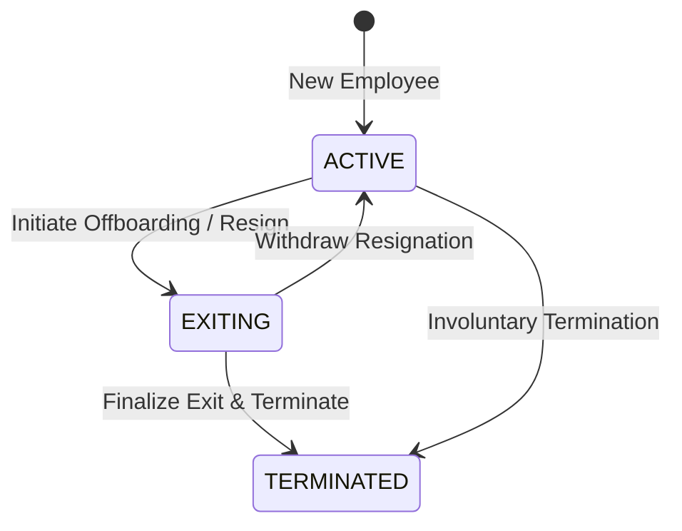
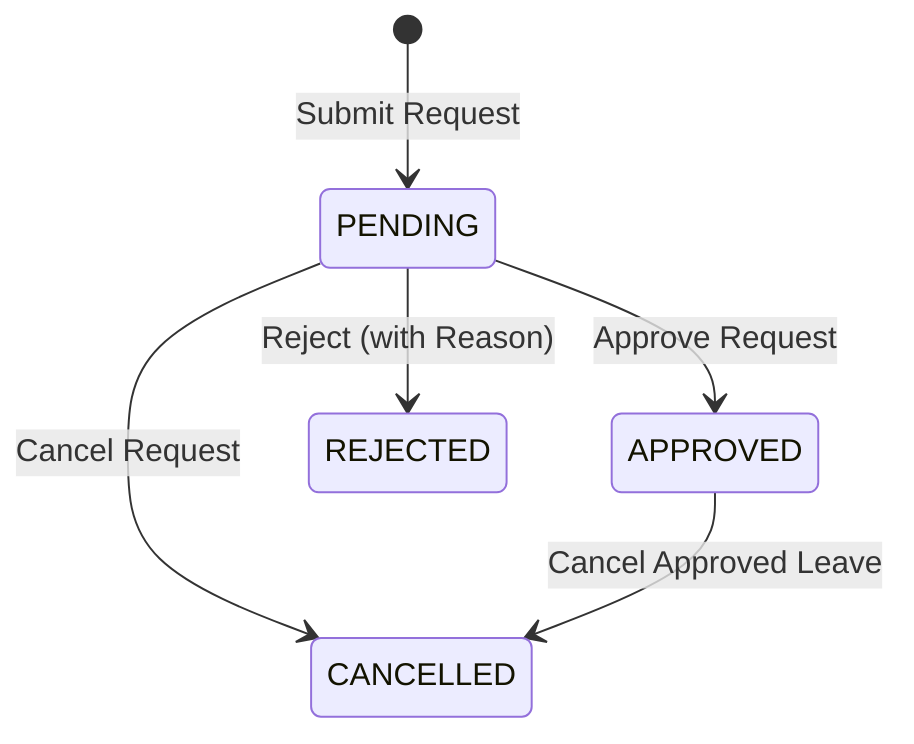
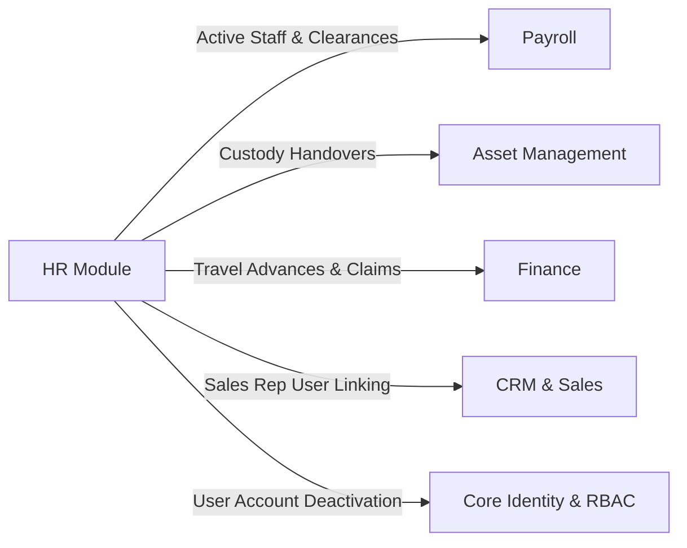

# HR

<div class="storyline-breadcrumb">Core Foundation for the <strong>Hire to Retire (H2R)</strong> &amp; <strong>Payroll Operations</strong> Storylines</div>

> The central human capital and workforce operations engine of TenArm BES, orchestrating the entire employee journey from master data onboarding and departmental assignment through daily attendance tracking, multi-tier leave approval governance, and 360° offboarding clearance.

The HR module serves as the organizational backbone of TenArm BES. It maintains authoritative employee profiles, departmental hierarchies, work calendar schedules, and leave policies. Downstream, it feeds active workforce data directly into **Payroll** for compensation runs and full-and-final settlements, coordinates hardware custody handovers with **Asset Management**, tracks open advances with **Finance**, and links sales reps to **CRM** opportunities for performance incentives.

---

## Workspace Ergonomics

The HR workspace is built for high-efficiency people operations, rapid attendance logging, and dispute-free employee transitions:

- **Multi-Tab Desk**: HR managers and department leads can operate across up to 3 workspace tabs simultaneously (for example, keeping the **Employee Directory** open while monitoring daily entries on the **Attendance Register** and executing separation audits in the **Clearance Desk**). Switching tabs preserves active table filters, search terms, and unsaved form inputs without reloading.
- **Draft Auto-Save**: Uncommitted form edits across the **New Employee**, **New Leave Request**, and **Leave Policy Groups** modals are automatically preserved in local browser storage. Active tab headers display a dirty dot indicator (`•`) until records are saved or cancelled.
- **Quick-Peek Slide-Out Drawer**: Clicking any linked employee number (`EMP-YYYY-NNNNNN`), employee name, or asset custody reference opens an inspection drawer from the right edge of the screen. Users can review contact details, bank accounts, or hardware custody without leaving their active workflow.
- **Optimistic Concurrency Control (OCC)**: High-traffic records—such as employee profiles, offboarding checklists, and company settings—display a version badge (e.g., `v3`). If two HR officers modify the same profile at the same time, the system flags the difference and opens the **Conflict Resolution Drawer** so no updates are lost.

---

## Core HR & Workforce Concepts

### The Employee Lifecycle
Every worker record moves through three distinct lifecycle stages:



| Lifecycle Status | Business Meaning | Allowed Operations |
|---|---|---|
| `ACTIVE` | Confirmed employee actively working for the organization. | Submit leave requests, record attendance, assign IT assets, edit profile, and initiate offboarding. |
| `EXITING` | Employee is serving their notice period or undergoing planned separation. | Update offboarding checklist, track clearance assets, withdraw resignation, or finalize termination. Login remains active unless manually revoked. |
| `TERMINATED` | Departed employee whose employment has formally ended. | Historical inspection only. System login is deactivated, assigned assets are returned or compensated, and final pay run is drafted. *(Irreversible).* |

### Offboarding Clearance 360
When an employee resigns or departs, offboarding requires coordination across multiple departments. The **Clearance Desk** unifies four critical separation tracks into a single cockpit:
1. **IT Asset Custody**: Inspects all physical hardware, laptops, monitors, and tools assigned in **Asset Management**. Assets must be returned to inventory or flagged for compensation recovery.
2. **Outstanding Expenses**: Checks open expense reports and travel advances in **Finance** to prevent unrecovered company funds.
3. **Commissions & Settlements**: Collates accrued sales commissions and unpaid bonuses from **Payroll** to roll into final pay runs.
4. **Administrative Checklist**: Tracks contractual milestones (handover documentation, access card return, exit interview) with individual completion statuses (`Pending`, `Done`, `N/A`).

### Leave Policy Groups vs. Discretionary Adjustments
TenArm BES balances structured corporate leave policies with individual management flexibility:
- **Leave Policy Groups**: Standard entitlement templates (e.g., *Standard Full-Time*, *Executive*, *Contractor*) defining default annual, sick, and casual days. Updating a group and clicking **Sync Group Balances** pushes refreshed allowances to all assigned employees without disturbing days already taken.
- **Individual Discretionary Adjustments**: HR administrators can override or grant special allowances for specific individuals directly from the **Leave Balances** desk without creating a separate policy group.

### Calendar Scheduling, Working Days & Holiday Calendars
Leave calculations and attendance accounting are strictly driven by tenant calendar configurations:
- **Work Week Days**: Standard working days (e.g., Monday through Friday) configured under **HR Settings**. Non-working days (weekends) are automatically excluded when calculating requested leave durations.
- **Public & Statutory Holidays**: Tenant-wide holiday dates registered in settings. When an employee requests leave spanning a statutory holiday, that day is omitted from the balance deduction.
- **Zero Working Day Guard**: Submitting a leave request exclusively over weekends or registered holidays is blocked to prevent accidental deduction of employee entitlements.

---

## HR Dashboard (Workforce Overview)

### Overview Desk

**What it does** — Provides executive leadership and HR managers with an aggregated, live snapshot of organizational headcount, recruitment activity, turnover rates, leave approval velocity, and attendance distributions.

```
/hr/dashboard
```

**Key Metrics & Cards**
- **Headcount & Workforce Pulse**: Real-time counts of total active employees, new hires in the selected month, in-progress separations, and total departures.
- **Leave Approval Velocity**: Shows total leave requests received, percentage approved, and cumulative approved leave days.
- **Monthly Trend Table**: Multi-period historical comparison tracking monthly hires, terminations, and approved time off.

**How to Use the Dashboard**
1. Navigate to **HR → HR Dashboard** (`/hr/dashboard`).
2. Use the month picker in the top right header to inspect historical periods, or click **Current Month** to return to today.
3. Click the **Previous Month** (`‹`) or **Next Month** (`›`) buttons to navigate month-by-month.
4. Review the **Monthly Trend** table to evaluate seasonal leave spikes or hiring cycles.

---

## Employee Directory & Profiles

### Employee Management

**What it does** — The authoritative central directory of all company personnel. Manages personal details, job titles, department assignments, leave policy groups, platform user logins, and disbursement bank accounts.

```
/hr/employees
```

**Lifecycle & States**

| Status | What it means | Next Allowed Actions |
|---|---|---|
| `ACTIVE` | Active staff member in good standing. | Edit profile, view incentives, initiate offboarding, or record direct termination. |
| `EXITING` | Resignation accepted or notice period underway. Checklist active. | Manage offboarding checklist, finalize exit, or withdraw resignation back to Active. |
| `TERMINATED` | Departed staff member. Read-only profile. | Historical inspection of employment record, clearance history, and exit settlement. |

**Key Fields on Employee Profiles**

| Field | Required | Description & Validation |
|---|:---:|---|
| **First Name** | ✅ | Legal given name. Cannot be blank. |
| **Last Name** | ✅ | Legal surname or family name. Cannot be blank. |
| **Email** | — | Corporate or personal email address for communications. |
| **Phone** | — | Contact telephone or mobile number. |
| **Job Title** | — | Organizational role or functional title (e.g., *Senior Metallurgical Engineer*). |
| **Department** | — | Assigned organizational unit selected from active departments. |
| **Leave Policy Group** | — | Policy tier governing annual, sick, and casual leave quotas. |
| **Hire Date** | — | Official date of joining. Drives tenure and service calculations. |
| **Login User Account** | — | Links the employee profile to a platform user account. Required for salespeople to earn CRM commissions and staff to use Employee Self-Service. |
| **Bank Name** | — | Name of financial institution for salary direct deposit. |
| **Bank Account Number** | — | Bank account number for payroll disbursements. |
| **Bank Code / IFSC / SWIFT** | — | Routing code, IFSC, or SWIFT identifier for electronic fund transfers. |
| **Notes** | — | Internal HR notes, emergency contacts, or contract terms. |

**How to Add a New Employee**
1. Navigate to **HR → Employees** (`/hr/employees`).
2. Click **+ New Employee** in the top action bar.
3. In the **New Employee** modal, enter the mandatory **First Name** and **Last Name**.
4. Select the **Department** and **Leave Policy Group** from the dropdown menus.
5. If the employee requires system login or earns sales incentives, select their profile in **Login User Account**.
6. Enter salary disbursement details in **Bank Name**, **Bank Account Number**, and **Bank Code / IFSC / SWIFT**.
7. Click **Create Employee**. The system generates a document number (`EMP-YYYY-NNNNNN`) and activates the profile.

**How to Edit an Employee Profile**
1. On the **Employees** table, locate the worker and click **Edit** under the **Actions** column.
2. Update the contact information, job title, department, or banking details.
3. Click **Save Changes**.

**Managing Resignation & Initiating Offboarding**
1. On an `ACTIVE` employee row, click **Offboard**.
2. In the **Offboard Employee** dialog:
   - Select the **Reason**: `Voluntary (resignation)` or `Involuntary (termination)`.
   - In **Last working day**, pick the scheduled final date. *(Leaving this blank automatically applies the company's default notice period configured under HR Settings).*
3. Click **Start Offboarding**. The employee transitions to `EXITING` status, and the 5-point separation checklist is seeded.

**Tracking the Offboarding Checklist**
1. For an employee in `EXITING` status, click **Offboarding** under the **Actions** column.
2. The modal displays the 5 separation milestones:
   - **Return company assets**: Shows assigned hardware count and book value. Click **Peek Custody** to inspect items, or **View Assets** to open the Asset Management register.
   - **Settle expense claims**: Displays open claims and advance balances. Click **Review Expenses** to inspect vouchers in Finance.
   - **Final payroll & settlement**: Shows pending commissions and settlement status. Click **Settle Pay Run** to review payroll calculations.
   - **Revoke system access**: Displays linked user account status. Click **Manage Login** to review user security.
   - **Exit interview & feedback**: Captures administrative handover notes.
3. Click **Pending**, **Done**, or **N/A** on each milestone to record progress.

**Finalizing Exit & Termination**
1. Once offboarding steps are verified, click **Complete Exit** (or **Terminate** on direct exits).
2. In the **Complete Exit** modal:
   - **Disable Login**: Check **Also disable this employee's login** to deactivate platform credentials immediately upon completion.
   - **Asset Dispositions**: For any hardware still in the employee's custody, choose whether each item is marked as **Return** or **Charge recovery** (entering the monetary amount to deduct from their settlement).
   - **Linked Expenses**: Review advisory balances for unsettled expense claims.
   - **Draft Final Settlement**: Check **Create a draft Full & Final settlement pay run** to automatically generate a settlement pay run in Payroll incorporating prorated salary and asset deductions.
3. Click **Complete Exit**. The employee status transitions permanently to `TERMINATED`.

**Withdrawing a Resignation**
If an exiting employee and the organization agree to continue employment:
1. Locate the employee in `EXITING` status.
2. Click **Withdraw** under the **Actions** column.
3. Confirm the action in the prompt. The employee immediately returns to `ACTIVE` status, and the in-progress exit checklist is cleanly archived into historical records.

---

## Offboarding Clearance 360 Desk

### Clearance Desk

**What it does** — A dedicated high-density SplitDesk workspace (`/hr/clearance`) designed for HR operations, IT administrators, and finance leads to collaborate on workforce separations without jumping between modules.

```
/hr/clearance
```

**Clearance Desk Layout**
- **Separation Queue (Left Pane)**:
  - Filter by separation stage using the dropdown: `In Offboarding (Exiting)`, `Active Employees`, `Terminated / Departed`, or `All Employees`.
  - Search employees by name, employee number, or job role.
  - Queue cards display live separation status badges, exit dates, and checklist completion progress (e.g. `Checklist: 4/5 completed`).
- **Clearance 360 Inspector (Right Pane)**:
  - **Header Bar**: Live status, OCC version badge (`v4`), scheduled last working day, and primary stage actions (**Initiate Offboarding**, **Withdraw Resignation**, and **Finalize Exit & Terminate**).
  - **IT Asset Custody Card**: Pulls live hardware custody from Asset Management. Displays piece count, asset tag numbers, descriptions, and current book value. Provides one-click buttons to **Peek Custody** in a drawer or **View Assets** in a new tab.
  - **Outstanding Expenses Card**: Pulls open expense vouchers and cash advances from Finance. Summarizes total unsettled balances with direct access to **Review Claims**.
  - **Commissions & Settlement Card**: Surfaces unpaid sales commissions, incentives earned, and settlement pay run links from Payroll.
  - **Offboarding Checklist Tasks Card**: Interactive task board with one-click toggles (`Pending`, `Done`, `N/A`) for handover milestones.

**How to Use the Clearance Desk**
1. Navigate to **HR → Clearance Desk** (`/hr/clearance`).
2. Select an employee from the left-hand **Separation Queue**.
3. Review the **IT Asset Custody** card. Verify that physical hardware has been returned to IT storage.
4. Review the **Outstanding Expenses** card to ensure no cash advances remain unvouched.
5. In the **Offboarding Checklist Tasks** card, mark handover milestones as **Done**.
6. When all items are cleared, click **Finalize Exit & Terminate** in the top action bar to close the departure.

---

## Departments & Organization Structure

### Departments

**What it does** — Manages organizational departments, business units, and team divisions. Tracks active workforce distribution and prevents accidental archiving of departments with assigned staff.

```
/hr/departments
```

**Lifecycle & States**

| Status | What it means | Allowed Operations |
|---|---|---|
| `ACTIVE` | Active department. Visible across employee forms. | Assign employees, update name/description, or archive (if headcount is zero). |
| `INACTIVE` | Archived department. Hidden from new employee forms. | Edit name or description. Cannot be assigned to new hires. |

**Key Fields on Departments**

| Field | Required | Description & Validation |
|---|:---:|---|
| **Code** | ✅ | Short departmental identifier (e.g., `ENG`, `SALES`, `FIN`). Must be unique across the tenant. Immutable once created. |
| **Department Name** | ✅ | Full organizational name (e.g., *Engineering & Technology*). |
| **Description** | — | Optional scope, cost center reference, or charter notes. |

**How to Create a Department**
1. Navigate to **HR → Departments** (`/hr/departments`).
2. Click **+ New Department** in the top action bar.
3. Enter a unique departmental **Code** (e.g., `OPS`) and the **Department Name**.
4. Optionally provide a functional **Description**.
5. Click **Create Department**.

**How to Edit or Archive a Department**
1. On the **Departments** table, click **Edit** next to any department to update its name or description.
2. To archive an obsolete department, verify that **Headcount** is `0 employees`.
3. Click **Archive**. The department is marked `INACTIVE`.
   *(If active staff are still assigned, the Archive button is automatically disabled with an explanatory tooltip: "Cannot archive department with N active employee(s). Reassign them first.").Reassign them in the Employee Directory before archiving.*

---

## Leave Requests & Approval Desk

### Leave Requests

**What it does** — Manages the full lifecycle of employee absence requests, managerial review workflows, audit remarks, and automated attendance balance drawdowns.

```
/hr/leave-requests
```

**Lifecycle & Status Progression**



| Status | What it means | Allowed Next Actions |
|---|---|---|
| `PENDING` | Request submitted by or for an employee; awaiting managerial review. | Approve, Reject (with mandatory reason), or Cancel. |
| `APPROVED` | Request confirmed. Working days deducted from balance; attendance marked `LEAVE`. | Cancel Approved Leave. |
| `REJECTED` | Request turned down. Manager justification logged in audit remarks. | Historical inspection only. *(Balance remains untouched).* |
| `CANCELLED` | Request withdrawn or revoked. Balance restored; attendance cleared. | Historical inspection only. |

**Key Fields on Leave Requests**

| Field | Required | Description & Validation |
|---|:---:|---|
| **Request #** | ✅ | System-generated document sequence identifier (e.g., `LV-2024-000042`). |
| **Employee** | ✅ | Staff member requesting time off. Must be `ACTIVE` or `EXITING`. |
| **Leave Type** | ✅ | Classification: `Annual`, `Sick`, `Unpaid`, or `Other`. |
| **From (Start Date)** | ✅ | First day of requested absence. |
| **To (End Date)** | ✅ | Last day of requested absence. Must be on or after Start Date. |
| **Days** | — | Total scheduled working days in range. Automatically excludes weekends and registered statutory holidays. |
| **Reason / Remarks** | — | Justification provided by employee, or managerial remarks logged during rejection. |

**How to Submit a Leave Request**
1. Navigate to **HR → Leave Requests** (`/hr/leave-requests`).
2. Click **+ New Leave Request** in the top action bar.
3. Select the **Employee** from the dropdown menu.
4. Select the **Leave Type** (`Annual`, `Sick`, `Unpaid`, or `Other`).
5. Choose the **Start Date** and **End Date**.
6. The system calculates scheduled working days automatically. Enter a brief **Reason** explaining the absence.
7. Click **Submit Request**. The request enters `PENDING` status.

**Managing Approvals, Rejections, and Cancellations**
- **To Approve a Request**: Click **Approve** on any `PENDING` row. The system verifies that the employee has sufficient remaining entitlement (unless negative balances are permitted in settings), deducts the working days from their balance, marks their attendance register as `LEAVE`, and transitions the request to `APPROVED`.
- **To Reject a Request**: Click **Reject**. The **Reject Leave Request** modal opens, prompting for a managerial explanation. Enter the reason for the audit trail and click **Confirm Rejection**. The request transitions to `REJECTED`, and the balance is preserved.
- **To Cancel a Request**: Click **Cancel** on a `PENDING` or `APPROVED` request. If the leave was already approved, the deducted days are automatically credited back to the employee's entitlement balance, and the corresponding daily attendance records are cleared.

> [!IMPORTANT]
> **Approval Governance Guard**: To uphold segregation of duties, managers cannot approve their own leave requests. Self-approval attempts are blocked by the system with an authorization guard.

---

## Leave Balances & Policy Groups

### Leave Balances

**What it does** — The authoritative ledger of employee leave entitlements, accrued consumption, and remaining allowances, featuring visual utilization gauges and organizational policy group management.

```
/hr/leave-balances
```

**Key Metrics & Ledger Display**
- **Pulse KPI Cards**: Monitor **Total Entitled Days**, **Total Taken Days**, **Available Balance**, and **Depleted / Deficit** accounts. Clicking the **Available Balance** card filters the grid to staff with positive days.
- **Ledger Columns**: Each employee row displays **Entitled**, **Taken**, **Remaining**, and an interactive **Utilization %** meter. The meter bar shifts dynamically to amber at 75% utilization and red at 100%.

**Adjusting an Individual Employee's Entitlement**
1. Navigate to **HR → Leave Balances** (`/hr/leave-balances`).
2. To create a new allowance, click **+ Set Entitlement**; to modify an existing allowance, click **Adjust** on the employee's row.
3. In the **Set Leave Entitlement** modal:
   - Select the **Employee**.
   - Select the **Leave Type** (`Annual`, `Sick`, or `Other`). *(Note: Unpaid leave does not use entitlement quotas).*
   - Enter the total **Entitled Days** (supports half-day increments, e.g., `22.5`).
4. Click **Save Entitlement**. The employee's available balance updates immediately while leaving previously taken days intact.

**Configuring Leave Policy Groups**
1. In the header of the Leave Balances page, click **Policy Groups**.
2. The **Leave Policy Groups** modal lists all configured tiers (e.g., *Full-Time Permanent*, *Executive Leadership*).
3. Click **+ Add Group** to define a new policy:
   - Enter a unique **Group Code** (e.g., `EXEC`) and **Group Name**.
   - Define default annual allowances for **Annual Leave**, **Sick Leave**, and **Casual Leave**.
   - Click **Save Group**.
4. **Pushing Allowances to Employees**: To apply policy adjustments across an entire group, click **Sync Group Balances** next to the group. The system updates entitlements for all assigned employees in a single operation without duplicating records or wiping out historical leave taken.

---

## Daily Attendance Register

### Attendance

**What it does** — Daily workforce presence logging, check-in/out timestamp capture, working hours accounting, and shift tracking.

```
/hr/attendance
```

**Attendance Status Classifications**

| Status | Code | Meaning & Accounting Impact |
|---|:---:|---|
| `PRESENT` | `PRESENT` | Physically present on site or at assigned post for standard shift hours. |
| `WFH` | `WFH` | Remote working from home; counted as full working day. |
| `LEAVE` | `LEAVE` | Authorized absence; automatically synchronized from approved leave requests. |
| `HALF_DAY` | `HALF_DAY` | Partial shift worked (typically 4.0 hours). |
| `ABSENT` | `ABSENT` | Unauthorized absence; working hours must be strictly `0.0`. |
| `HOLIDAY` | `HOLIDAY` | Tenant statutory public holiday or company non-working festival. |

**The Three Attendance Entry Modes**

#### 1. Single Attendance Record
1. Click **+ Record Attendance** in the top action bar.
2. Select the **Employee** and **Date**.
3. Choose the **Status** (`Present`, `WFH`, `Absent`, `Half Day`, or `Holiday`).
4. Enter optional **Check In** (e.g., `09:00`) and **Check Out** (e.g., `17:30`) times.
5. Enter total productive **Hours** (e.g., `8.0`).
6. Click **Record Attendance**. *(The system enforces an atomic upsert: submitting an entry for an employee on an existing date updates the record rather than creating duplicate lines).*

#### 2. Bulk Shift Marking
1. Click **Bulk Mark Attendance**.
2. Select the target **Date** (defaults to today).
3. Filter by a specific **Department** or choose **All Active Employees**.
4. Select the default **Status** (e.g., `Present`), standard shift **Check In** / **Check Out** times, and default **Hours Worked**.
5. Click **Save Bulk Attendance**. All active employees in the selected scope are marked in a single batch.

#### 3. Rapid Register
1. Click **Rapid Register**.
2. A streamlined, keyboard-friendly entry matrix opens, listing active staff members for the selected date.
3. Use keyboard navigation (`Tab`, `Enter`, and hotkeys) to toggle presence statuses and confirm hours rapidly without opening modal dialogs.
4. Click **Done** when register logging is finished.

**Date Filtering & Scheduled Working Days**
- Use the quick filter pills (**Today**, **Yesterday**, **All Dates**) or custom date picker to inspect records.
- The page header displays the total scheduled working days in the current period (e.g., `22 scheduled working days in 2024-11`), factoring in weekends and holidays.

---

## HR Settings & Company Policies

### Settings Desk

**What it does** — Tenant administrator configuration desk for company-wide employment terms, work week definitions, holiday calendars, and offboarding security rules.

```
/hr/settings
```

**Configuration Sections**

### 1. Resignation & Notice Period Defaults
- **Default Notice Period (Days)**: Specifies the organization's standard notice requirement (e.g., `30` or `60` days). When an employee offboarding is initiated without specifying a custom last working day, this parameter automatically calculates and sets their scheduled exit date.

### 2. Standard Work Week Schedule
- **Working Days Selector**: Toggle individual days of the week (**Mon**, **Tue**, **Wed**, **Thu**, **Fri**, **Sat**, **Sun**).
- **One-Click Presets**:
  - `Mon – Fri (5 days)`: Standard commercial business week.
  - `Mon – Sat (6 days)`: Standard industrial or retail operations week.
- *Selected working days dictate leave duration calculations; non-selected days (weekends) do not consume employee leave balances.*

### 3. Public & Statutory Holidays
- **Holiday Calendar Manager**: Register upcoming statutory public holidays.
- Select a date using the calendar input and click **+ Add Holiday**.
- Active holidays appear as removable badge chips. When leave requests span these dates, the system automatically omits them from leave day deductions.

### 4. Leave Overdraw & Balance Policy
- **Allow negative leave balance on approval**:
  - *Disabled (Default)*: Approvers cannot confirm leave requests that exceed an employee's available balance.
  - *Enabled*: Permits managers to approve leave in advance, allowing balances to go into deficit.

### 5. Security & Identity Offboarding Policy
- **Automatically disable login on employee termination**:
  - *Enabled (Recommended)*: When an employee's termination is finalized, their linked platform user account is deactivated atomically, revoking system access across web and mobile apps.

**How to Save Settings**
1. Update any desired parameters across the configuration cards.
2. Click **Save HR Settings** at the bottom of the page. The system saves changes under OCC version governance.

---

## If Something Goes Wrong (Common Validation & Guard Errors)

The table below explains common validation messages, warnings, and system guards encountered in the HR workspace, along with their business causes and resolution steps:

| What you see (Toast / Banner) | Why it happens | How to fix it in the workspace |
|---|---|---|
| `"First and last name are required"` | The employee form was submitted with an empty first or last name. | Enter legal first and last names in the form fields before clicking Create Employee. |
| `"User ID must be a positive integer"` | The linked user account field contains an invalid ID or non-numeric characters. | Select a valid platform user from the searchable dropdown or leave it set to *None*. |
| `"Cannot archive department with N active employee(s). Reassign them first."` | The department contains active staff members. To prevent orphaned employee records, departments with active staff cannot be archived. | Navigate to **Employees**, filter by that department, edit the employees to assign them to a different active department, then return to **Departments** and click **Archive**. |
| `"Department code already exists in your organization"` | Department code must be unique across the tenant. | Choose a unique departmental code (e.g., `ENG-RND` instead of `ENG`). |
| `"Approver cannot approve their own leave request"` | An employee with leave approval permissions attempted to approve their own pending leave request. | Segregation of duties requires a different authorized manager or HR administrator to review and approve the request. |
| `"Please provide a rejection reason for the audit trail"` | A manager clicked Confirm Rejection in the Reject Leave modal without entering an explanation. | Enter a clear managerial reason (e.g., *Project critical release sprint*) in the rejection textarea before confirming. |
| `"End date cannot be earlier than start date"` | The requested leave end date occurs chronologically before the start date. | Adjust the **End Date** so that it matches or falls after the **Start Date**. |
| `"Requested leave span has zero working days"` | The requested leave period falls entirely on weekends or registered statutory holidays. | Verify dates. Employees do not need to apply for leave on days they are not scheduled to work. |
| `"Insufficient leave balance for this request"` | The employee does not have enough remaining entitlement, and negative leave balance is disabled in company settings. | Either reduce the requested days, grant an individual entitlement adjustment under **Leave Balances**, or enable **Allow negative leave balance on approval** in **HR Settings**. |
| `"Employee already has overlapping leave for the selected dates"` | The employee already has another `PENDING` or `APPROVED` leave request covering one or more of the specified dates. | Check the **Leave Requests** register for that employee. Cancel the duplicate or conflicting request before submitting a new one. |
| `"Cannot record non-leave attendance while employee has approved leave"` | An attendance entry of `PRESENT`, `WFH`, or `ABSENT` was submitted for a date where the employee already has an `APPROVED` leave request. | If the employee worked on that day, cancel their approved leave request first; otherwise, record their attendance as `LEAVE`. |
| `"Check-out time cannot be earlier than check-in time"` | The entered check-out timestamp occurs earlier than the check-in timestamp. | Correct the check-in and check-out timestamps so that check-out follows check-in. |
| `"Hours must be 0 when attendance status is ABSENT"` | An attendance record with status `ABSENT` was submitted with working hours greater than zero. | Set **Hours** to `0.0` when logging an absence, or change the status to `HALF_DAY` or `PRESENT` if work was performed. |
| `"Cannot modify or record attendance for a terminated employee"` | An operation was attempted on an employee whose record is marked `TERMINATED`. | Terminated records are permanently closed. Verify employee selection; if a worker was rehired, create a new employee profile. |
| `"Notice period must be between 0 and 3650 days"` | A notice period value outside the valid range was entered in HR Settings. | Enter a realistic calendar day notice duration between `0` and `3650` days. |
| `"Record was modified by another session (vX vs vY)"` | Another user updated the employee profile or settings while your form was open (Optimistic Concurrency Control guard). | The **Conflict Resolution Drawer** will open automatically. Review the other user's changes and choose whether to merge or re-apply your edits. |

---

## Cross-Module Integrations

The HR module orchestrates key data flows across the TenArm BES ecosystem:



| Integrated Module | Data Exchanged | Business Impact |
|---|---|---|
| **Payroll** | Active employee master data, bank disbursement details, approved unpaid leave days, and separation settlement requests. | Powers monthly salary pay runs, prorates deductions for unpaid time off, and triggers Full & Final settlement pay runs (`payrun.final_settlement`) upon employee termination. |
| **Asset Management** | Assigned physical hardware tags, custody logs, and equipment return status during employee offboarding. | Surfaced on the **Clearance Desk** during offboarding. Assets can be returned to inventory or flagged for compensation recovery rolled directly into exit payroll. |
| **Finance** | Employee expense vouchers, travel advances, and open claims. | Prevents unrecovered company advances by auditing outstanding expense claims before employee departures are finalized. |
| **CRM & Sales** | User account IDs linked to employee records. | Enables commission tracking and performance incentive rollups for sales representatives based on closed deals. |
| **Core Identity & RBAC** | Linked platform `User` credentials and role permissions. | Enables Employee Self-Service access (`/hr/my-leave`, `/hr/my-attendance`) and automatically deactivates platform sign-in upon termination. |

---

## Permissions Reference

Access to HR functions is governed by granular permissions assigned through user roles:

| Permission | Display Label | What It Authorizes |
|---|---|---|
| `employee.view` | View Employees | Browse the employee directory, view employee profiles, and inspect the HR Dashboard. |
| `employee.create` | Create Employee | Add new employee records, configure job titles, and assign departments. |
| `employee.update` | Update Employee | Edit personal information, contact numbers, and bank account disbursement details. |
| `employee.resign` | Initiate Offboarding | Transition an employee from `ACTIVE` to `EXITING` status and initialize offboarding checklists. |
| `employee.offboarding.update` | Update Checklist | Mark offboarding milestones as `Pending`, `Done`, or `N/A`. |
| `employee.reactivate` | Withdraw Resignation | Cancel an in-progress exit and return an `EXITING` employee to `ACTIVE` status. |
| `employee.terminate` | Finalize Termination | Finalize departure, deactivate platform logins, settle assets, and generate final pay run. |
| `employee.clearance.view` | View Clearance Desk | Access the Clearance 360 command desk and inspect cross-module separation audits. |
| `department.view` | View Departments | Browse organizational departments and view team headcounts. |
| `department.create` | Create Department | Add new organizational departments and business units. |
| `department.update` | Update Department | Edit department names and functional descriptions. |
| `department.archive` | Archive Department | Inactivate obsolete departments that contain zero active staff members. |
| `leave.view` | View Leave Requests | Browse employee leave requests, review date ranges, and view request statuses. |
| `leave.request` | Submit Leave Request | Submit new time-off requests on behalf of employees. |
| `leave.approve` | Approve Leave | Review and approve pending leave requests, deducting entitlement days and logging attendance. |
| `leave.reject` | Reject Leave | Turn down pending leave requests with mandatory audit remarks. |
| `leave.cancel` | Cancel Leave | Cancel pending or approved leave requests, restoring balances and clearing attendance. |
| `leave.balance.view` | View Leave Balances | Inspect employee entitlement ledgers, taken days, and remaining allowances. |
| `leave.balance.set` | Adjust Leave Balance | Grant individual entitlement overrides and discretionary allowances. |
| `leave.group.view` | View Policy Groups | Inspect organizational leave policy tiers and group configurations. |
| `leave.group.create` | Create Policy Group | Define new leave policy tiers with standardized annual, sick, and casual allowances. |
| `leave.group.update` | Update Policy Group | Edit policy group allowances and push refreshed quotas via **Sync Group Balances**. |
| `attendance.view` | View Attendance | Review daily attendance logs, working hours, and check-in/out timestamps. |
| `attendance.record` | Record Attendance | Log single, bulk, or rapid attendance records for employees. |
| `attendance.update` | Update Attendance | Edit existing attendance records, adjust hours, or correct status classifications. |
| `tenant.admin` | HR Administration | Configure tenant HR settings, notice periods, work week schedules, and statutory holidays. |
