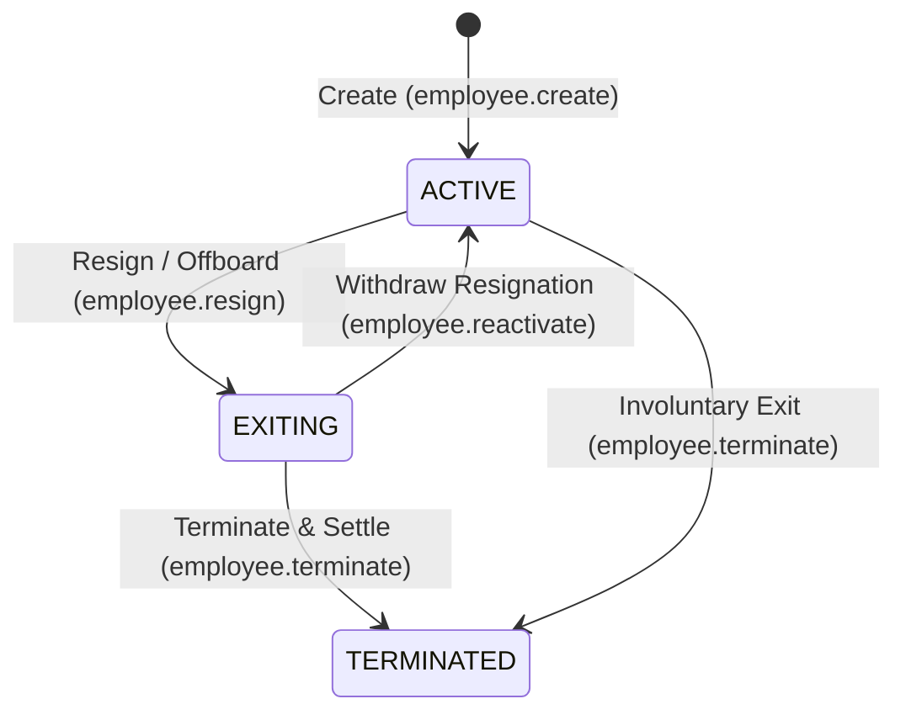
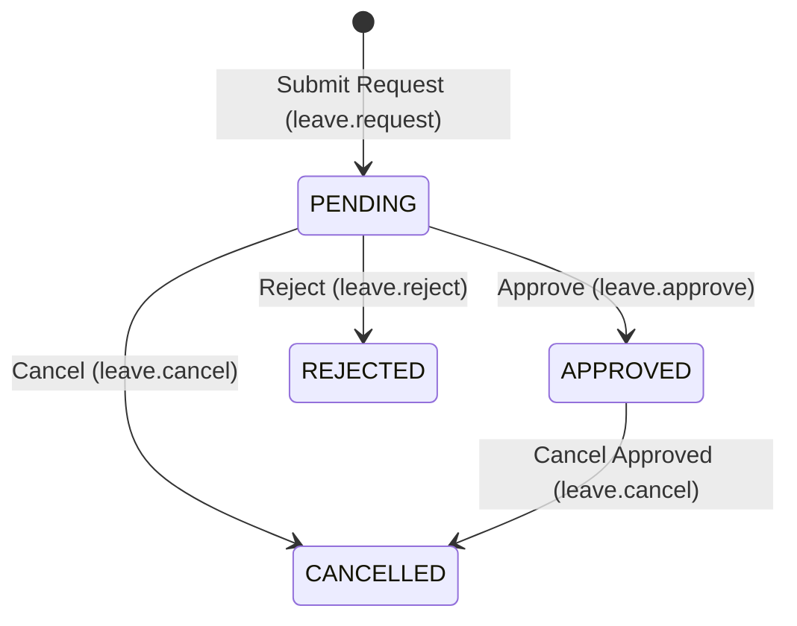

# HR

The HR module covers people management — employee records, organizational departments, leave requests, attendance tracking, and structured offboarding.

## Key Features

### Employee Management
- Maintain complete employee profiles with job title, contact information, hire date, salary, and manager hierarchy
- Link employee profiles to platform user accounts for self-service portal access
- Track employment status across the employee lifecycle (`ACTIVE → EXITING → TERMINATED`)
- Manage notice periods and last working dates configured via tenant settings

### Department Structure
- Map organizational hierarchy across departments
- Assign employees and designated department heads
- Maintain active and archived departments with safeguards preventing the archiving of departments with active staff

### Leave Management & Entitlements
- Configure leave balances and annual quotas per employee and leave type (e.g. Annual, Sick, Casual, Unpaid)
- Multi-step approval workflow for employee leave requests
- Automatic deduction from allocated balances upon leave approval
- Validate against overlapping requests and prevent negative balance deficits (unless configured)

### Employee Lifecycle & Offboarding
- **Resignation / Notice Period** (`employee.resign`): Transition active employees into `EXITING` status, defaulting last working day to notice period settings and initializing offboarding checklists
- **Withdraw Offboarding** (`employee.reactivate`): Withdraw an in-progress exit, returning the employee to `ACTIVE`
- **Checklist Tracking** (`employee.offboarding.update`): Track and update handovers, asset returns, and clearance milestones
- **Clearance Snapshot** (`employee.get_clearance_snapshot`): Query consolidated clearance status across pending checklist items and assigned assets
- **Termination & Settlement** (`employee.terminate`): Finalize employee departure (`EXITING | ACTIVE → TERMINATED`), revoke platform login credentials, and orchestrate Full & Final settlements with Asset Management and Payroll

### Attendance Tracking
- Record daily check-in and check-out times with day-status classification (`PRESENT`, `ABSENT`, `HALF_DAY`, `LEAVE`, `WFH`, `HOLIDAY`)
- Batch record daily attendance across departments or the entire organization
- Work calendar calculations accounting for tenant weekend days and statutory public holidays

### Employee Self-Service (My Workspace)
Employees with self-service access (`self_service.access`) can manage their daily work directly:
- **My Leave** (`/hr/my-leave`): Submit leave requests and track personal approval statuses and remaining balances
- **My Attendance** (`/hr/my-attendance`): View personal monthly attendance records, check-in timestamps, and hours worked

### HR Dashboard
View key HR metrics at a glance — headcount, active employees, pending leave requests, department distribution, and monthly attendance summaries.

## Workflows & State Machines

### Employee Lifecycle

### Leave Request Lifecycle

## Navigation

| Page | Path | Permission |
|------|------|-----------|
| Employees | `/hr/employees` | `employee.view` |
| Leave Requests | `/hr/leave-requests` | `leave.view` |
| Attendance | `/hr/attendance` | `attendance.view` |
| Departments | `/hr/departments` | `department.view` |
| Leave Balances | `/hr/leave-balances` | `leave.balance.view` |
| HR Settings | `/hr/settings` | `tenant.admin` |
| HR Dashboard | `/hr/dashboard` | `employee.view` |
| My Leave | `/hr/my-leave` | `self_service.access` |
| My Attendance | `/hr/my-attendance` | `self_service.access` |

## Cross-Module Integration

| Integration | How It Works |
|------------|-------------|
| **Payroll** | Active employee records, departments, and unpaid leave attendance drive compensation calculations and exit settlements (`payrun.final_settlement`) |
| **Asset Management** | Custody assets assigned to exiting employees are surfaced during clearance snapshots and automatically returned or compensated on `employee.terminate` |
| **Platform / Users** | Linking an employee to a platform `User` enables self-service features (`self_service.access`); `employee.terminate` automatically deactivates system login |

## Permissions

| Permission | Description |
|-----------|-------------|
| `department.view` | View departments and hierarchy |
| `department.create` | Create new departments |
| `department.update` | Edit department details and head assignments |
| `department.archive` | Archive inactive departments |
| `employee.view` | View employee directory and profiles |
| `employee.create` | Create new employee profiles |
| `employee.update` | Edit employee profile details |
| `employee.resign` | Initiate employee offboarding (ACTIVE → EXITING) |
| `employee.reactivate` | Withdraw employee offboarding (EXITING → ACTIVE) |
| `employee.offboarding.update` | Update offboarding checklist items |
| `employee.terminate` | Finalize employee termination and settlement |
| `employee.clearance.view` | View consolidated employee clearance snapshots |
| `leave.view` | View leave requests |
| `leave.request` | Submit leave requests |
| `leave.approve` | Approve pending leave requests |
| `leave.reject` | Reject pending leave requests |
| `leave.cancel` | Cancel pending or approved leave requests |
| `leave.balance.view` | View employee leave balances and quotas |
| `leave.balance.set` | Set or adjust employee leave balances |
| `attendance.view` | View attendance logs and records |
| `attendance.record` | Record single employee attendance |
| `attendance.update` | Update existing attendance records |
| `self_service.access` | Access personal workspace (My Leave, My Attendance) |
