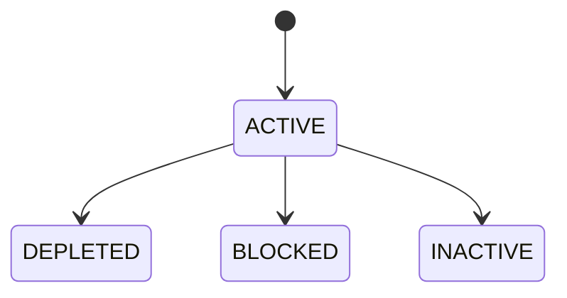
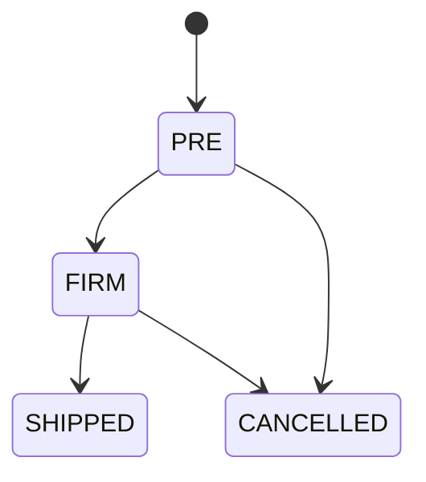

> The Inventory module provides real-time visibility and control over your physical stock, movements, and reservations.

## Overview
The Inventory module is the central hub for managing your organization's physical assets. It handles complex operations like catch-weight (dual-unit) tracking, lot/serial traceability, automated reorder points, and stock reservations for order fulfillment.

## Products & Warehouses

### What It Does
Products define the items you track, buy, and sell, while Warehouses represent the physical or logical locations where stock is kept.

### Key Fields
| Field | Required | Notes |
|-------|----------|-------|
| `name` | ✅ | Product name |
| `sku` | ✅ | Stock Keeping Unit |
| `uom` | ✅ | Primary unit of measure (e.g., EA, KG) |
| `secondary_uom` | — | Used for catch-weight tracking (e.g., tracking both Pieces and KG) |

### How To Create a Product
1. Navigate to **Inventory → Products**
2. Click **New Product** (via ProductEditorDrawer)
3. Fill in the required fields and assign attributes.

## Stock Balances & Lots

### What It Does
Provides a real-time, multi-dimensional view of what is on hand, reserved, and available for use across all warehouses. Stock is tracked at the Lot level for full traceability.

### Status Lifecycle (Lot)

| Status | What It Means | What You Can Do |
|--------|--------------|-----------------|
| `ACTIVE` | Stock is available for use | Receive, transfer, reserve |
| `DEPLETED` | All quantity has been shipped or consumed | View history |
| `BLOCKED` | Stock is on hold for quality or inspection | Cannot reserve or ship |
| `INACTIVE` | Lot is closed manually | View history |

### Status Lifecycle (Reservation)

## Stock Operations (Movements)

### What It Does
Records every change in inventory, ensuring a complete audit trail (Inventory Movement Facts).

### Available Actions
- **Receive**: Add stock to a warehouse (increases `on_hand_qty`).
- **Ship**: Dispatch stock out of a warehouse (decreases `on_hand_qty` and `reserved_qty`).
- **Return**: Restock returned goods.
- **Transfer**: Move stock between warehouses.
- **Adjust**: Manually correct stock levels.
- **Reclassify**: Convert stock of one product into another (e.g., scrap or off-cuts).
- **Reserve**: Place a hold on stock for an order (reduces `available_qty`).

### How To Receive Stock
1. Navigate to **Inventory → Stock Balances**
2. Select a product and click **Receive** to open the **Receive Stock** modal.
3. Fill in: Product, Warehouse, Quantity, Lot Number (optional), and Secondary Quantity (if using catch-weight).

### Things to Know
- **Catch-Weight (Dual-Unit) Pattern**: For items where quantity and weight vary independently (e.g., cheese wheels or steel coils), you can track both `qty` (e.g., pieces) and `qty_secondary` (e.g., kg). The system tracks balances and movements in both units simultaneously across all operations.
- **Reservations (ATP)**: When an order is placed, stock is reserved. This reduces the *Available to Promise* (ATP) quantity without changing the physical *On Hand* quantity until the stock is actually shipped.

---

## Integrations

| Module | When | What Happens |
|--------|------|-------------|
| `finance` | `StockShipped` | Triggers `FinanceCogsPosting` projection to recognize Cost of Goods Sold. |
| `finance` | `StockReturned` | Triggers `FinanceCogsReversal` projection to reverse the COGS entry. |
| `finance` | `InventoryOpeningBalanceImported` | Used to initialize inventory value during system go-live. |
| `sales` / `crm` | Order Placement | Uses the `stock.atp_for_product.get` capability to check Available to Promise stock. |

## Permissions

| Permission | What It Unlocks |
|-----------|----------------|
| `inventory.dashboard.view` | View the Inventory Dashboard and Stock by Feature reports |
| `inventory.view` | View stock balances, movements, and availability |
| `product.create` | Create new products in the catalog |
| `product.edit` | Update existing product details |
| `warehouse.create` | Create new warehouse locations |
| `stock.receive` | Receive incoming stock into a warehouse |
| `stock.reserve` | Reserve stock and confirm holds |
| `stock.release` | Release reserved stock |
| `stock.ship` | Ship stock out of a warehouse |
| `stock.return` | Process stock returns |
| `stock.transfer` | Move stock between locations |
| `stock.adjust` | Perform manual stock adjustments |
| `stock.reclassify` | Reclassify stock (e.g., for scrap/off-cuts) |
| `inventory.opening_balance.import` | Import initial balances during setup |
| `reorder.set` | Configure automatic reorder points |
| `reorder.remove` | Delete reorder points |
| `serial.view` | View serial number tracking |
