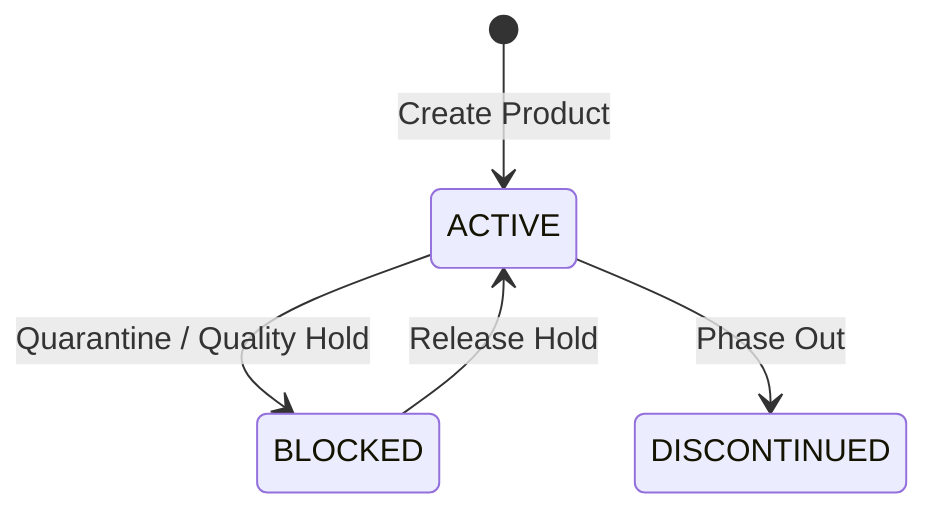
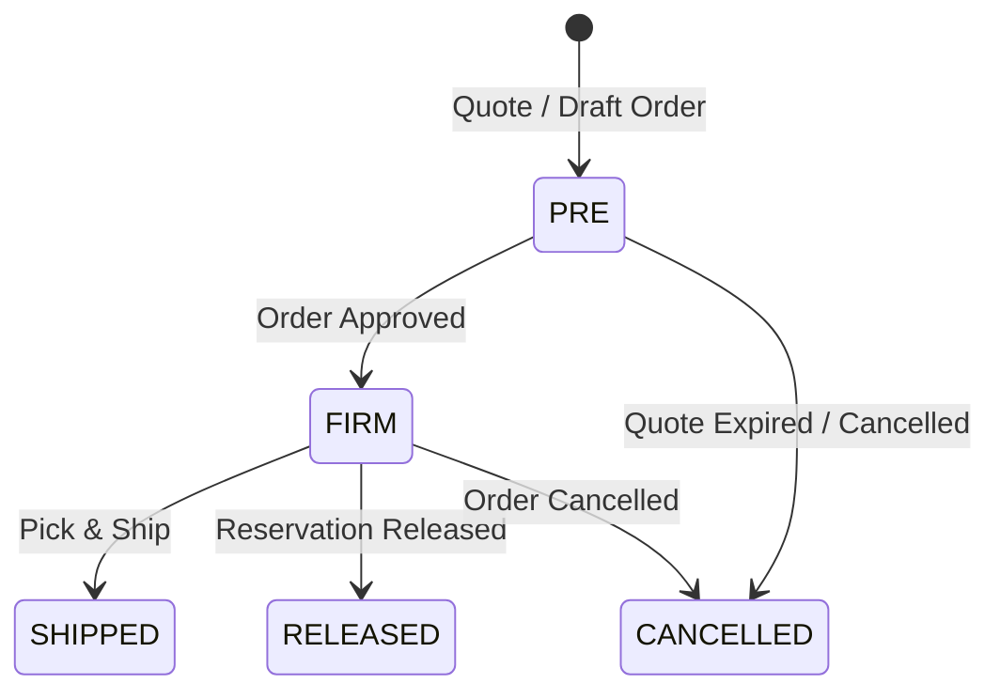
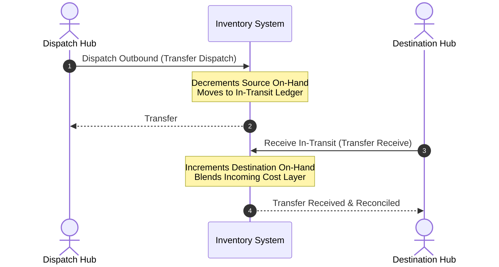
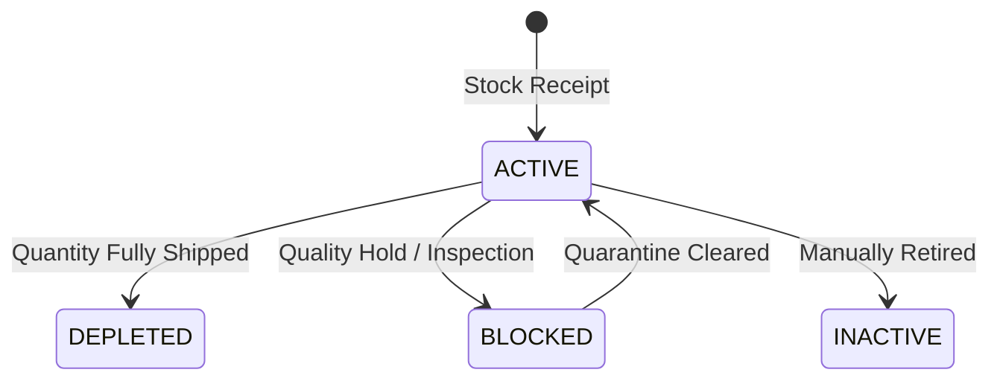
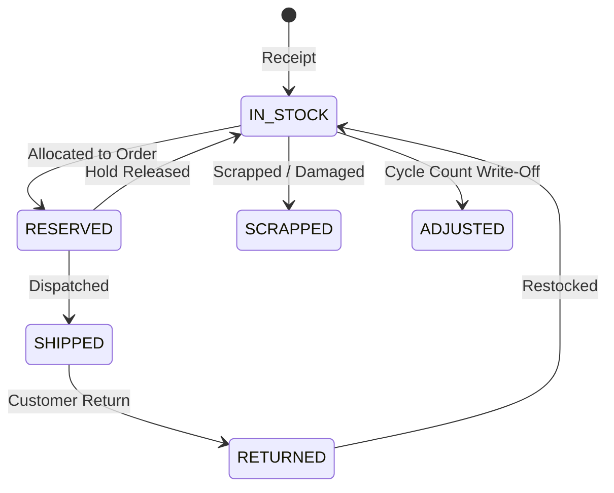

# Inventory

Part of the <strong>Procure to Pay (P2P)</strong> &amp; <strong>Order to Cash (O2C)</strong> Storylines: Step 3 of 5 (Goods Receipt) &amp; Step 5 of 6 (Fulfillment)

> The central operational engine for catalog definition, multi-warehouse stock balances, dual-unit catch-weight tracking, automated lot and serial traceability, and real-time Available-to-Promise (ATP) fulfillment.

The Inventory module bridges physical warehouse operations with upstream procurement and downstream commercial sales. Every receipt, stock reservation, inter-warehouse movement, cycle count audit, and customer dispatch is tracked through an immutable audit ledger, ensuring zero drift between warehouse yard balances and general ledger valuation.

---

## Workspace Ergonomics

The Inventory desk is built for fast, high-volume warehouse operations:

- **Multi-Tab Desk**: Open up to 3 independent inventory tabs simultaneously (e.g. keeping **Stock Balances**, a specific **Lot Storyline**, and **Cycle Count & Adjustments** open at the same time). Switching between tabs preserves table filters, search queries, pagination offsets, and uncommitted form edits without reloading.
- **Draft Auto-Save**: Unsaved entries in forms (such as product creation steps, cycle counts, or transfer notes) are continuously preserved locally. The active tab header displays a dirty dot indicator (`•`) until the record is submitted or explicitly cancelled.
- **Quick-Peek Slide-Out**: Clicking any linked product code, lot number, or warehouse code opens an inspection drawer from the right edge of the screen, allowing operators to verify specifications, cost layers, and reserved sales orders without losing their active workflow.

---

## Core Inventory Concepts

### Catch-Weight & Dual-Unit Tracking
For bulk and industrial commodities where count and continuous measurement vary independently (e.g. steel coils, cheese blocks, cable reels, timber packs), items are tracked in two distinct units:
- **Primary Base Unit (`qty`)**: The discrete physical count (e.g. `PCS`, `COIL`, `BOX`).
- **Secondary Unit (`qty_secondary`)**: The continuous commercial measure (e.g. `KG`, `MT`, `MTR`).

Balances and movements maintain both quantities concurrently. Pricing can be anchored to the discrete count or continuous weight (`priced_by`: `COUNT` vs `MEASURE`), ensuring accurate commercial billing and inventory asset valuation.

### Available to Promise (ATP) & Reservation Holds
To prevent over-selling and warehouse fulfillment conflicts, physical inventory is segregated into distinct tiers:
$$\text{Free Available (ATP)} = \text{On-Hand Stock} - \text{Total Reserved Stock}$$

Reservations support two hold types:
- **Soft Hold (`PRE`)**: Placed during quotation negotiation or draft sales order creation. Protects stock from competing quotes while permitting administrative overrides.
- **Confirmed Hold (`FIRM`)**: Hard reservation locked upon sales order approval. Earmarks specific warehouse balances or designated lots for pick, pack, and dispatch.

### Cost Layering & Moving Average Valuation
Every stock receipt records its exact purchase cost, creating an independent valuation layer. Warehouse inventory displays the true weighted average moving cost while preserving granular lot cost layers for exact FIFO Cost of Goods Sold (COGS) postings in Finance upon shipment.

---

## Catalog & Master Data

### Products

**What it does** — Maintains the catalog of items your organization purchases, stocks, manufactures, or sells. Governs traceability rules, measurement units, sales pricing, and custom specifications.

**Lifecycle & States**

| State | What it means | What you can do next |
|---|---|---|
| `ACTIVE` | Product is active for purchasing, stocking, sales, and manufacturing. | Raise POs, receive stock, create quotes, and ship orders. |
| `BLOCKED` | Product is temporarily suspended due to quality holds or vendor investigations. | View existing balances; all stock movements and new reservations are prevented. |
| `DISCONTINUED` | Product is retired and will no longer be replenished. | Exhaust remaining on-hand inventory; cannot create new purchase orders. |

**Key Fields (Product Configuration Studio)**

| Field | Tab | Required | Description & Validation |
|---|---|:---:|---|
| **Product Name** | Identity | ✅ | Unique commercial name of the product. |
| **Product Code / SKU** | Identity | — | Unique internal SKU. Auto-generated (`PROD-XXXXX`) if left blank. |
| **Category** | Identity | — | Hierarchical classification folder for reporting and default attributes. |
| **Item Type** | Identity | ✅ | `Inventory Item`, `Service / Non-Stock`, or `Raw Material`. |
| **Base Unit of Measure** | Measurement | ✅ | Primary stocking unit (e.g. `PCS`, `BOX`, `MTR`). Cannot be changed once stock exists. |
| **Secondary Unit (Catch-Weight)** | Measurement | — | Continuous unit (e.g. `KG`, `MT`) for dual-unit items. |
| **Pricing Basis** | Measurement | ✅ | `Price by Base Count` or `Price by Continuous Measure`. |
| **Base Sales Price** | Measurement | — | Standard benchmark selling price before customer discounts. |
| **Lot Tracking** | Traceability | — | When enabled, inbound receipts require a lot/batch identifier. |
| **Serial Tracking** | Traceability | — | When enabled, tracks individual serial numbers. *Requires Lot Tracking*. |
| **Default Warehouse** | Fulfillment | — | Default dispatch and receiving facility pre-selected on transaction lines. |
| **Custom Attributes** | Attributes | — | Technical specs inherited from category (e.g. Heat Number, Grade, Thickness). |

**How to Use**
1. Navigate to **Inventory → Products** (`/inventory/products`).
2. Click **+ Add Product** to open the **Product Configuration Studio**.
3. Complete the multi-step studio tabs:
   - **Identity**: Enter product name, optional code, and select category.
   - **Measurement**: Choose base UOM and optional secondary catch-weight unit.
   - **Traceability**: Toggle Lot Tracking or Individual Serial Numbers if tracking is required.
   - **Fulfillment**: Assign the default storage warehouse.
   - **Attributes**: Specify category-defined engineering specifications.
4. Review the summary and click **Create Product**.

**Workspace Tips**
- **Executive Pulse Cards**: The top summary banner highlights catalog metrics: total items, active lot-tracked SKUs, catch-weight items, and items needing setup attention.
- **Quick Filter Pills**: Switch views instantly between **All SKUs**, **Lot Tracked**, **Weight-Priced**, and **Needs Setup**.
- **Quick-Peek Drawer**: Clicking any product code opens the **Product 360 Drawer**, showing live stock across all depots, pending sales orders, and recent purchase receipts.

---

### Product Categories

**What it does** — Organizes products into a multi-tier taxonomy (up to 5 levels deep) and defines inherited technical attributes and measurement templates.

**How to Use**
1. Navigate to **Inventory → Categories** (`/inventory/categories`).
2. The left pane displays the interactive taxonomy tree; the right pane shows assigned SKUs and category statistics.
3. Click **+ Add Category** to create a root-level division, or select an existing category and click **+ Add Subcategory**.
4. Enter the category name, optional description, and default unit templates.
5. Click **Save Category**.

---

### Units of Measure (UOM)

**What it does** — Defines the measurement units used across purchasing, warehousing, and billing.

**Key Fields**

| Field | Required | Description |
|---|:---:|---|
| **Code** | ✅ | Standard symbol identifier (e.g. `PCS`, `KG`, `MT`, `BOX`). |
| **Name** | ✅ | Full unit description (e.g. `Pieces`, `Kilograms`, `Metric Tonnes`). |
| **Symbol** | ✅ | Screen display chip representation (e.g. `pcs`, `kg`, `t`). |

**How to Use**
1. Navigate to **Inventory → Units of Measure** (`/inventory/uom`).
2. Click **+ Add Unit**.
3. Enter code, name, and display symbol.
4. Click **Create Unit**.

---

## Facilities & Warehouses

### Warehouses

**What it does** — Represents physical distribution centres, factory yards, regional transit depots, or third-party logistics (3PL) facilities.

**Lifecycle & States**

| State | What it means | What you can do next |
|---|---|---|
| `ACTIVE` | Facility is operational for stock receipts, storage, and customer dispatches. | Full warehouse operations. |
| `INACTIVE` | Facility is closed or undergoing maintenance. | Cannot receive or ship stock. Cannot deactivate if on-hand stock remains. |

**How to Use**
1. Navigate to **Inventory → Warehouses** (`/inventory/warehouses`).
2. Click **+ Add Warehouse**.
3. Enter warehouse name, unique code, contact in-charge details, and physical address.
4. Check **Set as Default Warehouse** if this is the primary depot for transactions.
5. Click **Save Warehouse**.

**Workspace Actions**
- **360 Peek**: Opens the warehouse drawer showing current utilization, total inventory valuation, and stock balance breakdown.
- **Stock**: Opens a new workspace tab showing **Stock Balances** pre-filtered to the selected warehouse.
- **Set default**: One-click action to switch the tenant's primary transaction facility.

---

## Stock Operations & Inventory Balances

### Stock Balances & Available to Promise (ATP)

**What it does** — The central real-time command screen displaying physical on-hand inventory, active customer reservations, free available ATP, incoming vendor shipments, and moving-average valuation across all warehouses.

**Status Lifecycle (Stock Reservation)**

**Key Columns on Stock Balances Grid**

| Column | Description |
|---|---|
| **Product & Specifications** | Product name, SKU code chip, category path, and catch-weight badges. |
| **Warehouse** | Storage facility holding the inventory. |
| **On-Hand** | Total physical quantity verified in the warehouse. |
| **Committed / Reserved** | Quantity locked by sales orders. Clicking the chip displays soft holds (`PRE`) vs confirmed holds (`FIRM`). |
| **Free Available (ATP)** | Net stock uncommitted and deliverable. Highlights customer backorders when negative or zero. |
| **In Transit** | Quantities currently en route between internal warehouses or inbound from purchase orders. |
| **Value & Purchases** | Total monetary value and moving average unit cost. Clicking opens lot cost layers. |
| **Operations** | Quick-action button and overflow menu for stock receipts, holds, transfers, and adjustments. |

**How to Receive Stock**
1. Navigate to **Inventory → Stock Balances** (`/inventory/balances`).
2. Click **Receive Stock** in the page header (or select **Stock Receive** from a row's action menu).
3. Select **Product** and **Warehouse**.
4. Enter **Quantity** (and **Secondary Quantity** if catch-weight).
5. If the item is lot-tracked, enter or select the **Lot Number**. For dual-unit packages, record individual package weights.
6. Enter unit cost and reference document details (e.g. Purchase Order number).
7. Click **Submit**. The system increments on-hand stock and updates the moving average cost.

**How to Reserve Stock for an Order**
1. From **Stock Balances**, select **Stock Reserve** in the row action menu.
2. Enter **Quantity** to commit and specify the destination sales order reference.
3. Select hold type (**Soft Hold** or **Confirmed Hold**).
4. Click **Submit**. The system locks the requested quantity, decreasing free ATP immediately while keeping on-hand stock intact until shipment.

**FEFO / FIFO Automated Allocation**
1. Click **FEFO Planner** in the header.
2. Select target product, warehouse depot, and requested order fulfillment quantity.
3. Select allocation strategy:
   - **FEFO (First Expired, First Out)**: Prioritizes batches approaching shelf-life expiration.
   - **FIFO (Oldest Received First)**: Prioritizes oldest received cost layers.
   - **Nearest Secondary (Catch-Weight Match)**: Selects coils/packages minimizing weight variance against target order specs.
4. Click **Simulate Allocation** to preview matching lots.
5. Click **Confirm & Reserve Allocated Lots** to commit the pick list.

**Import Opening Stock Wizard**
During system onboarding or annual balance rollovers:
1. Click **Import Opening Stock** on the header.
2. **Step 1 (Upload)**: Download the standardized CSV template and upload your spreadsheet containing product codes, warehouse codes, quantities, lot numbers, and unit costs.
3. **Step 2 (Validate)**: The wizard performs a dry-run check, validating SKU codes, warehouse validity, and decimal precision.
4. **Step 3 (Execute)**: Click **Import Valid Stock Lines**. Balances and initial cost layers are created atomically.

---

### Inter-Warehouse Transfers & In-Transit Tracking

**What it does** — Orchestrates the physical movement of inventory between internal depots, supporting a two-stage dispatch and receipt workflow with vehicle tracking.

**How to Dispatch an Inter-Warehouse Transfer**
1. Navigate to **Inventory → Stock Balances** and click **Transfer Stock** (or open row menu → **Transfer Stock**).
2. The **Inter-Warehouse Transfer Storyline** modal opens on the **1. Dispatch Outbound** tab.
3. Select **Source Warehouse (From)** and **Destination Warehouse (To)**.
4. Select the **Product**. If the item is lot-tracked, select the specific **Lot** so its batch attributes and catch-weight travel with the consignment.
5. Enter **Dispatch Quantity** and optional transport/vehicle notes (e.g. *Vehicle MH-12-AB-1234, Driver contact*).
6. Click **Dispatch into Transit**. The goods leave the source depot and enter in-transit status.

**How to Receive In-Transit Transfers**
1. In the **Inter-Warehouse Transfer Storyline** modal, switch to **2. Receive In-Transit**.
2. Locate the transfer consignment card showing origin, quantity, and dispatch timestamp.
3. Click **Receive Goods**.
4. Confirm destination warehouse, enter verification notes (e.g. *Received intact, count verified*).
5. Click **Confirm Receipt & Blend Cost**. Inventory is credited to the destination depot and its valuation is blended into the receiving hub's moving average.

---

### Stock Adjustments & Cycle Counting

**What it does** — Enables warehouse teams to conduct scheduled cycle counts, audit physical inventory against book balances, record write-offs or shrinkage, and address dormant dead-stock.

**Key Features & Highlights**
- **Discrepancy Spotlight**: Real-time summary showing total warehouse items, audits entered, net unit variance, and 90-day dead-stock counts.
- **Filter Pills**: Instantly narrow the audit table:
  - **All Items**: Complete list of warehouse balances.
  - **Discrepancies Only**: Shows items where physical count deviates from the book ledger.
  - **Dead-Stock Spotlight**: Flags items with zero movement for 90+ days.

**How to Conduct a Cycle Count Audit**
1. Navigate to **Inventory → Stock Adjustments** (`/inventory/adjustments`).
2. Select the target **Warehouse** from the dropdown.
3. In the table, enter the **Physical Count** for each inspected item. The system instantly calculates and colors the variance:
   - Green ($+$): Surplus stock found.
   - Red ($-$): Shortage / shrinkage identified.
4. Select an adjustment reason: `CYCLE_COUNT`, `DAMAGED`, `FOUND`, or `SHRINKAGE`, and add operational notes.
5. To post an individual item, click **Post Adjustment** on that row.
6. To post all reconciled items at once, click **Post All Counted Adjustments** in the header.

---

### Stock Movements (Audit Ledger)

**What it does** — An immutable chronological ledger recording every transaction affecting inventory quantity, location, or valuation. Serves as the authoritative source of truth for stock accounting and traceability audits.

**Movement Types**

| Movement Type | Direction | Business Trigger |
|---|:---:|---|
| `RECEIVE` | Inbound ($+$) | Goods receipt against a purchase order or initial intake. |
| `SHIP` | Outbound ($-$) | Fulfillment dispatch against an approved sales order. |
| `RESERVE` | Hold | Stock locked against a quotation or sales order. |
| `RELEASE` | Unhold | Release of an unfulfilled or cancelled reservation hold. |
| `TRANSFER_OUT` | Outbound ($-$) | Dispatch leg of an inter-warehouse movement. |
| `TRANSFER_IN` | Inbound ($+$) | Receiving leg of an inter-warehouse movement. |
| `ADJUST` | Delta ($\pm$) | Physical cycle count correction or inventory write-off. |
| `LANDED_COST` | Cost Only | Revaluation of lot cost layer (e.g. freight/customs capitalization). |
| `RETURN_IN` | Inbound ($+$) | Customer return restocked into warehouse inventory. |
| `OPENING_BALANCE` | Inbound ($+$) | Go-live opening stock balance intake. |

**How to Use**
1. Navigate to **Inventory → Stock Movements** (`/inventory/movements`).
2. Use the **Filter Bar** to filter by Date Range, Product, Warehouse, or Movement Type.
3. Click any document reference link (e.g. `SalesOrder #SO-2024-0012` or `PurchaseOrder #PO-2024-0045`) to open the originating commercial document in a new tab.
4. Click **Export CSV** to download movement records for external accounting review.

---

## Tracking & Traceability

### Lots & Batch Traceability

**What it does** — Tracks items by discrete batch or production heat, preserving mill test certificates, expiration dates, chemical grades, and specific purchase cost layers.

**Status Lifecycle (Lot)**

| Status | What it means | What you can do |
|---|---|---|
| `ACTIVE` | Lot has available stock and has passed inspection. | Allocate to sales orders, transfer, or ship. |
| `DEPLETED` | All quantity in this lot has been consumed or shipped. | View historical movement audit trail. |
| `BLOCKED` | Lot is quarantined for quality checks or customer inspection. | Cannot be reserved, transferred, or shipped. |
| `INACTIVE` | Lot record is closed administratively. | Historical record inspection only. |

**How to Use the Lots Desk**
1. Navigate to **Inventory → Lots** (`/inventory/lots`).
2. Choose your view mode:
   - **SplitDesk View**: Displays a left-hand navigation queue grouped by **Product**, **Warehouse**, or **All**, with a detailed inspection pane on the right.
   - **Table View**: Comprehensive tabular list with CSV export.
3. Select any lot to inspect its **Lot Storyline**:
   - Primary and secondary quantities (on hand, reserved, available).
   - Receipt timestamp and source purchase order link.
   - Exact unit cost and total lot valuation.
   - Custom batch specifications (Heat Number, Grade, Coil Number, Mill).
   - Linked sales order reservations and historical movements.
4. Click **Revalue Cost** to capitalize landed freight or customs charges onto this specific lot.
5. Click **Allocate to Order** to manually assign this lot to an open sales order line.

---

### Serials Register

**What it does** — Maintains unit-level traceability for high-value machinery, equipment, or serialized components from purchase intake through customer dispatch.

**Status Lifecycle (Serial Number)**

**How to Use**
1. Navigate to **Inventory → Serials** (`/inventory/serials`).
2. Search by serial number or filter by product and status (`IN_STOCK`, `SHIPPED`).
3. Each record displays the serial number chip, associated product, holding warehouse, lot ID, custom attributes, and receipt date.

---

## Planning & Analytics

### Automated Reorder Rules

**What it does** — Monitors available warehouse stock against minimum threshold points and automatically suggests replenish quantities, with one-click purchase order generation.

**How to Use**
1. Navigate to **Inventory → Reorder Rules** (`/inventory/reorder-rules`).
2. Click **+ Add Rule**.
3. Select **Product** and **Warehouse**.
4. Set **Reorder Point (Min Qty)**: When available stock drops to or below this level, an alert is triggered.
5. Set **Reorder Qty**: Suggested purchase replenishment amount.
6. Click **Save Rule**.
7. When stock breaches the rule, the row status displays a red **LOW** badge. Click **Create PO** directly on the row to open the Procurement Desk pre-filled with the product, warehouse, and replenishment quantity.

---

### ATP Preview & Deliverability Simulator

**What it does** — A deliverability simulator for sales and customer service teams. Enables rapid checking of warehouse stock availability and incoming vendor purchase orders without leaving the quotation desk.

**How to Use**
1. Navigate to **Inventory → ATP Preview** (`/inventory/atp-preview?productId=<id>`).
2. Review the product's live availability breakdown:
   - **On-Hand vs Reserved**: Visual stock health meter.
   - **Warehouse Distribution Table**: Available stock separated by storage depot.
   - **Incoming Inbound Pipeline**: Expected vendor shipments grouped by arrival horizons (Next 7 days, 14 days, 30 days, and 30+ days).
3. In the **Deliverability Simulator** card, enter a target order quantity and click **Check Deliverability**. The simulator confirms immediate fulfillability or calculates the shortfall and estimated delivery date based on scheduled PO arrivals.
4. If AI ambient sweeps detect that open quotations exceed available stock, an **AI Over-Commitment Insight** card appears with corrective reorder recommendations.

---

### Inventory Dashboard

**What it does** — Executive operational overview of total stock valuation, stocking health, and depot throughput.

**Key Dashboard Metrics**
- **Total Products**: Count of active catalog items under tracking.
- **Stock Value**: Total capital asset valuation of on-hand inventory across all facilities.
- **Low Stock**: Count of items currently at or below minimum reorder points.
- **Out of Stock**: SKUs with zero on-hand quantity.
- **On-Hand vs Available Chart**: Visual comparison of top 10 products showing physical inventory against uncommitted stock.
- **Warehouse Summary**: Item count and valuation distribution across each facility.

---

### Stock by Feature Report

**What it does** — Deep-dive dimensional reporting for products managed with custom attributes (such as steel grades, heat numbers, chemical purity, or dimensions).

**How to Use**
1. Navigate to **Inventory → Stock by Feature** (`/inventory/reports/stock-by-feature`).
2. Select a **Product** and choose an **Attribute Feature** (e.g. *Grade*, *Heat Number*, *Thickness*).
3. Optionally filter by **Warehouse**.
4. The report renders a breakdown by feature value:
   - **Received (in)**: Total quantity received historically under this attribute.
   - **Shipped (out)**: Total quantity fulfilled to customers.
   - **Still here**: Net remaining on-hand quantity currently in stock.

---

## If Something Goes Wrong (Common Validation & Guard Errors)

The following guide translates on-screen toast notifications and validation guards into practical business resolutions:

| What you see (Toast / Banner) | Why it happens | How to fix it in the workspace |
|---|---|---|
| **"Insufficient available stock in warehouse"** | The requested reservation or dispatch quantity exceeds the free Available to Promise (ATP) balance. | Open **Stock Balances** (`/inventory/balances`) to check uncommitted stock. Release pending soft holds on old quotations, or click **Procure via PO** to raise a supplier order. |
| **"Product is lot-tracked; transfer/dispatch requires lot_id"** | Attempting to transfer, dispatch, or return inventory for a lot-controlled product without specifying the batch. | In the action modal or transfer dispatch leg, select the specific **Lot** from the dropdown so batch attributes travel with the items. |
| **"Product is BLOCKED — cannot move stock"** | Product is currently placed on quality hold or administrative quarantine. | Navigate to **Inventory → Products**, open the product drawer, and verify if quality inspections have cleared before switching status back to `ACTIVE`. |
| **"Warehouse is not ACTIVE"** | The chosen warehouse facility has been deactivated or closed. | Select an active warehouse facility, or re-activate the warehouse in **Facilities → Warehouses**. |
| **"Cannot deactivate a warehouse that currently holds on-hand stock"** | A warehouse still contains positive physical stock balances and cannot be closed. | Navigate to **Stock Balances**, filter by the warehouse, and transfer all remaining inventory to another facility before deactivating. |
| **"Cannot change traceability settings for product with active on-hand inventory"** | Attempting to toggle Lot Tracking or Serialization on a product that already has stock recorded. | Traceability rules can only be modified when total on-hand stock across all depots is zero. Transfer out or adjust stock to zero first. |
| **"Cannot change the measured or price unit of a product with stock on hand"** | Modifying base unit, catch-weight secondary unit, or pricing basis while stock exists would corrupt historical valuation. | Exhaust or write off active stock before changing fundamental units, or create a new SKU with the updated measurement profile. |
| **"A serialized product must also be lot-tracked"** | Serial number tracking was toggled on without enabling lot tracking. | In the **Product Configuration Studio → Traceability** tab, enable both **Track by Lot / Batch Number** and **Track Individual Serial Numbers**. |
| **"In-transit transfer has already been received"** | The transfer consignment was already processed and received by another warehouse operator. | Refresh the **In-Transit** list. Check **Stock Movements** (`/inventory/movements`) under `TRANSFER_IN` to view the completed receipt record. |
| **"Negative adjustment would drive on-hand below reserved quantity"** | The cycle count adjustment would reduce physical inventory below quantities already committed to active sales orders. | Check the **Committed / Reserved** column in Stock Balances. Reallocate or release sales order reservations before posting the inventory write-down. |
| **"Duplicate serial numbers in this receipt"** | The same serial number was entered more than once, or matches a serial number already marked `IN_STOCK`. | Verify physical unit tags and ensure every serial number is unique across active inventory. |
| **"Count matches book balance; no adjustment needed"** | The entered physical count is identical to the current recorded book balance. | No variance exists. No adjustment movement is created. |

---

## Integrations

| Module | Business Trigger | What Happens Automatically |
|---|---|---|
| **Procurement** | Purchase Order Receipt | Inbound goods arrival creates lot cost layers and increments warehouse on-hand balances. Low-stock rules automatically pre-fill replenishment POs. |
| **Sales** | Order Booking & Shipment | Sales orders place soft (`PRE`) or confirmed (`FIRM`) reservation holds against available ATP stock. Shipping dispatches goods and relieves reservations. |
| **Finance** | Stock Shipment (`StockShipped`) | Triggers automated Cost of Goods Sold (COGS) journal entry recognition in the General Ledger based on FIFO cost layer depletion. |
| **Finance** | Customer Return (`StockReturned`) | Restocks returned goods into originating cost layers and reverses COGS expense postings. |
| **Finance** | Landed Cost Revaluation | Capitalizes freight, duty, or customs clearance charges directly onto targeted inventory lot cost layers. |
| **Steel / Manufacturing** | Production Output & Scrap | Allocates parent raw coils/materials, tracks heat numbers, and registers finished production output or scrap reclassification. |
| **Logistics** | Vehicle Dispatch | Inter-warehouse transfer dispatches link to freight transport consignments and driver delivery notes. |
| **AI Insights** | Ambient Cron Sweeps | Scans for dead stock (90+ days without movement), supplier receipt reliability, and over-committed product quotations. |

---

## Permissions

| Permission | What it unlocks |
|---|---|
| `inventory.dashboard.view` | View the Inventory Executive Dashboard and Stock by Feature reports. |
| `inventory.view` | View stock balances, movements, available ATP, and lot registers. |
| `product.create` | Add new products, categories, and units of measure to the catalog. |
| `product.edit` | Update existing product details, descriptions, and category assignments. |
| `warehouse.create` | Add new warehouse facilities and update warehouse configurations. |
| `stock.receive` | Process inbound stock receipts and record catch-weight packages. |
| `stock.reserve` | Place and confirm stock reservations and run the FEFO allocation planner. |
| `stock.release` | Release active stock reservations back to free available ATP. |
| `stock.ship` | Dispatch reserved stock out of the warehouse against delivery orders. |
| `stock.return` | Restock returned customer merchandise. |
| `stock.transfer` | Dispatch and receive inter-warehouse transfers. |
| `stock.adjust` | Post physical cycle count audits, revalue lot costs, and write down inventory. |
| `stock.reclassify` | Reclassify stock into scrap or secondary derivative items. |
| `inventory.opening_balance.import` | Access the Opening Stock Balance Onboarding Wizard and import CSV balances. |
| `reorder.set` | Create, configure, and remove automated reorder threshold rules. |
| `serial.view` | Inspect the individual Serial Numbers Register. |
