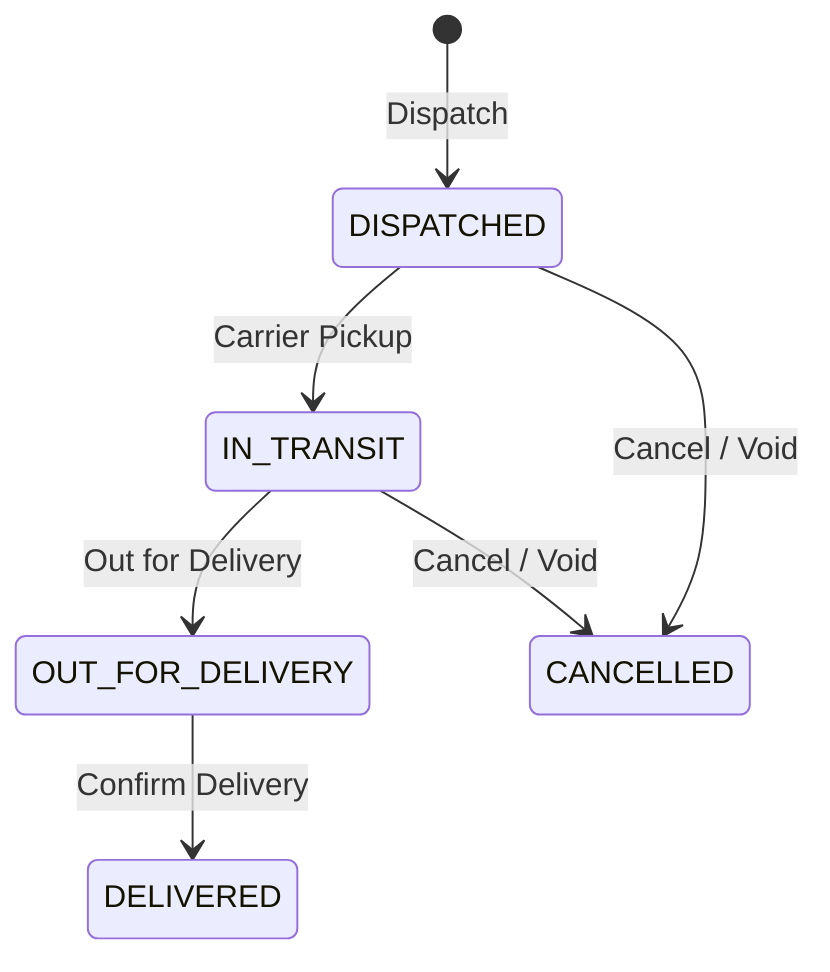
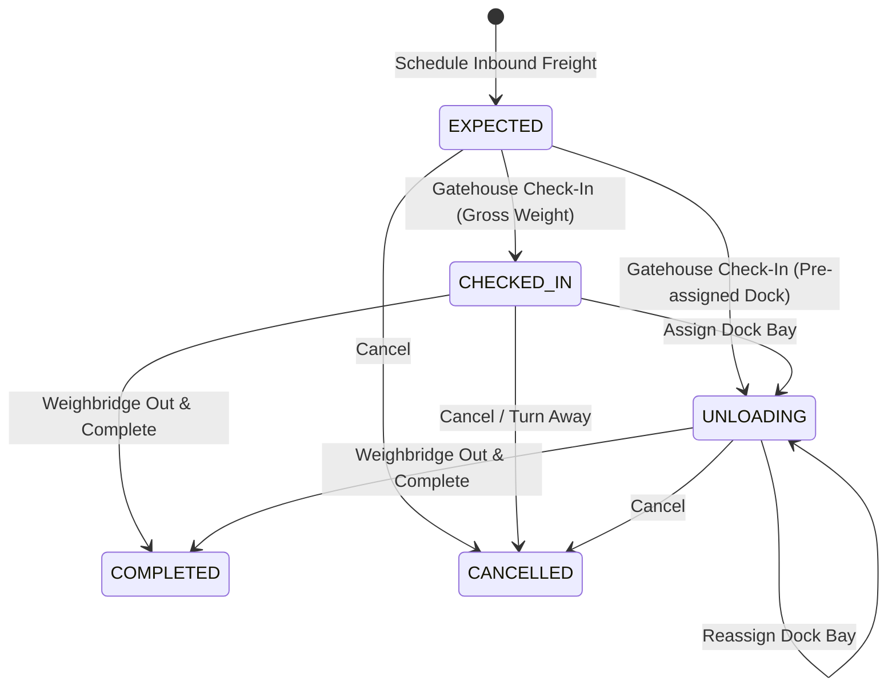

# Logistics

The Logistics add-on manages outbound shipments — dispatch scheduling, carrier assignment, and delivery tracking.

## Key Features

### Shipment Management
- Create shipments linked to sales orders or standalone
- Assign carriers and shipping methods
- Track shipment status from dispatch to delivery

### Dispatch Operations

1. **Dispatch** — Hand off order to carrier and generate delivery note (`DISPATCHED`)
2. **In Transit** — Track movement, carrier checkpoints, and tracking URLs (`IN_TRANSIT` / `OUT_FOR_DELIVERY`)
3. **Deliver** — Confirm delivery with recipient name and proof of delivery (`DELIVERED`)
4. **Cancel / Void** — Cancel uncompleted shipment and reverse stock draw (`CANCELLED`)

### Carrier Tracking
- Record carrier name, tracking number, and estimated delivery
- Update shipment status as the carrier progresses
- Log delivery confirmation details

### Proof of Delivery
- Record delivery date and time
- Capture recipient name
- Note any delivery exceptions

### Inbound Gate Operations

The Inbound Gate manages incoming delivery vehicles, weighbridge gross/tare scales, and dock bay assignments for procurement receipts and supplier freight.

1. **Schedule** (`EXPECTED`) — Register expected incoming supplier truck or peg directly from open purchase orders.
2. **Gatehouse Check-In** (`CHECKED_IN`) — Physical vehicle arrival at gatehouse, recording driver details and initial gross weighbridge scale weight.
3. **Dock Bay Assignment** (`UNLOADING`) — Allocate warehouse intake dock bay for physical unloading.
4. **Weighbridge Out & Complete** (`COMPLETED`) — Capture tare scale weight, compute net freight weight, and complete gate-out (terminal frontier state).
5. **Cancel** (`CANCELLED`) — Cancel uncompleted inbound appointment or turn away arriving vehicle.

#### Weighbridge Scale Net Calculation
$$\text{Net Weight} = \text{Gross Weight} - \text{Tare Weight}$$
The gatehouse enforces that gross weight cannot be less than tare weight, ensuring mathematically consistent weighbridge scale tickets.

## Navigation

| Page | Path | Permission |
|------|------|-----------|
| Logistics Desk | `/logistics` | `shipment.view` |
| Shipments | `/logistics/shipments` | `shipment.view` |
| Inbound Gate | `/logistics/inbound` | `shipment.view` |
| Dashboard | `/logistics/dashboard` | `shipment.view` |

## Cross-Module Integration

| Integration | How It Works |
|------------|-------------|
| **Sales** | Shipments link to sales orders |
| **Inventory** | Stock shipped from warehouse on dispatch |
| **Procurement** | Inbound gate pegging and arrival scheduling against open purchase orders |

## Permissions

| Permission | Description |
|-----------|-------------|
| `shipment.view` | View logistics desk, shipments register, and analytics dashboard |
| `shipment.dispatch` | Dispatch shipments and schedule inbound freight appointments |
| `shipment.update` | Update carrier, tracking, transport details, gate check-in, dock assignment, and weighbridge completion |
| `shipment.deliver` | Confirm delivery |
| `shipment.cancel` | Void delivery note, reverse inventory draw, and cancel inbound appointments |
