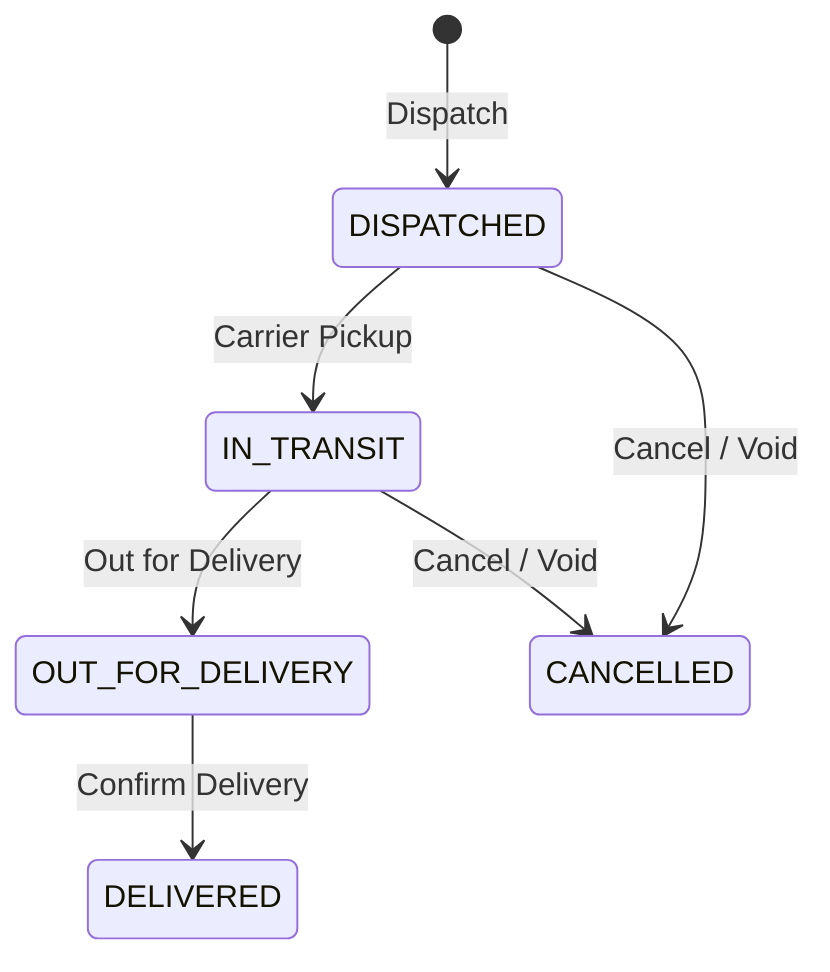

# Logistics

The Logistics add-on manages outbound shipments — dispatch scheduling, carrier assignment, and delivery tracking.

## Key Features

### Shipment Management
- Create shipments linked to sales orders or standalone
- Assign carriers and shipping methods
- Track shipment status from dispatch to delivery

### Dispatch Operations

1. **Dispatch** — Hand off order to carrier and generate delivery note (`DISPATCHED`)
2. **In Transit** — Track movement, carrier checkpoints, and tracking URLs (`IN_TRANSIT` / `OUT_FOR_DELIVERY`)
3. **Deliver** — Confirm delivery with recipient name and proof of delivery (`DELIVERED`)
4. **Cancel / Void** — Cancel uncompleted shipment and reverse stock draw (`CANCELLED`)

### Carrier Tracking
- Record carrier name, tracking number, and estimated delivery
- Update shipment status as the carrier progresses
- Log delivery confirmation details

### Proof of Delivery
- Record delivery date and time
- Capture recipient name
- Note any delivery exceptions

## Navigation

| Page | Path | Permission |
|------|------|-----------|
| Logistics Desk | `/logistics` | `shipment.view` |
| Shipments | `/logistics/shipments` | `shipment.view` |
| Dashboard | `/logistics/dashboard` | `shipment.view` |

## Cross-Module Integration

| Integration | How It Works |
|------------|-------------|
| **Sales** | Shipments link to sales orders |
| **Inventory** | Stock shipped from warehouse on dispatch |

## Permissions

| Permission | Description |
|-----------|-------------|
| `shipment.view` | View logistics desk, shipments register, and analytics dashboard |
| `shipment.dispatch` | Dispatch shipments |
| `shipment.update` | Update carrier, tracking, and transport details |
| `shipment.deliver` | Confirm delivery |
| `shipment.cancel` | Void delivery note and reverse inventory draw |
