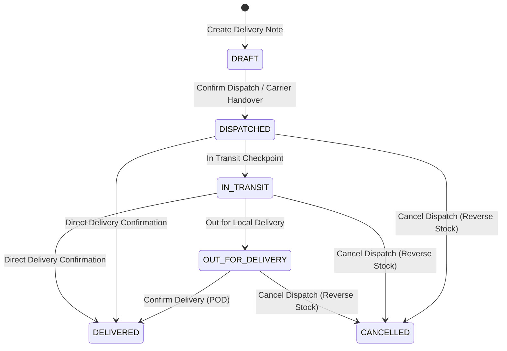
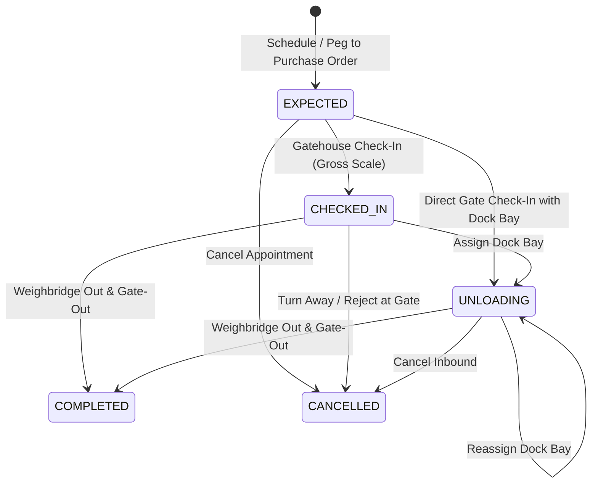

# Logistics

<div class="storyline-breadcrumb">Part of the <strong>Order to Cash (O2C)</strong> &amp; <strong>Procure to Pay (P2P)</strong> Storylines: Step 5 of 6 (Fulfillment &amp; Dispatch) &amp; Step 3 of 5 (Inbound Dock Intake)</div>

> The central physical transport and freight execution engine of TenArm BES, orchestrating sales order dispatches, truck weighbridge gross/tare scales, official delivery notes (challans), carrier tracking, proof of delivery (POD), and inbound supplier yard intake.

The Logistics module bridges commercial commitments with physical transport operations. For outbound sales, it manages vehicle assignments, multi-point weighbridge scale verification, government E-Way Bill generation, carrier tracking milestones, and customer proof of delivery. For inbound procurement, it manages physical gatehouse check-ins, gross and tare scale tickets, and warehouse dock bay allocations—ensuring zero discrepancy between scale measurements and warehouse inventory ledgers.

---

## Workspace Ergonomics

The Logistics workspace is optimized for fast dock execution, gatehouse weighbridge operations, and uninterrupted driver turnaround:

- **Multi-Tab Desk**: Logistics dispatchers and gatehouse weighmasters can operate across up to 3 active logistics tabs simultaneously (e.g. keeping the **Logistics Desk** open for dispatching trucks while monitoring the **Inbound Gate Yard Board** and checking **Carrier Analytics**). Switching tabs preserves active filters, search queries, pagination offsets, and uncommitted form edits without reloading.
- **Draft Auto-Save**: In-progress dispatch drafts (`logistics_dispatch_draft`), driver contact inputs, carrier selections, and weighbridge scale readings are continuously preserved locally. The active tab header displays a dirty dot indicator (`•`) until the dispatch is formally confirmed or discarded.
- **Quick-Peek Slide-Out**: Clicking any linked shipment number, sales order code, purchase order reference, customer account, or inbound freight ticket opens a slide-over drawer from the right edge of the screen, allowing dispatchers to verify sales order item allocations, warehouse lot tags, or consignee addresses without losing their place on the desk.

---

## Core Logistics Concepts

### Outbound Shipment Lifecycle & Frontier Custody
Outbound fulfillment progresses through a disciplined physical custody lifecycle:



| Status | What It Means | Operational Actions Available |
|---|---|---|
| `DRAFT` | Delivery note created against an approved sales order; undergoing packing and scale weighing. | Verify piece counts, record gross/tare scale readings, edit carrier details, or confirm dispatch. |
| `DISPATCHED` | Carrier has taken physical custody; vehicle has cleared warehouse gates. Inventory is deducted. | Update carrier tracking checkpoints, generate E-Way Bills, download Challan PDF, or cancel. |
| `IN_TRANSIT` | Vehicle is traveling between distribution centers or along the transit corridor. | Record transit milestones, update estimated arrival dates, or inspect carrier tracking links. |
| `OUT_FOR_DELIVERY` | Consignment is loaded on the local delivery vehicle for final-mile delivery. | Coordinate with driver; prepare customer receiving dock for handover. |
| `DELIVERED` | Consignment has been received and signed for by the customer. Physical custody has transferred. | View certified POD details, download sign-off slips; cancellations are permanently blocked. |
| `CANCELLED` | Shipment was aborted before delivery. Inventory is returned to warehouse yards. | Terminal audit record; reverses Cost of Goods Sold and restores order line balances. |

> [!IMPORTANT]
> **The External Frontier Principle**: Once a shipment transitions to `DELIVERED`, legal and physical custody has transferred to the customer. The system strictly forbids voiding or cancelling delivered shipments. Any subsequent customer returns must be processed through formal customer Return Material Authorizations (RMA) and Credit Notes in Finance.

---

### Weighbridge Scale Net Calculation
For bulk commodities, metals, and catch-weight items, physical payload weights are verified across calibrated truck weighbridge scales:

$$\text{Net Weight} = \text{Gross Weight} - \text{Tare Weight}$$

1. **Gross Weight**: The scale reading of the loaded truck (vehicle + cargo + driver).
2. **Tare Weight**: The scale reading of the empty vehicle.
3. **Net Weight**: The verified physical weight of the cargo delivered.

The logistics engine enforces that gross weight cannot be less than tare weight. All weighbridge tickets are recorded to four decimal places in metric tons (MT), ensuring complete alignment between physical gate scale tickets and financial invoicing.

---

### Inbound Gatehouse & Dock Bay Management
The Inbound Gate orchestrates incoming supplier deliveries from initial arrival through physical dock unloading:



1. **Schedule (`EXPECTED`)**: Register incoming supplier transport appointments or link directly to open purchase orders in Procurement.
2. **Gatehouse Check-In (`CHECKED_IN`)**: Vehicle arrives at the gatehouse. Gate staff verify driver credentials, vehicle registration, and record initial gross weighbridge scale weight.
3. **Dock Bay Assignment (`UNLOADING`)**: Yard masters direct the vehicle to an available warehouse unloading dock bay using the visual **Dock Allocation Radar**.
4. **Weighbridge Out & Complete (`COMPLETED`)**: Following physical unloading, the empty truck returns to the weighbridge to capture tare weight, compute net received tonnage, issue the weighbridge ticket, and complete gate-out.
5. **Cancel (`CANCELLED`)**: Void unfulfilled delivery appointments or reject non-compliant trucks at the gatehouse.

---

## Core Screens & Workflows

### 1. Logistics Desk (`/logistics`)

**What it does** — The central dispatch command center. A split-desk workstation for staging outbound shipments, monitoring active carriers, and managing fulfillment backlogs.

```
┌──────────────────────────────────────┬────────────────────────────────────────────────────────┐
│ DISPATCH QUEUE                       │ SHIPMENT STORYLINE                                     │
│ Tabs: [ Active ] [ Pending ] [ Done ]│ 🚚 SHP-2024-0089  [ DISPATCHED ]  v2                   │
│ 🔍 Search shipments, vehicles, AWB   │ Dispatched on 11 Nov 2024, 14:30                       │
│                                      ├────────────────────────────────────────────────────────┤
│ • SHP-2024-0089 — Blue Dart Logistics│ 1. Destination: Acme Infrastructure Pvt Ltd            │
│   Vehicle: MH-12-AB-1234 · 24.5 MT   │    Sales Order: SO-2024-0042 · Pune Works Yard         │
│   Status: In Transit                 ├────────────────────────────────────────────────────────┤
│                                      │ 2. Items & Weighbridge Scales                          │
│ • SHP-2024-0090 — VRL Logistics      │    Gross: 38.20 MT · Tare: 13.70 MT · Net: 24.50 MT    │
│   Vehicle: KA-01-CD-5678 · 12.0 MT   ├────────────────────────────────────────────────────────┤
│   Status: Dispatched                 │ 3. Carrier & Tracking: Blue Dart (AWB: 987654321)      │
│                                      │ [ Update Tracking ]  [ Confirm Delivery ]  [ PDF ]     │
└──────────────────────────────────────┴────────────────────────────────────────────────────────┘
```

**Key Controls & Features**
- **Executive Pulse HUD**: Displays real-time operational metrics:
  - `Total Shipments`: Cumulative count of dispatches.
  - `Active in Transit`: Shipments currently en route.
  - `Pending Orders`: Approved sales orders awaiting warehouse dispatch.
  - `Delivered`: Successfully confirmed customer deliveries.
  - `Total Net Payload`: Total metric tonnage dispatched.
- **Dispatch Queue Tabs**:
  - `Active Dispatches`: Shipments currently `DISPATCHED`, `IN_TRANSIT`, or `OUT_FOR_DELIVERY`.
  - `Pending Orders`: Orders in `APPROVED` or `PARTIALLY_SHIPPED` status with allocated stock awaiting truck loading.
  - `Delivered`: Historical archive of certified deliveries.
- **Toolbar & Filters**: Fast search across shipment numbers, sales order numbers, customer names, airway bills (AWB), and vehicle license plates, alongside carrier dropdowns and status pills.
- **Action Strip**:
  - `+ New Dispatch`: Opens the full dispatch configuration modal.
  - `Inbound Gate & Docks`: Navigates to supplier gatehouse operations.
  - `Shipments Register`: Opens the tabular register view.
  - `Reports & Analytics`: Navigates to the logistics dashboard.
  - `View Stock`: Opens warehouse inventory balances in a new tab.

---

### 2. Dispatching a Shipment (`NewDispatchModal`)

**What it does** — The single canonical dispatch workstation in TenArm BES. Links approved sales orders with physical carrier transport, capturing weighbridge weights and generating delivery notes.

**How to Dispatch an Order**
1. Navigate to **Logistics → Logistics Desk** (`/logistics`).
2. Click **+ New Dispatch** (or select an order from the **Pending Orders** tab and click **Dispatch Order**).
3. In the **New Outbound Dispatch** modal:
   - **Select Sales Order**: Choose the approved sales order to fulfill. The form automatically pre-populates customer information, destination address, and fulfilling warehouses.
   - **Specify Line Quantities**: Enter the quantity to ship for each line item. The system enforces that dispatched quantities cannot exceed remaining unfulfilled order quantities.
   - **Record Carrier & Transporter**: Enter the carrier name (e.g. `Blue Dart Logistics`), transporter ID, vehicle license plate (e.g. `MH-12-AB-1234`), driver name, and driver contact phone number.
   - **Generate E-Way Bill**: Click **Generate E-Way Bill** to transmit vehicle details to the GST portal and automatically attach the active E-Way Bill number.
   - **Weighbridge Catch-Weight Scales**: Enter the scale **Gross Weight** and **Tare Weight**. The modal automatically computes and displays the **Net Weight**.
   - **Set Schedule**: Enter the **Estimated Delivery Date** and any handling instructions in **Dispatch Notes**.
4. Click **Confirm Dispatch** (`modal-submit-btn`).
5. **What happens automatically**:
   - The shipment is created in `DISPATCHED` status with an immutable sequential number (e.g. `SHP-2024-0089`).
   - Physical warehouse inventory is drawn and logged against the sales order line.
   - Cost of Goods Sold (COGS) is recognized in Finance.
   - The sales order updates to `PARTIALLY_SHIPPED` or `SHIPPED`.
   - The official printable **Delivery Note (Challan PDF)** is compiled and ready for download.

---

### 3. Outbound Shipment Storyline (`ShipmentStoryline`)

**What it does** — The dedicated inspection and tracking workspace for an active shipment, detailing customer specifications, scale tickets, carrier checkpoints, and proof of delivery.

**Storyline Stages & Sections**
1. **Destination & Order Details**: Customer account name, customer code, sales order link, and delivery address.
2. **Items & Scale Weights**:
   - Itemized manifest table displaying catalog SKU, dispatch warehouse, primary unit quantity, and secondary catch-weight measure.
   - **Weighbridge Scale Slip Card**: Displays Gross Weight, Tare Weight, and calculated Net Payload in metric tons.
3. **Carrier, Vehicle & Live Tracking**:
   - Transporter name, tracking number, tracking URL, vehicle license plate, driver name, driver phone number, and E-Way Bill number.
   - **Status Checkpoint History**: Chronological log of carrier updates, milestone timestamps, transit locations, and carrier notes.
   - Click **Generate E-Way Bill** if transport details were modified after initial staging.
4. **Proof of Delivery (POD) Sign-Off**:
   - Displays certified recipient name, delivery timestamp, and recipient sign-off notes once delivered.
   - For in-transit shipments, provides the **Record Proof of Delivery** action button.
5. **Delivery Documents & POD Scans**:
   - Integrated document attachment tray for uploading customer-signed delivery notes, physical gate stamps, or cargo photographs.

**Tracking & Delivery Actions**
- **Update Tracking (`UpdateTrackingModal`)**: Update vehicle numbers, driver contacts, or advance status to `IN_TRANSIT` or `OUT_FOR_DELIVERY`.
- **Confirm Delivery (`ProofOfDeliveryModal`)**: Record customer handover:
  1. Click **Confirm Delivery**.
  2. Enter **Received By** (recipient name or authorized receiving agent).
  3. Verify **Delivered At** timestamp.
  4. (Optional) Enter receiving remarks or dock exceptions in **POD Notes**.
  5. Click **Confirm Delivery & Sign-Off**. The shipment locks into `DELIVERED`.
- **Delivery Note PDF**: Click **Delivery Note PDF** to view and print the official Goods Delivery Note (Challan) featuring company headers, consignee tax information, vehicle numbers, itemized goods, and signature blocks.
- **Cancel Shipment**: Click **Cancel** (`confirm-cancel`) to void an uncompleted dispatch. Reverses physical warehouse inventory draws, cancels COGS recognition, and rewinds the parent sales order status back to `APPROVED` or `PARTIALLY_SHIPPED`.

---

### 4. Shipments Register (`/logistics/shipments`)

**What it does** — Tabular, filterable historical register of all organizational dispatches with keyset streaming pagination and multi-field search.

**Key Features**
- **Status Filter Pills**: Filter across `All Status`, `Draft`, `Dispatched`, `In Transit`, `Delivered`, and `Cancelled`.
- **Carrier Filter**: Dropdown filtering shipments by specific freight and logistics partners.
- **Table Columns**:
  - `Shipment #`: Document identifier with status badge.
  - `Sales Order`: Clickable reference to the originating sales order.
  - `Customer`: Buyer account name and destination.
  - `Carrier & Transporter`: Logistics provider and tracking number.
  - `Vehicle & Driver`: Vehicle registration plate and driver phone.
  - `Net Weight`: Scale net payload in metric tons (MT).
  - `Shipped Date`: Timestamp of physical gate departure.
  - `Actions`: One-click **PDF** delivery note download and deep-link to the Logistics Desk storyline.

---

### 5. Inbound Gate & Docks (`/logistics/inbound`)

**What it does** — Central yard management system governing incoming supplier trucks, gatehouse security check-ins, gross and tare weighbridge scale measurements, and warehouse dock bay allocations.

```
┌──────────────────────────────────────┬────────────────────────────────────────────────────────┐
│ YARD BOARD                           │ INBOUND FREIGHT STORYLINE                              │
│ Pills: [ All ] [ In Yard ] [ Docks ] │ 🚚 INF-2024-0042  [ CHECKED_IN ]  v1                   │
│ 🔍 Search freight #, vehicle, PO     │ PO: PO-2024-0089 · Tata Steel Ltd                      │
│                                      ├────────────────────────────────────────────────────────┤
│ • INF-2024-0042 — Tata Steel Ltd     │ ⚖️ Weighbridge Scale Measurement                       │
│   Vehicle: NL-01-A-9988 · In Yard    │    Gross: 42.15 MT · Tare: — · Net: —                  │
│   [ Gate Check-In ]                  ├────────────────────────────────────────────────────────┤
│                                      │ 📍 Dock Bay: Bay 3 (Central Yard Intake)               │
│ • INF-2024-0043 — JSW Steel          │    Driver: Rajesh Kumar (+91 98765 12345)              │
│   Vehicle: MH-04-B-4433 · At Docks   │ [ Assign Dock Bay ]  [ Weighbridge Out ]  [ Cancel ]   │
└──────────────────────────────────────┴────────────────────────────────────────────────────────┘
```

**View Modes**
- **Yard Board (`view-yard-queue-btn`)**: SplitDesk layout featuring the queue of inbound freight on the left and the full **Inbound Freight Storyline** on the right.
- **Dock Radar & Bays (`view-dock-radar-btn`)**: Visual warehouse dock allocation matrix (`DockAllocationRadar`). Displays real-time occupancy across physical warehouse bays (e.g. `Bay 1: Unloading INF-2024-0043`, `Bay 2: Available`). Clicking an available bay allows one-click assignment.

**How to Process an Inbound Supplier Delivery**
1. **Schedule Inbound Delivery**:
   - Click **Schedule Inbound** (`schedule-inbound-header-btn`).
   - (Optional) Click **Expected Inbound POs** to select an approved purchase order from Procurement, pre-filling supplier and expected cargo details.
   - Enter expected arrival date, vehicle number, carrier name, and driver contact.
   - Click **Schedule Delivery**. The record is created in `EXPECTED` status.
2. **Gatehouse Check-In**:
   - When the truck physically arrives at the facility gate, locate the record on the Yard Board and click **Gate Check-In** (`gate-check-in-btn`).
   - In the **Gatehouse Check-In** modal, verify driver license details.
   - Drive the loaded truck onto the scale and enter the **Gross Weight** (e.g. `42.1500 MT`).
   - (Optional) Assign a designated dock bay immediately.
   - Click **Confirm Gate Check-In**. Status advances to `CHECKED_IN` (or `UNLOADING` if dock assigned).
3. **Assign Warehouse Dock Bay**:
   - If not assigned at the gate, click **Assign Dock Bay** (`assign-dock-btn`).
   - Select the destination warehouse and target intake bay (e.g. `Bay 3`).
   - Click **Assign Bay**. Status transitions to `UNLOADING`. Warehouse receiving clerks in Inventory can now inspect and unload goods.
4. **Weighbridge Out & Complete**:
   - Once physical unloading is complete, the empty truck returns to the gatehouse scale.
   - Click **Weighbridge Out & Complete** (`weighbridge-out-complete-btn`).
   - In the **Weighbridge Out & Gatehouse Check-Out** modal, enter the **Tare Weight** of the empty truck (e.g. `14.2000 MT`).
   - The system automatically calculates the **Net Weight** (`27.9500 MT`) and verifies $\text{Gross} \ge \text{Tare}$.
   - Enter the scale **Weighbridge Ticket Number**.
   - Click **Complete Gate-Out**. Status transitions to `COMPLETED`, recording gate departure and establishing the certified scale receipt.

---

### 6. Logistics Dashboard & Analytics (`/logistics/dashboard`)

**What it does** — Executive and operational reporting tracking monthly freight volume velocity, carrier performance scorecards, and customer delivery completion rates.

**Key Metrics & Visualizations**
- **Period Filter**: Select any calendar month (`YYYY-MM`) to analyze historical logistics velocity.
- **Pulse KPI Cards**:
  - `Total Dispatches`: Total shipments executed during the period.
  - `Delivered Shipments`: Completed customer handovers.
  - `Active in Transit`: Cargo currently moving on corridors.
  - `Total Payload Weight`: Aggregated scale tonnage (MT) transported.
  - `On-Time Delivery Rate`: Percentage of shipments delivered on or before the estimated delivery date.
- **Monthly Dispatch Volume Trend**: Area chart showing freight volume progression over the last 6 months.
- **Shipment Status Breakdown**: Visual distribution of dispatches across Dispatched, In Transit, Delivered, and Cancelled.
- **Carrier Performance Scorecard**: Itemized league table ranking logistics providers across total dispatches assigned, delivered count, active in-transit count, payload tonnage, and delivery completion rate percentage.
- **Top Freight Destinations**: Bar chart and summary table of high-volume customer accounts and delivery corridors.

---

## If Something Goes Wrong (Common Validation & Guard Errors)

| What you see (Toast / Banner) | Why it happens | How to fix it in the workspace |
|---|---|---|
| **"Cannot exceed remaining unfulfilled quantity"** | Dispatch quantity entered for an order line is greater than the unfulfilled balance remaining on the sales order. | Verify previous partial shipments in the Sales Order Storyline. Enter a quantity less than or equal to the remaining balance. |
| **"At least one item must have a dispatch quantity > 0"** | Attempted to click Confirm Dispatch with all line quantities set to zero or blank. | Enter the actual quantity loaded onto the truck for at least one order line before confirming. |
| **"Gross weight cannot be less than tare weight"** | Mathematical scale violation: recorded loaded truck weight is less than empty truck weight. | Re-verify weighbridge scale readings. Ensure the loaded truck reading is recorded in Gross Weight and empty truck in Tare Weight. |
| **"Cannot cancel delivered shipment"** | Terminal frontier rule: physical custody of goods has transferred to the customer upon POD sign-off. | Delivered shipments cannot be voided. To process returned goods, have Sales and Finance issue an official RMA and Credit Note. |
| **"Cannot cancel shipment: Parent sales order is COMPLETED"** | The originating sales order has been finalized and financially settled. | The shipment is locked. Process any commercial adjustments through Finance credit notes rather than logistics dispatch cancellation. |
| **"Delivering an already DELIVERED or CANCELLED shipment is prohibited"** | Attempted to record proof of delivery on a shipment that is already closed or voided. | No action needed; the shipment is already in a terminal state. |
| **"Estimated delivery date cannot be in the past"** | Configured estimated delivery date is earlier than the dispatch date. | Select an expected delivery date on or after today's date in the dispatch modal. |
| **"Invalid driver phone number format"** | Driver contact does not match standard 10-digit telephone formatting. | Enter a valid telephone number (e.g. `+91 98765 43210`) in driver phone details. |
| **"Please select an order to dispatch"** | Clicked Confirm Dispatch without selecting an approved sales order. | In the New Dispatch modal, choose an approved order from the order selection dropdown. |
| **"Record has been modified by another user (OCC Conflict)"** | Another dispatcher updated carrier tracking or weights while you had the record open. | Review the **Conflict Resolution Drawer** comparing your changes with the latest server state, select the desired version, and re-apply. |

---

## Integrations

| Integrated Module | When & Where | What Happens Automatically |
|---|---|---|
| **Sales** | Dispatching outbound orders | Dispatches deduct fulfilled quantities from sales orders, advancing orders from `APPROVED` to `PARTIALLY_SHIPPED` or `SHIPPED`. Cancelling a dispatch rewinds order status. |
| **Inventory** | Dispatching & cancelling shipments | Dispatches decrement warehouse on-hand balances. Cancelling a dispatch automatically executes a stock return, restoring warehouse inventory balances and lot tags. |
| **Finance** | Outbound dispatch & landed freight | Dispatches trigger Accounts Receivable billing candidates. Logistics carrier bills post as Accounts Payable liabilities and can be capitalized into landed inventory costs. |
| **Procurement** | Inbound gate check-ins & dock intake | Scheduled supplier trucks link to open Purchase Orders. Certified weighbridge scale weights verify receiving quantities against vendor delivery challans. |
| **GST Invoicing** | Carrier transport staging | Generates government-compliant E-Way Bills directly from vehicle and transporter details, linking official EWB numbers to delivery notes. |
| **AI Insights** | In-transit monitoring | Continuously scans for transit delays, overdue delivery estimates, and carrier SLA compliance exceptions. |

---

## Permissions Reference

| Permission | What It Unlocks in the Workspace |
|---|---|
| `shipment.view` | Access the Logistics Desk, Shipments Register, Inbound Gate Yard Board, and Analytics Dashboard. |
| `shipment.dispatch` | Create and confirm new outbound dispatches, assign line quantities, and schedule inbound delivery appointments. |
| `shipment.update` | Update carrier tracking details, vehicle numbers, driver contacts, gatehouse check-in, dock bay assignments, and weighbridge completion. |
| `shipment.deliver` | Record customer proof of delivery (POD), sign-off timestamps, and receiving agent details. |
| `shipment.cancel` | Cancel active outbound shipments (reversing warehouse stock draws) and cancel unfulfilled inbound freight appointments. |
