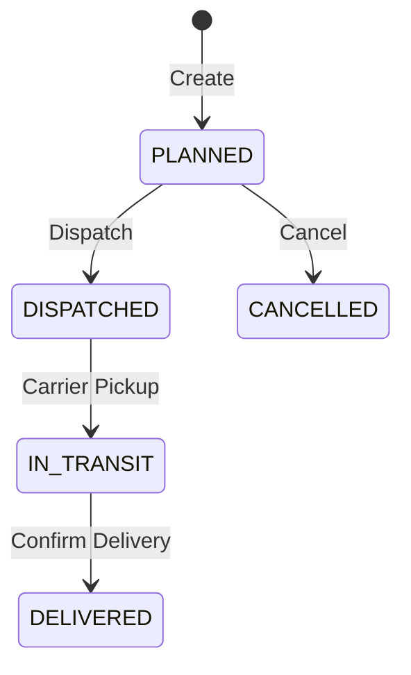

# Logistics

The Logistics add-on manages outbound shipments — dispatch scheduling, carrier assignment, and delivery tracking.

## Key Features

### Shipment Management
- Create shipments linked to sales orders or standalone
- Assign carriers and shipping methods
- Track shipment status from dispatch to delivery

### Dispatch Operations

1. **Plan** — Create a shipment with items, destination, and carrier
2. **Dispatch** — Hand off to the carrier with tracking details
3. **In Transit** — Track movement
4. **Deliver** — Confirm delivery with proof of delivery

### Carrier Tracking
- Record carrier name, tracking number, and estimated delivery
- Update shipment status as the carrier progresses
- Log delivery confirmation details

### Proof of Delivery
- Record delivery date and time
- Capture recipient name
- Note any delivery exceptions

## Navigation

| Page | Path | Permission |
|------|------|-----------|
| Logistics Desk | `/logistics` | `logistics.shipment.view` |
| Shipments | `/logistics/shipments` | `logistics.shipment.view` |
| Dashboard | `/logistics/dashboard` | `logistics.shipment.view` |

## Cross-Module Integration

| Integration | How It Works |
|------------|-------------|
| **Sales** | Shipments link to sales orders |
| **Inventory** | Stock shipped from warehouse on dispatch |

## Permissions

| Permission | Description |
|-----------|-------------|
| `logistics.shipment.view` | View shipments |
| `logistics.shipment.create` | Create shipments |
| `logistics.shipment.dispatch` | Dispatch shipments |
| `logistics.shipment.deliver` | Confirm delivery |
