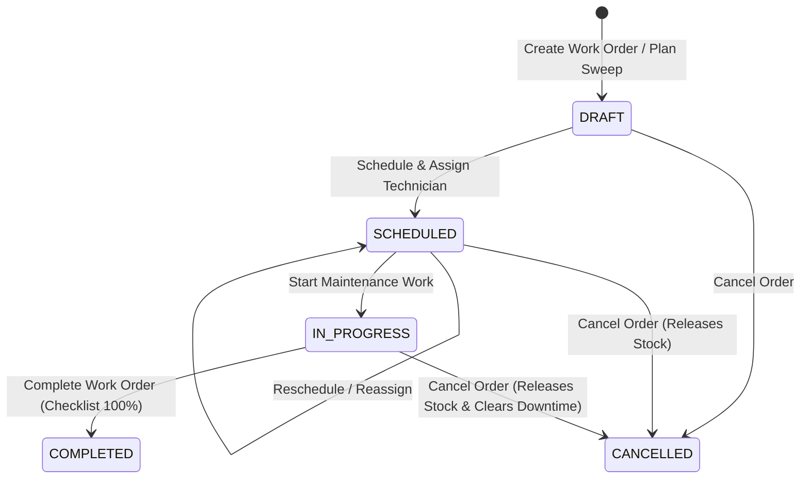
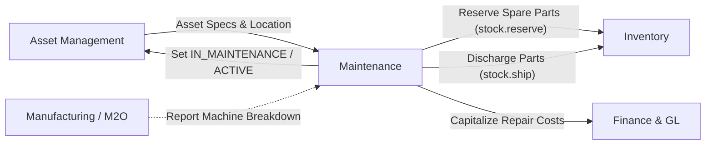

# Maintenance

Operational Foundation for <strong>Asset Reliability &amp; Maintenance</strong> and <strong>Make to Order (M2O)</strong> Production Support

> The asset reliability and shop floor maintenance engine of TenArm BES, orchestrating equipment servicing from recurring preventive schedules and checklist inspections through technician dispatch, spare parts reservation, and operational sign-off.

The Maintenance module protects physical plant investments and production uptime. It coordinates scheduled preventive maintenance routines with reactive breakdown repairs, bridging machinery records in Asset Management with inventory stores in Warehousing and cost tracking in Finance.

---

## Workspace Ergonomics

The Maintenance workspace is engineered for high-tempo shop floor dispatch, mobile technician execution, and equipment monitoring:

- **Multi-Tab Desk**: Maintenance dispatchers and reliability engineers can operate across up to 3 workspace tabs simultaneously (for example, keeping the **Maintenance Desk** open to manage active work order queues while reviewing the **Preventive Plans** schedule and monitoring the **Maintenance Dashboard**). Switching tabs preserves active search queries, status filters, and scroll positions without reloading.
- **Draft Auto-Save**: Uncommitted inputs in work order creation forms and modal dialogs are continuously preserved locally. The active tab header displays a dirty dot indicator (`•`) until the work order is submitted or discarded.
- **Quick-Peek Slide-Out**: Clicking any linked work order number, fixed asset tag, or spare part code opens an inspection drawer from the right edge of the screen, allowing users to inspect equipment service history and asset locations without navigating away from their active queue.

---

## Core Maintenance Concepts

### Preventive vs. Corrective Maintenance
Maintenance work is categorized into two operational disciplines:
- **Preventive Maintenance (`PREVENTIVE`)**: Planned, recurring service intervals (e.g. 30-day lubrication, 90-day filter replacement, annual safety recertification) anchored to fixed assets. Plans automatically generate draft work orders and advance their calendar cadence.
- **Corrective Maintenance (`CORRECTIVE`)**: Unplanned repair orders raised in response to equipment breakdowns, abnormal vibration, safety hazards, or operator-reported defects.

### Automated Asset Status Synchronization
The Maintenance module coordinates machinery availability directly with Asset Management:
- **Starting Work**: When a work order transitions to `IN_PROGRESS`, the associated fixed asset is automatically transitioned to `IN_MAINTENANCE`, alerting production planners in Manufacturing and Make to Order (M2O) that the machine is off-line.
- **Completing or Cancelling Work**: When the work order reaches `COMPLETED` or `CANCELLED`, the system checks whether any other concurrent work orders remain active for that machine. If no other orders remain in progress, the asset status automatically returns to `ACTIVE`.

### Checklist Governance & Quality Gates
Every work order supports an interactive inspection checklist. For preventive plans, checklists are inherited from standardized templates (e.g., verifying torque tolerances, fluid levels, or emergency shutoffs).
- **Mandatory Completion Gate**: A technician cannot mark a work order `COMPLETED` if any checklist task remains pending. The sign-off button remains gated until every procedure is checked off.

### Two-Phase Spare Parts Accounting
Spare parts consumption integrates directly with the Inventory warehouse ledger:
1. **Reservation Phase (`Issue Spare Part`)**: While a work order is `SCHEDULED` or `IN_PROGRESS`, issuing a spare part immediately places a warehouse reservation (`stock.reserve`) against the selected product and warehouse. This guarantees parts availability and prevents stockouts without immediately expensing the item.
2. **Discharge & Costing Phase (`Complete Work Order`)**: Upon final sign-off, all reserved parts are discharged from inventory (`stock.ship`), decrementing both on-hand and reserved stock balances. The actual inventory valuation (COGS) is calculated and automatically rolled into the work order's **Total Recorded Cost** alongside technician labor fees.
3. **Cancellation Recovery**: If an open work order is cancelled, all reserved spare parts are released back to available warehouse stock (`stock.release`).

### Automated Daily Plan Sweep
In addition to on-demand manual generation, TenArm BES runs an automated daily background scheduler at `02:00 UTC`. The job identifies all active plans whose next due date has arrived, generates new `DRAFT` work orders, populates standardized checklists, and advances each plan's next due date forward by its defined interval.

---

## Work Order Lifecycle & State Machine

Work orders progress through a 5-stage lifecycle governed by optimistic concurrency control (OCC):

| Status | Meaning | Allowed Next Actions |
|---|---|---|
| `DRAFT` | Initial scope definition. Machine, problem description, and inspection tasks recorded. | Schedule and assign technician, edit scope, or cancel order. |
| `SCHEDULED` | Assigned to a specific technician with a target maintenance execution date. | Start maintenance work, reassign technician, issue spare parts, or cancel order. |
| `IN_PROGRESS` | Technician is actively servicing the equipment. Asset is marked `IN_MAINTENANCE`. | Toggle checklist tasks, issue spare parts, sign off and complete order, or cancel. |
| `COMPLETED` | Service finished, all checklist items completed, parts discharged, and asset restored to `ACTIVE`. | Review final cost ledger, checklist log, and historical service notes. *(Final state)* |
| `CANCELLED` | Work order aborted. Reserved parts released back to warehouse stock. | Historical audit only. *(Final state; raise new work order if needed)* |

---

## Maintenance Desk (`/maintenance`)

The **Maintenance Desk** is the primary shop floor command center, featuring a split-screen workbench that pairs an active work order queue on the left with an interactive 4-stage inspection and execution storyline on the right.

### Executive Pulse HUD
The top of the desk displays live operational KPIs:
- **Active Work Orders**: Count of all open orders across `DRAFT`, `SCHEDULED`, and `IN_PROGRESS` stages.
- **In-Progress Repairs**: Number of work orders currently being executed on the shop floor.
- **Completed Orders**: Total volume of successfully executed and closed work orders.
- **Preventive Plans**: Total number of active scheduled maintenance intervals.
- **Recorded Cost**: Cumulative financial expenditure across all maintenance work orders (parts and labor).

### Action Strip
- **Spare Parts**: Opens the spare parts inventory catalog (`/inventory/products`) in a dedicated tab.
- **Orders Register**: Navigates to the tabular work orders register (`/maintenance/work-orders`).
- **Maintenance Plans**: Navigates to preventive schedules management (`/maintenance/plans`).
- **+ New Work Order**: Opens the creation modal to raise a corrective or ad-hoc work order.

### Filter & Search Toolbar
- **Search Input**: Instant search filtering by work order number (e.g. `WO-00042`), title, machine name, asset tag, or assigned technician.
- **Type Filter Pills**: Toggle between `All Types`, `Corrective`, and `Preventive`.
- **Status Filter Pills**: Quick filter by lifecycle state: `ALL`, `DRAFT`, `SCHEDULED`, `IN_PROGRESS`, `COMPLETED`, `CANCELLED`.

### 4-Stage Work Order Storyline

When an order is selected from the left queue, the right inspector pane displays the full 4-stage execution storyline:

#### Stage 1: Machine & Issue Details
- Displays machine specifications: **Fixed Asset** tag, **Asset Category**, **Physical Location**, and **Assigned Technician**.
- Chronological timeline tracking: **Scheduled Date**, **Execution Started**, **Closure Sign-Off**, and **Recorded Cost**.
- Displays the problem scope, defect symptoms, and operational notes.
- If generated from a recurring schedule, displays the source preventive plan banner.

#### Stage 2: Standard Operating Checklist
- Displays the interactive checklist with a dynamic **Task Completion Progress %** bar.
- Technicians check off inspection tasks as they are physically completed on the equipment.
- Each task tracks its completion state and displays a `Done` badge.
- When an item is checked, the desk immediately saves the state using optimistic concurrency control.

#### Stage 3: Spare Parts Used
- Displays the spare parts ledger detailing all materials consumed for the repair.
- Columns include: `Part Code & Name`, `Warehouse Depot`, `Qty Issued`, `Unit (UOM)`, `Notes`, and `Recorded At`.
- When the order is in `SCHEDULED` or `IN_PROGRESS` status, authorized users can click **Issue Spare Part** to reserve additional components from warehouse inventory.

#### Stage 4: Status & Actions
Displays lifecycle action buttons according to the current stage:
- **In `DRAFT`**: Click **Schedule & Assign Technician** to set the target date and select a specialist.
- **In `SCHEDULED`**: Click **Start Maintenance Work** to commence servicing and set asset downtime.
- **In `IN_PROGRESS`**: Click **Complete Work Order** to finalize sign-off. If any checklist items remain incomplete, the button is disabled with an advisory prompt: *"Closure is gated: complete all checklist tasks above before finalizing."*
- **In Open States (`DRAFT`, `SCHEDULED`, `IN_PROGRESS`)**: Click **Cancel Order** to abort the work order and release any reserved materials.

---

## Step-by-Step Procedures

### How to Create an Ad-Hoc / Corrective Work Order
1. Navigate to **Maintenance → Maintenance Desk** (`/maintenance`) or **Work Orders** (`/maintenance/work-orders`).
2. Click **+ New Work Order** to open the modal dialog.
3. Select the **Fixed Asset** from the dropdown (displays asset code, name, and plant location).
4. Select the **Maintenance Type**:
   - `CORRECTIVE (Breakdown / Repair)` for unscheduled fixes.
   - `PREVENTIVE (Routine Service)` for manual preventive routines.
5. Enter a concise **Work Order Title** (e.g. *Replace compressor intake air filter*).
6. *(Optional)* Select a **Scheduled Date** (must be today or in the future).
7. Enter the **Problem / Scope Description** detailing error codes, symptoms, or observed defects.
8. Under **Inspection Checklist Items**, type specific tasks into the input field and click **+ Add Task** (or press Enter) to define mandatory verification steps.
9. Click **Create Work Order**. The system assigns a sequential document number (`WO-XXXXX`) and places the order in `DRAFT`.

### How to Schedule and Assign a Technician
1. Open the work order in the **Maintenance Desk** or click the schedule icon in the **Work Orders Register**.
2. Click **Schedule & Assign Technician** to open the scheduling dialog.
3. Select the **Assigned Technician** from the list of active organization specialists.
4. Set the **Target Scheduled Date**.
5. Click **Schedule & Assign**. The work order transitions to `SCHEDULED`.

### How to Issue Spare Parts from Warehouse Stock
1. Open a work order in `SCHEDULED` or `IN_PROGRESS` status.
2. In **Stage 3: Spare Parts Used**, click **Issue Spare Part** to open the parts dialog.
3. Select the **Spare Part Product** from catalog items.
4. Select the **Source Warehouse** depot holding the parts.
5. Enter the **Quantity to Issue** (the field automatically reflects the item's primary unit of measure).
6. *(Optional)* Enter **Consumption Notes / Installation Details** (e.g. *Torqued bolts to 45 Nm*).
7. Click **Issue Part from Stock**. The system creates an immediate warehouse reservation, locks the inventory, and appends the line to the work order's parts ledger.

### How to Execute and Complete a Work Order
1. On the scheduled date, open the work order and click **Start Maintenance Work**. The order transitions to `IN_PROGRESS` and marks the asset `IN_MAINTENANCE`.
2. As physical servicing progresses, check off each item in **Stage 2: Standard Operating Checklist**.
3. Issue any replacement parts used during repair in **Stage 3: Spare Parts Used**.
4. Once all checklist tasks reach 100% completion, click **Complete Work Order** in **Stage 4: Status & Actions**.
5. In the sign-off dialog:
   - Enter the **Total Execution Cost** (captures external service fees, third-party vendor charges, or technician labor).
   - Enter **Final Completion Notes / Observations** (e.g. *Hydraulic pressure restored to 210 bar; safety interlocks tested normal*).
6. Click **Sign Off & Complete**.
7. The system:
   - Discharges all reserved spare parts from inventory (`stock.ship`), posting material costs.
   - Sums parts valuation and labor fees into the final recorded cost.
   - Restores the machine to `ACTIVE` in Asset Management.
   - Marks the work order `COMPLETED`.

---

## Work Orders Register (`/maintenance/work-orders`)

The **Work Orders Register** provides a comprehensive tabular ledger of all organizational maintenance jobs:

### Executive Statistics HUD
- **Active Orders**: Open orders pending execution (`DRAFT`, `SCHEDULED`, `IN_PROGRESS`).
- **In-Progress**: Orders currently being serviced on the floor.
- **Completed**: Fully executed and closed jobs.
- **Total Spend**: Aggregate historical expenditure across all work orders.

### Tabular Grid Columns
| Column | Description |
|---|---|
| **WO Number** | Sequential document reference (e.g. `WO-00014`). Clicking opens the quick-peek drawer. |
| **Fixed Asset** | Asset name, asset tag, and equipment category. |
| **Type** | Color-coded badge: `PREVENTIVE` (green) or `CORRECTIVE` (amber). |
| **Scope & Title** | Primary title and summary defect description. |
| **Technician** | Assigned specialist name, or *Unassigned*. |
| **Scheduled** | Target execution date. |
| **Checklist** | Completed task ratio (e.g. `4/5 tasks`). |
| **Status** | Status badge (`DRAFT`, `SCHEDULED`, `IN_PROGRESS`, `COMPLETED`, `CANCELLED`). |
| **Cost** | Recorded financial cost formatted in tenant currency. |
| **Actions** | Quick action buttons: **Open in Desk**, quick schedule (`UserCheck` icon), and quick start (`Play` icon). |

---

## Preventive Maintenance Plans (`/maintenance/plans`)

Preventive maintenance plans automate recurring maintenance schedules to prevent equipment breakdown and prolong machinery service life.

### Pulse HUD Metrics
- **Active Schedules**: Total count of recurring preventive plans currently active.
- **Due for Execution**: Plans whose next due date has arrived and require work order generation.
- **Managed Assets**: Total count of active fixed assets covered by maintenance policies.

### Plan Lifecycle
- **`ACTIVE`**: The schedule is active. Generates recurring work orders on cadence.
- **`INACTIVE`**: The plan has been archived. No further work orders are generated.

### Tabular Grid & Plan Attributes
| Column | Description |
|---|---|
| **Plan Name** | Schedule title (e.g. *Monthly Chiller Condenser Descaling*) and operating notes. |
| **Fixed Asset** | Covered machine name, asset tag, and equipment category. |
| **Type** | Preventive or corrective schedule type. |
| **Interval** | Recurrence interval in calendar days (e.g. *Every 90 days*). |
| **Next Due Date** | Target date for the next service cycle. Overdue dates are highlighted in amber. |
| **Template Tasks** | Count of standardized checklist procedures automatically copied to generated orders. |
| **Status** | `ACTIVE` or `INACTIVE` badge. |
| **Actions** | **Generate Order** (creates draft work order on demand), **Edit Plan** (pencil icon), and **Archive Plan** (archive icon). |

### Creating a Preventive Maintenance Plan
1. Navigate to **Maintenance → Maintenance Plans** (`/maintenance/plans`).
2. Click **+ New Maintenance Plan**.
3. Select the target **Fixed Asset**.
4. Enter the **Plan Schedule Name** (e.g. *Quarterly Hydraulic Fluid & Filter Overhaul*).
5. Specify the **Interval (Days)** (e.g. `90` for quarterly, `30` for monthly, `365` for annual).
6. *(Optional)* Specify the **Next Due Date**. If left blank, defaults to today plus the interval days.
7. Enter **Standard Operating Procedures / Notes**.
8. In **Checklist Template Tasks**, click **+ Add Task** to establish the mandatory inspection procedures that will be cloned onto every generated work order.
9. Click **Create Plan**.

### On-Demand Work Order Generation
While the daily background sweep automatically creates orders on schedule, dispatchers can generate orders immediately:
1. Locate the plan on the **Preventive Maintenance Plans** grid.
2. Click **Generate Order**.
3. The system generates a new work order in `DRAFT` status with the plan's checklist tasks pre-populated, advances the plan's `next_due_date` forward by `interval_days`, and navigates directly to the work order in the **Maintenance Desk**.

---

## Maintenance Dashboard (`/maintenance/dashboard`)

The **Maintenance Dashboard** delivers high-level visibility into equipment reliability, technician throughput, and departmental spend.

### Period KPI Metrics
- **Work Orders**: Total work orders created during the active monthly period.
- **Open**: Current count of uncompleted orders awaiting completion.
- **Completed**: Total completed orders and the period **Completion Rate %**.
- **Cancelled**: Volume of aborted work orders.
- **Total Cost**: Cumulative expenditure across spare parts consumption and labor fees.

### Analytics & Visualizations
- **Work Order Status Distribution**: Horizontal bar chart breaking down orders across `DRAFT`, `SCHEDULED`, `IN_PROGRESS`, `COMPLETED`, and `CANCELLED`.
- **Created vs. Completed Trend**: 6-month dual-layer area chart comparing intake volume against completion velocity.
- **Monthly Summary Table**: Chronological table showing monthly totals for orders created, orders completed, and total maintenance costs.

---

## Key Fields Reference

### Work Order Fields (`MaintenanceWorkOrder`)
| Field | Required | Description & Validation |
|---|:---:|---|
| **Fixed Asset** (`asset_id`) | ✅ | Selected from active assets in Asset Management. Machine must belong to the tenant. |
| **Maintenance Type** (`maintenance_type`) | ✅ | `CORRECTIVE` or `PREVENTIVE`. |
| **Title** (`title`) | ✅ | Descriptive title of the repair or maintenance routine. |
| **Scheduled Date** (`scheduled_date`) | ❌ | Target execution date; must be today or in the future. |
| **Problem / Scope Description** (`description`) | ❌ | Technical description of symptoms, inspection results, or fault codes. |
| **Assigned Technician** (`technician_user_id`) | ❌ (Req for schedule) | Specialist assigned to execute the order; must be an active tenant user. |
| **Inspection Checklist** (`checklist`) | ❌ | Array of inspection items (`{ item: string, done: boolean, note: string }`). |
| **Total Recorded Cost** (`cost`) | ❌ | Computed sum of labor expenses entered at sign-off and inventory parts valuation. |

### Preventive Plan Fields (`MaintenancePlan`)
| Field | Required | Description & Validation |
|---|:---:|---|
| **Fixed Asset** (`asset_id`) | ✅ | Target equipment covered by the recurring plan. |
| **Plan Schedule Name** (`name`) | ✅ | Distinct name for the recurring routine. |
| **Interval (Days)** (`interval_days`) | ✅ | Recurrence frequency in days (minimum `1`, maximum `3650` days / 10 years). |
| **Next Due Date** (`next_due_date`) | ❌ | Scheduled date for next generation; must not be in the past. |
| **Checklist Template Tasks** (`checklist_template`) | ❌ | Standardized task strings inherited by every generated work order. |
| **Standard Operating Procedures / Notes** (`notes`) | ❌ | Technical instructions, safety guidelines, and tool requirements. |

### Spare Part Issue Fields (`MaintenanceWorkOrderPart`)
| Field | Required | Description & Validation |
|---|:---:|---|
| **Spare Part Product** (`product_id`) | ✅ | Selected from active inventory catalog products. |
| **Source Warehouse** (`warehouse_id`) | ✅ | Warehouse depot from which parts are drawn. |
| **Quantity to Issue** (`qty`) | ✅ | Positive decimal quantity in the product's inventory unit of measure. |
| **Consumption Notes** (`notes`) | ❌ | Installation notes, part serial numbers, or calibration readings. |

---

## Cross-Module Integrations

| Integration Module | Business Interaction |
|---|---|
| **Asset Management** | Work orders and plans link directly to machinery assets. Transitioning a work order to `IN_PROGRESS` marks the asset `IN_MAINTENANCE`. Completing the work order restores the asset to `ACTIVE` service once all concurrent repairs finish. |
| **Inventory & Warehousing** | Spare parts are issued directly from warehouse depots. Issuing a part creates a stock reservation (`stock.reserve`). Completing the work order ships the items (`stock.ship`), deducting on-hand stock and expensing COGS. Cancelling releases reservations (`stock.release`). |
| **Workforce & Users** | Technicians and maintenance specialists are assigned directly from active tenant user accounts. |
| **Finance & General Ledger** | Total maintenance costs (spare parts valuation plus recorded labor expenses) provide equipment maintenance spend tracking and fixed asset maintenance capitalization. |
| **Manufacturing & Make to Order (M2O)** | Machine downtime alerts production planners, preventing production jobs from being scheduled on unavailable or out-of-service assets. |

---

## Permissions & Role Governance

Access to maintenance screens and operations is governed by role-based permissions:

| Permission | Operation | Description |
|---|---|---|
| `maintenance.wo.list` | `maintenance.wo.list` | View the Maintenance Desk, Work Order Queue, and Orders Register. |
| `maintenance.wo.create` | `maintenance.wo.create` | Author new work orders and generate work orders from preventive plans. |
| `maintenance.wo.schedule` | `maintenance.wo.schedule` | Assign technicians and set execution dates on work orders. |
| `maintenance.wo.start` | `maintenance.wo.start` | Commence work orders and set asset downtime to `IN_MAINTENANCE`. |
| `maintenance.wo.consume_part` | `maintenance.wo.consume_part` | Issue and reserve spare parts from warehouse inventory. |
| `maintenance.wo.complete` | `maintenance.wo.complete` | Sign off and close work orders, discharge inventory, and restore asset uptime. |
| `maintenance.wo.cancel` | `maintenance.wo.cancel` | Cancel open work orders and release reserved spare parts back to stock. |
| `maintenance.plan.list` | `maintenance.plan.list` | View the Preventive Maintenance Plans register and schedules. |
| `maintenance.plan.create` | `maintenance.plan.create` | Create new interval-driven preventive maintenance plans. |
| `maintenance.plan.update` | `maintenance.plan.update` | Modify plan intervals, due dates, notes, and checklist templates. |
| `maintenance.plan.archive` | `maintenance.plan.archive` | Archive preventive maintenance plans to discontinue automated generation. |
| `maintenance.dashboard.get` | `maintenance.dashboard.get` | Access the executive Maintenance Dashboard and historical analytics. |

---

## If Something Goes Wrong (Common Validation & Guard Errors)

The table below translates UI alerts, toast notifications, and system guards into immediate operational resolutions:

| What you see (Toast / Banner) | Why it happens | How to fix it in the workspace |
|---|---|---|
| *"Cannot complete work order: X checklist item(s) still outstanding"* | A user attempted to complete an order while one or more checklist tasks remain unchecked. | Navigate to **Stage 2: Standard Operating Checklist**, verify that the physical maintenance tasks have been executed, check off all remaining tasks to reach 100%, and then click **Complete Work Order**. |
| *"Cannot consume parts in 'DRAFT' status (expected SCHEDULED/IN_PROGRESS)"* | Parts were requested for an unapproved draft order that has not been scheduled or started. | Click **Schedule & Assign Technician** to advance the work order to `SCHEDULED` status, or click **Start Maintenance Work**. Once scheduled or in progress, the **Issue Spare Part** button becomes active. |
| *"Insufficient stock available"* (or stock reservation rejected) | The requested spare part quantity exceeds the unreserved on-hand inventory in the chosen warehouse depot. | Check inventory balances in other warehouse depots via the **Spare Parts** button, initiate an inventory stock transfer, or raise a purchase order through **Procurement**. |
| *"Technician user not found or inactive in organization"* | The assigned specialist account has been deactivated or was not selected. | Select an active specialist from the technician dropdown. If the technician is newly hired, ensure their user profile is activated under **Tenant Administration**. |
| *"Scheduled date cannot be in the past"* / *"Next due date cannot be in the past"* | A date prior to today was entered in the scheduled date or plan due date field. | Select today's date or a future calendar date on the date picker. |
| *"Interval days cannot exceed 3650 (10 years)"* | An interval value greater than 3650 days was entered for a preventive maintenance plan. | Enter an interval between 1 and 3650 days (e.g. 30, 90, 180, or 365 days). |
| *"Total execution cost must be a non-negative number"* | A negative number or invalid character was entered in the completion cost field. | Enter `0.00` or a valid positive expense figure representing technician or external contractor costs. |
| *"Document conflict (OCC 409): Another user modified this work order"* | Another dispatcher or technician updated the work order or checklist concurrently. | The **Conflict Resolution Drawer** opens automatically. Review the latest changes from the server, click **Reload Latest**, and re-apply your action. |
| *"Cannot generate work order from inactive plan"* | An attempt was made to generate an order from an archived maintenance plan. | Re-create an active preventive maintenance plan for the equipment, or raise an ad-hoc corrective work order. |
