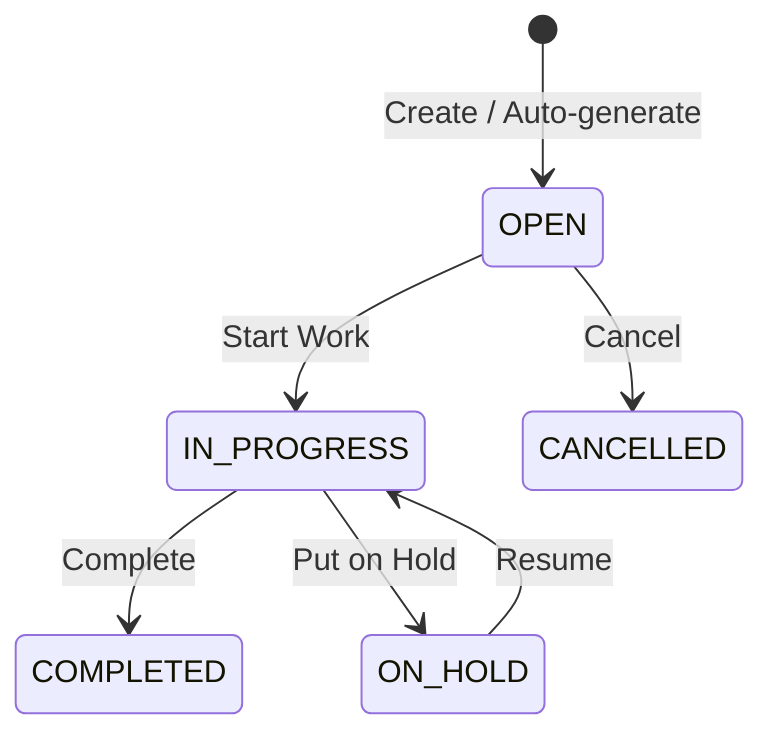

# Maintenance

The Maintenance module helps you schedule and track maintenance activities — both preventive (scheduled) and corrective (reactive).

## Key Features

### Preventive Maintenance Plans
Schedule recurring maintenance before failures occur:

- Define maintenance tasks and checklists
- Set frequency (daily, weekly, monthly, annually)
- Assign to specific assets or equipment
- Auto-generate work orders when maintenance is due

### Work Orders

Track each maintenance job:
1. Work order created (manually or from a preventive plan)
2. Assign a technician
3. **Start Work** — technician begins the job
4. Log activities, parts used, and time spent
5. **Complete** — record findings and close

### Corrective Maintenance
When equipment breaks down:
1. Create an ad-hoc work order
2. Classify the issue (breakdown, defect, safety)
3. Track diagnosis, repair, and parts replacement

### Maintenance Dashboard
Monitor maintenance health:
- Open work orders by priority
- Overdue maintenance plans
- Equipment downtime tracking
- Technician workload

## Navigation

| Page | Path | Permission |
|------|------|-----------|
| Maintenance Desk | `/maintenance` | `maintenance.wo.view` |
| Work Orders | `/maintenance/work-orders` | `maintenance.wo.view` |
| Preventive Plans | `/maintenance/plans` | `maintenance.plan.view` |
| Dashboard | `/maintenance/dashboard` | `maintenance.wo.view` |

## Cross-Module Integration

| Integration | How It Works |
|------------|-------------|
| **Asset Management** | Maintenance plans link to specific assets |
| **Inventory** | Spare parts consumed from stock |

## Permissions

| Permission | Description |
|-----------|-------------|
| `maintenance.wo.view` | View work orders |
| `maintenance.wo.create` | Create work orders |
| `maintenance.wo.complete` | Complete work orders |
| `maintenance.plan.view` | View preventive plans |
| `maintenance.plan.create` | Create/edit plans |
