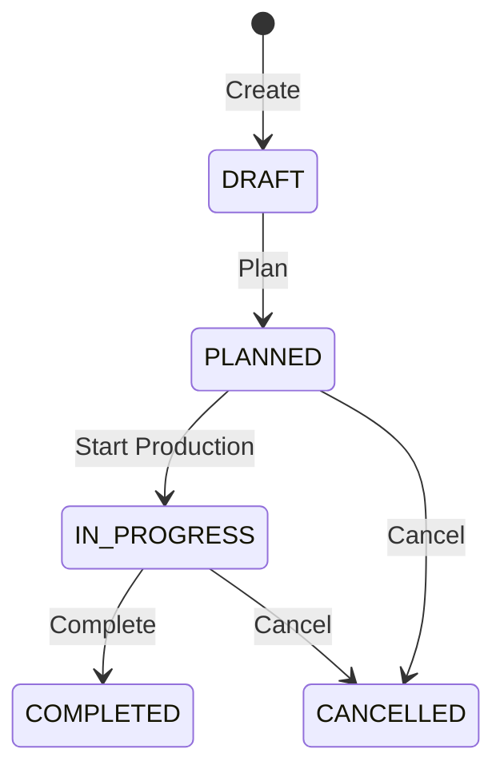

# Manufacturing

The Manufacturing module manages production — from defining what goes into a product (BOM) to tracking production orders on the shop floor.

## Key Features

### Bills of Materials (BOM)
Define the recipe for each manufactured product:

- **Finished Good** — The product being manufactured
- **Raw Materials** — Components and quantities required
- **Operations** — Work steps with estimated time and cost
- **Yield** — Expected output quantity
- **Scrap Factor** — Expected material waste percentage

### Production Orders (Work Orders)

Create and track production runs:

1. Navigate to **Manufacturing → Manufacturing Desk**
2. Click **New Work Order**
3. Select the BOM and quantity to produce
4. **Plan** the order — system calculates material requirements
5. **Start Production** — materials are consumed from inventory
6. **Complete** — finished goods are received into inventory

### Material Requirements
When planning a work order, the system:
- Calculates required raw materials from the BOM
- Checks available stock in the source warehouse
- Highlights shortages that need purchasing

### WIP Costing
Track costs through production:
- Material cost (raw materials consumed)
- Labour cost (work centre hours)
- Overhead allocation
- Finished goods valuation

## Navigation

| Page | Path | Permission |
|------|------|-----------|
| Manufacturing Desk | `/manufacturing` | `workorder.view` |
| Work Orders | `/manufacturing/work-orders` | `workorder.view` |
| Bills of Materials | `/manufacturing/boms` | `bom.view` |
| Work Centres | `/manufacturing/work-centres` | `workcentre.view` |
| Dashboard | `/manufacturing/dashboard` | `workorder.view` |

## Cross-Module Integration

| Integration | How It Works |
|------------|-------------|
| **Inventory** | Raw materials consumed on production start; finished goods received on completion |
| **Finance** | WIP and finished goods costing posted to GL |
| **Procurement** | Material shortages can trigger purchase orders |

## Permissions

| Permission | Description |
|-----------|-------------|
| `workorder.view` | View work orders |
| `workorder.create` | Create work orders |
| `workorder.plan` | Plan and schedule production |
| `workorder.start` | Start production |
| `workorder.complete` | Complete production |
| `bom.view` | View bills of materials |
| `bom.create` | Create/edit BOMs |
