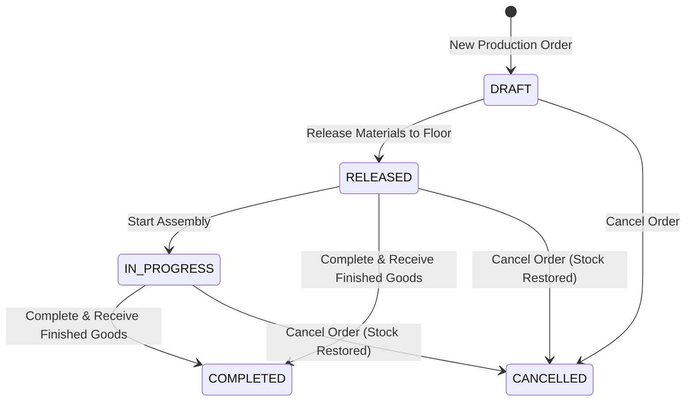

# Manufacturing

<div class="storyline-breadcrumb">Part of the <strong>Make to Order (M2O)</strong> Storyline: Steps 2 &amp; 5 of 7 (Production Order &amp; Floor Execution)</div>

> The industrial production engine of TenArm BES, orchestrating standard engineering recipe definitions (BOMs), scrap-adjusted component rollups, shop floor dispatch commands, atomic raw material consumption, finished goods capitalization, and real-time Work-in-Progress (WIP) valuation.

The Manufacturing module bridges product engineering with warehouse logistics and corporate finance. It provides shop floor superintendents and operations planners with a unified command desk to schedule production runs, snapshot ingredient picklists, track active assembly stages, record actual yield variances, and automatically receive serialized or lot-tracked finished goods into stock while posting synchronized journal entries to the general ledger.

---

## Workspace Ergonomics

The Manufacturing workspace is engineered for demanding production environments and fast-moving shop floor dispatches:

- **Multi-Tab Desk**: Plant managers and production controllers can maintain up to 3 open workspace tabs concurrently (for example, keeping the **Manufacturing Desk** active while cross-referencing **Raw Materials & Stock Availability** in Inventory and reviewing the **Production Orders** register). Switching tabs preserves active queue filters, search queries, selected work order focus, and uncommitted form entries without reloading.
- **Draft Auto-Save**: Uncommitted inputs across the workspace—including new production order parameters (`mfg_new_work_order`), custom shop floor routing notes, and multi-line BOM recipes (`mfg_bom_recipe`)—are continuously preserved locally. The active tab header displays a dirty dot indicator (`•`) until the record is saved or discarded.
- **Quick-Peek Slide-Out**: Clicking any linked work order number (`WO`), output product SKU, target warehouse, or recipe code opens a contextual slide-over drawer from the right edge of the screen, allowing operators to verify stock balances, component specifications, or process audit lineage without losing their place on the command desk.

---

## Core Manufacturing Concepts

### Bills of Materials (BOM) & Recipe Engineering
A Bill of Materials defines the standardized blueprint recipe required to manufacture an output product:
- **Output Finished Product**: The manufactured inventory item generated by the run.
- **Standard Batch Yield (`output_qty`)**: The nominal finished quantity produced by a single execution of the recipe (e.g. 1 unit, 100 pcs, or 500 kg).
- **Ingredient Picklist**: The granular components and subassemblies required to assemble the batch. Each component item defines:
  - **Required Quantity (`qty`)**: The baseline quantity consumed per batch yield.
  - **Standard Unit Cost (`standard_cost`)**: The nominal cost per component unit, driving live estimated batch cost rollups.
  - **Scrap Allowance Percentage (`scrap_pct`)**: Planned shop floor material loss or machining fallout (e.g. 2.5% cutting waste or trimming loss).
- **Live Recipe Cost Rollup**: The system continuously computes total estimated batch cost and unit cost:
  $$\text{Unit Estimated Cost} = \frac{\sum (\text{Component Qty} \times \text{Standard Cost})}{\text{Output Batch Qty}}$$

### The 5 Stages of the Production Order Lifecycle
Every manufacturing run is tracked through an immutable, strictly controlled lifecycle:



| Lifecycle State | Operational Meaning | Allowed Actions |
|---|---|---|
| `DRAFT` | Initial production schedule. Target quantity and warehouse are configured, but materials remain in inventory and no costs are booked. | Edit parameters, release materials to floor, or cancel order. |
| `RELEASED` | Recipe components are frozen and snapshotted. Raw materials are atomically deducted from warehouse stock, and WIP capital is booked. | Start assembly, complete run, or cancel order. |
| `IN_PROGRESS` | Shop floor assembly, machining, or mixing is actively underway. | Complete run and receive goods, or cancel order. |
| `COMPLETED` | Production run is finalized. Actual good yield is recorded, finished goods are received into warehouse stock, and WIP is capitalized. | Final state. Inspect process lineage and stock ledger movements. |
| `CANCELLED` | Run was aborted. Any raw materials issued at release are automatically returned to warehouse stock, and WIP capital is reversed. | Final state. Preserved for operational auditing. |

### Component Scaling & Scrap Multipliers
When a work order is released, the system calculates exact component requirements proportional to the scheduled batch size:
$$\text{Scale Factor} = \frac{\text{Work Order Qty}}{\text{BOM Standard Output Qty}}$$
$$\text{Required Qty} = \text{BOM Component Qty} \times \text{Scale Factor} \times \left(1 + \frac{\text{Scrap Pct}}{100}\right)$$

This guarantees that scrap allowances and proportional batch scalings are locked into the work order snapshot at release time, insulating active floor runs from subsequent engineering recipe edits.

### Atomic Stock Issuance & WIP Capitalization
Unlike generic task lists, releasing a work order executes an immediate, atomic inventory transaction. The system verifies that every required ingredient is on-hand in the target warehouse. If sufficient stock exists, ingredients are deducted from inventory in a single database transaction and their total valuation is credited to inventory and debited to **Work-in-Progress (WIP)**. If any ingredient is short, the entire release is aborted to prevent partial allocations or warehouse balance drift.

### Finished Goods Receipt & Traceability
Upon completing a run, the system:
1. Prompts the operator for the **Actual Good Quantity Produced** to record scrap or partial batch runs.
2. Calculates the finalized unit cost by capitalizing total WIP into finished goods:
   $$\text{Finalized Unit Cost} = \frac{\text{Total WIP Cost}}{\text{Actual Completed Qty}}$$
3. Automatically assigns an inventory **Batch / Lot Number** matching the Work Order number (`wo_number`).
4. If the output product is serialized, generates sequential unit serial numbers formatted as `{wo_number}-0001`, `{wo_number}-0002`, etc.
5. Receives the finished items into the target warehouse stock ledger and auto-posts the GL completion journal: **Debit Finished Goods Inventory / Credit Work-in-Progress (WIP)**.

---

## Core Screens & Workflows

### 1. Manufacturing Desk (`/manufacturing`)

**What it does** — The central dispatch cockpit for shop floor superintendents. Features real-time executive pulse telemetry, quick queue searching, category filtering, and the interactive **4-Stage Work Order Storyline**.

```
┌──────────────────────────────────────────────────────────────────────────────────────────────────┐
│ EXECUTIVE PULSE HUD                                                                              │
│ [ Active Recipes: 12 ] [ Floor WIP: 6 ] [ Draft Orders: 3 ] [ Completed: 48 ] [ WIP: $42,850 ]    │
├────────────────────────────────────────┬─────────────────────────────────────────────────────────┤
│ PRODUCTION QUEUE                       │ WORK ORDER STORYLINE: MO-2026-0042 [v3] [IN_PROGRESS]   │
│ 🔍 Search orders, products, notes...   ├─────────────────────────────────────────────────────────┤
│ [All] [Released] [In Progress] [Draft] │ STAGE 1: RECIPE & BATCH SPECS                           │
│                                        │ Output: PROD-CHAIR — Executive Swivel Chair             │
│ • MO-2026-0042 [IN_PROGRESS]           │ Batch Size: 50 pcs · Warehouse: Central Plant           │
│   Executive Swivel Chair · 50 pcs      │ Recipe Blueprint: BOM-0004 (Standard Assembly)          │
│   Plant: Central Plant · WIP: $6,400   ├─────────────────────────────────────────────────────────┤
│                                        │ STAGE 2: MATERIAL PICKLIST & WIP CONSUMPTION            │
│ • MO-2026-0043 [RELEASED]              │ • Steel Frame (50 pcs) — CONSUMED · $2,250              │
│   Heavy Duty Caster Set · 200 units    │ • Cushion Foam (50 pcs) — CONSUMED · $1,500             │
│   Plant: Assembly Line B · WIP: $1,800 │ • Leather Upholstery (105 m) — CONSUMED · $2,650        │
│                                        │ Total WIP Capital: $6,400                               │
│ • MO-2026-0044 [DRAFT]                 ├─────────────────────────────────────────────────────────┤
│   Standard Desk Assembly · 25 units    │ STAGE 3: SHOP FLOOR EXECUTION                           │
│   Plant: Central Plant                 │ [ Complete & Receive Finished Goods ]  [ Cancel Order ] │
│                                        ├─────────────────────────────────────────────────────────┤
│                                        │ STAGE 4: FINISHED GOODS OUTPUT & TRACEABILITY           │
│                                        │ Lot / Batch: MO-2026-0042 · Capitalized Value: $6,400   │
│                                        │ [ View Stock Ledger Movements ]  [ View process ]       │
└────────────────────────────────────────┴─────────────────────────────────────────────────────────┘
```

#### Executive Pulse HUD Metrics
- **Active Recipes**: Count of active production BOMs available for immediate scheduling.
- **Floor WIP**: Count of orders currently active on the floor (`RELEASED` and `IN_PROGRESS`).
- **Draft Orders**: Count of scheduled production orders awaiting floor release.
- **Completed Output**: Cumulative work orders successfully produced to stock.
- **Active WIP Capital**: Total monetary value of raw materials currently committed to the shop floor.

#### The 4-Stage Work Order Storyline

##### Stage 1: Recipe & Batch Specs
Displays core production parameters:
- **Output Product**: Code, description, and product category.
- **Batch Size**: Planned output quantity with unit of measure symbol.
- **Target Warehouse**: The facility or assembly line receiving finished output.
- **Planned Execution**: Planned run date. Past dates are explicitly permitted to allow shop floor backfilling of already-completed runs.
- **BOM Blueprint**: Linked recipe name and code. Clicking the link opens the Bills of Materials page in a new workspace tab.
- **Notes & Routing Instructions**: Operator instructions, tooling setups, or machine routing guidelines.

##### Stage 2: Material Picklist & WIP Consumption
Provides a live table of snapshotted ingredients:
- **Component**: Product SKU, description, and category.
- **Req Qty**: Required quantity including scrap multiplier and batch scaling.
- **Consumed**: Quantity deducted from warehouse stock upon order release.
- **Unit Cost**: Booked cost per unit from inventory.
- **Line Total**: Extended material cost for this component.
- **Status Badge**: Component state (`PENDING` in draft; `CONSUMED` once released).
- **Total Work-in-Progress (WIP)**: Live footer rollup displaying total capitalized material cost.

##### Stage 3: Shop Floor Execution
Displays context-sensitive action triggers based on order status:
- In `DRAFT`: Displays informational banner *"Releasing issues raw materials from warehouse stock and locks in the WIP valuation."* Click **Release Materials to Floor** to snapshot ingredients and deduct inventory.
- In `RELEASED`: Displays informational banner *"Materials issued. Acknowledge when assembly begins on the shop floor."* Click **Start Assembly** to advance order to `IN_PROGRESS`.
- In `RELEASED` or `IN_PROGRESS`: Click **Complete & Receive Finished Goods** to open the completion modal.
- In `DRAFT`, `RELEASED`, or `IN_PROGRESS`: Click **Cancel Order** to abort the run. If materials were already issued, the system automatically returns them to warehouse inventory and reverses WIP capital.
- In `COMPLETED`: Displays confirmation banner *"Production run completed. Finished goods received into stock."*
- In `CANCELLED`: Displays confirmation banner *"Work order cancelled. Any consumed stock was returned to the warehouse."*

##### Stage 4: Finished Goods Output & Traceability
Tracks output receipt and quality assurance metrics:
- **Allocated Batch / Lot Number**: The assigned inventory lot (defaults to the Work Order number upon completion).
- **Finished Goods Valuation**: Total capitalized cost received into inventory.
- **Actual Yield**: Completed quantity vs planned quantity with yield percentage (e.g. `49 / 50 units (98.0%)`).
- **Yield Variance**: Net difference between planned batch size and actual yield (e.g. `-1 units`).
- **Completed Timestamp**: UTC timestamp of receipt.
- **Quick Links**:
  - `View Stock Ledger Movements`: Jumps directly to `/inventory/movements` filtered for this order.
  - `View process`: Opens `/core/process` to inspect the full immutable document audit lineage.

---

### How to Create a New Production Order

1. Navigate to **Manufacturing → Manufacturing Desk** (`/manufacturing`) or **Work Orders** (`/manufacturing/orders`).
2. Click **+ New Production Order** (or click **New WO** directly from any active recipe in Bills of Materials).
3. In the modal, fill in the required fields:
   - **Recipe (Active BOM)**: Select an active blueprint recipe from the dropdown. The modal immediately renders the **Live Recipe Blueprint & Component Preview**, showing standard yield, estimated unit cost, total production cost, and scaled component picklist.
   - **Production Quantity**: Enter target output units. Component requirements scale automatically.
   - **Target Warehouse / Plant**: Select the fulfilling warehouse (prefilled with organization default).
   - **Planned Execution Date**: Select target run date (optional; past dates allowed for catch-up logging).
   - **Shop Floor Routing Instructions**: Enter notes for assembly operators (optional).
4. Click **Create Production Order**. The order is generated in `DRAFT` status and immediately loaded on the Manufacturing Desk.

---

### How to Complete a Production Run and Receive Finished Goods

1. Select an active work order in `RELEASED` or `IN_PROGRESS` status on the **Manufacturing Desk**.
2. Click **Complete & Receive Finished Goods**.
3. In the **Complete & Receive Work Order** dialog:
   - Verify the **Target Planned Batch Size**.
   - Enter the **Actual Good Quantity Produced**. If units were lost to scrap, enter the net good units produced.
   - Review the financial summary card displaying **Total WIP Capital to Capitalize**, **Resulting Unit Cost**, and **Yield Variance**.
4. Click **Complete Run & Receive Goods**. The finished goods are received into warehouse inventory, auto-assigned a lot/serial number, and the WIP journal is capitalized.

---

### 2. Bills of Materials (`/manufacturing/boms`)

**What it does** — Master engineering registry of standard production recipes, ingredient specifications, scrap allowances, and standard cost structures.

#### Executive Pulse HUD
- **Total BOM Recipes**: Total number of recipes configured across all states.
- **Active Production Recipes**: Count of verified recipes currently authorized for production runs.
- **Draft Engineering Recipes**: Recipes under design or engineering review.
- **Average Active Batch Cost**: Mean standard production cost across all active recipes.

#### Recipe Register Table Columns
- **BOM Code**: Unique document identifier (e.g. `BOM-0001`).
- **Recipe Name**: Descriptive name and engineering notes.
- **Output Finished Product**: Code, name, category tag, and product type (`FINISHED_GOODS`).
- **Batch Yield**: Standard output quantity and unit of measure.
- **Component Count**: Number of ingredient lines in the recipe.
- **Batch Cost**: Total standard cost per batch.
- **Unit Cost**: Standard cost per single finished unit.
- **Status**: Status badge (`DRAFT`, `ACTIVE`, `ARCHIVED`).
- **Actions**:
  - `New WO`: (Active BOMs only) 1-click shortcut to launch a new production order pre-populated with this recipe.
  - `Activate Recipe` (`CheckCircle2` icon): (Draft BOMs only) Authorizes the recipe for shop floor use.
  - `Edit Recipe` (`Edit2` icon): Opens the recipe editor modal.
  - `Archive Recipe` (`Archive` icon): (Active BOMs only) Retires the recipe. Archived recipes cannot back new work orders.

#### How to Author a Bill of Materials Recipe

1. Navigate to **Manufacturing → Bills of Materials** (`/manufacturing/boms`).
2. Click **+ New Recipe**.
3. In the **New Bill of Materials Recipe** modal:
   - **BOM Code (Optional)**: Leave blank to auto-generate a sequential number (`BOM-XXXX`) or provide a custom code.
   - **Recipe Name**: Enter a clear engineering title (e.g. *Executive Chair Standard Assembly*).
   - **Output Product**: Select the manufactured product from the dropdown (prioritizes finished goods).
   - **Output Batch Qty**: Enter the nominal batch yield (e.g. `1`).
   - **Assembly Notes / Instructions**: Enter operational instructions or standard operating procedures.
4. Under **Recipe Ingredients & Bill of Materials**, add one or more component lines:
   - **Component**: Select raw material or subassembly product.
   - **Required Qty**: Enter quantity required per batch.
   - **Unit Standard Cost**: Enter baseline unit cost.
   - **Scrap % (Allowance)**: Enter planned scrap or machining loss percentage (0–100%).
   - The line summary displays calculated extended line cost: $\text{Qty} \times \text{Standard Cost}$.
5. Monitor the top **Live Cost Rollup Banner** showing **Estimated Batch Cost** and **Estimated Unit Cost**.
6. Click **Create Recipe**. The recipe is saved in `DRAFT` status.
7. Click the green checkmark (**Activate Recipe**) on the table row to enable it for production orders.

---

### 3. Work Orders Register (`/manufacturing/orders`)

**What it does** — Master ledger of all manufacturing runs across your organization. Engineered for high-density tabular scanning, multi-warehouse auditing, and bulk execution tracking.

#### Executive Statistics HUD
- **Total Orders**: All scheduled and historical work orders.
- **In-Progress Runs**: Active floor executions (`RELEASED` and `IN_PROGRESS`).
- **Completed Runs**: Successfully finished production runs.
- **Total Produced**: Cumulative good finished units received into stock.
- **Active WIP Capital**: Total valuation of work-in-progress on the floor.

#### Master Table Filters & Features
- **Status Pills**: Filter by `All Orders`, `Draft`, `Released`, `In Progress`, `Completed`, or `Cancelled`.
- **Product Category Selector**: Narrow orders by finished product category.
- **Warehouse Selector**: Filter by specific manufacturing plant or staging warehouse.
- **Search Bar**: Instant keyword search matching order numbers, product SKUs, recipe names, or notes.
- **Row Actions**:
  - `Desk`: Jumps directly to the **Manufacturing Desk** with the selected work order focused in the inspector.
  - `Components`: Opens the **Components Picklist** modal displaying snapshotted ingredients, required quantities, consumed counts, and WIP cost rollups.
  - `Release`: Fast 1-click release for `DRAFT` orders directly from the table.
  - `Start`: Fast 1-click start for `RELEASED` orders.

---

### 4. Manufacturing Dashboard (`/manufacturing/dashboard`)

**What it does** — High-level production management and operational analytics, reading from the high-performance `ManufacturingSummary` projection.

#### Controls & KPI Row
- **Period Selector**: Month picker (`YYYY-MM`) with a **Current Month** reset button to review historical trends.
- **Work Orders**: Total production orders created during the period.
- **Released**: Number of runs released to the floor.
- **Open**: Active open orders awaiting completion.
- **Completed**: Runs finished to stock with percentage completion rate.
- **Produced Qty**: Total physical units manufactured with aggregate capitalized output cost.

#### Analytics Visualizations
- **Work Order Status Chart**: Horizontal bar chart illustrating volume distribution across order statuses.
- **Created vs Completed Trend**: 6-month historical area chart comparing production demand against floor throughput.
- **Monthly Trend Ledger**: Tabular breakdown reporting created runs, completed runs, and finished quantities by calendar month.

---

## If Something Goes Wrong (Common Validation & Guard Errors)

Every shop floor action is validated against strict inventory balances, recipe statuses, and optimistic concurrency locks. Refer to this resolution guide if an error banner or toast appears:

| What you see (Toast / Banner) | Why it happens | How to fix it in the workspace |
|---|---|---|
| `"Cannot release work order MO-XXXX: BOM BOM-YYYY is 'DRAFT' (must be ACTIVE)"` | The selected recipe blueprint is in `DRAFT` status and has not been formally approved. | Navigate to **Bills of Materials** (`/manufacturing/boms`), locate recipe `BOM-YYYY`, and click the green checkmark (**Activate Recipe**). Then re-trigger release. |
| `"Cannot release MO-XXXX: stock issue failed (Insufficient stock available)"` | One or more required raw materials do not have sufficient unreserved on-hand balance in the target warehouse. | Click **Materials Stock** to view inventory levels in `/inventory/products`. Receive pending Purchase Orders in Procurement or execute an inventory transfer from another warehouse. |
| `"Output product cannot be used as an input component"` | The recipe attempts to consume the exact finished item it produces, creating a circular bill of materials. | Edit the recipe in **Bills of Materials** and remove the circular component. Ensure only raw materials, packaging, or intermediate subassemblies are listed as ingredients. |
| `"Duplicate component product selected in recipe. Each component must be unique."` | The same component product was added across multiple rows in the recipe ingredients table. | Consolidate the rows into a single component line item with the combined required quantity and scrap allowance. |
| `"Cannot modify an ARCHIVED bill of materials"` | The recipe was archived and is preserved as an immutable historical record. | Click **+ New Recipe** to author a new recipe revision with updated ingredients and a new code. |
| `"Cannot activate a BOM with no components"` | Attempted to activate a recipe that has zero ingredient lines defined. | Edit the recipe and add at least one valid component product with quantity and standard cost before activating. |
| `"Document modified by another user (Conflict / OCC 409)"` | Another operator or engineer modified the work order or recipe concurrently. | The **Conflict Resolution Drawer** opens automatically. Inspect the updated server version, discard local conflicting edits, and re-apply your change. |
| `"Production quantity must be greater than zero"` | The target batch size was entered as `0` or a negative number. | Enter a valid positive number in the `Production Quantity` field (e.g. `1` or `50`). |
| `"Completed quantity must be greater than zero"` | Attempted to complete a work order with `0` or negative finished goods yield. | Enter the actual positive count of good units produced in the completion dialog. If the entire batch was scrapped with zero output, click **Cancel Order** instead. |

---

## Cross-Module Integrations

The Manufacturing module operates in tight synchronization with upstream commerce, downstream logistics, and core financial ledgers:

| Integrated Module | Interaction Flow & Shared Invariants |
|---|---|
| **Inventory** | **Atomic Raw Material Issue**: Releasing a work order immediately deducts required components from warehouse stock with reference `PRODUCTION: Issued to work order MO-XXXX`.<br>**Finished Goods Receipt**: Completing a run receives finished items into warehouse inventory, auto-assigns an inventory lot number (`MO-XXXX`), and generates sequential serial numbers for serialized items.<br>**Cancellation Restorations**: Cancelling a released order returns all consumed components back to warehouse inventory. |
| **Finance** | **Automatic GL Journal Postings**:<br>• **Material Issue (Release)**: $\text{Dr Work-in-Progress (WIP)} \; / \; \text{Cr Raw Materials Inventory}$<br>• **Finished Goods Receipt (Complete)**: $\text{Dr Finished Goods Inventory} \; / \; \text{Cr Work-in-Progress (WIP)}$<br>• **Cancellation Reversal**: $\text{Dr Raw Materials Inventory} \; / \; \text{Cr Work-in-Progress (WIP)}$ |
| **Sales** | **Make to Order (M2O) Fulfillment**: Confirmed sales orders for manufactured products trigger production work orders on the Manufacturing Desk. Upon run completion, finished goods are immediately reserved for dispatch and delivery note generation. |
| **Procurement** | **Ingredient Sourcing**: Component shortages identified during production scheduling generate Request for Quotations (RFQs) and Purchase Orders to replenish raw material warehouses prior to floor release. |
| **Maintenance** | **Work Centre Availability**: Machine downtime and preventive maintenance schedules in the Maintenance module coordinate with production planning to prevent scheduling runs during machine overhauls. |

---

## Role Permissions & Security Access

Access to manufacturing operations is governed by role-based permissions:

| Permission Code | Operational Capability | Screen / Control Protected |
|---|---|---|
| `workorder.view` | View work orders, queue list, snapshotted picklists, and manufacturing dashboard | `/manufacturing`, `/manufacturing/orders`, `/manufacturing/dashboard` |
| `workorder.create` | Create new production orders in draft status | `+ New Production Order` modal, `New WO` button |
| `workorder.release` | Snapshot recipe components, issue raw stock, and capitalize WIP | `Release Materials to Floor`, table `Release` button |
| `workorder.start` | Acknowledge shop floor assembly has begun | `Start Assembly`, table `Start` button |
| `workorder.complete` | Finalize production run, record actual yield, and receive finished stock | `Complete & Receive Finished Goods` modal |
| `workorder.cancel` | Abort production run and return issued materials to inventory | `Cancel Order` action |
| `bom.view` | View bills of materials recipes, component lists, and cost rollups | `/manufacturing/boms` |
| `bom.create` | Author and register new bill of materials recipes | `+ New Recipe`, `Create Recipe` |
| `bom.update` | Edit recipe specifications, adjust component quantities, and activate draft recipes | `Edit Recipe`, `Save Changes`, `Activate Recipe` |
| `bom.archive` | Permanently retire obsolete BOM recipes | `Archive Recipe` action |
| `manufacturing.dashboard.get` | View executive production throughput KPIs, charts, and monthly trends | `/manufacturing/dashboard` |
