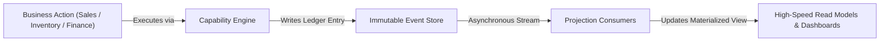
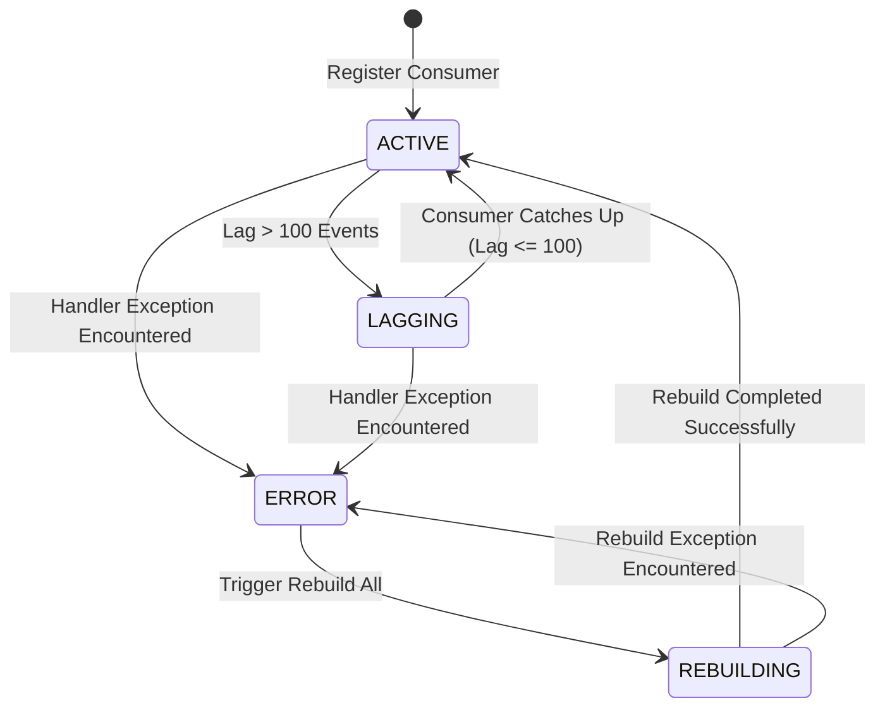

# Monitoring & Observability

<div class="storyline-breadcrumb">Core Foundation for <strong>Platform Operations</strong>, <strong>Event Projection Integrity</strong> &amp; <strong>Execution Telemetry</strong></div>

> The central observability and health console of TenArm BES, providing platform operators and system leads with real-time visibility into capability invocation throughput, execution latency, failure trends, asynchronous event projection consumer lag, and self-healing read-model rebuilds.

TenArm BES is built on an event-driven, capability-based execution architecture. Every business transaction—whether quoting an order in Sales, issuing a purchase receipt in Procurement, or posting a general ledger entry in Finance—executes through atomic business capabilities and registers an immutable entry in the system event ledger.

The **Monitoring & Observability** console provides unified operational surveillance across two specialized workspaces:
1. **Capability Health (`/monitoring/capabilities`)**: Continuous execution telemetry tracking invocation volume, success versus failure ratios, average duration, daily execution trends, and top/slowest/most-failed capability breakdowns across selectable look-back windows.
2. **Projection Health (`/monitoring/projections`)**: Real-time synchronization surveillance of asynchronous event consumer projections, monitoring event sequence watermarks, backlog lag counts, execution error counts, and automated rebuild orchestration.

---

## Workspace Ergonomics

The Monitoring consoles are optimized for real-time diagnostic triage and uninterrupted fleet inspection:

- **Multi-Tab Desk**: Operators can maintain up to 3 active tabs simultaneously (e.g. keeping **Capability Health** open while inspecting consumer lag in **Projection Health** and referencing fleet tenant status in **Platform Overview**). Switching tabs preserves active look-back periods, filter states, table scroll offsets, and expanded rebuild logs without triggering page reloads or losing diagnostic context.
- **Draft Auto-Save & Tab State**: Unsaved configurations and diagnostic parameter selections persist continuously in workspace session memory; the tab header indicates an active session until closed or re-navigated.
- **Quick-Peek Slide-Out**: Deep-link references to event store sequence numbers or tenant identifiers open contextual slide-out drawers from the right viewport margin, enabling rapid verification without closing the primary telemetry view.
- **Real-Time Visual Accents**: Top-level HUD pulse cards and projection cards use dynamic status accents—green (`success`), amber (`warning`), and red (`danger`)—to surface anomalies, high failure rates, or excessive backlog lag instantly.

---

## Core Observability Concepts

### Capability Execution Telemetry
In TenArm BES, every business operation runs as a discrete, named **Capability** (such as `sales.quotations.create` or `inventory.stock.transfer`). Whenever an operation executes:
- **Duration Tracking**: The system records millisecond-precision execution duration.
- **Outcome Status**: Invocations are classified as `SUCCESS` or `FAILED`.
- **Caller Context**: Audit logging preserves the tenant organization, invoking user, and timestamp.

The Capability Health console aggregates these metrics across 7-day, 14-day, 30-day, or 90-day rolling windows, highlighting operational hotspots, performance regressions, and intermittent failure points.

### The Event-Driven Projection Architecture
To deliver high-speed search, filtering, and reporting without database lock contention, TenArm BES decouples transaction writes from reporting reads:



1. **Transactional Execution**: The capability completes the write operation, commits the business aggregate, and publishes domain events to the Event Store.
2. **Asynchronous Consumer Projections**: Specialized background workers consume the event stream and update dedicated read models (such as Accounts Receivable aging tables, inventory valuation summaries, and General Ledger balances).
3. **Zero Lock Contention**: Analytical queries and user dashboards query the read models directly, ensuring heavy operational reporting never blocks checkout or dispatch flows.

### Consumer Watermarks & Backlog Lag
Each projection consumer maintains a persistent sequence pointer called `last_processed_event_id`. The difference between the latest event committed to the store (`max_event_id_in_store`) and the consumer's pointer defines the **Lag Count**:

$$\text{Lag Count} = \max(0, \text{Max Event ID in Store} - \text{Last Processed Event ID})$$



- **`Active`**: The projection consumer is healthy and synchronized with the latest event stream (lag $\le$ 100 events).
- **`Lagging`**: High transaction surges have caused unprocessed events to exceed 100 items. The background worker is processing the backlog.
- **`Rebuilding`**: The projection read model is actively undergoing complete re-materialization from operational records.
- **`Error`**: The consumer encountered an unhandled exception or data mismatch, halting automatic event ingestion until reviewed.

---

## Features

### 1. Capability Health (`/monitoring/capabilities`)

**What it does** — Provides real-time execution analytics across all registered business capabilities, surfacing top-volume operations, latency bottlenecks, and failure spikes.

```
/monitoring/capabilities
```

**Pulse HUD Metrics**

The top metric bar summarizes execution performance across the selected look-back period:

| Metric Card | Description | Visual Status Accent |
|---|---|---|
| **Total Executions** | Total number of business capability invocations completed. | Blue (`primary`) |
| **Failure Rate** | Percentage of executions that terminated in an error status. | Green ($\le 1\%$), Amber ($1\% - 5\%$), Red ($> 5\%$) |
| **Avg Duration** | Average execution latency across all capability runs (formatted in `ms` or seconds `s`). | Cyan (`info`) |
| **Failed Count** | Cumulative count of failed capability runs. | Green ($0$ failures), Red ($> 0$ failures) |
| **Unique Capabilities** | Number of distinct business capabilities invoked within the window. | Neutral (`default`) |

**Period Selection**

Operators can toggle the analysis window in the page header actions:
- **`7d`**: Default one-week operational window.
- **`14d`**: Two-week trend baseline.
- **`30d`**: Monthly aggregate overview.
- **`90d`**: Quarterly capacity and growth audit.

**Executions by Day Chart**

A stacked bar chart visualizes daily volume trends over the chosen period:
- **Success (`green`)**: Successfully completed capability runs.
- **Failed (`red`)**: Failed runs requiring operational investigation.
- **Interactive Tooltips**: Hovering over any daily bar displays exact success, failure, and total execution counts.

**Telemetry Breakdown Tabs**

The primary data card provides three diagnostic perspectives and a **Refresh** button:

1. **Top Used Tab (`Flame` icon)**:
   - Identifies the highest-frequency capabilities driving platform load.
   - Table columns: `#` (rank), `Capability` (formatted code badge, e.g. `sales.quotations.create`), and `Executions` (formatted invocation count).
   - Empty state: *"No executions in this period"*.

2. **Slowest Tab (`Timer` icon)**:
   - Highlights capabilities with the highest average execution duration (filtered to operations with at least 5 invocations to eliminate cold-start anomalies).
   - Table columns: `#` (rank), `Capability`, and `Avg Duration`.
   - Latency color coding:
     - Green (`< 300ms`): Optimal transaction response.
     - Amber (`300ms - 1000ms`): Moderate latency; watch for database index growth.
     - Red (`> 1000ms`): High latency; candidate for optimization or background queuing.
   - Empty state: *"No duration data yet"*.

3. **Most Failed Tab (`AlertTriangle` icon)**:
   - Surfaces operations experiencing validation blocks, concurrency conflicts, or system exceptions.
   - Table columns: `#` (rank), `Capability`, and `Failures` (badged in red).
   - Empty state: When zero failures exist, displays a green checkmark with *"No failures in this period"*.

**How to Inspect Capability Telemetry**
1. Navigate to **Monitoring → Capability Health** (`/monitoring/capabilities`).
2. Click the desired period button (**7d**, **14d**, **30d**, or **90d**) to adjust the look-back window.
3. Review the **Pulse HUD** for anomalous failure rates or elevated average duration.
4. Switch to the **Slowest** tab to identify capabilities exceeding expected latency thresholds.
5. Switch to the **Most Failed** tab to inspect capabilities encountering frequent exceptions.
6. Click **Refresh** to re-query live execution telemetry.

---

### 2. Projection Health (`/monitoring/projections`)

**What it does** — Monitors asynchronous event consumer synchronization, tracking backlog lag, error counts, event store watermarks, and orchestrating full projection rebuilds.

```
/monitoring/projections
```

**Pulse HUD Metrics**

| Metric Card | Description | Visual Status Accent |
|---|---|---|
| **Projections** | Total number of registered asynchronous event projection consumers. | Blue (`primary`) |
| **Events in Store** | Highest global sequence ID recorded in the immutable event ledger. | Cyan (`info`) |
| **Lagging** | Count of projection consumers currently trailing the event stream. | Green ($0$), Amber ($> 0$) |
| **Errored** | Count of projection consumers currently halted in an `ERROR` state. | Green ($0$), Red ($> 0$) |
| **Total Lag** | Cumulative backlog of unprocessed events across all projection consumers. | Green ($0$), Amber ($> 0$) |

**Projection Cards & Health Indicators**

Each registered consumer appears as an individual health card displaying:
- **Status Pill**:
  - `Active`: Operating normally and up to date.
  - `Lagging`: Unprocessed event backlog exceeds 100 items.
  - `Rebuilding`: Currently regenerating historical read models.
  - `Error`: Consumer halted due to a handler exception.
- **Consumer Name**: Monospace badge indicating the projection consumer code (e.g. `ar_aging_summary`, `inventory_valuation_projection`, `gl_account_balance_projection`).
- **Event Watermarks**:
  - `Last event: #<id>`: The sequence number of the most recent event successfully committed to this read model.
  - `Max in store: #<id>`: The head sequence number of the event store ledger.
- **Visual Lag Progress Bar**: An interactive progress bar displaying relative backlog size alongside the numeric lag count.
  - Green ($0$ lag)
  - Amber ($< 10\%$ of store size)
  - Red ($\ge 10\%$ of store size)
- **Errors**: Dedicated error counter highlighted in red when greater than zero.
- **Expand Chevron**: Clicking anywhere on the card header expands recent rebuild audit records.

**Expanded Rebuild History**

Expanding a projection card reveals recent rebuild execution records:
- **Status Dot**: Visual indicator displaying green (`DONE`), amber/pulsing (`RUNNING`), or red (`FAILED`).
- **Status Label**: Text indicator (`DONE`, `RUNNING`, `FAILED`).
- **Row Count**: Number of rows populated (e.g. `1,420 rows`).
- **Triggered By**: Audit username or system process that initiated the rebuild (e.g. `by admin@tenant.com` or `by system`).
- **Start Timestamp**: Localized execution date and time.
- **Error Banner**: If a rebuild failed, displays the detailed system diagnostic message in red.
- **Last Processed**: Monospace timestamp indicating when the consumer last committed an event, or *"Never"*.

**How to Monitor and Rebuild Projections**
1. Navigate to **Monitoring → Projection Health** (`/monitoring/projections`).
2. Review the top pulse bar:
   - If **Lagging** is greater than 0, check the individual projection cards to see which consumers have backlogs.
   - If **Errored** is greater than 0, click the affected projection card to expand its history and inspect error details.
3. Click **Refresh** to re-poll the latest event watermarks.
4. If a projection's read model is corrupt, out of sync after schema maintenance, or stalled in an error state:
   - Click **Rebuild All** in the top action bar.
   - The button enters a loading state, dispatches the rebuild capability, and displays a toast confirmation: *"Projection rebuild triggered — refreshing in 3s…"*.
   - The view automatically reloads 3 seconds later, displaying updated `REBUILDING` or `ACTIVE` statuses and refreshed event watermarks.

---

## Workspace Tips & Best Practices

- **Pairing with Platform Overview**: The **Platform Overview** (`/platform`) dashboard features a dedicated **Fleet Health** widget tracking *Lagging Projections*. Clicking the card directly navigates to `/monitoring/projections`.
- **Scheduled Maintenance Windows**: If running large-scale data migrations or mass transaction imports, anticipate brief status changes to `Lagging`. Allow background consumers several minutes to catch up before triggering a manual rebuild.
- **Selective Diagnostic Look-Backs**: For high-volume transaction environments, use `7d` for daily operational reviews to minimize query overhead, switching to `30d` or `90d` primarily during sprint retrospectives or capacity planning.

---

## If Something Goes Wrong (Common Validation & Guard Errors)

| What you see (Toast / Banner) | Why it happens | How to fix it in the workspace |
|---|---|---|
| **"Failed to load capability metrics"** | Network interruption or transient query timeout during multi-day execution aggregation. | Click **Refresh** on the tab header. If timeout persists, select a shorter period (e.g. switch from `90d` to `7d`). |
| **"Failed to load projection health"** | Temporary database lock contention or connectivity loss when querying event consumer status. | Verify network connectivity and click **Refresh** in the top action bar. |
| **"Rebuild failed"** | A projection rebuild is already actively running, or a projection handler encountered a data validation conflict while processing historical events. | Expand the projection card to inspect the recent rebuild error message. Wait for any active background rebuild to conclude before re-clicking **Rebuild All**. |
| **"403 Forbidden: Insufficient permissions"** | The current user account lacks the required `platform.admin` authority. | Ensure you are logged into a platform administrator account with operational governance credentials. |
| **Projection Status displays `Lagging`** | Sudden influx of domain transactions (e.g. bulk sales orders or inventory receipts) outpacing background consumer processing. | Wait a few moments for the background queue to clear, then click **Refresh**. If the lag counter does not decrease over time, trigger **Rebuild All**. |
| **Projection Status displays `Error`** | A malformed domain event failed projection parsing, or an unexpected schema constraint blocked read-model insertion. | Expand the card to read the error message. Review the **Dead Letter Queue** (`/platform/dead-letters`) to inspect unprocessable events, resolve the payload anomaly, and click **Rebuild All**. |

---

## Integrations

| Subsystem / Module | How Monitoring Integrates |
|---|---|
| **Event Store Ledger** | Serves as the authoritative source of truth. Projection Health compares each consumer's processed watermark against the global `max_event_id_in_store`. |
| **Capability Dispatcher** | Telemetry hooks record duration, status, and execution metadata for every business operation into the execution audit ledger. |
| **Platform Overview (`/platform`)** | Displays high-level fleet health cards with direct navigation into Projection Health and Dead Letter Queue management. |
| **Dead Letter Queue (`/platform/dead-letters`)** | Captures unprocessable domain events rejected by projection consumers for quarantine, inspection, and replay. |
| **Analytical Read Models** | Projections continuously synchronize specialized operational summary tables (AR Aging, Stock Valuations, General Ledger summaries) queried by Sales, Inventory, and Finance dashboards. |

---

## Permissions

Access to system monitoring, execution telemetry, and projection rebuilds is restricted to platform governance roles:

| Permission | Business Purpose | Unlocks in UI |
|---|---|---|
| `platform.admin` | Full operational surveillance and maintenance of platform runtimes. | Access to `/monitoring/capabilities`, `/monitoring/projections`, look-back controls, and the **Rebuild All** action. |
