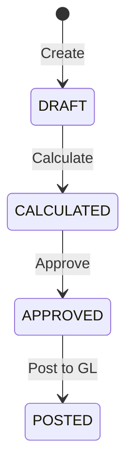

# Payroll

The Payroll module handles employee compensation — pay components, pay run processing, statutory deductions, and automatic salary posting to Finance.

## Key Features

### Pay Components
Define the building blocks of compensation:

| Type | Examples |
|------|---------|
| **Earnings** | Basic Salary, House Rent Allowance, Overtime |
| **Deductions** | Provident Fund, Professional Tax, Income Tax |
| **Employer Contributions** | Employer PF, ESI Employer Share |

### Salary Structure
Assign pay components to employees with specific amounts or formula-based calculations:
- Fixed amounts or percentage-based (e.g., HRA = 40% of Basic)
- Per-employee overrides for special arrangements

### Pay Runs

Process payroll for a period:

1. Navigate to **Payroll → Pay Runs**
2. Click **New Pay Run** and select the period
3. System calculates gross pay, deductions, and net pay for all employees
4. Review the pay run summary
5. **Approve** the pay run
6. On approval, salary journal entries are automatically posted to Finance

### Statutory Compliance
- **Provident Fund (PF)** — Employee and employer contribution tracking
- **Professional Tax** — State-wise professional tax deductions
- **Income Tax (TDS)** — Tax deduction at source calculations

### Payslips
Generate individual payslips for each employee showing:
- Earnings breakdown
- Deduction breakdown
- Net pay
- Year-to-date totals

## Navigation

| Page | Path | Permission |
|------|------|-----------|
| Pay Runs | `/payroll/runs` | `payrun.view` |
| Pay Components | `/payroll/components` | `payroll.component.view` |
| Salary Structures | `/payroll/structures` | `payroll.structure.view` |
| Statutory Rules | `/payroll/statutory` | `payroll.statutory.view` |
| Payslips | `/payroll/payslips` | `payroll.payslip.view` |

## Cross-Module Integration

| Integration | How It Works |
|------------|-------------|
| **Finance** | Approved pay runs auto-post salary journals (Dr Salary Expense / Cr Salary Payable) |
| **HR** | Employee records and department assignments drive payroll calculations |

## Permissions

| Permission | Description |
|-----------|-------------|
| `payrun.view` | View pay runs |
| `payrun.create` | Create pay runs |
| `payrun.approve` | Approve and post pay runs |
| `payroll.component.view` | View pay components |
| `payroll.component.create` | Create/edit pay components |
| `payroll.statutory.view` | View statutory rules |
| `payroll.statutory.create` | Create/edit statutory rules |
