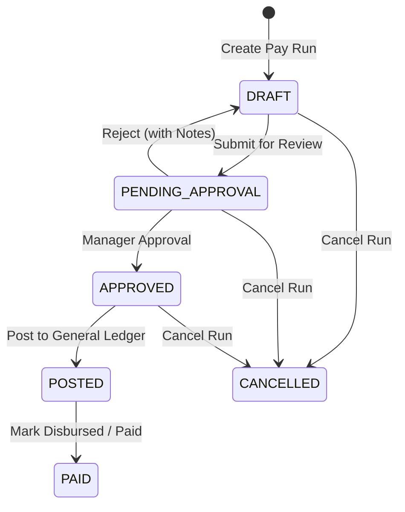
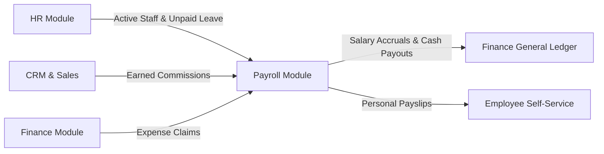

# Payroll

<div class="storyline-breadcrumb">Part of the <strong>Hire to Retire (H2R)</strong> &amp; <strong>Financial Ledger Settlement</strong> Storylines</div>

> The compensation, statutory compliance, and payroll settlement engine of TenArm BES, orchestrating monthly salary computation, progressive tax withholdings, sales commissions sweeping, Full & Final exit settlements, and automated double-entry postings to the General Ledger in Finance.

The Payroll module bridges workforce human resource operations with commercial financial accounting. It ingests active employee profiles, scheduled working calendars, and unpaid leave absences from **HR**, gathers earned sales profit commissions from **CRM & Sales**, computes multi-tier statutory withholdings (PF, ESI, TDS, Professional Tax), and generates individual employee payslips. Upon manager sign-off, it posts double-entry expense and liability journals directly into the **Finance General Ledger** and records bank disbursement vouchers.

---

## Workspace Ergonomics

The Payroll workspace is engineered for high-accuracy financial processing, rigorous segregation of duties, and zero-discrepancy disbursements:

- **Multi-Tab Desk**: Payroll officers and financial controllers can operate across up to 3 workspace tabs simultaneously (for example, keeping the **Pay Runs** desk open while inspecting individual voucher calculations on the **Full & Final Settlement Desk** and tuning salary structures under **Compensation**). Switching tabs preserves active filters, search criteria, and uncommitted calculations without page reloads.
- **Draft Auto-Save**: Uncommitted form inputs across **New Pay Run**, **Set Compensation**, **Full & Final Settlement Draft**, and the **Incentive Policy Configurator** are continuously saved to local storage. Active tab headers display a dirty dot indicator (`•`) until the record is saved or discarded.
- **Quick-Peek Slide-Out Drawer**: Clicking any linked payslip number (`PS-YYYY-NNNNNN`), employee reference, or pay run code opens an inspection drawer from the right edge of the screen. Users can examine itemized earnings, statutory tax slabs, and download official PDF payslips without losing their place on the primary table.
- **Optimistic Concurrency Control (OCC)**: Every pay run, compensation profile, pay component, and statutory rule carries an OCC version badge (e.g., `v2`). If another payroll administrator modifies a compensation structure or approves a pay run concurrently, the system alerts you and opens the **Conflict Resolution Drawer** to prevent duplicate or conflicting ledger transactions.

---

## Core Payroll & Compensation Concepts

### The Pay Run Lifecycle
Every payroll batch follows a disciplined financial workflow from initial draft calculation through audit approval, General Ledger accrual, and bank payout:



| Lifecycle Status | What It Means | Allowed Next Actions |
|---|---|---|
| `DRAFT` | Pay run created and batch calculated. Earnings, deductions, and swept commissions compiled. | Review individual payslips, submit for approval, or cancel. |
| `PENDING_APPROVAL` | Pay run submitted for formal financial authorization. Enforces segregation of duties. | Approve, reject back to draft (with mandatory explanation), or cancel. |
| `APPROVED` | Administratively authorized by finance/payroll management. Ready for accounting commitment. | Post to General Ledger, or cancel (restoring swept items). |
| `POSTED` | Multi-leg salary expense and statutory liability journals committed to Finance GL. | Execute bank disbursement and mark as Paid. *(Cannot be cancelled).* |
| `PAID` | Salaries disbursed via bank transfer. Cash settlement journal posted to Finance. | Historical inspection and PDF payslip printing. *(Terminal state).* |
| `CANCELLED` | Pay run voided prior to posting. Swept commissions, expenses, and leave roll back to source pools. | Historical inspection only. *(Cannot be reopened).* |

### Regular Pay Runs vs. Full & Final (FnF) Settlements
TenArm BES distinguishes regular monthly operational payroll from individual employee departure settlements:
- **Regular Pay Runs (`REGULAR`)**: Processed once per month for the entire enrolled active workforce. Automatically aggregates all employees with positive base salaries or pending earnings adjustments. Enforces a strict one-regular-run-per-period guard per organization.
- **Full & Final Settlements (`FINAL_SETTLEMENT`)**: Dedicated, single-employee exit runs created for departing personnel (`EXITING` or `TERMINATED`). Exempt from the one-run-per-period rule, incorporating worked-days salary proration, leave encashment, notice pay shortfall recoveries, gratuity payouts, and unreturned asset deductions.

### Automated 3-Way Cross-Module Sweeping
When a pay run is created, the system performs an automated cross-module sweep to compile variable pay and attendance deductions:
1. **Sales Commissions (CRM & Sales)**: Gathers pending commission entries accrued from completed customer orders and converts them to `ACCRUED`, adding them as a **Sales Incentive** earning line.
2. **Unpaid Leave Absences (HR Attendance)**: Inspects approved unpaid leave records recorded in the HR calendar and calculates daily salary deductions based on scheduled working days in the month.
3. **Expense Advances & Reimbursements (Finance)**: Sweeps approved out-of-pocket employee expense reimbursements directly into payslips as non-taxable additions.
*(If a draft or approved pay run is subsequently cancelled, all swept entries are safely reverted to `PENDING` so they can be included in future runs).*

### Double-Entry General Ledger Integration
Posting a pay run executes precise, double-entry financial journals in the **Finance** module:
- **Accrual Posting (`Post to GL`)**:
  - `Debit`: **Salaries & Wages Expense** (Gross compensation total)
  - `Credit`: **Statutory Liabilities** (PF Payable, ESI Payable, TDS Withholding, Professional Tax)
  - `Credit`: **Salaries Payable** (Net disbursable wages)
- **Settlement Posting (`Mark Paid`)**:
  - `Debit`: **Salaries Payable** (Clearing the liability)
  - `Credit`: **Operating Bank Account / Cash** (Reflecting the cash outflow)

---

## Payroll Analytics & Dashboard

### Dashboard Desk

**What it does** — Provides executive management, financial controllers, and HR leadership with real-time analytics on company-wide compensation expenditure, statutory withholding liabilities, historical cost trends, and per-employee disbursement averages.

```
/payroll/dashboard
```

**Key Metrics & Cards**
- **Active Headcount**: Total number of employees enrolled on the period's pay run.
- **Gross Total**: Aggregate gross payroll commitment prior to withholdings.
- **Total Deductions**: Cumulative employee-side deductions, statutory taxes, and benefit withholdings.
- **Net Disbursed**: Final take-home pay delivered to the workforce, accompanied by the average net pay per employee.
- **Historical Cost & Disbursement Chart**: Visual 6-period bar chart comparing monthly Gross Pay against Net Disbursements.
- **Period Breakdown Table**: Detailed historical tabular ledger tracking headcount, gross, net, and average compensation per employee across past accounting periods.

**How to Use the Dashboard**
1. Navigate to **Payroll → Payroll Dashboard** (`/payroll/dashboard`).
2. Select any calendar month from the **Period** dropdown in the header to view historical payroll figures.
3. Hover over the **Payroll Cost & Disbursements** chart to review specific gross-to-net variance figures.
4. Inspect the **Period Breakdown** table for year-over-year compensation budgeting.

---

## Pay Runs & Monthly Processing

### Pay Runs Desk

**What it does** — The primary operational cockpit for drafting monthly payroll, validating employee payslip calculations, executing manager sign-offs, committing General Ledger salary journals, and recording bank disbursements.

```
/payroll/runs
```

**Pay Runs Pulse Bar**
- **Total Runs**: Total lifetime pay runs drafted across the tenant.
- **In Review**: Count of active pay runs currently in `DRAFT` or `APPROVED` status requiring administrative action.
- **Gross Disbursed**: Cumulative gross payroll expenditure posted across all confirmed runs.
- **Net Paid Out**: Net cash successfully disbursed to employees across completed `PAID` runs.

**Key Fields on Pay Runs**

| Field | Required | Description |
|---|:---:|---|
| **Run #** | ✅ | System-generated document sequence identifier (e.g., `RUN-2024-000011`). |
| **Period** | ✅ | Target payroll month formatted as `YYYY-MM` (e.g., `2024-11`). |
| **Pay Date** | — | Scheduled date of salary direct deposit or disbursement. |
| **Workforce** | ✅ | Total number of employees included in the batch (or employee name for FnF runs). |
| **Gross Total** | ✅ | Total gross earnings across all enrolled employee payslips. |
| **Deductions Total** | ✅ | Total statutory and company deductions withheld across the batch. |
| **Net Total** | ✅ | Final net payable amount required for bank disbursement. |
| **Status** | ✅ | Current lifecycle state: `DRAFT`, `PENDING_APPROVAL`, `APPROVED`, `POSTED`, `PAID`, or `CANCELLED`. |
| **Notes** | — | Internal memo, run purpose, or audit commentary. |

**How to Create a Monthly Pay Run**
1. Navigate to **Payroll → Pay Runs** (`/payroll/runs`).
2. Click **New Pay Run** in the header.
3. In the **New Pay Run** modal:
   - Enter the target **Period (YYYY-MM)** (defaults to the current month).
   - Enter the scheduled **Pay Date**.
   - Optionally add internal **Notes**.
4. Click **Create Pay Run**. The system compiles active employee compensation structures, sweeps pending sales commissions, calculates statutory brackets, and creates the pay run in `DRAFT` status.

**Inspecting Employee Payslips on a Run**
1. Locate the pay run on the **Pay Runs** table.
2. Click the **Payslips** button (file icon) on the row.
3. The **Payslips Modal** opens, summarizing batch totals (Gross, Deductions, Net) and listing all individual employee slips.
4. Click **View** on any employee row to open their itemized payslip in the Quick-Peek slide-out drawer, or click **PDF** to download their formal payslip document.

**The 4-Stage Execution Workflow**

#### Stage 1: Submit for Review
1. Once payslips are verified on a `DRAFT` run, click **Submit**.
2. If the gross total is below the tenant's configured financial approval threshold, the run moves directly to `APPROVED`.
3. If it meets or exceeds the threshold, it enters `PENDING_APPROVAL` and routes to authorized approvers.

#### Stage 2: Manager Approval
1. An authorized manager with approval permissions inspects the run in `PENDING_APPROVAL`.
2. Click **Approve** to authorize the payroll batch (`DRAFT` → `APPROVED`).
   *(Alternatively, click **Reject**, enter a mandatory explanation in the prompt, and return the run to `DRAFT` for adjustments).*

#### Stage 3: Post to General Ledger
1. On an `APPROVED` pay run, click **Post to GL**.
2. The **Confirm General Ledger Posting** modal opens, displaying the exact double-entry consequences:
   - `Dr. Salaries & Wages Expense`: Total gross compensation.
   - `Cr. Statutory Liabilities`: Deductions for PF, ESI, and TDS.
   - `Cr. Salaries Payable`: Net wages payable to staff.
3. Click **Confirm & Post to GL**. The pay run moves to `POSTED`, and the journal voucher is recorded in Finance.

#### Stage 4: Mark as Paid (Disbursement)
1. Following corporate bank transfers or automated payment clearance, locate the `POSTED` run.
2. Click **Mark Paid**.
3. The **Confirm Cash Disbursement** modal opens, outlining the settlement journal:
   - `Dr. Salaries Payable`: Clearing net wage liabilities.
   - `Cr. Operating Bank Account / Cash`: Disbursing cash funds.
4. Click **Confirm & Mark Paid**. The pay run moves to `PAID`.

---

## Full & Final (FnF) Settlement Command Desk

### Final Settlement Desk

**What it does** — A dedicated SplitDesk workspace (`/payroll/final-settlement`) engineered for HR and payroll specialists to compute, verify, and settle compensation for departing employees (`EXITING` or `TERMINATED`).

```
/payroll/final-settlement
```

**Desk Architecture**
- **Separation Queue (Left Pane)**:
  - Filter departures using the dropdown: `Needs Settlement (Pending Draft)`, `Draft Settlements`, `Approved (Awaiting Post)`, `Posted (Awaiting Payout)`, `Settled & Paid`, or `All Separations & Settlements`.
  - Queue cards display the employee's name, employee number, separation status, and settlement amount.
- **Settlement Inspector (Right Pane)**:
  - **Clearance Integration Banner**: Surfaces live asset custody and expense claims from the HR Clearance 360 inspection. If the employee still holds laptops or company hardware, an amber alert badge appears with a one-click button to **Add Asset Recovery Line**.
  - **Proration Calculator**: Dynamically adjusts monthly base salary based on the exact number of worked days in their final month against scheduled calendar working days.
  - **Adjustment Slabs**: Supports preset earnings and deductions:
    - `Leave Encashment`: Computes cash payout for unutilized accrued leave days.
    - `Gratuity Payout`: Statutory longevity gratuity addition.
    - `Notice Shortfall Recovery`: Deductions for unserved notice period days.
    - `Asset Recovery`: Deductions for damaged or unreturned IT equipment.
  - **One-Click Settlement Finalization**: Direct action buttons to approve, post journals to the General Ledger, and record payment sign-offs without leaving the desk.

**How to Draft an Exit Settlement**
1. Navigate to **Payroll → Final Settlement** (`/payroll/final-settlement`).
2. Select an employee from the **Separation Queue**.
3. In the **Draft Settlement** panel:
   - Enter the settlement **Period (YYYY-MM)** and scheduled **Pay Date**.
   - In **Worked Days in Final Month**, enter the days worked prior to departure (e.g., `12` out of `22` scheduled working days). The system automatically calculates prorated base salary and allowances.
   - Click **+ Leave Encashment** to add encashed leave days.
   - Click **+ Asset Recovery** or **+ Notice Shortfall** if company deductions apply.
4. Click **Create Draft Settlement**. The system generates an individual `FINAL_SETTLEMENT` pay run ready for approval and posting.

---

## Employee Compensation & Salary Structures

### Compensation Desk

**What it does** — Maintains the master record of who to pay, their base monthly salary, disbursement currency, effective dates, and sales commission rates.

```
/payroll/compensation
```

**Pulse Bar Metrics**
- **Total Enrolled**: Active personnel enrolled with configured salary profiles.
- **Monthly Base Commitment**: Total baseline monthly fixed payroll liability.
- **Average Base Salary**: Average baseline salary across enrolled personnel.
- **Sales Commission Plans**: Count of staff enrolled in performance incentive plans.

**Key Fields on Compensation Records**

| Field | Required | Description |
|---|:---:|---|
| **Employee** | ✅ | Staff member selected from active HR employee directory. |
| **Base Salary (monthly)** | ✅ | Base fixed salary paid per month before additions or deductions. |
| **Sales Incentive Rate (%)** | — | Percentage of gross sales profit awarded to commissioned sales reps. |
| **Currency** | — | ISO currency code for disbursement (defaults to tenant currency, e.g., `INR`). |
| **Effective From** | — | Starting date for this compensation structure. |

**How to Set or Edit an Employee's Salary**
1. Navigate to **Payroll → Compensation** (`/payroll/compensation`).
2. To configure a new employee, click **Set Compensation**; to modify an existing package, click **Edit** on their row.
3. In the modal:
   - Select the **Employee**.
   - Enter their **Base Salary (monthly)**.
   - If the employee earns sales commissions on closed orders, specify their **Sales Incentive Rate (% of gross profit)** (e.g., `5.0%`).
   - Choose the **Currency** and **Effective From** date.
4. Click **Save Compensation**.

**Assigning Recurring Pay Components to an Employee**
1. On any employee's compensation row, click **Components**.
2. The **Employee Components** modal lists recurring allowances or deductions assigned specifically to that individual.
3. Select an assignable component from the dropdown (e.g., `Car Allowance` or `Special Allowance`).
4. Optionally specify an **Amount Override** to tailor the fixed amount or percentage for this individual.
5. Click **Assign Component**. The component will now automatically calculate on every monthly pay run for this employee.

---

## Pay Components Catalogue

### Pay Components

**What it does** — The central catalog of recurring earnings and deduction building blocks applied across employee payslips.

```
/payroll/components
```

**Component Classification**
- **Earnings (`EARNING`)**: Additions to gross compensation (e.g., Basic Salary, House Rent Allowance, Travel Allowance, Shift Differential).
- **Deductions (`DEDUCTION`)**: Non-statutory subtractions from gross pay (e.g., Health Insurance Premium, Loan Repayment, Gym Subsidy).

**Amount Calculation Types**
- **Fixed (`FIXED`)**: A flat numerical currency value added or subtracted on each pay run (e.g., `₹5,000.00`).
- **Percent of Base (`PERCENT_OF_BASE`)**: Dynamically calculated as a percentage of the employee's monthly base salary (e.g., `40% of Base Salary` for HRA).

**Component Scope**
- **All Employees (`ALL`)**: Organization-wide component applied automatically to every employee on every pay run (e.g., standard HRA).
- **Assigned Employees (`ASSIGNED`)**: Tailored component applied strictly to employees who have it assigned individually via the Compensation desk (e.g., Executive Vehicle Allowance).

**How to Create a Pay Component**
1. Navigate to **Payroll → Pay Components** (`/payroll/components`).
2. Click **+ New Component** in the header.
3. In the modal:
   - Enter a unique **Code** (e.g., `HRA`, `TRANSPORT`, `MED_INS`).
   - Enter the display **Name** (e.g., `House Rent Allowance`).
   - Select the **Kind**: `EARNING` or `DEDUCTION`.
   - Select the **Amount Type**: `Fixed Amount` or `Percent of Base`.
   - Enter the default **Amount** (or percentage value).
   - Select the **Scope**: `All Employees` or `Assigned Only`.
4. Click **Create Component**.

> [!WARNING]
> **Component Deletion Guard**: A pay component cannot be archived if it is currently assigned to any active employee. Reassign or remove the component from individual compensation profiles before archiving.

---

## Statutory Deduction Rules & Tax Brackets

### Statutory Rules

**What it does** — Jurisdiction-neutral engine defining mandatory government withholdings, social security contributions, employee retirement funds (PF), and progressive personal income tax (PAYE/TDS) brackets.

```
/payroll/statutory
```

**Calculation Methods**
- **Flat Percentage (`PERCENT`)**: Deducts a fixed percentage of income (e.g., `12.0%` for employee Provident Fund).
- **Progressive Brackets (`BRACKET`)**: Applies progressive marginal tax rates across customizable income tiers (e.g., standard personal income tax slabs).

**Assessment Base**
- **Gross Pay (`GROSS`)**: Withholding calculated against total gross earnings including base salary and allowances.
- **Base Salary (`BASE`)**: Withholding calculated strictly against fixed base compensation.

**How to Configure a Statutory Deduction Rule**
1. Navigate to **Payroll → Statutory Rules** (`/payroll/statutory`).
2. Click **+ New Rule** in the header.
3. In the **New Statutory Rule** modal:
   - Enter a unique **Code** (e.g., `PF_EMP`, `ESI_EMP`, `TDS`).
   - Enter the display **Name** (e.g., *Employee Provident Fund*).
   - Select the **Calculation Method**: `PERCENT` or `BRACKET`.
   - Select the **Applies To Base**: `Gross Pay` or `Base Salary`.
   - If using `PERCENT`, enter the mandatory **Rate %** (e.g., `12.0`).
   - If using `BRACKET`, configure progressive slabs in the **Brackets Editor**:
     - *Tier 1*: Up to `₹25,000.00` at `0.0%`
     - *Tier 2*: Up to `₹50,000.00` at `5.0%`
     - *Tier 3*: Up to `₹100,000.00` at `20.0%`
     - *Tier 4*: Remaining balance at `30.0%`
   - Optionally enter an **Income Cap** (the maximum monthly taxable wage ceiling above which withholdings cease).
4. Click **Create Rule**.

---

## Sales Incentives & Policy Configurator

### Incentives Ledger (`/payroll/incentives`)

**What it does** — The central ledger of sales commissions earned by commercial representatives. As sales orders are completed in **Sales**, commissions accrue automatically as a percentage of gross profit margin. Entries in `PENDING` status are swept into the next pay run; entries in `ACCRUED` status have already been paid out.

**Incentive Realization Payout Toggle**
Located at the top of the Incentives page, this toggle defines when sales reps receive their payout:
- **Accrue Immediately upon Order Completion**: Commissions enter `PENDING` as soon as goods are delivered or orders completed.
- **Hold for Payment Realization**: Commissions remain in `PENDING_PAYMENT` and are only released to `PENDING` once the customer's sales invoice is marked `PAID` in Finance.

---

### Incentive Policy Configurator (`/payroll/incentives/policy`)

**What it does** — An interactive, visual policy builder allowing sales directors and finance leaders to establish commercial incentive rules, tiered commission slabs, quota overachievement bonuses, and attendance reliability rewards.

```
/payroll/incentives/policy
```

**Policy Architecture**
1. **Payout Timing**: Configure immediate order delivery vs. invoice payment realization.
2. **Customer Eligibility**:
   - `All Orders (Continual)`: Standard commission applied across all customer orders.
   - `New Customers Only`: Commission awarded only on the customer's first order.
   - `Differentiated Multipliers`: Custom split rates rewarding new customer acquisition (e.g., `1.5x` multiplier) versus repeat accounts (`1.0x` multiplier).
3. **Commission Slabs**:
   - `Tiered (Marginal)`: Progressive commission rates where higher percentages apply only to the margin within each slab.
   - `Flat Threshold`: The entire commission volume is awarded at the highest tier percentage reached.
4. **Target & Quota Bonuses**: Define milestone rewards for reaching or exceeding monthly quotas (e.g., `₹5,000.00` bonus at 100% quota; `₹15,000.00` President's Club bonus at 150% quota).
5. **Attendance & Punctuality Reliability Bonuses**: Incentive rewards granted to operational or factory staff for zero unplanned leaves and 100% punctuality during the pay period.
6. **Live Payout Simulator Sandbox**: Test order volumes, gross profits, and attendance days to preview exact calculated commission outcomes in real time before committing changes.

---

## Individual Payslip Records & Quick-Peek

### Payslip Viewer

**What it does** — The detailed single-voucher view of an individual employee's earnings, statutory withholdings, net payout, and year-to-date figures.

```
/payroll/payslips/:payslipId
```

**Accessing Payslips**
- **Quick-Peek Slide-Out**: Clicking any linked payslip ID (`PS-YYYY-NNNNNN`) on a pay run opens the slide-out drawer from the right edge of the screen.
- **Full Page Record**: Click **Open in Tab** from the drawer to load the dedicated record view.
- **Employee Self-Service**: Employees view their own personal payslips under **Me → My Payslips** (`/payroll/my-payslips`).

**Itemized Breakdown Sections**
- **Earnings Card**: Base salary, House Rent Allowance, recurring benefits, non-taxable expense reimbursements, and swept sales incentives.
- **Statutory Withholdings Card**: Employee Provident Fund (PF), Employee State Insurance (ESI), Professional Tax, and Income Tax (TDS).
- **Attendance Deductions Card**: Salary deductions for approved unpaid leave absences.
- **Disbursement Card**: Net take-home pay and destination bank account details.
- **Export PDF**: Click **PDF** in the header to download a branded, audit-ready PDF payslip document.

---

## If Something Goes Wrong (Common Validation & Guard Errors)

The table below explains common validation banners, toasts, and guard errors in the Payroll module, along with practical steps to resolve them in the workspace:

| What you see (Toast / Banner) | Why it happens | How to fix it in the workspace |
|---|---|---|
| `"Period must match YYYY-MM format"` | The period input does not conform to the standard year-month format. | Enter the period as a 4-digit year and 2-digit month separated by a hyphen (e.g., `2024-11`). |
| `"A regular pay run already exists for period YYYY-MM"` | TenArm BES permits only one regular monthly pay run per accounting period to prevent duplicate wage payments. | Open the existing pay run for that period under **Pay Runs**. If edits are required, cancel the draft run before creating a replacement. |
| `"Pay run cannot be approved by the submitter"` | Segregation of duties prevents the user who authored or submitted a pay run from approving it. | Have an independent finance manager or payroll supervisor log in to inspect and approve the pay run. |
| `"A rejection reason is required for the audit trail"` | A manager clicked Reject on a pending pay run without entering an explanation. | Enter a clear reason (e.g., *Discrepancy in sales incentive sweep for sales team*) before confirming rejection. |
| `"Pay run must be in APPROVED status to post to GL"` | An attempt was made to post a draft or pending pay run directly to the General Ledger. | Submit and approve the pay run first. Only approved runs can commit financial journals. |
| `"Pay run must be in POSTED status to mark as paid"` | An attempt was made to disburse a run before committing its salary journals to the General Ledger. | Click **Post to GL** to record salary expenses and liabilities before clicking **Mark Paid**. |
| `"Cannot cancel a POSTED or PAID pay run"` | Pay runs that have committed General Ledger journals cannot be deleted or cancelled. | Use adjusting journal entries in **Finance** or manual compensation corrections in subsequent pay runs. |
| `"Pay component code already exists in your organization"` | Component codes must be unique across the tenant. | Choose a distinct code (e.g., `HRA_EXEC` instead of `HRA`). |
| `"Cannot archive pay component assigned to active employees"` | The component is actively assigned to one or more employees on their compensation profiles. | Open **Compensation**, remove the component assignment from affected employees, and then archive the component. |
| `"Statutory rule code already exists in your organization"` | Statutory rule codes must be unique across the tenant. | Choose a distinct code (e.g., `PF_VOLUNTARY` instead of `PF`). |
| `"Bracket statutory rules require at least one tier"` | A statutory rule was configured with method `BRACKET` but no income slabs were defined. | Use the **Brackets Editor** to add at least one income tier with an upper threshold and rate. |
| `"Rate must be between 0 and 100 percent"` | A percentage rate outside the valid `0.0% – 100.0%` boundary was entered. | Enter a valid percentage value between `0` and `100`. |
| `"Base salary must be a non-negative number"` | A negative salary value was submitted on an employee's compensation profile. | Enter a positive numerical base salary amount (or `0.00` if purely commissioned). |
| `"No compensation record configured for employee"` | An attempt was made to draft a Full & Final settlement for an employee who has no base salary record. | Open **Compensation**, configure a baseline salary profile for the employee, and retry the settlement. |
| `"Record was modified by another session (vX vs vY)"` | Another user updated the pay run, component, or compensation structure while your form was open (OCC guard). | The **Conflict Resolution Drawer** will open. Review the other user's changes and choose whether to reload or re-apply your edits. |

---

## Cross-Module Integrations

The Payroll module interacts closely with multiple domains across the enterprise:



| Integrated Module | Data Exchanged | Business Outcome |
|---|---|---|
| **HR** | Employee master profiles, departments, scheduled working calendars, and approved unpaid leave days. | Determines employee eligibility, calculates daily salary proration for mid-month exits, and automatically deducts pay for unpaid absences. |
| **CRM & Sales** | Realized order gross profits and attributed sales representative user accounts. | Calculates sales commissions according to configured slabs and sweeps them into monthly employee payslips. |
| **Finance** | Approved out-of-pocket employee expense reimbursement vouchers and travel advances. | Includes non-taxable expense disbursements on payslips and prevents unrecovered advances during Full & Final settlements. |
| **Finance (General Ledger)** | Multi-leg journal vouchers posted upon run approval (`payrun.post`) and settlement (`payrun.pay`). | Ensures automated double-entry accounting with zero manual journal entry, posting to Salary Expense, Statutory Liabilities, and Bank accounts. |
| **Employee Self-Service** | Verified individual payslip summaries and PDF download links. | Allows staff to view monthly earnings, deductions, and tax withholdings directly in their personal workspace. |

---

## Permissions Reference

Access to compensation, pay run execution, and compliance rules is governed by role-based permissions:

| Permission | Display Label | What It Authorizes |
|---|---|---|
| `payrun.view` | View Pay Runs | View the pay runs directory, dashboard analytics, and batch payslip summaries. |
| `payrun.create` | Create Pay Run | Draft regular monthly pay runs and initiate batch payroll calculations. |
| `payrun.final_settlement` | Final Settlement | Draft and compute individual Full & Final exit settlements for departing personnel. |
| `payrun.submit` | Submit Pay Run | Submit draft pay runs for administrative financial review. |
| `payrun.approve` | Approve Pay Run | Formally authorize pending pay runs or reject them back to draft. |
| `payrun.post` | Post Pay Run to GL | Commit double-entry salary expense and liability journals into the Finance General Ledger. |
| `payrun.pay` | Disburse Pay Run | Mark posted pay runs as paid and record bank cash outflow journals. |
| `payrun.cancel` | Cancel Pay Run | Void draft or approved pay runs and restore swept sales commissions to source pools. |
| `compensation.view` | View Compensation | Inspect employee base salaries, currency settings, and sales commission rates. |
| `compensation.set` | Set Compensation | Configure or update employee base salaries, effective dates, and commission percentages. |
| `empcomponent.view` | View Assigned Components | View tailored recurring allowances and deductions assigned to specific employees. |
| `empcomponent.assign` | Assign Component | Attach recurring pay components with individual amount overrides to an employee. |
| `empcomponent.remove` | Remove Component | Detach recurring pay components from an employee's salary profile. |
| `paycomponent.view` | View Pay Components | Browse the organization's catalog of recurring earnings and deduction components. |
| `paycomponent.create` | Create Pay Component | Define new recurring earnings or deductions with fixed or percentage-based math. |
| `paycomponent.update` | Update Pay Component | Edit component display names, default amounts, and scope rules. |
| `paycomponent.archive` | Archive Pay Component | Inactivate obsolete pay components that have no active employee assignments. |
| `statutory.view` | View Statutory Rules | Inspect statutory withholding rules, percentage rates, and income tax brackets. |
| `statutory.create` | Create Statutory Rule | Define new statutory deduction rules and progressive taxation bracket tables. |
| `statutory.update` | Update Statutory Rule | Modify statutory tax rates, bracket thresholds, and taxable income ceilings. |
| `statutory.archive` | Archive Statutory Rule | Inactivate obsolete statutory rules so they are omitted from future pay runs. |
| `commission.view` | View Sales Incentives | Inspect the sales commission ledger and monitor pending vs accrued commission entries. |
| `self_service.access` | View Own Payslips | Allows individual employees to view and download their personal payslips in Self-Service. |
