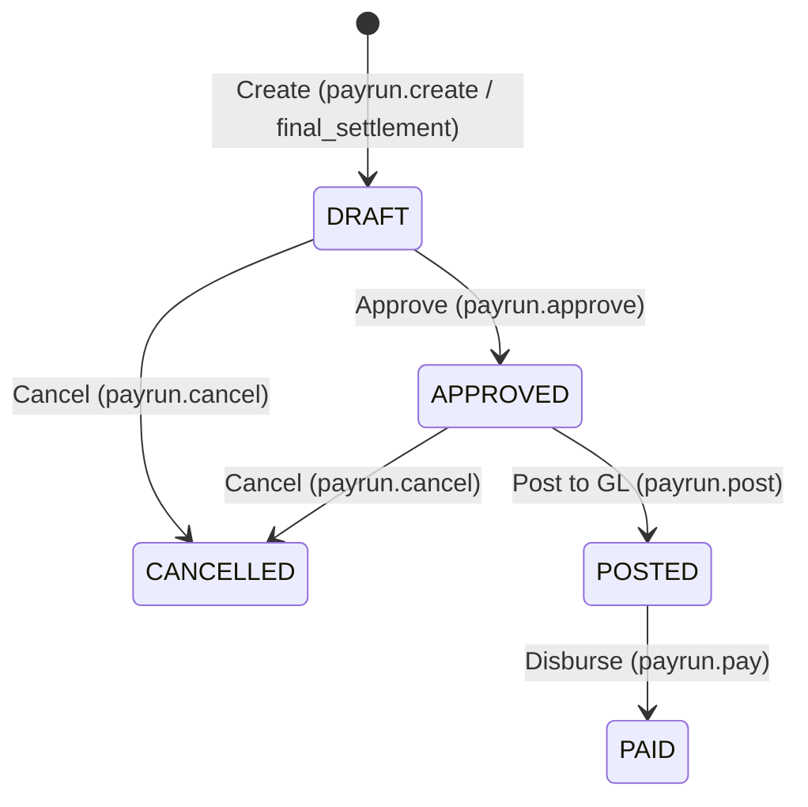

# Payroll

The Payroll module handles employee compensation — pay components, pay run processing, statutory deductions, and automatic salary posting to Finance.

## Key Features

### Pay Components
Define the building blocks of compensation:

| Type | Examples |
|------|---------|
| **Earnings** | Basic Salary, House Rent Allowance, Overtime |
| **Deductions** | Provident Fund, Professional Tax, Income Tax |
| **Employer Contributions** | Employer PF, ESI Employer Share |

### Salary Structure & Compensation
Assign base compensation and components to employees:
- Fixed annual or monthly base salary with per-employee overrides
- Configurable earning and deduction components assigned per employee
- Commission and incentive rate settings integrated with sales performance

### Pay Runs

Process payroll for a period:

1. Navigate to **Payroll → Pay Runs**
2. Click **New Pay Run** and select the period (e.g. `YYYY-MM`) and pay date (or trigger a **Full & Final Settlement** for an exiting employee)
3. System creates the pay run in `DRAFT` status and synchronously calculates gross pay, statutory deductions, and net pay for all eligible employees
4. Review the pay run summary, totals, and individual employee payslips
5. **Approve** the pay run (`payrun.approve`) to record administrative authorization (`DRAFT` → `APPROVED`)
6. **Post** the pay run to the General Ledger (`payrun.post`) (`APPROVED` → `POSTED`), automatically posting multi-leg salary expense and payable journals to Finance
7. **Disburse / Pay** the pay run (`payrun.pay`) (`POSTED` → `PAID`) once salary transfers are executed, posting the payment settlement journal to Finance
8. (Optional) **Cancel** a `DRAFT` or `APPROVED` pay run (`payrun.cancel`), which returns swept sales incentives, unpaid leave deductions, and expense claims back to their source pools

### Statutory Compliance
- **Provident Fund (PF)** — Employee and employer contribution tracking
- **Professional Tax** — State-wise professional tax deductions
- **Income Tax (TDS)** — Progressive bracket and tax deduction at source calculations

### Payslips
Generate individual payslips for each employee showing:
- Earnings breakdown (Basic, HRA, allowances, sales incentives)
- Deduction breakdown (statutory deductions, unpaid leaves, taxes)
- Net pay
- Year-to-date totals

## Navigation

| Page | Path | Permission |
|------|------|-----------|
| Pay Runs | `/payroll/runs` | `payrun.view` |
| Compensation | `/payroll/compensation` | `compensation.view` |
| Pay Components | `/payroll/components` | `paycomponent.view` |
| Statutory Rules | `/payroll/statutory` | `statutory.view` |
| Sales Incentives | `/payroll/incentives` | `commission.view` |
| Payroll Dashboard | `/payroll/dashboard` | `payrun.view` |
| My Payslips | `/payroll/my-payslips` | `self_service.access` |

## Cross-Module Integration

| Integration | How It Works |
|------------|-------------|
| **Finance** | Posted pay runs auto-post salary journals (`Dr Salary Expense / Cr Salary Payable`) on `payrun.post`, and settlement journals (`Dr Salary Payable / Cr Cash`) on `payrun.pay` |
| **HR** | Active employee records, departments, and unpaid leave attendance drive compensation calculations and exit settlements |
| **Sales** | Realized sales commission and performance incentives are swept into employee payslips |

## Permissions

| Permission | Description |
|-----------|-------------|
| `payrun.view` | View pay runs and dashboard |
| `payrun.create` | Create monthly pay runs |
| `payrun.final_settlement` | Create Full & Final exit settlement pay runs |
| `payrun.approve` | Approve draft pay runs |
| `payrun.post` | Post approved pay runs to the General Ledger |
| `payrun.pay` | Mark posted pay runs as disbursed/paid |
| `payrun.cancel` | Cancel draft or approved pay runs |
| `paycomponent.view` | View pay components |
| `paycomponent.create` | Create pay components |
| `paycomponent.update` | Update pay components |
| `paycomponent.archive` | Archive pay components |
| `compensation.view` | View employee compensation structures |
| `compensation.set` | Set employee base compensation and commission rates |
| `empcomponent.view` | View employee component allocations |
| `empcomponent.assign` | Assign pay components to employees |
| `empcomponent.remove` | Remove component assignments from employees |
| `statutory.view` | View statutory compliance rules |
| `statutory.create` | Create statutory deduction rules |
| `statutory.update` | Update statutory deduction rules |
| `statutory.archive` | Archive statutory rules |
| `commission.view` | View sales incentives and commission realization |
| `self_service.access` | View personal payslips via My Workspace (`/payroll/my-payslips`) |
