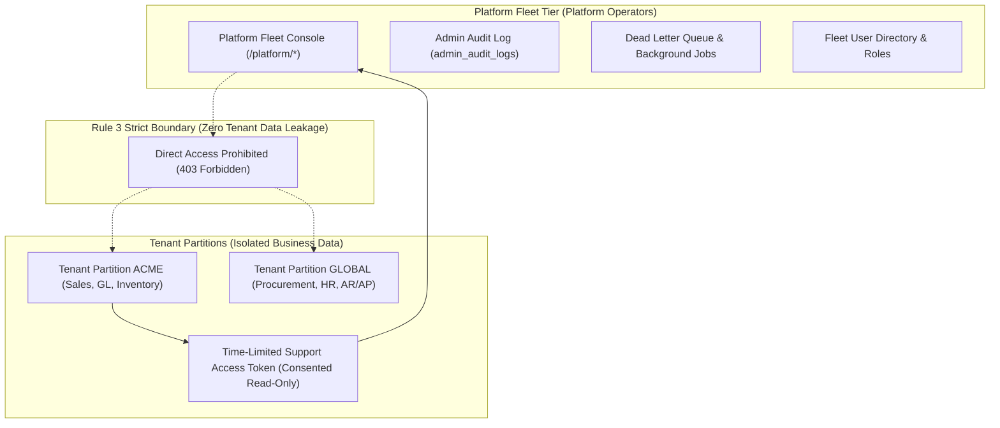
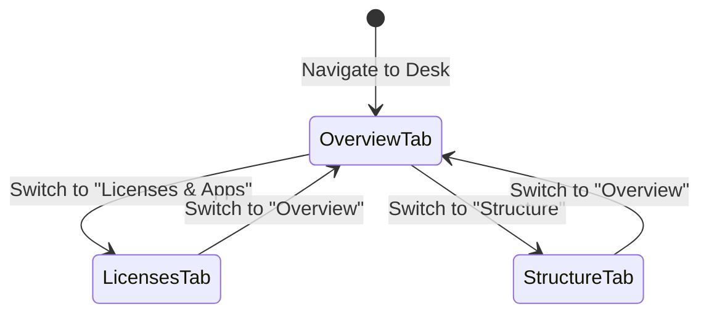
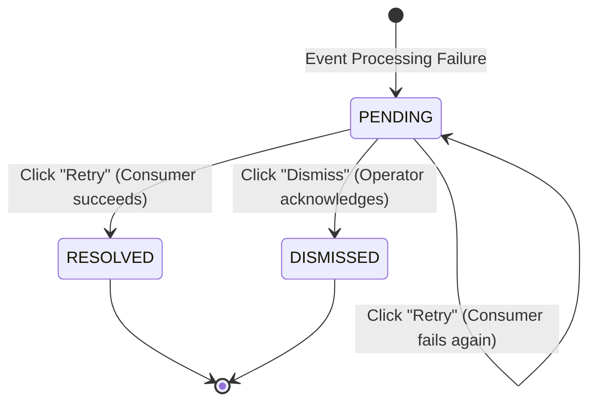

# Platform Fleet Console

<div class="storyline-breadcrumb">Core Cockpit for <strong>Fleet Governance</strong>, <strong>Multi-Tenant Operations</strong> &amp; <strong>Platform Reliability</strong></div>

> The mission-critical operations cockpit for platform administrators, delivering centralized multi-tenant lifecycle management, automated tenant provisioning, license governance, asynchronous event recovery, and fleet-wide observability.

The **Platform Fleet Console** (`/platform`) is the dedicated operational environment for platform operators and system administrators. Unlike tenant-tier users who operate within a single isolated company partition, platform operators manage the multi-tenant fleet across its entire lifecycle—from automated onboarding and branch topology to license enforcement, event bus reliability, and background queue orchestration.

---

## Workspace Ergonomics

The Platform Fleet Console is engineered for zero-downtime fleet administration, strict tenant isolation, and rapid operational triage:

- **Multi-Tab Desk**: Operators can open and maintain up to 3 concurrent active tabs (e.g. keeping **Platform Overview** open in Tab 1 while fine-tuning tenant configuration in **Tenant Operations Desk** in Tab 2 and monitoring event recovery in **Dead Letters** in Tab 3). Switching tabs preserves active filters, search queries, pagination, and unsaved form states without page reloads.
- **Draft Auto-Save & Dirty Dot**: Unsaved inputs in the **Provision Tenant** wizard or modal forms are continuously stored in local session memory. An active tab with pending changes displays a dirty dot indicator (`•`) on its header until saved or discarded.
- **Quick-Peek Slide-Out Drawers**: Selecting a user record in the **Fleet Users** directory opens an inspection drawer from the right edge of the screen, allowing administrators to audit assigned roles, authentication status, and partition assignments without leaving the directory table.
- **Optimistic Concurrency Control (OCC)**: Tenant status changes, license window modifications, and branch structures display an OCC version badge (e.g. `v3`). If two platform operators update the same tenant concurrently, the system alerts you immediately and opens the **Conflict Resolution Drawer** to prevent accidental overwrites.

---

## Core Administrative Concepts

### Fleet-Tier vs. Tenant-Tier Isolation (Rule 3)
Security in TenArm BES enforces a strict architectural boundary between platform operators and tenant business data:



1. **No Impersonation or Data Snooping**: Platform operators never scope into tenant business transactions (sales orders, general ledger journals, inventory balances, customer invoices). Attempting to browse tenant business endpoints returns a `403 Forbidden` guard.
2. **Customer-Consented Support Access**: When an organization requests technical support, a tenant administrator generates an ephemeral **Support Grant Code** inside their workspace (`/support-access`). The platform operator enters this code via **Redeem Support Code** to start a time-limited, strictly read-only troubleshooting session. Every query executed during the session is recorded in the customer's immutable audit log.
3. **Dedicated Admin Audit Ledger (Rule 4)**: Fleet-tier operations record no business events in tenant event streams. All fleet operations (creating organizations, enabling modules, altering license dates, updating user credentials) are recorded in the dedicated, tamper-evident `admin_audit_logs` ledger.

---

## Features

### 1. Platform Overview (`/platform/overview`)

**What it does** — The executive landing cockpit showing overall fleet health KPIs and a searchable directory of all tenant organizations.

```
/platform/overview
```

**Fleet Health Pulse HUD**

| Metric Card | What it shows | Action on Click |
|---|---|---|
| **Total Organizations** | Total provisioned tenant partitions with active tenant count. | Refreshes the tenant fleet table. |
| **Dead Letter Queue** | Total pending asynchronous event consumption failures. Accent turns warning (&lt;10) or danger (10+). | Navigates directly to `/platform/dead-letters`. |
| **Lagging Projections** | Read-model projection tables lagging behind the immutable event store, highlighting any projections in error. | Navigates directly to `/monitoring/projections`. |

**Tenant Fleet Directory**

The main directory table displays every onboarded tenant organization:

| Column | Description |
|---|---|
| **Name** | Full commercial name of the tenant organization. |
| **Code** | Unique uppercase organization identifier badge (e.g. `ACME`, `CORP`). |
| **Status** | Status badge: `ACTIVE` (green / operational) or `INACTIVE` (warning / suspended). |
| **Actions** | Quick-navigation buttons: **Desk** (opens Tenant Operations Desk) and **Licenses** (opens License & App Configuration). |

**How to Use**
1. Navigate to **Fleet → Overview** (`/platform/overview`).
2. Type in the **Search tenants by name or code...** input to filter organizations in real time.
3. Click any row or the **Desk** button to inspect that tenant's dedicated operations console.
4. Click **+ New Tenant** to launch the tenant onboarding wizard.

---

### 2. Tenant Provisioning Wizard (`/platform/provision`)

**What it does** — An automated multi-step wizard that establishes an isolated tenant partition, configures regional compliance packs, sets up primary branches and departments, configures license validity, enables required modules, and provisions the initial tenant administrator.

```
/platform/provision
```

**Provisioning Lifecycle Flow**

```mermaid
flowchart LR
    Step0["1. Org Identity<br/>(Code, Name, Country, Timezone)"] --> Step1["2. Primary Branch<br/>(HQ Branch Code & Name)"]
    Step1 --> Step2["3. Department<br/>(Ops Dept Code & Name)"]
    Step2 --> Step3["4. License Window<br/>(Active, Valid Until)"]
    Step3 --> Step4["5. Apps & Packs<br/>(Core Apps, Country Packs)"]
    Step4 --> Step5["6. Onboarding Scripts<br/>(Chart of Accounts, Tax Setup)"]
    Step5 --> Step6["7. Admin User<br/>(Credentials & Role)"]
    Step6 --> Step7["8. Review & Provision<br/>(Execute Pipeline)"]
```



**Wizard Steps & Key Fields**

| Step | Form Section | Required Fields & Validation Rules |
|---|---|---|
| **1** | **Organization Identity** | • **Organization Code** (2–10 uppercase alphanumeric characters; must be unique across the fleet)<br/>• **Organization Name** (Full legal corporate entity name)<br/>• **Country** (Dropdown selecting legal jurisdiction, e.g. `India (IN)`)<br/>• **Timezone** (IANA timezone string, e.g. `Asia/Kolkata`; automatically pre-filled by country pack) |
| **2** | **Primary Operating Branch** | • **Branch Code** (Defaults to `HQ`)<br/>• **Branch Name** (Defaults to `Head Office`) |
| **3** | **Internal Department** | • **Department Code** (Defaults to `OPS`)<br/>• **Department Name** (Defaults to `Operations`) |
| **4** | **License Window** | • **License Active** (Checkbox toggle, default checked)<br/>• **Valid Until** (Optional expiration date; blank indicates a perpetual license) |
| **5** | **Business Apps & Packs** | • **Business Apps**: Toggle standard domain modules (Sales, Procurement, Inventory, Finance, HR, Payroll, Manufacturing, etc.)<br/>• **Country Packs**: Mandatory country packs (e.g. India GST) are automatically enabled and locked<br/>• **Industry Packs**: Opt-in modules (e.g. Steel, AI Assistant) |
| **6** | **Onboarding Scripts** | • Select initial initialization recipes (e.g. Standard Chart of Accounts, Tax Master Codes, Demo Demonstration Master Data) |
| **7** | **Initial Tenant Admin** | • **Email Address** (Corporate email for the primary administrator)<br/>• **Full Name** (Administrator contact name)<br/>• **Password** (Minimum 12 characters; enforces uppercase, lowercase, number, and special symbol complexity) |
| **8** | **Review & Provision** | • Summary inspection card verifying all parameters. Click **Provision Tenant** to trigger atomic creation. |

**How to Use**
1. Navigate to **Fleet → Provision Tenant** (`/platform/provision`) or click **+ New Tenant** from Overview.
2. Complete Step 1 by entering the unique organization code, business name, country, and timezone.
3. Review or adjust the default Primary Branch and Department in Steps 2 and 3.
4. Set the license expiration date or leave blank for perpetual validity in Step 4.
5. In Step 5, toggle optional modules. Note that mandatory country compliance packs are locked on.
6. Select initial master data setup scripts in Step 6.
7. Enter credentials for the primary tenant administrator in Step 7.
8. Review the blueprint in Step 8 and click **Provision Tenant**. The system provisions the organization, branches, departments, apps, and administrator account atomically, displaying the success summary card.

---

### 3. Tenant Operations Desk (`/platform/orgs/:orgId`)

**What it does** — The unified single-pane operations desk for managing an individual tenant partition, including real-time telemetry, operational status, license windows, modular app enablement, physical branch and department topologies, and support access.

```
/platform/orgs/:orgId
```

**Desk View Tabs**



#### Tab 1: Overview (`?view=overview`)
- **Profile & Lifecycle Card**: Displays organization legal name, code, onboarding timestamp, and active app ratio. Contains the master **Activate Tenant** / **Deactivate Tenant** button (guarded by Optimistic Concurrency Control).
- **Pulse Telemetry Grid**:
  - `License Window`: Indicates whether the organization is currently within an open license window, along with the validity date range.
  - `Status`: Operational lifecycle stage (`ACTIVE` or `INACTIVE`).
  - `Total Users`: Number of provisioned tenant users, highlighting active accounts.
  - `Total Events`: Total transactions and ledger events processed in this partition.
- **Active Applications**: Badge list of all active modules currently enabled for this tenant.

#### Tab 2: Licenses & Apps (`?view=licenses`)
- **License Window Editor**:
  - Form controls: **License Active** (checkbox), **Valid From** (date picker), and **Valid Until** (date picker).
  - Click **Save License Window** to commit changes with OCC version validation.
- **Application Enablement Matrix**:
  - Displays all registered base apps, country packs, industry packs, and opt-in modules.
  - Visual badges designate the module kind: `Base App`, `Country Pack`, `Industry Pack`, or `Opt-in Module`.
  - Displays module dependencies (e.g. "Requires Sales, Inventory").
  - Operators can click **Enable** or **Disable** next to any app. The system enforces dependency cascading—attempting to disable an app that other enabled modules depend upon triggers an explanatory validation alert.

#### Tab 3: Organizational Structure (`?view=structure`)
- **Operating Branches**:
  - Lists all registered physical locations, warehouses, and regional offices for the tenant.
  - Click **+ New Branch** to open the creation modal (Branch Code, Name, Street Address, City, State, Country).
  - Click **Edit** on any branch row to update location attributes.
- **Internal Departments**:
  - Lists functional teams, business units, and cost centers linked to operating branches.
  - Click **+ New Dept** to open the creation modal (Department Code, Name, Parent Branch).
  - Click **Edit** to modify department details.

#### Consented Support Session Redemption (`Redeem Support Code`)
When assisting a tenant with technical issues, platform operators cannot access customer business tables directly. If the customer administrator has issued a grant code:
1. Click **Redeem Support Code** on the Tenant Operations Desk.
2. In the modal, enter the 8-character **Support Grant Code** provided by the tenant administrator.
3. Click **Redeem Code**. The system verifies the token, records the consent grant in the customer's audit log, and enters a temporary, read-only session inside the tenant's workspace (`/`).

---

### 4. Fleet Users Directory (`/platform/users`)

**What it does** — Centralized user identity governance across all tenant partitions and platform-level operators, facilitating cross-partition searches, role assignment, and account security management.

```
/platform/users
```

**Pulse HUD Metrics**
- **Total Users**: Total registered user accounts across the entire platform.
- **Active Users**: Users currently in good standing eligible to authenticate.
- **Inactive Users**: Deactivated or suspended accounts.

**Directory Table & Filtering**
- **Search Bar**: Real-time filtering by user full name or email address.
- **Tenant Filter Dropdown**: Filter users belonging to a specific tenant partition or select **All Tenants**.
- **Status Filter Pills**: Quick toggle between `All`, `Active`, and `Inactive`.
- **Columns**: `User` (Name & Email), `Partition / Tenant` (Tenant Name or Platform Operator badge), `Roles` (Assigned system roles), `Status` (`ACTIVE` / `INACTIVE`), and `Created At`.

**User Detail Quick-Peek Drawer**
Clicking any user row opens the contextual slide-out drawer:
- **Profile Header**: User avatar, full name, email, and partition tier.
- **Role Governance**: View assigned roles; assign or revoke roles (e.g. `Platform Admin`, `Tenant Admin`, `Finance Manager`).
- **Account Actions**:
  - Click **Deactivate Account** / **Activate Account** to toggle sign-in permission.
  - Click **Reset Password** to generate a secure password reset link or override credentials.

**How to Provision a User from the Fleet Console**
1. Navigate to **Fleet → Users** (`/platform/users`).
2. Click **+ New User** to open the provisioning modal.
3. Select the target partition: choose a specific **Tenant Organization** or select **Platform (Fleet Tier)**.
4. Enter the user's **Full Name**, **Email Address**, and a complex **Password** (minimum 12 characters).
5. Select the initial **Roles** to grant.
6. Click **Create User**.

---

### 5. Dead Letter Queue (`/platform/dead-letters`)

**What it does** — Operational triage and reprocessing center for asynchronous business events that failed consumption across background workers, read-model projection consumers, or cross-module event handlers.

```
/platform/dead-letters
```

**Event Recovery Lifecycle**



**Pulse HUD Metrics**
- **Total Events**: Overall count of dead letter queue entries recorded.
- **Pending**: Unresolved failures requiring operator triage (colored in warning orange or alert red).
- **Resolved**: Events that have been successfully reprocessed.
- **Dismissed**: Events manually acknowledged and discarded without reprocessing.

**Triage Controls & Table**
- **Search & Filters**: Filter by error keyword, consumer name, target organization, or status (`PENDING`, `RESOLVED`, `DISMISSED`).
- **Table Columns**: `ID`, `Tenant`, `Event Name`, `Consumer`, `Error`, `Retries`, `Status`, `Created At`, and `Actions`.
- **Actions**:
  - **Inspect**: Opens a detailed inspection modal displaying the full event JSON payload, consumer class, retry history, and complete error traceback.
  - **Retry**: Immediately re-injects the event into the event bus for the designated consumer. If successful, the entry transitions to `RESOLVED`.
  - **Dismiss**: Prompts for confirmation to mark the entry as `DISMISSED` without further retries (used when the failure was caused by invalid obsolete data or was resolved out-of-band).

---

### 6. Background Jobs & Scheduled Tasks (`/platform/jobs`, `/control/scheduled-jobs`)

**What it does** — Real-time orchestration and telemetry for asynchronous system workloads, including full read-model projection rebuilds, historical event replays, large data exports, and periodic cron schedules.

```
/platform/jobs
/control/scheduled-jobs
```

**Background Jobs HUD & Controls (`/platform/jobs`)**
- **HUD Pulse Bar**: Real-time counter of `Total Jobs`, `Queued`, `Running`, `Done`, and `Failed`.
- **Live Polling**: When any job is queued or running, the console polls every 2 seconds to update dynamic progress bars in real time.
- **Header Actions**:
  - **Rebuild Projections**: Submits a platform-wide asynchronous workload to rebuild all read-model projections from the immutable event store.
  - **Replay Events**: Replays historical events starting from sequence 0 or a specified event ID to resynchronize downstream projections.
  - **Scheduled Cron Jobs**: Direct link to the scheduled cron maintenance console.

**Background Jobs Table**

| Column | Description |
|---|---|
| **Type** | Workload category: `REBUILD`, `REPLAY`, `EXPORT`, `IMPORT`. |
| **Organization** | Target tenant partition or `All Tenants` (fleet-wide). |
| **Progress** | Visual animated progress bar indicating completion percentage. |
| **Status** | Status badge: `QUEUED` (muted), `RUNNING` (blue / active), `DONE` (green), `FAILED` (red), `CANCELLED` (warning). |
| **Duration** | Total execution time formatted in milliseconds (`ms`) or seconds (`s`). |
| **Submitted By** | Email of the administrator or system process that queued the workload. |
| **Actions** | Click **Cancel** on any `QUEUED` job to remove it from the processing queue before execution begins. |

**Scheduled Cron Tasks (`/control/scheduled-jobs`)**
The Scheduled Tasks console governs automated recurring background jobs:
- **Registered Tasks**: Session cleanup, automated nightly balance rollups, retention policy pruning, projection consistency audits.
- **Task Controls**:
  - **Cron Schedule Expression**: Inspect or edit the cron schedule (e.g. `0 2 * * *` for nightly at 2:00 AM).
  - **Run Now**: Instantly trigger execution of a scheduled task outside its standard cron window.
  - **Enable / Disable**: Toggle active scheduling status.

---

### 7. Admin Audit Log (`/platform/audit-logs`)

**What it does** — An immutable, tamper-evident audit ledger recording every administrative mutation executed by platform operators across the fleet.

```
/platform/audit-logs
```

**Audit Trail Columns**

| Column | Description |
|---|---|
| **Timestamp** | Date and time (down to the second) when the mutation occurred. |
| **Operator** | Email address and user ID of the platform operator who performed the action. |
| **Action** | Exact operation executed (e.g. `org.create`, `org.update`, `app.enable`, `license.update`, `user.provision`). |
| **Target Tenant** | Name and ID of the tenant partition affected by the action. |
| **Outcome** | Badge: `SUCCESS` (green) or `FAILED` (red). |
| **Details / Changes** | Summary of modified attributes. |
| **Actions** | Click **Inspect** to view the full audit record modal, including client IP, user agent, before/after JSON diffs, and error diagnostics if the action failed. |

---

### 8. System Health & Observability (`/monitoring/*`)

**What it does** — Fleet-wide observability dashboards providing deep operational insights into API capability performance and read-model projection sync health.

#### Capability Health (`/monitoring/capabilities`)
- **Throughput & Failure Rate**: Displays total executions, success counts, failure counts, failure rate percentage, and average execution duration in milliseconds.
- **Diagnostic Tabs**:
  - **Top Used Capabilities**: Identifies the highest volume business operations across the fleet.
  - **Slowest Handlers**: Ranks capabilities with the highest average latency to identify optimization candidates.
  - **Most Failed Operations**: Surfaces operations with recurring errors.
- **Time Range Filter**: Switch analysis windows between 24 Hours, 7 Days, and 30 Days.

#### Projection Health (`/monitoring/projections`)
- **Real-Time Lag Tracking**: Monitors the synchronization gap between the append-only event store and read-model query tables.
- **Consumer Status Table**:
  - `Consumer Name`: Projection subscriber (e.g. `sales_order_projection`, `general_ledger_projection`).
  - `Status`: `ACTIVE` (green / healthy), `LAGGING` (orange / catching up), `REBUILDING` (blue / full rebuild in progress), `ERROR` (red / consumer stopped on unhandled exception).
  - `Lag Progress Bar`: Visual bar showing the number of unconsumed events relative to the latest event sequence.
  - `Last Processed Event`: Most recent event sequence ID and timestamp processed.
  - `Rebuild History`: Click to view recent projection rebuild timestamps, trigger origins, and duration records.

---

## Workspace Tips

- **Three-Desk Multi-Tasking**: Keep the **Platform Overview** open in your primary tab, a specific customer's **Tenant Operations Desk** in your secondary tab, and **Dead Letters** in your tertiary tab. Switching between tabs maintains scroll position and filter state.
- **Support Access Protocol**: Never ask customer administrators for their personal login credentials. Direct them to generate a time-limited **Support Grant Code** in **Settings → Support Access** and redeem it through the Tenant Operations Desk.
- **Safe App Deactivation**: Before disabling a core app (such as `sales` or `inventory`), check the module's dependency list in **Tenant Operations Desk → Licenses & Apps**. Disabling a foundational app cascade-disables dependent modules.

---

## If Something Goes Wrong (Common Validation & Guard Errors)

| What you see (Toast / Banner) | Why it happens | How to fix it in the workspace |
|---|---|---|
| **"Organization code already exists"** | A tenant partition with this code is already registered in the fleet directory. | Enter a distinct 2–10 character uppercase code in Step 1 of the provisioning wizard. |
| **"Password must be at least 12 characters and include uppercase, lowercase, numbers, and symbols"** | The initial tenant administrator password does not meet platform complexity standards. | Provide a password containing at least 12 characters with a mix of uppercase letters, lowercase letters, numbers, and special symbols. |
| **"Country pack '[pack]' is mandatory for country [country] and cannot be disabled"** | Legal compliance packs (such as GST for India) are legally required for tenants in that jurisdiction. | Keep the mandatory country pack enabled; it cannot be switched off for that legal territory. |
| **"Cannot disable app 'sales': required by 'logistics' and 'portal'"** | Other active modules declare a mandatory contract dependency on the app you are attempting to disable. | Disable the dependent downstream apps (`logistics`, `portal`) first before disabling `sales`. |
| **"Version conflict: This tenant was modified by another operator (OCC 409)"** | Another administrator updated the tenant's status, license, or profile while your form was open. | Click **Reload** or review conflicting fields in the **Conflict Resolution Drawer** to re-apply changes to the latest version. |
| **"Invalid support grant code or code has expired"** | The customer support grant code has exceeded its 15-minute time-to-live (TTL) window or was already redeemed. | Ask the tenant administrator to generate a fresh support code under `Settings → Support Access` in their workspace. |
| **"Platform operators cannot access tenant business records (Rule 3 violation)"** | Direct navigation to tenant business URLs (e.g. `/sales/orders`) without an active consented support session is prohibited. | Return to the **Platform Fleet Console** (`/platform`) or redeem a valid support code issued by the customer. |
| **"Dead letter retry failed: Consumer exception"** | The underlying data issue or external service fault that caused the original event failure has not been resolved. | Click **Inspect** on the DLQ entry to examine the full stack trace and event payload. Once the root cause is resolved, click **Retry** again. |

---

## Integrations

The Platform Fleet Console coordinates across all TenArm BES architectural tiers:

- **Tenant Administration (`/admin`)**: Provides tenant-tier administrators with self-service identity and role governance within their provisioned partition.
- **Core Event Bus & Ledgers**: Captures every state mutation across business modules and surfaces processing failures directly in the Dead Letter Queue.
- **Projection Engine**: Maintains synchronized read-model tables from the immutable event store, monitored and rebuilt via the Platform Background Jobs and Projection Health consoles.
- **Support Access Subsystem**: Enforces customer-consented, audited, time-limited troubleshooting sessions while upholding strict multi-tenant boundary isolation.
