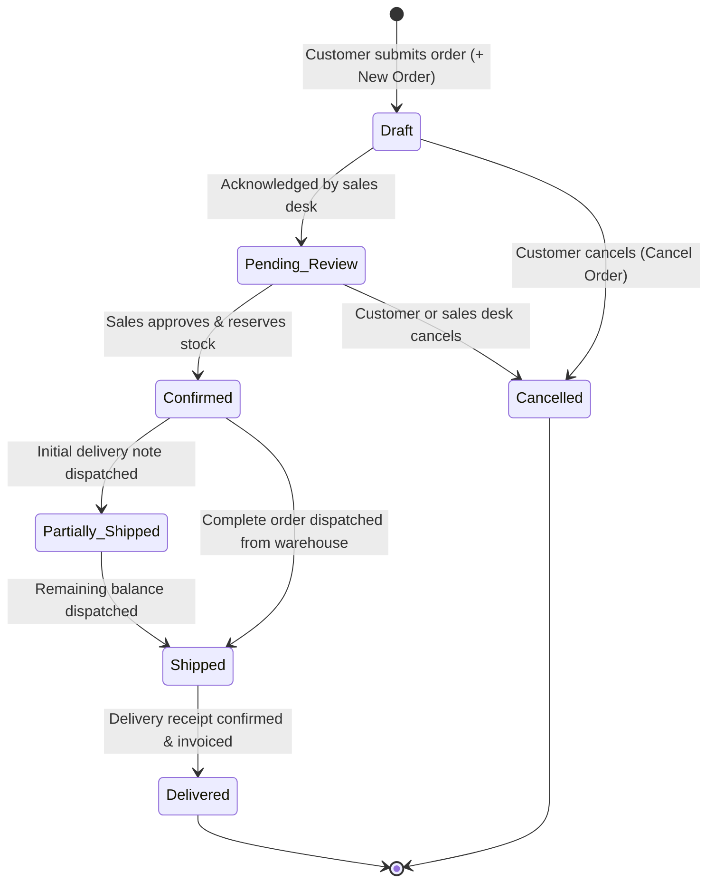

# Customer Portal

<div class="storyline-breadcrumb">Part of the <strong>Order to Cash (O2C)</strong> Storyline: Step 4 of 6 (Customer Self-Service Order Entry)</div>

> A dedicated, secure self-service workspace enabling external customer accounts to browse authorized product catalogs, submit purchase orders directly into the order-to-cash pipeline, and track fulfillment progress in real time.

The Customer Portal provides approved commercial counterparties with direct, transparent access to their business transactions. Rather than relying on phone calls, emailed spreadsheets, or manual quotation requests, authorized customer contacts log into a streamlined external interface to place purchase commitments against published catalog prices and monitor delivery progress from order receipt to final warehouse dispatch.

---

## Workspace Ergonomics

The Customer Portal provides a tailored experience specifically designed for external clients:

- **Dedicated External Shell (`PortalLayout`)**: External customer accounts operate in a focused workspace that replaces internal ERP sidebars and administrative menus with three clean navigation tabs: **Overview**, **My Orders**, and **Place Order**.
- **Draft Auto-Save & Discard Guard**: Order entry on the **Place an Order** screen continuously preserves uncommitted product lines, quantities, and order notes in local browser storage (`portal_order_create`). If a customer accidentally closes the browser tab or navigates away, edits remain intact. Clicking **Cancel** triggers an explicit **Discard Portal Order?** dialog before clearing unsaved work.
- **Optimistic Concurrency Control (OCC) Protection**: If an order status changes on the server (for example, when an internal sales representative approves the order or warehouse personnel issue a dispatch) while a customer has the detail page open, attempting to cancel the order triggers the **Conflict Resolution Drawer**, refreshing the screen with live server facts.
- **Strict Data Scoping**: All queries are strictly scoped to the authenticated user's linked customer account. External users can never view other customers' records, internal gross profit margins, cost structures, or unapproved inventory batches.

---

## Core Features & Workflows

### 1. Portal Overview (`/portal`)

**What it does** — The welcome landing page providing quick account summary cards and direct access to order history.

```
┌────────────────────────────────────────────────────────────────────────┐
│ Welcome back, Alex                                                     │
│ CUST-0024 — Acme Industrial Corporation                                │
├──────────────────────────────────┬─────────────────────────────────────┤
│ QUICK ACCESS                     │ ACCOUNT                             │
│ My Orders                        │ Profile                             │
│ View your purchase history and   │ Email: alex.smith@acmeind.com       │
│ order status                     │ Account: CUST-0024                  │
│ [ View orders → ]                │                                     │
└──────────────────────────────────┴─────────────────────────────────────┘
```

**Key Elements**
- **Personalized Header**: Greets the logged-in user and displays the linked counterparty account number and commercial company name.
- **Quick Access Card**: Displays a direct shortcut link (**View orders**) to open the customer's complete order history.
- **Account Profile Card**: Summarizes the user's registered login email address and unique counterparty account code.

---

### 2. My Orders (`/portal/orders`)

**What it does** — A centralized register of all historical and active purchase orders placed by the customer's organization.

**Key Features & Controls**
- **Order Register Grid**: Displays orders sorted with the most recent transactions first:
  - **Order #**: Clickable reference badge (e.g. `SO-2024-0042`) opening the full order details.
  - **Status**: Visual status badge reflecting the real-time fulfillment stage (e.g. `Draft`, `Pending Review`, `Confirmed`, `Shipped`, `Delivered`, `Cancelled`).
  - **Total**: Net monetary commitment formatted in the tenant's transaction currency.
  - **Items**: Total discrete product line count included in the order.
  - **Date**: Calendar date when the order was submitted.
- **New Order Button (`+ New Order`)**: Positioned in the header row, this button takes users directly to the order creation form.
- **Empty State**: If no orders have been placed yet, an empty state card offers guidance and invites the customer to browse the catalog and place their first order.
- **Row Click Navigation**: Clicking any order row opens its full specification, delivery timeline, and line-item breakdown.

---

### 3. Place an Order (`/portal/orders/new`)

**What it does** — A structured self-service order intake form allowing customers to build an order from active, sellable catalog products.

```
┌─────────────────────────────────────────────────────────────────────────────────────────┐
│ Place an Order                                                                          │
│ Select products and quantities. Our team will review and confirm your order.            │
├─────────────────────────────────────────────────────────────────────────────────────────┤
│ Order Lines                                                                [ + Add Line ]│
│                                                                                         │
│ Product                      Qty       Unit Price   Notes           Total               │
│ [ Select product…          ] [ 100   ] [ $45.00   ] [ Urgent site ] $4,500.00  [ X ]    │
│ [ Structural Tube (ST-10)  ] [ 25    ] [ $120.00  ] [ Heat cert req]$3,000.00  [ X ]    │
│                                                                                         │
│                                                             Order Total: $7,500.00      │
├─────────────────────────────────────────────────────────────────────────────────────────┤
│ Order Notes (optional)                                                                  │
│ [ Please deliver to Gate 4, West Receiving Dock between 8:00 AM and 11:30 AM…         ] │
├─────────────────────────────────────────────────────────────────────────────────────────┤
│                                                            [ Cancel ] [ Place Order ]   │
└─────────────────────────────────────────────────────────────────────────────────────────┘
```

**Key Fields**

| Field | Required | Description & Validation |
|---|:---:|---|
| **Product** | ✅ | Selected from the active catalog dropdown. Only sellable items with active catalog pricing are listed. |
| **Qty** | ✅ | Ordered quantity. Must be a positive number greater than zero. Negative signs and non-numeric characters are prohibited. |
| **Unit Price** | 🔒 | Read-only catalog selling price. Determined authoritatively by the organization's published price list; customers cannot manually edit prices. |
| **Notes** (Line) | Optional | Specific line-level instructions, such as packaging preferences, cutting tolerances, or destination markings. |
| **Order Notes** | Optional | General shipment instructions, site access constraints, delivery gate numbers, or preferred dispatch dates. |

**How to Place an Order**
1. Click **+ New Order** on the **My Orders** screen or select the **Place Order** navigation tab.
2. In the **Order Lines** card, select a product from the **Product** dropdown. The catalog price and unit of measure populate automatically.
3. Enter the required order quantity in the **Qty** input. The line total recalculates instantly.
4. To order additional items, click **+ Add Line** and repeat steps 2 and 3.
5. (Optional) Enter line-level notes or overarching delivery instructions in **Order Notes (optional)**.
6. Review the **Order Total** summary at the bottom of the lines card.
7. Click **Place Order**. A confirmation toast displays (`Order SO-2024-XXXX placed`) and the workspace automatically opens the order's tracking page.

---

### 4. Order Tracking & Lifecycle (`/portal/orders/:orderId`)

**What it does** — Provides real-time visibility into order status, fulfillment progression, allocated quantities, and customer-side cancellation.

**Lifecycle & States**



| Portal State Label | Internal Status | Business Meaning | Customer Actions |
|---|---|---|---|
| **Draft** | `DRAFT` | Order received; waiting for initial commercial review by sales team. | Review line items, verify totals, or click **Cancel Order**. |
| **Pending Review** | `SUBMITTED` | Commercial team is reviewing stock availability and delivery feasibility. | Order can still be cancelled if commercial plans change. |
| **Confirmed** | `APPROVED` | Sales team confirmed order; warehouse stock is firmly reserved. | Order locked; fulfillment in progress. Contact sales rep for changes. |
| **Partially Shipped** | `PARTIALLY_SHIPPED` | Part of the order has been dispatched under a Delivery Note. | Inspect delivered quantities and wait for balance dispatch. |
| **Shipped** | `SHIPPED` | Entire order has been dispatched from the fulfilling facility. | Prepare receiving dock for carrier delivery. |
| **Delivered** | `COMPLETED` | Goods delivered and commercial billing finalized in Finance. | Transaction concluded; historical archive. |
| **Cancelled** | `CANCELLED` | Order terminated prior to commercial commitment. | View historical record; place a new order if required. |

**Order Detail Components**
- **Header Summary**: Displays the order number, placement date, current status badge, and the **< Back to My Orders** navigation link.
- **Horizontal Progress Timeline**: Visual stepper tracking progression across **Draft**, **Pending Review**, **Confirmed**, **Shipped / Partially Shipped**, and **Delivered**. If the order was cancelled, a prominent red `Cancelled` badge is shown.
- **Line Items Breakdown**: Detailed table displaying line numbers, product descriptions, internal item codes, quantities with unit symbols, catalog unit prices, line totals, and the aggregate **Order Total**.
- **Customer Notes**: Displays special shipping instructions or order notes submitted with the purchase.

**Cancelling an Order**
1. Open the order from **My Orders**.
2. If the order is in **Draft** or **Pending Review**, the **Cancel Order** button appears in the upper right corner.
3. Click **Cancel Order**. A confirmation dialog opens:
   > *"Are you sure you want to cancel order SO-2024-XXXX? This will release allocated items and cannot be undone."*
4. Click **Cancel Order** in the dialog. The order status updates immediately to `Cancelled` and a confirmation toast is displayed.
5. *Note*: Once an order moves to **Confirmed** (`APPROVED`), the **Cancel Order** button is hidden because physical stock reservation and warehouse pick lists are already committed.

---

## Administrator Guide: Provisioning Portal Users

Tenant administrators manage customer portal access directly through the internal TenArm BES administration screens:

1. Navigate to **Tenant Administration → User Management** (`/admin/users`).
2. Click **+ New User** (or click an existing customer contact to edit).
3. Enter the user's **Full Name**, corporate **Email**, and set their initial password.
4. In the **Linked Party** selector, choose the corresponding Customer counterparty record (e.g. `Acme Industrial Corporation`).
5. In the **Roles** checklist, assign the **Portal User** role.
6. Click **Save**.

::: tip Automatic Shell Routing
Portal users log in through the standard organization login screen. The application automatically detects their linked party profile and portal role, immediately directing them into the Customer Portal workspace rather than internal administrative modules.
:::

---

## If Something Goes Wrong (Common Validation & Guard Errors)

| What you see (Toast / Banner / Field Error) | Why it happens | How to fix it in the workspace |
|---|---|---|
| *"Duplicate product in order lines. Please combine quantities."* | The same product SKU was selected across multiple rows in the order table. | Click the red **X** button to delete the redundant line, then adjust the quantity on the primary line. |
| *"This product has no catalog price and cannot be ordered."* | The selected item does not have an active selling price configured in the organization catalog. | Choose a priced catalog SKU or contact your sales account manager to publish contract pricing for this item. |
| *"Quantity must be greater than 0"* | The quantity field was left empty, set to zero, or contains an invalid value. | Enter a valid positive numeric quantity (e.g. `10` or `25.5`). |
| *"Add at least one line with a product and quantity"* | Attempted to click **Place Order** with an empty order table. | Click **+ Add Line**, select a product, specify the desired quantity, and re-submit. |
| *"Cannot cancel an order in 'APPROVED' status"* | A customer attempted to cancel an order after the commercial team approved it and allocated warehouse stock. | Contact your internal sales account representative directly to request an order modification or dispatch hold. |
| *"You do not have access to view orders"* / *"You do not have permission to place orders"* | The signed-in user account is missing required portal permissions (`portal.orders.view` or `portal.orders.create`). | Contact your tenant administrator to verify that the **Portal User** role is assigned to your user account. |
| *"Portal access requires a linked party account."* | The user account exists in the system but has not been associated with a customer counterparty record. | Request your tenant administrator to edit your account in **User Management** and assign your company in the **Linked Party** field. |
| **Conflict Resolution Drawer opens during cancellation** | Another user or internal sales rep updated the order status while you were viewing the screen. | Review the updated status displayed in the drawer and click **Reload** to see current order facts. |

---

## Integrations

The Customer Portal connects directly into core TenArm BES modules without duplicating operational logic:

| Module | How It Integrates with Customer Portal |
|---|---|
| **Sales** | Portal orders are injected directly into the sales pipeline as DRAFT sales orders (`specs.sales.create_order`), emitting `PortalOrderPlaced` events. Internal commercial teams review, price-check, and approve them on the **Sales Orders** register. |
| **Inventory** | When sales teams approve a portal order, firm Available-to-Promise (ATP) reservations lock physical stock in the fulfilling warehouse. Subsequent warehouse dispatches advance the portal timeline to `Shipped`. |
| **CRM & Counterparties** | Customer account details, commercial trading terms, and contact profiles are anchored to the core Counterparty (Party) master data. |
| **Product Catalog** | The portal product picker reads sellable catalog master items (`models.product`), ensuring that only active products with valid commercial selling prices can be ordered. |

---

## Permissions Reference

| Permission Code | Description | Default Role |
|---|---|---|
| `portal.orders.view` | Allows the user to view their organization's portal dashboard, order history, and order details. | Portal User |
| `portal.orders.create` | Grants access to the product catalog and enables submitting new portal purchase orders. | Portal User |
| `portal.orders.cancel` | Allows cancelling unconfirmed (`Draft` or `Pending Review`) purchase orders. | Portal User |
