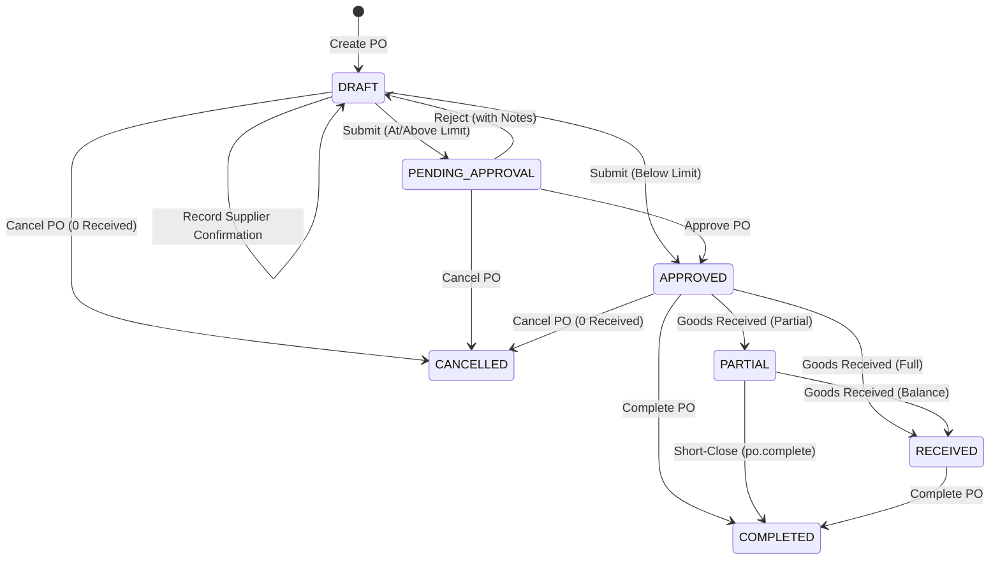

# Procurement

Part of the <strong>Procure to Pay (P2P)</strong> Storyline: Steps 1 &amp; 2 of 5 (Requisition &amp; Purchase Order)

> The central purchasing and vendor management engine of TenArm BES, orchestrating commercial supplier commitments from demand discovery and purchase order authoring through financial approvals, physical dock receipts, dual-unit catch-weight verification, and inbound landed cost capitalization.

The Procurement module governs the acquisition of physical goods, raw materials, drop-ship consignments, and subcontracted services. It links upstream customer sales demand and automated inventory reorder thresholds with downstream warehouse receiving and financial three-way matching in Accounts Payable.

---

## Workspace Ergonomics

The Procurement desk is optimized for high-volume purchasing, rapid dock intake, and continuous supplier coordination:

- **Multi-Tab Desk**: Buyers and receiving clerks can operate across up to 3 procurement tabs simultaneously (e.g. keeping the **Procurement Desk** open for drafting new orders while inspecting a live **PO Storyline** and monitoring the **Landed Cost Command Desk**). Switching tabs preserves active filters, line item quantities, and unsaved changes without page reloads.
- **Draft Auto-Save**: Uncommitted form inputs across the Procurement Desk and the Receive Goods dialog are continuously preserved locally. The active tab header displays a dirty dot indicator (`•`) until the purchase order is submitted or discarded.
- **Quick-Peek Slide-Out**: Clicking any linked purchase order number, supplier name, vendor bill ID, or inventory lot opens an inspection drawer from the right edge of the screen, allowing users to verify supplier reliability, credit balances, or mill test certificates without interrupting their primary active workflow.

---

## Core Procurement Concepts

### Dual-Unit & Catch-Weight Purchasing
For dimensional, metal, and bulk commodities (e.g. steel coils, structural beams, chemical barrels, wire spools), items are purchased and tracked using two coordinated units:
- **Primary Unit (`qty`)**: The discrete piece count (e.g. `PCS`, `COIL`, `BUNDLE`).
- **Secondary Catch-Weight Unit (`qty_secondary`)**: The continuous commercial measure (e.g. `KG`, `MT`, `MTR`).

Pricing can be anchored to the discrete count or continuous weight basis (`priced_by`: `COUNT` vs `MEASURE`). During goods receipt at the warehouse dock, clerks record the actual scale weight for each individual piece, ensuring zero discrepancy between supplier invoices and inventory ledger valuation.

### Sourcing Intelligence & Backorder Demand
The Procurement Desk continuously evaluates sales operations across the tenant. When customers place sales orders that exceed available yard stock, the desk immediately flags these shortages on the **Customer Sales Backorders** banner, allowing buyers to fulfill backorders with a single click. In parallel, the **Vendor Sourcing Intelligence Rail** compares approved suppliers, historical purchase prices, and lead times to optimize vendor selection.

### Approval Threshold Governance
Purchase orders enforce automated governance rules based on organizational policy:
- **Below Approval Limit**: If the purchase order total is below the tenant's configured approval threshold (or if approval policies are disabled), the order is automatically marked `APPROVED` upon submission and is immediately authorized for supplier dispatch.
- **At or Above Approval Limit**: If the order total meets or exceeds the threshold, it enters `PENDING_APPROVAL`, routing to designated procurement managers for formal sign-off.

### Physical Dock Intake vs. Commercial Fulfillment
The module cleanly separates physical warehouse dock intake from non-dock fulfillments:
- **Physical Goods (`Goods Received`)**: Requires warehouse dock intake, assigns inventory lots, captures scale weights, and increments warehouse on-hand balances in Inventory.
- **Services & Drop-Ship (`Confirm Service / POD`)**: For drop-ship shipments delivered straight to customer job sites or subcontracted service lines, orders are confirmed complete via Proof of Delivery (POD) without creating internal warehouse inventory layers.

### Inbound Landed Cost Capitalization
Third-party carrier freight, customs duties, port clearance tariffs, and marine transit insurance bills from Finance can be apportioned across received inventory lots. Landed costs increase the cost basis of on-hand stock and rebalance warehouse moving average valuation, while quantities already fulfilled to customers post cleanly as Cost of Goods Sold (COGS) variance in the General Ledger.

---

## Purchasing & Procurement Desk

### Procurement Desk

**What it does** — The dedicated purchasing cockpit for drafting purchase orders, sourcing items from approved vendor catalogs, satisfying customer sales backorders, and establishing GST/tax treatments.

**Key Features & Highlights**
- **Awaiting Supplier Confirmation Banner**: Highlights draft purchase orders sent to suppliers (`po.send`) awaiting vendor confirmation, proforma invoice, or order acknowledgement. Overdue supplier follow-up dates are surfaced first.
- **Customer Sales Backorders Banner**: Displays open customer sales order lines awaiting warehouse replenishment. Clicking **+ Add to PO** automatically transfers the required product, destination warehouse, and quantity directly into the purchase order draft.
- **Vendor Sourcing Intelligence Rail**: When adding product lines, the right-hand panel displays approved suppliers, supplier SKU references, standard lead times, and the last purchase price paid. Clicking an approved supplier pre-populates delivery dates and pricing benchmark rates.

**How to Draft and Commit a Purchase Order**
1. Navigate to **Procurement → Procurement Desk** (`/procurement/desk`).
2. **Select Supplier**: Choose a vendor from the **Supplier & Commercial Terms** card. If the vendor has configured lead times, the **Expected Delivery Date** is calculated and populated automatically.
3. **Record Commercial Reference**: Enter the supplier's quotation, proforma invoice, or sales proposal number in **Supplier Quotation / Ref**.
4. **Add Product Lines**:
   - In **Order Line Items**, select the catalog **Product** and destination **Warehouse**.
   - Enter **Order Quantity** (and **Expected Weight / MT** if catch-weight).
   - Verify the **Unit Price** (pre-filled with the vendor's last agreed rate).
   - To add multiple items sourced from this supplier, click **+ Add Line** or select items directly from the **Products Sourced from Vendor** tray.
5. **Review Financial Summary**: Verify subtotal, tax code treatment (e.g. Inter-State IGST vs Intra-State CGST/SGST), freight terms, and grand total in the **Commercial Settlement** card.
6. **Submit Order**:
   - If the order total is below the approval limit, click **Create Purchase Order** to approve and commit immediately.
   - If the order requires executive authorization, click **Submit for Approval**.

---

### Purchase Orders (Orders Directory & Storyline)

**What it does** — The central register of all organizational purchase orders, providing a complete chronological history, keyset search, and the interactive **PO Storyline** inspection desk.

**Lifecycle & Status Progression**

| Status | What it means | Allowed Next Actions |
|---|---|---|
| `DRAFT` | Order is being authored or awaiting supplier quotation confirmation. | Edit lines, send for supplier confirmation, record supplier confirmation, or submit. |
| `PENDING_APPROVAL` | Order exceeds approval limit and awaits executive manager authorization. | Approve, reject back to draft, or cancel. |
| `APPROVED` | Commercially authorized commitment. Supplier has been notified. | Process dock receipts, confirm drop-ship/service lines, or cancel (if 0 received). |
| `PARTIAL` | Partial physical delivery received at warehouse dock. | Receive remaining balance, raise partial AP bills, or short-close unreceived balance. |
| `RECEIVED` | Full ordered quantity physically received and verified into inventory. | Raise AP vendor bill, view landed cost allocations, or complete PO. |
| `COMPLETED` | Entire purchasing lifecycle finished. Order lines settled and closed. | View historical billing snapshots, AP bills, and GL postings. |
| `CANCELLED` | Order voided before any dock intake occurred. | Historical inspection only. *(Cannot be reopened; raise new PO).* |

**Key Fields on Purchase Orders**

| Field | Required | Description |
|---|:---:|---|
| **PO # (`po_number`)** | ✅ | System-generated document sequence identifier (e.g. `PO-2024-0012`). |
| **Supplier** | ✅ | Vendor providing goods or services; must hold active `SUPPLIER` party role. |
| **Supplier Reference** | — | Vendor quotation, proforma invoice, or order confirmation document number. |
| **Expected Delivery Date** | — | Anticipated warehouse arrival date; drives AI overdue delivery tracking. |
| **Warehouse** | ✅ | (On line items) Destination storage facility receiving the physical stock. |
| **Payment Status** | — | Derived commercial status: `UNPAID`, `PARTIALLY_PAID`, or `PAID`. |
| **Total Amount** | ✅ | Final commercial commitment value inclusive of line items, freight, and taxes. |

**How to Use the Orders Desk**
1. Navigate to **Procurement → Purchase Orders** (`/procurement/orders`).
2. Switch between **Split View** (left-hand order queue with sticky inspection pane) and **Table** view.
3. Use the **Status Filter** pills to view `Draft`, `Pending Approval`, `Approved`, `Partial`, or `Received` orders.
4. Select any order to load its interactive **PO Storyline**:
   - **Header Bar**: Live status, supplier reference, PDF print button, and stage action buttons.
   - **Order Lifecycle Panel**: Step-by-step milestone progression (Created → Confirmed → Approved → Received → Billed → Paid).
   - **Line Items & Catch-Weight Breakdown**: Detailed line status, received vs remaining quantities, assigned warehouses, and receipt discrepancy tags.
   - **Financials & 3-Way Match**: Linked Accounts Payable bills, payment receipts, and balance outstanding.
   - **Landed Cost Summary**: Capitalized freight/customs allocations linked to this order.

**Managing Approvals & Rejections**
- **To Approve an Order**: Managers with `po.approve` click **Approve PO** in the storyline header. The order moves to `APPROVED` and dispatches an automated confirmation notification to the vendor.
- **To Reject an Order**: Click **Reject**. Enter a mandatory justification note. The order returns to `DRAFT` status and notifies the buyer for revision.

---

## Receiving & Dock Intake

### Goods Received (Physical Dock Intake)

**What it does** — Records physical delivery of inbound goods at the warehouse dock, captures actual catch-weight scale weights, generates unique inventory lots, and flags line-level discrepancies.

**Receiving Scenarios & Patterns**
- **Bulk Lot Receipts**: For general commodities, items are received into a single lot or split into multiple batches across different receiving bins.
- **Itemized Catch-Weight Pieces**: For steel coils, heavy equipment, or discrete tagged items, receiving clerks enter individual scale weights (e.g. piece 1 = 2.45 MT, piece 2 = 2.52 MT).
- **Over-Tolerance Receipts**: If received quantity exceeds the ordered quantity plus configured tolerance, the line is tagged with an `OVER_TOLERANCE_RECEIPT` flag, notifying finance before vendor bill settlement.

**How to Receive Inbound Stock**
1. Open an `APPROVED` or `PARTIAL` purchase order in the **PO Storyline**.
2. Click **Goods Received** in the header.
3. In the **Receive Goods** modal:
   - For each receivable line, enter the **Receive Qty** (and **Receive MT / Scale Weight** for catch-weight items).
   - Enter or verify the **Lot / Batch #** and production **Heat Number**.
   - If items arrive across multiple coils or packages, use the piece grid to record individual item weights.
   - If goods are damaged or specifications deviate from the PO, check **Flag an issue with this line** and enter the discrepancy note.
4. In **Delivery Note / Truck Details**, record the transporter's delivery challan number, vehicle license plate, and driver contact.
5. In **Supplier Invoice & Delivery Documents**, record the vendor's invoice number and date, and upload a copy of the signed physical delivery note.
6. Click **Confirm Receipt**.
7. The system creates inventory movements in Inventory, generates new cost layers, and updates the PO status to `PARTIAL` or `RECEIVED`.

---

### Non-Dock Fulfillment (Service & Drop-Ship)

**What it does** — Fulfills commercial purchase order lines that bypass internal warehouse yards (e.g. equipment rental, subcontracted engineering labor, or goods shipped directly from vendor to client).

**How to Confirm Drop-Ship or Service Lines**
1. In the **PO Storyline**, locate orders containing drop-ship or service line items.
2. Click **Confirm Service / POD** in the header.
3. Confirm that the service was executed or that the customer's signed Proof of Delivery (POD) has been received.
4. The system marks the lines as received without creating warehouse inventory lots, advancing the purchase order to `RECEIVED` and unlocking AP bill matching in Finance.

---

### Short-Closing an Order (Close Short)

**What it does** — Allows procurement leads to close an order when a vendor cannot deliver the remaining unreceived balance, releasing committed budget without cancelling historical dock receipts.

> [!IMPORTANT]
> **Cancellation vs. Short-Closing Invariant**: You can only **Cancel** a purchase order if *zero* goods have been received (`received_qty == 0`). If any delivery has occurred, you must use **Confirm Short-Close** to close the unreceived balance.

**How to Short-Close an Order**
1. Open an open purchase order in `APPROVED` or `PARTIAL` status.
2. In the storyline header, click **Complete PO** (or select **Close Short**).
3. The **Close Purchase Order Short** modal opens, detailing the unreceived items and financial variance to be cancelled.
4. Select a standard justification reason:
   - `Supplier Cancelled`: Vendor confirmed inability to fulfill remainder.
   - `Force Majeure`: Supply chain or environmental disruption.
   - `Defective Batch`: Remaining shipment rejected due to quality failure.
   - `Mutual Cancellation`: Commercial agreement to close short without penalty.
   - `Discontinued by Vendor`: Line item obsolete or discontinued.
5. Enter additional operational notes.
6. Optionally attach proof documentation (e.g. vendor cancellation email or settlement agreement).
7. Click **Confirm Short-Close**. The purchase order advances to `COMPLETED` with a visible **Closed Short** badge.

---

## Valuation & Landed Cost

### Landed Cost Command Desk

**What it does** — Apportions third-party freight charges, port tariffs, customs duty bills, and transit insurance across received inventory lots, ensuring accurate moving-average inventory valuation.

**Allocation Bases**

| Allocation Basis | How It Apportions | Best Used For |
|---|---|---|
| **Apportioned by Weight (`WEIGHT`)** | Apportions carrier bills proportional to received secondary weight ($\text{MT} / \text{KG}$). | Heavy commodities, metals, freight and cartage bills where shipping rates depend on mass. |
| **Apportioned by Value (`VALUE`)** | Apportions charges proportional to line currency value ($\text{Quantity} \times \text{Unit Price}$). | Customs import duties, port ad-valorem taxes, and cargo transit insurance. |

**Accounting & Valuation Treatment**
- **Capitalized to Inventory**: For received stock currently remaining on hand in the warehouse, the lot unit cost is increased, blending into the warehouse moving average cost.
- **COGS Variance**: If portions of the received lots have already been fulfilled and shipped to customers, the corresponding freight variance is posted directly to Cost of Goods Sold (COGS) in Finance.

**How to Allocate Landed Costs**
1. Navigate to **Procurement → Landed Cost** (`/procurement/landed-cost`).
2. Click **+ Allocate Landed Cost** (or click **Landed Cost** on an individual PO Storyline).
3. Select the target **Purchase Order** holding received inventory lots.
4. Select the carrier or customs **Supplier Bill** from Accounts Payable.
5. Choose the **Allocation Basis**: `Apportioned by Weight` or `Apportioned by Value`.
6. Enter an optional explanatory note (e.g. *Container ocean freight & port clearance charges*).
7. Click **Confirm Allocation**.
8. The system updates the unit cost of every received lot and creates the corresponding General Ledger journal entry.

---

## Supplier Relationship Management

### Suppliers (Directory & Master Data)

**What it does** — Maintains the database of verified suppliers, their tax identities, registered offices, contact directories, and active catalogs.

**How to Use**
1. Navigate to **Procurement → Suppliers** (`/procurement/suppliers`).
2. The top pulse cards summarize:
   - **Active Suppliers**: Vendors ready for purchase order placement.
   - **With Contact Info**: Suppliers with verified phone or email contacts.
   - **Physical Addresses**: Registered warehouse dispatch depots.
3. Click **+ Add Supplier** to register a new vendor.
4. Enter code, legal company name, email, phone, physical address, and Tax ID (GSTIN).
5. Click **Create Supplier**.

---

### Supplier 360 View

**What it does** — The comprehensive operational relationship profile for an individual supplier, consolidating historical purchasing volume, billing balances, performance metrics, and catalog mappings.

**Key Sections in Supplier 360**
- **Supplier Profile Header**: Tax identification, jurisdiction, primary contact phone, and registered office.
- **Sourcing Radar & Reliability**:
  - **On-Time Delivery Rate (%)**: Percentage of PO lines delivered on or before the expected delivery date.
  - **Average Delay Days**: Average lateness across trailing deliveries.
  - **Catch-Weight Short-Ship Variance**: Metric highlighting suppliers who consistently short-ship physical weight compared to purchase order specifications.
- **Sourced Product Catalog**:
  - Direct mappings between internal catalog items and vendor SKUs.
  - Standard lead times in calendar days.
  - Benchmark unit purchasing rate.
  - Preferred supplier toggle.
  - Action: Click **+ Map Product** to link a new product to this supplier.
- **Commercial Stream**:
  - Comprehensive register of Purchase Orders, Goods Receipts, AP Bills, and Outgoing Payments.
  - **Record Advance**: Log advance cash disbursements to the vendor before goods arrive.
  - **Statement of Account (SOA)**: Generate formal financial statements of account for vendor reconciliation.

---

## Procurement Analytics

### Procurement Dashboard

**What it does** — Executive intelligence dashboard tracking total purchasing expenditure, supplier delivery reliability, status pipelines, and month-over-month procurement trends.

**Key Dashboard Metrics**
- **Total PO Value**: Cumulative spend committed across purchase orders for the selected monthly period.
- **OTIF Delivery Rate (%)**: On-Time In-Full delivery compliance score across all vendors.
- **Active Orders Pipeline**: Breakdown of orders by state (`Draft`, `Pending Approval`, `Approved`, `Partial`, `Received`, `Completed`).
- **Supplier Spend Distribution**: Chart illustrating purchasing expenditure concentration across top suppliers.
- **Overdue Deliveries Spotlight**: Immediate visibility into supplier shipments past their target delivery dates.

---

## If Something Goes Wrong (Common Validation & Guard Errors)

The table below translates system validation guards and toasts into clear, actionable business resolutions:

| What you see (Toast / Banner) | Why it happens | How to fix it in the workspace |
|---|---|---|
| **"Cannot cancel PO: goods have already been received on this purchase order"** | Attempting to cancel a purchase order where `received_qty > 0`. Once dock receipts exist, cancellation is legally and architecturally forbidden. | If the supplier cannot deliver remaining items, click **Complete PO** and use the **Close Short** modal to short-close unreceived balances. |
| **"Cannot submit PO with no lines"** | Attempting to submit a draft purchase order that contains zero product line items. | In the Procurement Desk, click **+ Add Product Line** to specify items, quantities, and prices before submitting. |
| **"The supplier's document cannot be dated in the future"** | In **Record Supplier Confirmation**, the entered supplier quote/proforma date is later than today's calendar date. | Enter today's date or the historical date printed on the vendor's confirmation document. |
| **"Cannot edit purchase order; only DRAFT POs can be edited"** | Attempting to modify quantities or pricing on an order that has already been approved or partially received. | Approved orders represent legally binding commercial commitments. If terms changed, reject back to draft (if unapproved), or process revisions via credit memos and short-closes. |
| **"Cannot complete PO with unreceived items without confirming short close"** | Clicking Complete PO on an order that still has unfulfilled line items without checking the short-close confirmation. | Use the **Close Purchase Order Short** modal, select an official justification reason, upload proof if available, and click **Confirm Short-Close**. |
| **"Party does not have SUPPLIER role"** | The chosen vendor account is not tagged with the `SUPPLIER` role in the party master. | Navigate to **Procurement → Suppliers** to create the vendor properly, or update party roles in **Settings → Parties**. |
| **"Line [N]: duplicate lot numbers in receipt"** | In the Goods Received dialog, the same lot/coil number was entered multiple times on the same line item. | Ensure every individual piece or package receives a unique lot, heat, or serial tag. |
| **"No received inventory lots found for Purchase Order"** | Attempting to allocate landed freight/customs charges to a purchase order that has zero processed dock receipts. | Inbound landed costs can only be capitalized onto physical inventory lots. Complete **Goods Received** first before allocating costs. |
| **"Cannot allocate landed cost from [Status] bill"** | The carrier freight or customs bill selected from Accounts Payable is in `DRAFT` or `CANCELLED` status. | Ensure the carrier bill has been reviewed and posted in **Finance → Supplier Bills** before apportioning. |
| **"This product is already mapped to this supplier"** | Attempting to create a duplicate catalog mapping for a product that is already linked to the vendor. | Update the existing product row in the **Sourced Product Catalog** under Supplier 360 instead of creating a duplicate mapping. |
| **"Items skipped — no warehouse assigned"** | In the Goods Received modal, one or more line items have no receiving warehouse specified on the PO line. | In the PO Storyline line items table, click the warehouse dropdown to assign a destination storage depot, then process receipt. |

---

## Integrations

| Module | Business Trigger | What Happens Automatically |
|---|---|---|
| **Inventory** | Confirm Goods Receipt (`po.receive`) | Automatically invokes `stock.receive`, creates unique inventory lot cost layers, updates warehouse on-hand balances, and updates the supplier's last purchase price. |
| **Finance** | Raise AP Bill (`finance.bill.create`) | Loads `po.get_billing_snapshot` to execute automated 3-way matching, validating that billed quantities never exceed received quantities. |
| **Finance** | Landed Cost Allocation (`procurement.landed_cost.allocate`) | Capitalizes carrier freight and duty bills onto inventory lots, adjusting lot unit costs and posting GL variance entries for shipped stock. |
| **Sales** | Backorder Resolution | Satisfying customer backorders on the Procurement Desk directly reserves incoming PO inventory for pending sales orders. |
| **Notifications** | Purchase Order Approved (`PurchaseOrderApproved`) | Automated background triggers dispatch the finalized purchase order document directly to the vendor's registered email address. |
| **AI Insights** | Daily Overdue Scan | The AI engine scans open orders against expected delivery dates plus grace periods, generating supplier reliability alerts and overdue shipment warnings. |

---

## Permissions

| Permission | What it unlocks |
|---|---|
| `procurement.dashboard.view` | View the Procurement Executive Dashboard, OTIF scores, and spend metrics. |
| `po.view` | View purchase orders, the Procurement Desk, supplier profiles, and landed cost registers. |
| `po.create` | Draft new purchase orders and record supplier quotation confirmations. |
| `po.submit` | Submit draft purchase orders for financial authorization and processing. |
| `po.approve` | Authorize or reject purchase orders requiring management sign-off. |
| `po.receive` | Process physical dock receipts, record catch-weight scale pieces, and confirm service PODs. |
| `po.complete` | Mark purchase orders completed, including executing governance short-closes. |
| `po.cancel` | Cancel unfulfilled purchase orders that have zero dock receipts. |
| `po.supplier_product.manage` | Add, modify, or delete supplier-to-product catalog mappings. |
| `party.create` | Register new supplier corporate profiles in the vendor directory. |
| `finance.bill.create` | Access the Raise AP Bill action to generate vendor bills from received orders. |
