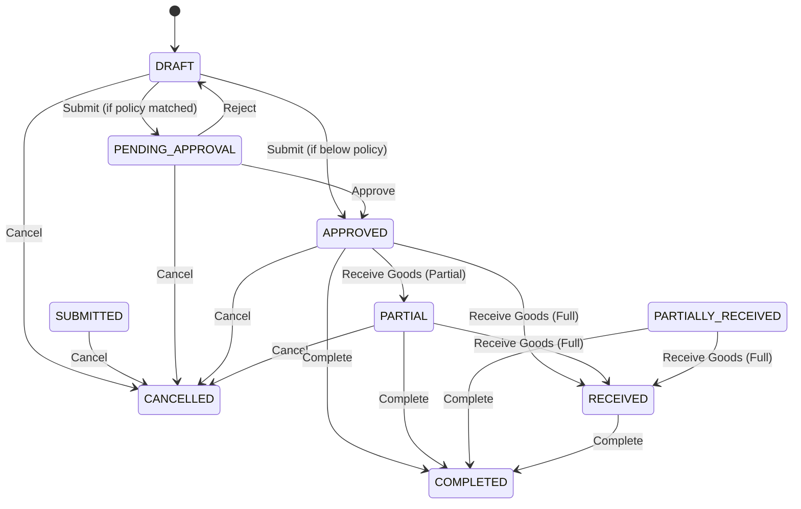

# Procurement
> Manage the entire purchasing lifecycle from raising purchase orders to supplier communications and receiving inbound goods.

## Overview
The Procurement module serves as the central hub for purchasing activities. It enables teams to create Purchase Orders (POs) for suppliers, enforce financial approval thresholds, and seamlessly process Goods Receipt Notes (GRNs) into inventory. It provides built-in support for advanced receiving scenarios like lot tracking, secondary catch-weights, and split receipts.

## Purchase Orders

### What It Does
Represents a formal, trackable request to a vendor to supply goods or services at agreed prices and delivery dates.

### Status Lifecycle

| Status | What It Means | What You Can Do |
|--------|--------------|-----------------|
| `DRAFT` | The PO is being drafted and hasn't been finalised. | Add products, update quantities, and **Submit**. |
| `PENDING_APPROVAL` | The PO exceeds automatic approval limits and is awaiting review. | **Approve** or **Reject** back to draft. |
| `APPROVED` | The PO is authorised and confirmed with the supplier. | **Receive Goods** or **Cancel** (if nothing received). |
| `PARTIAL` / `PARTIALLY_RECEIVED` | Some line items have been received, but others are outstanding. | **Receive Goods** for the balance, or **Complete** to close short. |
| `RECEIVED` | All ordered goods have been physically received. | **Complete** to close the order. |
| `COMPLETED` | The order lifecycle is completely finished. | View historical record and billing snapshot. |
| `CANCELLED` | The order was aborted before any goods were received. | View historical record. |

### Key Fields
| Field | Required | Notes |
|-------|----------|-------|
| PO # (`po_number`) | Yes | The unique identifier for the purchase order. |
| Supplier | Yes | The vendor providing the goods. |
| Expected Delivery Date | No | The target arrival date of the inbound supply. |
| Total Amount | Yes | The calculated total value of the PO including taxes. |
| Warehouse | No | (On line items) The destination inventory warehouse for receiving. |

### How To Receive Goods
1. Navigate to **Procurement → Purchase Desk** or **Purchase Orders**.
2. Select an `APPROVED`, `PARTIAL`, or `PARTIALLY_RECEIVED` purchase order from the queue.
3. Open the **Receive Goods** dialog.
4. For each product line, input the **Receive Qty** (and **Receive MT / Weight** if tracking secondary catch-weights).
5. Specify the **Lot / Batch #** (or split the receipt into multiple lots/coils using the split action).
6. *(Optional)* Add a **Flag an issue with this line** note if there are discrepancies or damages.
7. Save to automatically update inventory and advance the PO status.

### Things to Know
- **Approval Policies**: Submitting a PO will automatically move it to `APPROVED` if its total is beneath your configured procurement approval thresholds. Otherwise, it routes to `PENDING_APPROVAL`.
- **Cancellations vs Short-Closing**: You cannot **Cancel** a PO once *any* goods have been received. If a supplier cannot fulfill the remaining balance of an open order, you must instead **Complete** the order (confirming `close_unreceived=true`) to close it short.
- **Skipped Lines**: If a PO line has no warehouse assigned when receiving, the receipt for that line will be skipped. You can assign a warehouse later and receive it.
- **Last Purchase Price**: Successfully receiving goods with a unit price will automatically update the supplier's "last price" for that product in the master data.

---

## Suppliers

### What It Does
Manages your vendor master data and explicitly maps which suppliers can provide which internal products.

### Key Features
- **Supplier Product Mapping**: Link specific products to suppliers, capturing their unique `supplier_sku`, standard lead times in days, and preferred status.
- **Supplier Analytics**: The procurement system actively tracks supplier reliability, late delivery statistics, and short-ship variance by catch-weight over trailing months.

---

## Integrations

| Module | When | What Happens |
|--------|------|-------------|
| **Inventory** | On Receive Goods | Triggers `stock.receive` for each line item/lot to instantly create inventory records and update warehouse levels. |
| **Notifications** | On PO Approval | The `SupplierEmailOnPoApproved` projection automatically emails the confirmed PO to the vendor. |
| **Finance** | On Billing | Exposes `po.get_billing_snapshot` and billing candidate lists so the Finance module can execute 3-way matching against vendor invoices. |

---

## Permissions

| Permission | What It Unlocks |
|-----------|----------------|
| `po.view` | View purchase orders, procurement desks, and supplier dashboards. |
| `po.create` | Create new purchase orders in draft status. |
| `po.submit` | Submit draft purchase orders for processing and approval. |
| `po.approve` | Approve or reject purchase orders pending authorisation. |
| `po.receive` | Receive goods into inventory against open purchase orders. |
| `po.complete` | Mark orders as completed, including closing open orders short. |
| `po.cancel` | Void/cancel purchase orders that have no receipt history. |
| `po.supplier_product.manage` | Add, update, or remove supplier-to-product catalog mappings. |
| `procurement.dashboard.view` | Access the high-level procurement analytics dashboard. |
