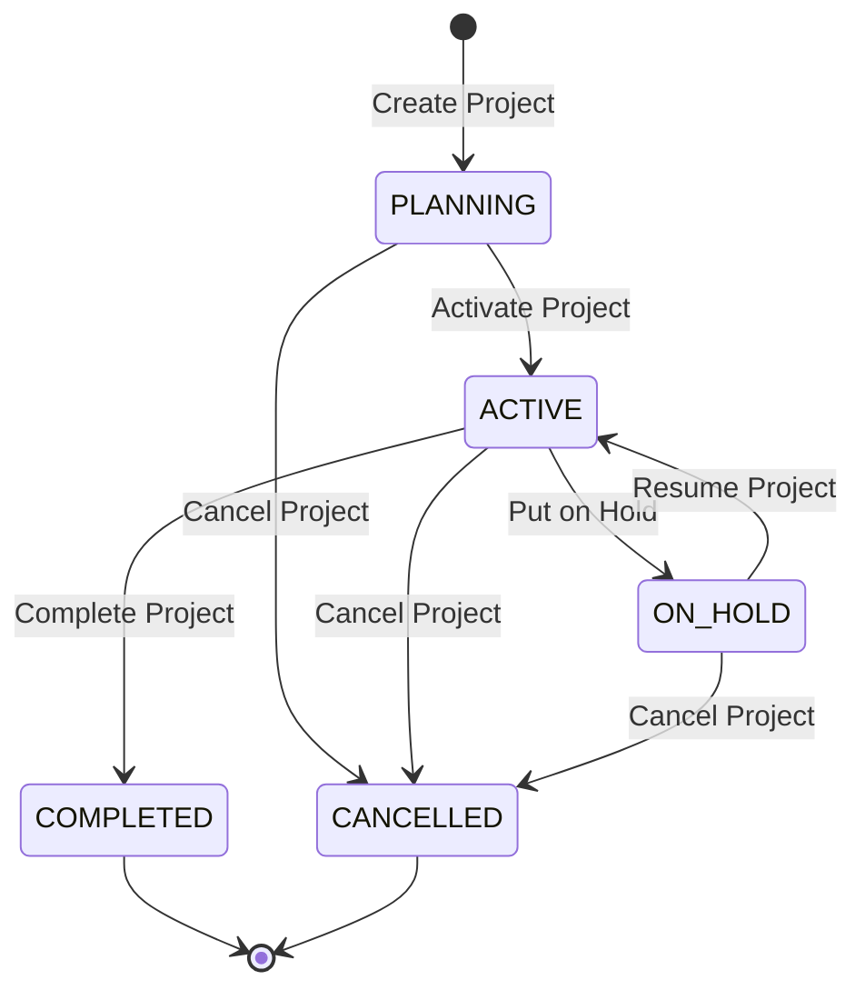
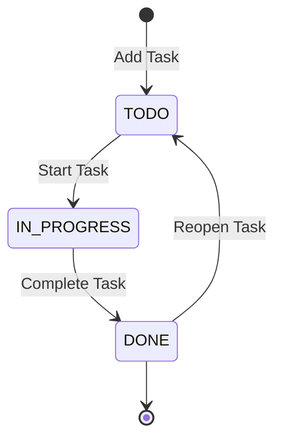

# Projects

Operational Hub for <strong>Customer Deliverables</strong>, <strong>Project Execution</strong> &amp; <strong>Team Work Breakdown</strong>

> The deliverable execution and task governance engine of TenArm BES, orchestrating project initiation, milestone progression, Kanban task workflows, prerequisite dependency enforcement, and real-time team collaboration.

The Projects module bridges strategic planning and day-to-day team execution. Whether coordinating complex client implementation deliverables, capital engineering initiatives, or departmental work orders, Projects provides a structured environment to break work down into prioritized tasks, sequence critical path dependencies, monitor dated milestones, and track derived deliverable completion in real time.

---

## Workspace Ergonomics

The Projects workspace is engineered for operational speed, zero lost context, and multi-user team coordination:

- **Multi-Tab Desk**: Project managers and team leads can keep up to 3 active workspace tabs open simultaneously (e.g. keeping the **Projects Desk** open alongside **All Projects** register and the **Projects Dashboard**). Switching between tabs preserves table search queries, status filter selections, scroll positions, and uncommitted form drafts without reloading.
- **Split Command Desk**: The primary desk (`/projects`) employs a split-pane layout. The left queue displays project cards with live progress bars, owner tags, and quick status pills (`All`, `Active`, `Planning`, `On Hold`, `Completed`, `Cancelled`), while the right inspector displays the comprehensive **Project Storyline** for the selected project.
- **Draft Auto-Save**: Uncommitted form inputs in creation modals (such as project scope descriptions, start/due dates, or new task deliverables) are continuously preserved in local browser storage. The active tab displays a dirty dot indicator (`•`) until the record is created or explicitly discarded.
- **Quick-Peek Slide-Out**: Clicking any linked project reference ID or document code across the application opens the **Project Peek Storyline** in a right-hand contextual drawer, allowing operators to review task progress and milestones without leaving their current workflow.
- **Real-Time Live Collaboration**: The workspace listens to ambient Server-Sent Events (SSE). When a colleague creates a task, marks a deliverable complete, or posts a discussion update, task lists and completion percentages refresh automatically across all connected screens.
- **Optimistic Concurrency Protection (OCC)**: Every state transition and deliverable update is version-checked. If two leads attempt to reassign or transition a task at the same moment, the system prevents silent overwrites and opens the **Conflict Resolution Drawer** with a visual side-by-side comparison.

---

## Core Projects Concepts

### Derived Progress Rollup
Projects in TenArm BES do not rely on manually guessed progress percentages. A project's overall completion rate is calculated automatically from its constituent deliverables:

$$\text{Project Progress (\%)} = \text{round}\left(\frac{\text{Done Tasks}}{\text{Total Tasks}} \times 100\right)$$

If a project has no tasks defined, its progress defaults to $0\%$. As individual tasks transition to `DONE`, the executive pulse HUD cards, queue list progress bars, and storyline headers update instantly.

### Upstream Prerequisite Task Dependencies
Complex projects often require tasks to be executed in a strict chronological sequence. TenArm BES supports directed task dependencies ($Task_A \to Task_B$, meaning Task A is blocked by Task B).
- **Prerequisite Enforcement**: A task cannot be started (`TODO` $\to$ `IN_PROGRESS`) until all upstream tasks it depends on have reached `DONE` status.
- **Cycle Prevention**: The system analyzes the dependency graph before saving any link, preventing circular dependencies ($A \to B \to A$) from ever entering the system.
- **Scope Isolation**: Dependencies can only be linked between tasks within the exact same project.

### Closed Project Immutability
When a project reaches `COMPLETED` or is marked `CANCELLED`, it transitions into an immutable closed state:
- All constituent tasks, dependencies, and milestones become strictly read-only.
- Team members cannot add new tasks, edit existing deliverables, reassign owners, or link new dependencies.
- Historical audit comments and timeline events remain fully accessible for post-project reviews.

---

## Project Container Management

### Projects

**What it does** — Serves as the master administrative container for an initiative, defining ownership, target timelines, deliverables scope, and high-level lifecycle progression.

**Lifecycle & States**

| State | What it means | What you can do next |
|---|---|---|
| `PLANNING` | Initial scoping state. Deliverables, dates, and milestones are being defined. | Add tasks, establish milestones, link dependencies, edit scope, click **Activate Project**, or click **Cancel Project**. |
| `ACTIVE` | Project is under active execution by the project team. | Start and complete tasks, assign team members, mark milestones reached, click **Put on Hold**, click **Complete Project**, or click **Cancel Project**. |
| `ON_HOLD` | Temporarily paused due to customer delays, budget holds, or resource constraints. | Review timeline and discussion notes; click **Resume Project** to return to execution or click **Cancel Project**. |
| `COMPLETED` | All deliverables have been successfully fulfilled and closed. | View project history, inspect completed tasks, and download attachments. The project is locked against further edits. |
| `CANCELLED` | Abandoned or terminated early. Cancellation is permanent and final. | Review cancellation audit notes in the timeline. The project is locked against further edits. |

**Key Fields**

| Field | Required | Description & Validation |
|---|:---:|---|
| **Project #** | 🔒 Auto | Unique system document number generated from the sequence engine (e.g. `PRJ-00001`). |
| **Project Name** | ✅ | Concise, descriptive name for the project or client engagement. |
| **Project Owner** | — | Team lead or manager responsible for deliverable governance, selected from active users. |
| **Planned Start Date** | — | Scheduled kickoff calendar date. |
| **Target Due Date** | — | Scheduled completion calendar date. Must be equal to or later than the Planned Start Date. |
| **Project Description & Scope** | — | Detailed breakdown of project goals, technical deliverables, and customer success criteria. |
| **Lifecycle Status** | 🔒 Auto | Current operational stage (`PLANNING`, `ACTIVE`, `ON_HOLD`, `COMPLETED`, `CANCELLED`). |

**How to Use**

#### Creating a New Project
1. Navigate to **Projects → Projects Desk** (`/projects`) or **Projects → All Projects** (`/projects/list`).
2. Click **New Project** in the page header.
3. In the **Create New Project** modal, provide:
   - **Project Name \***: Enter the initiative title (e.g. *Cold Rolling Mill Automation Phase II*).
   - **Project Owner**: Select the designated lead from the team member dropdown.
   - **Planned Start Date** & **Target Due Date**: Pick the scheduled timeline boundaries.
   - **Project Description & Scope**: Enter deliverables, assumptions, and key milestones.
4. Click **Create Project**. The project is created in `PLANNING` status and assigned its sequence number (`PRJ-XXXXX`).

#### Activating a Project
1. Open the project in the **Projects Desk** or **Project Detail** page.
2. In the action toolbar, click **Activate Project**.
3. The project transitions to `ACTIVE`. Team members assigned to tasks can now begin starting deliverables.

#### Pausing and Resuming Execution
1. While a project is in `ACTIVE` status, click **Put on Hold** in the action toolbar if work must pause.
2. The project moves to `ON_HOLD`.
3. To resume work once blockers clear, click **Resume Project** to return the initiative to `ACTIVE`.

#### Completing a Project
1. Ensure all critical project tasks have been resolved and reached `DONE`.
2. In the action toolbar, click **Complete Project**.
3. The project moves to `COMPLETED` and all tasks and milestones lock into read-only status.

#### Cancelling a Project
1. If an engagement is aborted, click **Cancel Project** (or **Cancel**).
2. A confirmation dialog appears: *Are you sure you want to cancel PRJ-XXXXX? This cannot be undone.*
3. Click **Cancel Project** to confirm. The project moves to `CANCELLED` and execution terminates.

---

## Task & Deliverable Governance

### Tasks

**What it does** — Represents an atomic unit of work within a project, assigned to an individual team member with a designated priority, due date, and lifecycle status.

**Task Lifecycle & Progression**

| State | What it means | What you can do next |
|---|---|---|
| `TODO` | Queued deliverable ready to be scheduled and picked up. | Assign team member, edit details, or click **Start** (once all prerequisite tasks are complete). |
| `IN_PROGRESS` | Actively being executed by the assigned team member. | Reassign, update details, or click **Complete** upon finishing work. |
| `DONE` | Successfully completed deliverable with completion timestamp recorded. | Review completion notes or click **Reopen** if deliverable verification fails. |

**Key Fields**

| Field | Required | Description & Validation |
|---|:---:|---|
| **Task Title** | ✅ | Clear summary of the specific deliverable (e.g. *Calibrate weighbridge load cell sensors*). |
| **Assignee** | — | Team member accountable for executing the task, chosen from active organizational users. |
| **Priority** | ✅ | Urgency classification: `LOW`, `NORMAL`, `HIGH`, `URGENT`. Defaults to `NORMAL`. |
| **Due Date** | — | Specific target deadline date for deliverable completion. |
| **Task Description** | — | Comprehensive instructions, acceptance criteria, or technical specifications. |
| **Status** | 🔒 Auto | Current task state (`TODO`, `IN_PROGRESS`, `DONE`). |

**How to Use**

#### Adding a Task
1. In the **Project Storyline**, navigate to the **Tasks** tab (or click **Add Task** in the action bar).
2. Click **Add Task** to open the **Add Project Task** modal.
3. Enter the **Task Title \***.
4. Select an **Assignee** and set the **Priority** (`LOW`, `NORMAL`, `HIGH`, `URGENT`).
5. Choose an optional **Due Date** and enter detailed work instructions in **Task Description**.
6. Click **Add Task**. The task appears in the `TODO` column and updates the project total task count.

#### Starting a Task
1. Locate the task in the **Tasks** tab.
2. Click **Start** on the task row.
3. If the task has no unfinished upstream dependencies, it moves to `IN_PROGRESS`.
4. *(Note: If an upstream prerequisite task is still in `TODO` or `IN_PROGRESS`, the system blocks the action and displays an error banner identifying the blocking task).*

#### Completing and Reopening Tasks
1. Once the deliverable is verified, click **Complete** on the task row.
2. The task advances to `DONE`, stamps the exact UTC completion timestamp, and automatically increments the project's progress bar.
3. If post-delivery QA finds an issue or rework is needed, click **Reopen**. The task returns to `TODO` and completion time is cleared.

#### Assigning and Reassigning Deliverables
1. Click the assignee button (or **Assign**) on the task row to open the **Assign Task · #{id}** modal.
2. Select the designated user from the **Assignee \*** dropdown.
3. Click **Assign Task**. The assignee badge updates immediately and the action is logged in the project timeline.

#### Editing Task Details
1. Click **Edit** on any open task row to open the **Edit Task · #{id}** modal.
2. Modify the **Task Title**, **Priority**, **Due Date**, or **Task Description**.
3. Click **Save Changes**. The update is saved under optimistic concurrency control.

---

## Project Milestones & Checkpoints

### Milestones

**What it does** — Marks major checkpoints, contractual delivery gates, or phase reviews on a project schedule.

**How to Use**
1. In the **Project Storyline**, navigate to the **Overview** tab.
2. Scroll to the **Project Milestones** section.
3. Each milestone displays its checkpoint name, target due date, and status badge (`Pending` or `Reached`).
4. When a milestone phase is met:
   - Click **Mark Reached** on the milestone row.
   - The status updates to `Reached` with a green checkmark and the current completion timestamp is saved.
5. If a milestone was marked prematurely, click **Mark Pending** to revert it to open tracking.

---

## Collaboration: Discussion & System Timeline

### Discussion Tab
The **Discussion** tab provides a persistent, chronological communication thread embedded directly in the project container:
- Post progress updates, meeting summaries, risk warnings, or blocker notes.
- Type in the message box and click **Post Comment**.
- Every comment records the author's full name and exact timestamp.
- Comments emit system domain events and are preserved permanently as part of the project record.

### Timeline Tab
The **Timeline** tab provides an immutable system audit trail tracking all lifecycle transitions and work breakdown actions across the project and its tasks:
- **Project Events**: `ProjectCreated`, `ProjectActivated`, `ProjectHeld`, `ProjectCompleted`, `ProjectCancelled`, `ProjectCommented`.
- **Task Events**: `TaskCreated`, `TaskStarted`, `TaskCompleted`, `TaskReopened`, `TaskAssigned`.
- Displays the triggering user, action description, and precise date/time for complete operational compliance and accountability.

### Attachments Tab
The **Attachments** tab connects the project container to centralized document storage:
- Upload project charters, engineering drawings, client acceptance sign-offs, vendor quotations, or testing reports.
- View file metadata, size, upload timestamp, and download files directly within the project desk.

---

## Executive Analytics: Projects Dashboard

Navigate to **Projects → Projects Dashboard** (`/projects/dashboard`) for macro operational intelligence across all organizational initiatives.

### Pulse HUD Metrics
The top-level KPI grid provides instantaneous visibility into the active reporting period:
- **Projects**: Total initiatives created during the selected period.
- **Active**: Current volume of open projects actively in execution.
- **Completed**: Total projects successfully delivered during the period.
- **Tasks Done**: Count of completed task deliverables alongside the net completion rate percentage.
- **Cancelled**: Total initiatives terminated or aborted during the period.

### Interactive Period Selector
Select any rolling month from the **Period** dropdown (up to 24 previous months) to analyze historical performance and seasonal work volume trends.

### Visual Analytics
- **Project Status Distribution**: A horizontal bar chart illustrating the proportion of initiatives across `Active`, `Completed`, and `Cancelled` states.
- **Tasks Created vs Done (Last 6 Months)**: Dual-trend area chart comparing work intake against delivery throughput over the preceding six calendar months.
- **Monthly Summary Table**: Tabular breakdown reporting project counts, tasks created, and tasks completed per calendar month.

---

## Screen & Navigation Map

| Screen Label | URL Path | Primary Entry Operation | Key Features & Views |
|---|---|---|---|
| **Projects Desk** | `/projects` | `project.list` | Split-desk command center, Executive Pulse HUD, status pill filters, quick search, project queue cards, and embedded Project Storyline inspector. |
| **All Projects** | `/projects/list` | `project.list` | Full tabular registry with keyset pagination, task rollup progress bars, status badges, direct row transitions, and New Project modal. |
| **Project Detail** | `/projects/:projectId` | `project.get` | Full-width standalone view of the Project Storyline with Overview, Tasks, Discussion, Timeline, and Attachments tabs. |
| **Projects Dashboard** | `/projects/dashboard` | `projects.dashboard.get` | Operational KPI metrics, period selector, status breakdown bar charts, and 6-month task throughput trend analysis. |

---

## If Something Goes Wrong (Common Validation & Guard Errors)

The Projects module applies strict data consistency, lifecycle state validation, and dependency rules. The table below outlines common error messages and their business resolutions:

| What you see (Toast / Banner) | Why it happens | How to fix it in the workspace |
|---|---|---|
| **"Cannot start task #X: upstream prerequisite task(s) '...' (#Y) must be completed (DONE) first"** | The task has one or more upstream dependencies that are still in `TODO` or `IN_PROGRESS` status. | Open the **Tasks** tab, locate the prerequisite blocking task(s), and complete them first before starting this task. |
| **"This dependency would create a cycle"** | Adding this dependency link would create a circular loop ($A \to B \to A$) in the task dependency graph. | Review the dependency relationships of both tasks. Ensure prerequisites follow a strict linear progression. |
| **"A task cannot depend on itself"** | A user attempted to link a task as a prerequisite of itself. | Select a different prerequisite task within the same project. |
| **"Tasks must belong to the same project"** | A dependency link was attempted between tasks belonging to two separate projects. | Verify task IDs; dependencies can only connect deliverables within the same project container. |
| **"Project X is completed [or cancelled] — its tasks, dependencies and milestones can no longer change"** | Attempted to add a task, change a milestone, or reassign a deliverable on a closed project. | Closed projects are immutable. If further deliverables are required, create a new follow-on project in `PLANNING` status. |
| **"Target due date cannot be earlier than Planned start date"** | In the New Project form, the Target Due Date was set chronologically before the Planned Start Date. | Adjust the calendar dates so the Planned Start Date is on or before the Target Due Date. |
| **"Task title is required"** | Attempted to create or update a task with a blank title. | Enter a descriptive deliverable title before clicking **Add Task** or **Save Changes**. |
| **"Comment body is required"** | Attempted to post an empty message in the Discussion tab. | Type an update or note in the discussion textarea before clicking **Post Comment**. |
| **"Project transitioned: CANCELLED" (Cannot Undo)** | A project in `PLANNING`, `ACTIVE`, or `ON_HOLD` was cancelled. | Project cancellation is permanent and final. To continue work, create a new project. |
| **"The record was modified by another user (Version Conflict)"** | Another team member updated or transitioned the project/task while your screen was open. | Inspect the **Conflict Resolution Drawer** to review the latest changes, then click **Reload with Latest** to apply your update cleanly. |

---

## Cross-Module Integrations

The Projects module coordinates with core operational modules across TenArm BES:

- **Sales & Commercial Delivery**: Client implementation projects can be referenced against customer sales orders and delivery commitments, tracking bespoke engineering work before final dispatch.
- **CRM Opportunities**: Won deals in CRM transition directly into delivery initiatives in Projects, carrying forward customer project scopes and target deadlines.
- **Manufacturing & Steel**: Custom fabrication, coil slit trials, and capital equipment installations are tracked as structured projects with dated milestones and shop-floor dependencies.
- **Core Approvals & Audit Feed**: Significant project milestones, activations, and cancellations automatically broadcast to the organization-wide **Activity Feed** (`/activity`), maintaining unified executive visibility.
- **Tenant Administration & RBAC**: Projects and task assignments strictly respect tenant boundaries and user directory definitions, ensuring deliverable accountability across departments.

---

## Role-Based Permissions Reference

Operational permissions are configured in **Tenant Administration → Roles & Permissions** (`/roles`):

| Permission Code | Description | Recommended Roles |
|---|---|---|
| `project.view` | View the Projects Desk, All Projects list, task deliverables, milestones, timeline, and executive dashboards. | All Employees, Project Coordinators, Operations Leads |
| `project.create` | Create new projects in `PLANNING` status with scope definitions and timeline dates. | Project Managers, Department Heads |
| `project.activate` | Transition projects from `PLANNING` or `ON_HOLD` into `ACTIVE` execution status. | Project Managers, Operations Directors |
| `project.hold` | Place active projects on hold (`ACTIVE` $\to$ `ON_HOLD`). | Project Managers, Operations Leads |
| `project.complete` | Mark projects successfully finished (`ACTIVE` $\to$ `COMPLETED`), locking all child records. | Project Directors, Executive Management |
| `project.cancel` | Terminate projects permanently (`CANCELLED`). | Operations Directors, Executive Management |
| `project.comment` | Post discussion comments and updates to the project communication thread. | All Team Members, Project Contributors |
| `task.create` | Add new task deliverables to open projects. | Project Managers, Team Leads |
| `task.start` | Begin work on a task deliverable (`TODO` $\to$ `IN_PROGRESS`), subject to prerequisite checks. | Task Assignees, Team Leads |
| `task.complete` | Mark task deliverables finished (`IN_PROGRESS` $\to$ `DONE`). | Task Assignees, Quality Leads |
| `task.reopen` | Return completed tasks to `TODO` status for rework. | Quality Leads, Project Managers |
| `task.assign` | Delegate or reassign tasks to team members. | Project Managers, Team Leads |
| `task.update` | Edit task titles, priorities, due dates, descriptions, and dependency edges. | Project Managers, Team Leads |
| `milestone.manage` | Add project milestones and toggle milestone checkpoint status (`Reached` / `Pending`). | Project Managers, Operations Leads |
